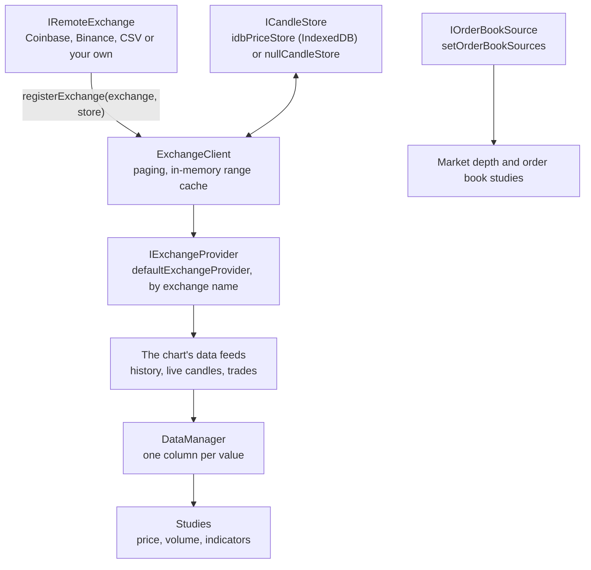

# Data Sources

A SciTrader chart asks for its candles by **exchange name**, e.g. `exchangeName: "Coinbase"`, and a symbol and interval. An **exchange** is any object that implements `IRemoteExchange`: it answers simple requests such as "the 1h candles for BTC-USD between these times", and streams live candles. You register it once, by name, and every chart, watchlist and symbol picker can use it.

The SDK has exchanges for Coinbase, Binance and CSV data built in, and you can write one for any market data API.

## How Data Reaches the Chart



1. **You register an exchange** with `registerExchange(exchange, store)`. The SDK wraps it in a client that pages through long ranges, keeps the candles it has in memory, and stores them in the **candle store**, e.g. IndexedDB, so a reload draws from the cache. See [Candle Stores and Caching](/financial-charts/data-sources/candle-stores-and-caching/).
2. **A chart asks the provider** for the exchange by name, and its **data feeds** load the candles for its symbol, interval and period, then stream live updates.
3. **The feeds write the candles into the chart's data manager**, as columns of open, high, low, close and volume. **Studies** read those columns, and write their own. See [Data Manager and Data Feeds](/financial-charts/data-sources/data-manager-and-data-feeds/).

Order books are separate: an `IOrderBookSource` per exchange, which the Market Depth panel and the order book studies read. See [Order Book Data](/financial-charts/data-sources/order-book-data/).

## Every Built-in Data Source

| Data source | Class | History | Live updates |
| --- | --- | --- | --- |
| [JSON or JavaScript objects](/financial-charts/data-sources/json-data/) | `CSVExchange`, for now | The objects | No |
| [CSV files or text](/financial-charts/data-sources/csv-data/) | `CSVExchange` | The file's rows, at every coarser interval | No |
| [Coinbase](/financial-charts/data-sources/coinbase-and-binance/) | `CoinbaseExchange` | Yes, back to listing | Yes: candles, trades, tickers |
| [Binance](/financial-charts/data-sources/coinbase-and-binance/) | `BinanceExchange` | Yes, back to listing | Yes: candles, trades, tickers |
| [Any market data API](/financial-charts/data-sources/custom-exchange/) | your own `IRemoteExchange` | As the API allows | If the API streams |
| [Order books](/financial-charts/data-sources/order-book-data/) | your own `IOrderBookSource` | Recorded heatmap history, if you have it | Yes: the live book |

:::tip
The examples in this section that don't need live data use real price history for BTCUSDT, ETHUSDT and SOLUSDT: 90 days of hourly and 4 years of daily candles. The files are on the [CSV Data](/financial-charts/data-sources/csv-data/#sample-data) page; use them for your own experiments.
:::

## Registering an Exchange {#registering-an-exchange}

Register each exchange once, at app startup, with the candle store that caches its candles:

```ts
import { CoinbaseExchange, defaultExchangeProvider, idbPriceStore } from "scichart-scitrader";

defaultExchangeProvider.registerExchange(CoinbaseExchange, idbPriceStore);

// Any chart can now ask for it by name
await SciFinanceChartPanel.create(container, { exchangeName: CoinbaseExchange.name, symbol: "BTC-USD", … });
```

`defaultExchangeProvider` is the registry that charts, the watchlist and the symbol picker use unless told otherwise. It starts empty.

The second argument is the **candle store**, which decides what is cached between sessions:

- `idbPriceStore` keeps candles in IndexedDB. A reload draws from the cache and fetches only newer candles. Use it for real market data.
- `nullCandleStore` keeps nothing, so every page load starts cold; the in-memory cache still works within a session. Use it for data that changes between loads, such as generated data, or CSV data moved to the current date.

See [Candle Stores and Caching](/financial-charts/data-sources/candle-stores-and-caching/) for both, and for writing your own.

## Keeping an Exchange Private to a Chart {#keeping-an-exchange-private-to-a-chart}

To use an exchange in one chart without registering it for every chart, give the chart a provider of its own, through its `services`:

```ts
import { createExchangeProvider, DataFeedManager, nullCandleStore } from "scichart-scitrader";

const provider = createExchangeProvider(); // an empty registry of this chart's own
provider.registerExchange(myExchange, nullCandleStore);

await SciFinanceChartPanel.create(container, {
    exchangeName: myExchange.name,
    // …
    services: { dataFeedManager: new DataFeedManager(provider) }, // the chart's data comes from `provider`
});
```

For CSV data, `createCSVServices(exchange)` builds the same services for you; see [CSV Data](/financial-charts/data-sources/csv-data/).

:::note
The symbol picker (`getSymbolCatalog`) always reads `defaultExchangeProvider`, so a privately registered exchange doesn't appear in it.
:::

## Reading Data from a Registered Exchange: IExchangeClient

`provider.getExchange(name)` returns the registered exchange's **client**, an `IExchangeClient`. Charts use it; your own UI can too, e.g. for a price ticker or a table of candles. Its requests go through the same cache:

```ts
const coinbase = defaultExchangeProvider.getExchange("Coinbase");

// Historical candles: times in milliseconds; prices as strings, as exchanges send them
const candles = await coinbase.getCandles("BTC-USD", CandleInterval.ONE_HOUR, Date.now() - 86_400_000, Date.now());

// Live data, as RxJS Observables: unsubscribe when done
const subscription = coinbase.getTickerStream("BTC-USD").subscribe((ticker) => console.log(ticker.curDayClose));
subscription.unsubscribe();
```

| IExchangeClient member | What it gives |
| --- | --- |
| `getCandles(symbol, interval, start, end)` | Historical candles, through the cache |
| `getCandleStream`, `getRealtimeCandleStream` | Live candles |
| `getTrades`, `getTradeStream` | Recent trades, and live trades |
| `getTickerStream`, `getAllTickerStream` | Live 24-hour tickers: price, change, volume |
| `getInstruments()` | Every symbol the exchange trades |
| `getSupportedIntervals()` | The intervals it serves, which the interval pickers offer |
| `getListingDate(symbol, interval)` | Where its history starts |

<details>
<summary>The IExchangeProvider interface, createExchangeProvider, defaultExchangeProvider and ISciFinanceChartServices, with their TSDoc</summary>

```ts
interface IExchangeProvider {
    getExchange: (name: string) => IExchangeClient;
    registerExchange: (exchange: IRemoteExchange, localStore: ICandleStore) => void;
}

/**
 * Construct a fresh, isolated `IExchangeProvider` registry.
 *
 * Each call returns an independent registry — no shared module-level state.
 * Apps (`SciTraderApp`, `SciTraderSandbox`) call this once at startup and
 * register their adapters (`BinanceExchange`, future `CoinbaseExchange`, …)
 * into the returned instance.
 */
const createExchangeProvider: () => IExchangeProvider;

/**
 * Shared default registry, **empty by default**.
 *
 * Bootstrap responsibility: `SciTraderApp` and `SciTraderSandbox` register
 * `BinanceExchange` into this instance at startup. Library consumers that
 * read `defaultExchangeProvider.getExchange("Binance")` rely on that
 * registration having run.
 *
 * Tests that need isolation should call {@link createExchangeProvider}
 * directly instead of mutating this shared instance.
 */
const defaultExchangeProvider: IExchangeProvider;

/** Services shared across all panes in a SciFinanceChart. */
interface ISciFinanceChartServices {
    dataManager?: IDataManager;
    dataFeedManager?: IDataFeedManager;
    /**
     * Per-pane init-phase emitter (`"surface"` → `"configured"` → `"data"`).
     * Pass an emitter when callers need to subscribe *during* init — events on
     * the returned `SciFinanceChart` only become subscribable after
     * `createWithStudies` resolves, by which point all init-time phase advances
     * have already fired. When omitted, the chart default-creates one,
     * accessible via {@link SciFinanceChart.progress}.
     */
    progress?: PaneProgressEmitter;
}
```

</details>

<details>
<summary>The IExchangeClient interface, with its TSDoc</summary>

```ts
interface IExchangeClient {
    /**
     * Candles this client will fetch in ONE request, when it knows. Optional: replay and mock
     * clients do not page.
     *
     * Read by the chart so the historical-load coordinator can size a backward spawn to a
     * whole page instead of a fixed 1,000 candles. Sizing the spawn LARGER than this would
     * make `getCandlesInternal` paginate it internally into several sequential round trips,
     * which is the opposite of the intent — hence taking the real figure rather than a
     * constant.
     */
    readonly batchSize?: number;
    name: string;
    /** List of all trading-status symbols on the exchange (provider-native shape). */
    getInstruments: () => Promise<string[]>;
    getCandles: (symbol: string, interval: CandleInterval, start?: number, end?: number, endInclusive?: boolean, 
    /**
     * Optional per-call cap on candles returned by the underlying remote-exchange API.
     * When set, the call bypasses the cache layer (limited fetches are typically
     * one-off transient queries like watchlist sparklines where caching has no value).
     * When omitted, the client's default `candleLimit` is used and the cache layer applies.
     */
    limit?: number, 
    /**
     * optional cancellation signal. Propagated to the
     * cache layer and remote exchange via {@link abortable}.
     */
    signal?: AbortSignal) => Promise<ExchangeRestCandle[]>;
    /**
     * Live candles for the requested symbol(s).
     *
     * **Adapter contract.** The stream must emit candles for the requested symbol(s) and no
     * others, and each candle's `symbol` must be the same string the caller passed in
     * (compared case-insensitively downstream). An adapter that multiplexes several
     * subscriptions over one transport owns the demultiplexing — a shared connection is an
     * implementation detail of the adapter, never of its callers.
     */
    getCandleStream: (symbol: string | string[], interval: CandleInterval) => Observable<SciTraderCandle>;
    /** Single-symbol live candles. Same adapter contract as {@link getCandleStream}. */
    getRealtimeCandleStream: (symbol: string, interval: CandleInterval) => Observable<SciTraderCandle>;
    /**
     * Optional snapshot+live streaming candle source — present only when the underlying remote
     * exchange implements {@link IRemoteExchange.getSparklineCandleStream} (Coinbase Advanced
     * Trade WS). Delegated straight through (no cache layer). Used by the watchlist sparklines.
     */
    getSparklineCandleStream?: (symbols: string[], interval: CandleInterval, 
    /**
     * How many historical candles to seed each symbol with. A source that cannot honour
     * the requested `interval` will not honour this count as a duration either, so treat
     * it as a depth hint and trim the result by timestamp — see `ICandleBatch.interval`.
     */
    snapshotCandles?: number) => Observable<ICandleBatch>;
    getTrades: (symbol: string, start?: number, end?: number, limit?: number) => Promise<SciTraderTrade[]>;
    getTradeStream(symbol: string): Observable<SciTraderTrade>;
    getTickerStream(symbol: string | string[]): Observable<SciTraderTicker>;
    /**
     * Multiplexed ticker stream emitting batches of `SciTraderTicker[]`.
     *
     * Binance: subscribes to `!ticker@arr` (one stream → every market). `productIds` is ignored.
     * Coinbase: requires `productIds` (no "all markets" channel exists); subscribes to the
     * `ticker` WebSocket channel with that product list. Calling without `productIds` on
     * Coinbase yields `EMPTY`.
     */
    getAllTickerStream(productIds?: string[]): Observable<SciTraderTicker[]>;
    /**
     * drop the cache-layer entry for `(symbol, interval)` so the
     * next `getCandles` call re-seeds from IDB and starts a fresh
     * `knownEmptyRanges` registry. Called from `DataFeedBase.change` on
     * symbol/interval swap. Safe to call when no entry exists.
     */
    invalidateCache?(symbol: string, interval: CandleInterval): void;
    /**
     * Read the persisted listing-date floor (open time, ms) for this
     * `(symbol, interval)` from the underlying local store. Used by
     * `OHLCVDataFeed.loadInitialData` to short-circuit the HTTP call
     * when the value is already cached from a prior session.
     *
     * Optional: clients without a local store (in-memory mocks,
     * stubbed exchanges) omit this — callers must tolerate `undefined`.
     */
    getEarliestCandleTime?(symbol: string, interval: CandleInterval): Promise<number | undefined>;
    /**
     * Persist a discovered listing-date floor (open time, ms) to the
     * underlying local store. Called by `OHLCVDataFeed.loadInitialData`
     * on successful `getListingDate` lookup (and by `loadPreviousData` on
     * lazy floor discovery) so future sessions can short-circuit.
     *
     * Optional: clients without a local store omit this.
     */
    setEarliestCandleTime?(symbol: string, interval: CandleInterval, time: number): Promise<void>;
    /**
     * Forward to the underlying remote exchange's {@link IRemoteExchange.getListingDate}.
     */
    getListingDate(symbol: string, interval: CandleInterval, signal?: AbortSignal): Promise<IListingDateResult | null>;
    /**
     * Persist externally-sourced candles into the local store. Used by
     * `OHLCVDataFeed.resolveListingDate` to save the surplus candles a
     * listing-date probe returned (Binance gets the first 1000 candles
     * for free with its probe; this method caches them for future
     * sessions). Optional — clients without a local store omit this.
     */
    insertLocalCandles?(symbol: string, interval: CandleInterval, candles: ExchangeRestCandle[]): Promise<void>;
    /**
     * Forward to the underlying remote exchange's {@link IRemoteExchange.getSupportedIntervals}.
     */
    getSupportedIntervals(): CandleInterval[];
}
```

</details>

## Where to read next

- [Coinbase and Binance](/financial-charts/data-sources/coinbase-and-binance/): the built-in live exchanges.
- [CSV Data](/financial-charts/data-sources/csv-data/) and [JSON Data](/financial-charts/data-sources/json-data/): chart your own OHLCV data.
- [Building a Custom Exchange](/financial-charts/data-sources/custom-exchange/): connect any market data API, with a Kraken example.
