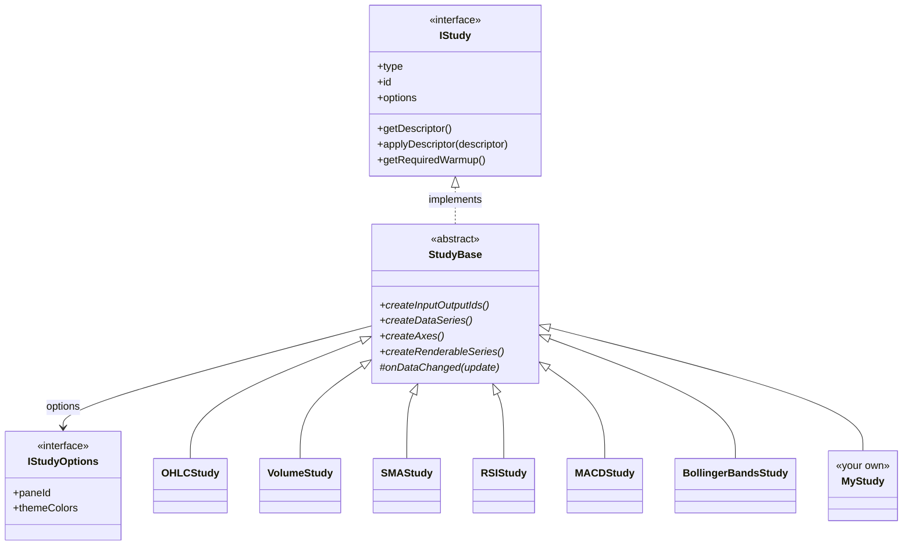

# Technical Indicators and Studies

Everything a SciTrader chart draws is a **study**. `OHLCStudy` draws the price series, `VolumeStudy` draws volume, and every technical indicator is a study too. SciTrader ships with 32 built-in studies: 29 you can add from code or from a study picker, and [3 more](#studies-outside-the-study-picker) for special inputs. You can also write your own.

Studies come in two kinds:

- **Overlays**, such as [moving averages](/financial-charts/studies-and-indicators/add-indicators/moving-averages-sma-ema-wma/), [Bollinger Bands](/financial-charts/studies-and-indicators/add-indicators/bollinger-bands/), [Ichimoku](/financial-charts/studies-and-indicators/add-indicators/ichimoku-cloud/) and [VWAP](/financial-charts/studies-and-indicators/add-indicators/vwap-volume-weighted-average-price/), draw on the price pane, against the price axis.
- **Oscillators**, such as [RSI](/financial-charts/studies-and-indicators/add-indicators/rsi-relative-strength-index/), [MACD](/financial-charts/studies-and-indicators/add-indicators/macd/) and [Stochastic](/financial-charts/studies-and-indicators/add-indicators/stochastic-oscillator/), have a scale of their own, so each gets a pane of its own below the price pane.

This section covers:

| Page | What it covers |
| --- | --- |
| [Price Chart Types](/financial-charts/studies-and-indicators/price-chart-types/) | Candlestick, OHLC bar, line, mountain and Heikin-Ashi price series, and Renko and Point & Figure charts |
| [Add Technical Indicators to a Financial Chart](/financial-charts/studies-and-indicators/add-indicators/) | Adding indicators when the chart is created, adding and removing them at runtime, and building an indicator picker. Under it, a page for each of the most popular indicators, such as RSI, MACD, Bollinger Bands and VWAP: what each is, how it is calculated, and how to add it |
| [Altering Study Settings](/financial-charts/studies-and-indicators/altering-study-settings/) | Changing an indicator's settings (lengths, levels, colours) from code or with the ready-made Settings Form and Study List |
| [Creating Custom Studies](/financial-charts/studies-and-indicators/creating-custom-studies/) | Writing an indicator of your own, step by step, with a settings form, live updates and save and restore |

## Every Built-in Indicator and Study {#the-catalogue}

The tables below list every study, grouped by the categories of the SDK's study picker (`EStudyCategory`). Indicators with a page of their own link to it, for what the indicator is, how it is calculated and how to add it. For each one:

- **Under its name** is its class, to construct, e.g. `new RSIStudy({ length: 21 })`.
- **Under that**, its `EStudyType`, to create it by, e.g. `studyProvider.getStudy(EStudyType.RSI)`.
- **Options** are its constructor options, with their defaults. Options left out take their defaults.

Every study also takes the [`IStudyOptions`](#istudyoptions) every study shares. Line studies take `renderOptions`, SciChart's `IFastLineRenderableSeriesOptions` (`stroke`, `strokeThickness`, `strokeDashArray`), for their line.

### Price and Chart Type Studies

| Indicator | Draws on | Options (default) |
| --- | --- | --- |
| **OHLC: Open-High-Low-Close**<br />`OHLCStudy`<br />`EStudyType.OHLC` | Price pane | `candleType` (`ECandleType.Candlestick`), `renderOptions` |
| **Renko**<br />`RenkoStudy`<br />`EStudyType.Renko` | Own pane, category axis | `brickSize` (sized from the price range), `reversalAmount` (2) |
| **Point & Figure**<br />`PointAndFigureStudy`<br />`EStudyType.PointAndFigure` | Own pane, category axis | `boxSize` (sized from the price range), `reversalAmount` (3) |

See [Price Chart Types](/financial-charts/studies-and-indicators/price-chart-types/).

### Trend Indicators

| Indicator | Draws on | Options (default) |
| --- | --- | --- |
| **[SMA: Simple Moving Average](/financial-charts/studies-and-indicators/add-indicators/moving-averages-sma-ema-wma/)**<br />`SMAStudy`<br />`EStudyType.SMA` | Price pane | `length` (14), `renderOptions` |
| **[EMA: Exponential Moving Average](/financial-charts/studies-and-indicators/add-indicators/moving-averages-sma-ema-wma/)**<br />`EMAStudy`<br />`EStudyType.EMA` | Price pane | `length` (14), `renderOptions` |
| **[WMA: Weighted Moving Average](/financial-charts/studies-and-indicators/add-indicators/moving-averages-sma-ema-wma/)**<br />`WMAStudy`<br />`EStudyType.WMA` | Price pane | `length` (14), `renderOptions` |
| **PSAR: Parabolic SAR**<br />`PSARStudy`<br />`EStudyType.PSAR` | Price pane | `step` (0.02), `max` (0.2), `dotColor`, `pointSize` (5) |
| **[Ichimoku Cloud](/financial-charts/studies-and-indicators/add-indicators/ichimoku-cloud/)**<br />`IchimokuCloudStudy`<br />`EStudyType.Ichimoku` | Price pane | `conversionPeriod` (9), `basePeriod` (26), `spanPeriod` (52), `displacement` (26), and a line style per line: `tenkanOptions`, `kijunOptions`, `senkouAOptions`, `senkouBOptions`, `chikouOptions`, `cloudFillOptions` |
| **[ADX: Average Directional Index](/financial-charts/studies-and-indicators/add-indicators/adx-average-directional-index/)**<br />`ADXStudy`<br />`EStudyType.ADX` | Own pane | `length` (14), `adxColor`, `pdiColor`, `mdiColor`, `strokeThickness` |

### Momentum Indicators

| Indicator | Draws on | Options (default) |
| --- | --- | --- |
| **[RSI: Relative Strength Index](/financial-charts/studies-and-indicators/add-indicators/rsi-relative-strength-index/)**<br />`RSIStudy`<br />`EStudyType.RSI` | Own pane | `length` (14), `overbought` (70), `oversold` (30), `thresholdFills` (`"show"`), `overboughtFill`, `oversoldFill`, `renderOptions` |
| **[MACD: Moving Average Convergence/Divergence](/financial-charts/studies-and-indicators/add-indicators/macd/)**<br />`MACDStudy`<br />`EStudyType.MACD` | Own pane | `fast` (12), `slow` (26), `signal` (9), `bandOptions` (MACD and signal lines), `columnOptions`, `histogramAboveZero`, `histogramBelowZero` |
| **[Stochastic Oscillator](/financial-charts/studies-and-indicators/add-indicators/stochastic-oscillator/)**<br />`StochasticStudy`<br />`EStudyType.Stochastic` | Own pane | `length` (14), `signalPeriod` (3), `strokeK`, `strokeD`, `strokeThickness` |
| **CCI: Commodity Channel Index**<br />`CCIStudy`<br />`EStudyType.CCI` | Own pane | `length` (20), `renderOptions` |
| **Williams %R: Williams Percent Range**<br />`WilliamsRStudy`<br />`EStudyType.WilliamsR` | Own pane | `length` (14), `renderOptions` |
| **ROC: Rate of Change**<br />`ROCStudy`<br />`EStudyType.ROC` | Own pane | `length` (12), `renderOptions` |
| **TRIX: Triple EMA Oscillator**<br />`TRIXStudy`<br />`EStudyType.TRIX` | Own pane | `length` (18), `renderOptions` |
| **AO: Awesome Oscillator**<br />`AwesomeOscillatorStudy`<br />`EStudyType.AO` | Own pane | `upColor`, `downColor` |

### Volatility Indicators

| Indicator | Draws on | Options (default) |
| --- | --- | --- |
| **[BBANDS: Bollinger Bands](/financial-charts/studies-and-indicators/add-indicators/bollinger-bands/)**<br />`BollingerBandsStudy`<br />`EStudyType.BBANDS` | Price pane | `period` (20), `stdDev` (2), `upperBandOptions`, `middleBandOptions`, `lowerBandOptions`, `bandFillOptions` |
| **Keltner Channels**<br />`KeltnerChannelsStudy`<br />`EStudyType.Keltner` | Price pane | `maPeriod` (20), `atrPeriod` (10), `multiplier` (2), `upperBandOptions`, `basisOptions`, `lowerBandOptions`, `bandFillOptions` |
| **Donchian Channels**<br />`DonchianChannelsStudy`<br />`EStudyType.Donchian` | Price pane | `period` (20), `upperBandOptions`, `basisOptions`, `lowerBandOptions`, `bandFillOptions` |
| **[ATR: Average True Range](/financial-charts/studies-and-indicators/add-indicators/atr-average-true-range/)**<br />`ATRStudy`<br />`EStudyType.ATR` | Own pane | `length` (14), `renderOptions` |

### Volume Indicators

| Indicator | Draws on | Options (default) |
| --- | --- | --- |
| **Volume**<br />`VolumeStudy`<br />`EStudyType.Volume` | Price pane, along the bottom | `volumeUpColor`, `volumeDownColor`, `renderOptions` |
| **[Volume Profile: volume traded by price](/financial-charts/studies-and-indicators/add-indicators/volume-profile/)**<br />`VolumeProfileStudy`<br />`EStudyType.VolumeProfile` | Price pane, as sideways bars | `binCount` (40), `rangeMode` (`"visible"`, or `"all"`), `side` (`"right"`), `widthFraction` (0.25), `showPointOfControl` (`true`), `pointOfControlColor` |
| **[VWAP: Volume Weighted Average Price](/financial-charts/studies-and-indicators/add-indicators/vwap-volume-weighted-average-price/)**<br />`VWAPStudy`<br />`EStudyType.VWAP` | Price pane | `renderOptions` |
| **OBV: On Balance Volume**<br />`OBVStudy`<br />`EStudyType.OBV` | Own pane | `renderOptions` |
| **MFI: Money Flow Index**<br />`MFIStudy`<br />`EStudyType.MFI` | Own pane | `length` (14), `renderOptions` |
| **Force Index**<br />`ForceIndexStudy`<br />`EStudyType.ForceIndex` | Own pane | `length` (13), `renderOptions` |

### Order Book Studies

These read an order-book feed, so they need an order-book data source (`IOrderBookSource`) registered for the chart's exchange. The built-in Coinbase and Binance exchanges don't provide one; see [Order-book data](/financial-charts/data-sources/#order-book-data).

| Indicator | Draws on | Options (default) |
| --- | --- | --- |
| **Order Book Heatmap: resting liquidity behind price**<br />`OrderBookHeatmapStudy`<br />`EStudyType.OrderBookHeatmap` | Price pane | `side` (`"both"`, `"bid"` or `"ask"`), `palette` (`"liquidity"`), `opacity` (50), `scaleType` (`"log"`), `colorFromPct` (50), `colorToPct` (99), `stops` |
| **Order Book Imbalance: bid versus ask depth, per candle**<br />`OrderBookImbalanceStudy`<br />`EStudyType.OrderBookImbalance` | Own pane | `method` (`"weighted"`, `"band"` or `"percent"`), `pct` (0.3), `bidColor`, `askColor`, `fillStyle` (`"gradient"`), `gauge` (`"show"`) |

### Studies Outside the Study Picker

Three more studies aren't in the picker's catalogue (`STUDY_MENU_ITEMS`) or registered with `studyProvider`, because each needs an input you choose. Create them with `new`:

| Study | Draws on | What it is for |
| --- | --- | --- |
| **Line**<br />`LineStudy` | Price pane | Plots any data source as a line: pass its `DataSourceId` as `inputId` |
| **Large trades**<br />`LargeTradeStudy` | Price pane | Marks trades above `threshold` from a trade feed you create; `buyColor`, `sellColor` |
| **[Sparkline](/financial-charts/ui-components/sparklines/)**<br />`SparklineStudy` | Price pane | The small price chart in each row of a watchlist |

### IStudyOptions: Options Every Study Takes {#istudyoptions}

| Option | What it does |
| --- | --- |
| `paneId` | The pane the study draws in. Leave it out for the study's own default: the price pane (`PaneId.DEFAULT`) for an overlay, a new pane for an oscillator |
| `themeColors` | Colours per theme, as the settings form records them when the user edits colours. Pass colours in the study's own options instead to use them in every theme |
| `chartPaneLayoutConfig`, `surfaceOptions` | Layout and SciChart surface options for a pane the study creates |

<details>
<summary>The IStudyOptions interface, with its TSDoc</summary>

```ts
/**
 * A study's colours per theme: theme name → colour-control name → colour. The key `"*"` holds
 * colours that apply in every theme. A theme without an entry draws the theme's own defaults.
 */
type TStudyThemeColors = Record<string, Record<string, string>>;
/** The {@link TStudyThemeColors} key for colours that apply in every theme. */
const ALL_THEMES_KEY = "*";
interface IStudyOptions {
    chartPaneLayoutConfig?: TPaneLayoutConfig;
    surfaceOptions?: I2DSurfaceOptions;
    paneId?: PaneId;
    /**
     * Colours chosen per theme, as saved with the chart. Written by the study itself as colours
     * are edited in its settings form, so a colour picked under the dark theme applies to the
     * dark theme only. Pass colours in the study's own constructor options instead to use them in
     * every theme.
     */
    themeColors?: TStudyThemeColors;
}
```

</details>

## Study Class Hierarchy: IStudy, StudyBase and the Built-in Studies {#study-class-hierarchy}

Every study implements the `IStudy` interface. The built-in studies all extend the abstract `StudyBase` class, which implements `IStudy` and does the work every study shares: it claims its pane and axes, runs its data updates, keeps its settings, and moves its colours when the chart's theme changes. A study of [your own](/financial-charts/studies-and-indicators/creating-custom-studies/) extends `StudyBase` too. The diagram shows a few of the 32 built-in studies:



Members marked `*` are abstract: each study implements them. Each study's options extend `IStudyOptions`, e.g. `IRsiOptions` for `RSIStudy`.

### The IStudy Interface: What Every Study Has {#istudy}

The members you use from an app are:

| Member | What it is |
| --- | --- |
| `type` | Its `EStudyType`, e.g. `"RSI"` |
| `id`, `studyId` | Its id on the chart, unique among the chart's studies |
| `chartPaneId` | The pane it draws in |
| `options` | The options it was created with |
| `getDescriptor()`, `applyDescriptor(descriptor)`, `getDefaultDescriptor()` | Its settings: read, change and reset them; see [Altering Study Settings](/financial-charts/studies-and-indicators/altering-study-settings/) |
| `supportsLiveApply` | Whether `applyDescriptor` updates it in place |
| `descriptorApplied` | Fires after its settings change |
| `dataChanged` | Fires after it has processed new input data |
| `inputIds`, `outputIds` | The data columns it reads and writes |
| `renderableSeries`, `yAxes`, `parentSurface` | The SciChart series, axes and surface it draws with |
| `getRequiredWarmup()` | Candles it needs before its first value; the chart loads that many extra |

The rest are called by the chart, such as `onAttach` and `onDetach`, or implemented by custom studies, such as `createXAxis` and `getLegendColor`.

<details>
<summary>The IStudy interface, with its TSDoc</summary>

```ts
interface IStudy {
    readonly type: EStudyType;
    readonly chartPaneId: PaneId;
    readonly id: string;
    readonly studyId: StudyId;
    readonly parentSurface: SciChartSurface;
    readonly yAxes: ObservableArray<AxisBase2D>;
    /**
     * Sizing hint for this study's pane when this study is the primary occupant.
     * Caller's `ISciFinanceChartPanelConfig.paneSizing[paneId]` overrides this.
     * If neither is set, the pane uses the layout renderer's default (`grow: 1`).
     *
     * Use `{ grow: N }` for a flex weight relative to other grow-based panes,
     * or `{ size: Npx }` for a fixed pixel height/width along the layout axis.
     */
    readonly paneSizeConfig?: IPaneSizeConfig;
    /**
     * A feed this study cannot work without, created on its behalf before it attaches.
     *
     * Studies normally read a source the default OHLCV feed already publishes, so they need no
     * such declaration. The order-book heatmap is the first that does not: its data arrives on a
     * separate feed that nothing else on the chart would ever ask for, and `onAttach` resolves
     * its input synchronously — so unless the feed exists by then, the study binds to the candle
     * close instead and silently draws nothing.
     *
     * Best-effort. A feed that cannot be built (no book source for this venue) is not an error:
     * the study still attaches and draws nothing, which is the documented empty path.
     */
    readonly requiredFeedType?: EDataFeedType;
    /**
     * Optional — the chart has switched symbol or exchange, and the {@link requiredFeedType}
     * feed now follows the new instrument. For studies that fetch from that feed on viewport
     * changes rather than through their inputs: without it they keep drawing the old instrument
     * until the next pan.
     */
    onInstrumentChanged?(): void;
    readonly inputIds: DataSourceId[];
    readonly outputIds: DataSourceId[];
    /**
     * A line for the legend when the study has something to say that is not a value — "not
     * recorded for this instrument", "1m tier". Shown for studies with no outputs, which would
     * otherwise have no legend row at all. The legend re-reads it on every redraw.
     */
    readonly legendStatus?: string;
    /**
     * Optional — a legend line for what is under the mouse, for studies whose reading depends on
     * the cursor's price as well as its candle (the order-book heatmap). Called only while the
     * mouse is over this study's own pane; `undefined` falls back to {@link legendStatus}.
     *
     * @param at the cursor in DEVICE pixels within the pane's series area — the space the pane's
     *   coordinate calculators take — so a study reads it through its own axes.
     */
    getLegendReadout?(at: {
        x: number;
        y: number;
    }): string | undefined;
    readonly renderableSeries: ObservableArray<IRenderableSeries>;
    readonly options: IStudyOptions;
    /** Fires whenever the study's input data updates — fired after `onDataChanged` processes the update. */
    readonly dataChanged: EventHandler<TDataUpdate<any>>;
    /**
     * Fires after {@link applyDescriptor} has mutated the live study (whether
     * invoked by the form's debounced apply, the per-study "Reset to defaults"
     * button, or the batch "Reset all study styles" helper). The form
     * subscribes so it can re-sync its local draft state when an external
     * applyDescriptor lands — without this, the form keeps showing stale
     * values while the chart already reflects the new descriptor.
     */
    readonly descriptorApplied: EventHandler<TStudyDescriptor>;
    onAttach(parentFinanceChart: SciFinanceChart, parentChartPane: ChartPane, wasmContext: TSciChart, dataManager: IDataManager): void;
    onDetach(): void;
    /**
     * Optional — supply the X axis for this study's pane. When a study returns an
     * axis here, {@link SciFinanceChart} uses it instead of the default time-based
     * `DiscontinuousDateAxis`, marks the pane **non-time-domain** (excluded from
     * axis-sync and from the shared time-label routing in `applyXAxisLabels`), and
     * skips the base-values / live-tip machinery for that pane.
     *
     * Used by studies whose data is not indexed in the time domain — e.g. Renko
     * (evenly-spaced bricks) and Point & Figure (columns) both return a
     * `CategoryAxis` so points are positioned by index, not by timestamp.
     *
     * Return `undefined` (the default — omit the method) to keep the standard
     * time axis. Studies that share their pane's existing axis need not implement it.
     *
     * `axisDefaults` is passed in because this runs during pane configuration —
     * BEFORE `onAttach`, so `parentFinanceChart` is not yet set. Spread it onto the
     * axis to inherit the chart's theme (label style, strip background, etc.).
     */
    createXAxis?(wasmContext: TSciChart, axisDefaults: IChartAxisDefaults): AxisBase2D | undefined;
    getDescriptor(): TStudyDescriptor;
    /**
     * Returns the descriptor a freshly-constructed instance of this study
     * type would expose — i.e. constructor defaults, no user customisation.
     * Powers the per-study "Reset to defaults" form button and the batch
     * "Reset all study styles" header / More-tab actions. Does NOT mutate
     * this instance — callers are expected to feed the returned descriptor
     * into {@link applyDescriptor} (or hand it to the form draft, which
     * will fire its debounced apply for them).
     */
    getDefaultDescriptor(): TStudyDescriptor;
    addDescriptor(section: EDescriptorSectionName, descriptor: IuiDescriptor): void;
    setDescriptor(descriptor: TStudyDescriptor): void;
    /**
     * Apply edits from an in-form descriptor onto this live study instance.
     * Concrete studies that override {@link IStudy.supportsLiveApply} to
     * return `true` mutate their renderable series / data series in place
     * (instant for style edits, recompute for input edits) — no detach,
     * no re-attach, no flash.
     *
     * Studies that haven't implemented live apply leave
     * {@link supportsLiveApply} as `false` (the default); callers detect that
     * and fall back to the legacy `detachStudy + getStudy(new) + attachStudy`
     * pipeline.
     */
    applyDescriptor(descriptor: TStudyDescriptor): void;
    /**
     * Whether {@link applyDescriptor} performs a real in-place update. When
     * `false`, the caller (e.g. the SDK's `StudyList`) falls back
     * to detach + re-instantiate. Default `false` on {@link StudyBase}; each
     * study opts in by overriding to return `true`.
     */
    readonly supportsLiveApply: boolean;
    /**
     * Number of input candles the study needs to consume before producing its
     * first valid output. Used by `SciFinanceChart` to size the fetch buffer
     * so every candle in the visible range has every indicator's output.
     *
     * Raw-display studies (OHLC, Volume) return 0. Computed indicators
     * (RSI, SMA, MACD, Bollinger Bands) return their period — possibly the
     * sum of cascaded periods (MACD = slow + signal).
     *
     * Default impl in `StudyBase` returns 0.
     */
    getRequiredWarmup(): number;
    /**
     * Colour to paint this output's VALUE with in the legend, so a reader can tell
     * which row belongs to which line. Only the number is coloured — the label stays
     * in the legend's muted text colour, otherwise the row is all one colour and the
     * label competes with the value it is labelling.
     *
     * Implementations read the LIVE renderable series rather than the study's stored
     * `renderOptions`, so a colour drag in the study form shows up in the legend on the
     * next cursor move with no extra plumbing. Where SciChart auto-picked the colour,
     * the stored options never held it in the first place.
     *
     * `xIndex` is the candle under the cursor (`undefined` = the latest), for outputs
     * whose colour is a function of the data rather than a fixed stroke: OHLC and Volume
     * are red or green per candle, and the MACD histogram flips about zero.
     *
     * Return `undefined` to leave the value in the legend's default colour — correct
     * for an output with no single colour of its own.
     */
    getLegendColor(outputId: DataSourceId, xIndex?: number): string | undefined;
    /**
     * Move the study's theme-following colours from one theme to another. Optional so a
     * hand-written `IStudy` still type-checks; `StudyBase` implements it for every built-in study.
     */
    applyThemeChange?(from: ISciTraderTheme, to: ISciTraderTheme): void;
}
```

</details>

### The StudyBase Class {#studybase}

`StudyBase<T>` is the abstract base of every built-in study, where `T` is the type of value it reads, `number` for prices. Extend it to write a study of your own: [Creating Custom Studies](/financial-charts/studies-and-indicators/creating-custom-studies/) walks through each member you implement or override.

| Members | Kind | What they are for |
| --- | --- | --- |
| `createInputOutputIds`, `createDataSeries`, `createAxes`, `createRenderableSeries`, `onDataChanged` | Abstract | What it reads, stores, draws and calculates |
| `onInitComplete`, `getRequiredWarmup`, `configureDescriptor`, `onDescriptorApplied`, `supportsLiveApply`, `onThemeChanged`, `getLegendColor` | Override | Optional behaviour: set-up, warm-up, settings, theme and legend colours |
| `getInputSourceId`, `createOutputSourceId`, `addReferenceAnnotation`, `nanPad`, `valueAt`, `strokeForDataSeries` | Helper | Data columns, guide lines and values |
| `wasmContext`, `dataManager`, `parentFinanceChart`, `parentSurface`, `theme` | Context | Set when the study attaches |

<details>
<summary>The StudyBase class (public and protected members), with its TSDoc</summary>

```ts
abstract class StudyBase<T> implements IStudy {
    readonly type: EStudyType;
    readonly chartPaneId: PaneId;
    readonly options: IStudyOptions;
    readonly yAxes: ObservableArray<AxisBase2D>;
    readonly renderableSeries: ObservableArray<IRenderableSeries>;
    readonly outputIds: DataSourceId[];
    readonly inputIds: DataSourceId[];
    /** Fires whenever the study's input data updates — fired after {@link Changed} processes the update. */
    readonly dataChanged: EventHandler<TDataUpdate<T>>;
    /** Fires after {@link applyDescriptor} mutates this study's live state. */
    readonly descriptorApplied: EventHandler<TStudyDescriptor>;
    /** Convenience accessor — delegates to parentChartPane.surface. */
    get parentSurface(): SciChartSurface;
    protected idProperty: StudyId;
    get studyId(): StudyId;
    get id(): string;
    protected xId: DataSourceId;
    protected wasmContext: TSciChart;
    protected dataManager: IDataManager;
    protected parentChartPane: ChartPane;
    protected parentFinanceChart: SciFinanceChart;
    protected subscriptions: Subscription[];
    /**
     * Guide-line annotations (e.g. overbought/oversold reference lines) this
     * study added to the pane surface via {@link addReferenceAnnotation}. Tracked
     * so {@link onDetach} can remove them: an annotation left on the surface after
     * its y-axis is deleted dereferences the axis's (now-undefined) WASM index
     * calculator on the next render loop, crashing it with
     * `Cannot read properties of undefined (reading 'GetIndex')`.
     */
    protected readonly referenceAnnotations: IAnnotation[];
    protected descriptor: TStudyDescriptor;
    /**
     * Frozen snapshot of the descriptor right after {@link initialize} completes
     * — i.e. RS instances exist with SciChart's auto-picked brushes / strokes,
     * and no user edits have landed yet. Drives {@link getDefaultDescriptor}.
     * `undefined` until the study is attached.
     */
    protected defaultDescriptorSnapshot?: TStudyDescriptor;
    constructor(type: EStudyType, defaultChartPaneId: PaneId, options: IStudyOptions);
    protected setDefaultDescriptors(): void;
    /**
     * Refresh-on-read: every call clears the descriptor structure and asks the
     * concrete study to repopulate it from its **current** instance state via
     * {@link configureDescriptor}.
     */
    getDescriptor(): TStudyDescriptor;
    /**
     * Per-study descriptor registration. Concrete studies override to register
     * their inputs/styles via {@link addDescriptor}. Called once at construction
     * (to seed the descriptor) and again on every {@link getDescriptor} read
     * (to refresh from live state). Idempotent — `addDescriptor` overwrites by
     * `name` so re-running rebuilds the same entries with current values.
     */
    protected configureDescriptor(): void;
    setDescriptor(descriptor: TStudyDescriptor): void;
    /**
     * Returns the descriptor that represents this study's "freshly attached"
     * state — the snapshot taken right after {@link initialize} completed,
     * before any user edits could land. Powers the per-study "Reset to
     * defaults" form button and the batch "Reset all study styles" actions.
     *
     * **Why a snapshot, not a transient instance:** some studies (OHLC, MACD)
     * delegate default colors to SciChart's auto-picker, which only sets
     * brushes/strokes on the live RS — never copied back into the study's
     * `renderOptions`. A transient instance has no RS, so its descriptor
     * would fall back to empty strings (`""`); applying those would paint
     * invisible candles. Snapshotting after RS creation captures the
     * auto-picked colors correctly.
     *
     * **Lifecycle note:** if called before {@link onAttach} runs (no snapshot
     * captured yet), falls back to {@link getDescriptor}. This shouldn't
     * happen for any user-facing reset path because the UI only exposes the
     * action after the study is on the chart.
     */
    getDefaultDescriptor(): TStudyDescriptor;
    /**
     * Override in concrete studies to return `true` once they've implemented
     * {@link onDescriptorApplied}. Callers gate the live-apply path on this
     * flag and fall back to detach + re-instantiate when it's `false`.
     */
    get supportsLiveApply(): boolean;
    /**
     * Dispatch an in-form descriptor edit onto this live instance.
     *
     * Derives constructor-options from the descriptor via the concrete study's
     * static `getOptionsFromDescriptor`,
     * then hands them to {@link onDescriptorApplied}.  Concrete studies
     * override that method to mutate their renderable / data series in place
     * and (where required) trigger an internal recompute.
     *
     * Studies that haven't implemented live apply yet leave
     * {@link supportsLiveApply} as `false`; the caller bails out before
     * reaching here.
     */
    applyDescriptor(descriptor: TStudyDescriptor): void;
    /**
     * Override in concrete studies to mutate renderable / data series in place
     * given the new options. Default is a no-op so a study without an override
     * combined with `supportsLiveApply: false` results in the caller using the
     * fallback detach+attach path — see StudyList.
     */
    protected onDescriptorApplied(_opts: IStudyOptions): void;
    /**
     * The theme this study draws with: its chart's, or the built-in theme before the study is
     * attached. Read colours that are not settings-form controls (reference lines, markers) from
     * here, and update them in {@link onThemeChanged}.
     */
    protected get theme(): ISciTraderTheme;
    /**
     * The colours chosen for this study per theme; see {@link TStudyThemeColors}. Saved with the
     * chart through `options.themeColors`.
     */
    get themeColors(): TStudyThemeColors;
    /**
     * Draw this study in `to`'s colours: for each of its colour controls, the colour chosen for
     * `to` if there is one, else a colour set for every theme, else `to`'s default. Colours chosen
     * under other themes are kept for when the chart switches back. "Reset to defaults" in the
     * settings form resets to `to`'s defaults.
     *
     * The chart calls this on every attached study when its theme changes, and on each study as it
     * attaches.
     */
    applyThemeChange(from: ISciTraderTheme, to: ISciTraderTheme): void;
    /**
     * Record `descriptor`'s colours against the current theme, when they came from the user rather
     * than from a theme switch. The base {@link applyDescriptor} calls this; a study that overrides
     * `applyDescriptor` must call it too, with the descriptor as applied, or its colour edits
     * won't be kept per theme.
     */
    protected rememberEditedThemeColours(descriptor: TStudyDescriptor): void;
    /**
     * Recolour anything that is not a settings-form control: reference lines, markers,
     * annotations. Descriptor colours have already moved by the time this runs.
     */
    protected onThemeChanged(_theme: ISciTraderTheme, _previous: ISciTraderTheme): void;
    addDescriptor(section: EDescriptorSectionName, descriptor: IuiDescriptor): void;
    onAttach(parentFinanceChart: SciFinanceChart, parentChartPane: ChartPane, wasmContext: TSciChart, dataManager: IDataManager): void;
    /**
     * Add a horizontal guide / reference line to the pane surface and track it so
     * {@link onDetach} removes it. Use this instead of calling
     * `parentSurface.modifierAnnotations.add(...)` directly — an untracked
     * annotation outlives its y-axis and crashes the render loop on teardown.
     */
    protected addReferenceAnnotation(...annotations: IAnnotation[]): void;
    onDetach(): void;
    /** Set inputIds and create unique output Ids using the studyId */
    abstract createInputOutputIds(): void;
    /** Create the Dataseries(s) and anything else that needs to exist before data is loaded */
    abstract createDataSeries(): void;
    /** Create Y Axes and return them */
    abstract createAxes(): AxisBase2D[];
    /** Create RenderableSeries and return them */
    abstract createRenderableSeries(): IRenderableSeries[];
    /** Anything that should happen after initial data is loaded */
    protected onInitComplete(): void;
    protected abstract onDataChanged(update: TDataUpdate<T>): void;
    /**
     * Default warmup is zero — appropriate for raw-display studies (OHLC,
     * Volume) that have valid output from index 0. Studies with rolling-window
     * indicators (RSI, SMA, MACD, Bollinger Bands) override and return their
     * configured period.
     */
    getRequiredWarmup(): number;
    /**
     * Default: a study drawing a single line has exactly one colour, so every output
     * it owns takes that line's stroke. Covers all the single-output indicators
     * (SMA, EMA, WMA, RSI, VWAP, ATR, CCI, ROC, TRIX, …) without each restating it.
     *
     * Multi-output studies override — one stroke cannot stand for three bands — as do
     * OHLC and Volume, whose colour depends on the candle rather than on a fixed
     * stroke. See {@link IStudy.getLegendColor}.
     */
    getLegendColor(_outputId: DataSourceId, _xIndex?: number): string | undefined;
    /**
     * Value of `sourceId` at the hovered candle — the same read the legend template
     * performs, so a colour derived from the data always agrees with the number it is
     * painting. `undefined` xIndex means the latest candle, matching the legend's
     * static (no cursor) mode.
     */
    protected valueAt(sourceId: DataSourceId, xIndex?: number): number | undefined;
    /**
     * Stroke of whichever renderable series draws `dataSeries`.
     *
     * Multi-output studies pair an output with its line this way rather than by index
     * into `renderableSeries`, because the arrays are not parallel: the band studies
     * put a fill series first, and Ichimoku draws a Chikou line that has no output
     * column at all.
     */
    protected strokeForDataSeries(dataSeries: unknown): string | undefined;
    protected setXInput(): void;
    /**
     * Resolve the {@link DataSourceId} for a named feed source on the default
     * feed (e.g. High / Low / Close / Volume). Wraps the verbose
     * `getSourceIdByName(DEFAULT_FEED_ID, name)` call every multi-input study
     * otherwise repeats in {@link createInputOutputIds}.
     */
    protected getInputSourceId(name: EDataSourceStringId): DataSourceId;
    /**
     * Create a new output {@link DataSourceId} for this study, inheriting the
     * feed from `fromInputId`. `shortName` becomes the source's legend name.
     * Wraps the `DataSourceId.create(this.dataManager, "", shortName, this.studyId, …)`
     * call every study makes for each of its outputs.
     */
    protected createOutputSourceId(shortName: string, fromInputId: DataSourceId): DataSourceId;
    /**
     * Prepend `warmup` NaN values so an indicator's (shorter) output array
     * aligns by index with the full input series — the RSI/SMA convention,
     * where callers pass `this.dataManager.xValues.length - result.length`.
     * Returns the array unchanged when `warmup <= 0`.
     */
    protected static nanPad(values: number[], warmup: number): number[];
}
```

</details>

## Price Chart Types: Candlestick, Heikin-Ashi, Renko and Point & Figure {#candle-types}

The price series itself can be drawn in several ways:

- **Candlestick**, **OHLC bars**, **line** and **mountain** (area) charts;
- **Heikin-Ashi** candles, which average each candle with the one before to smooth out noise;
- **Renko** and **Point & Figure** charts, which plot price moves rather than time, each in a pane of its own.

The first five are candle types of the price study, switched with `setCandleType`. Renko and Point & Figure are studies. See [Price Chart Types](/financial-charts/studies-and-indicators/price-chart-types/), with live examples.

## Where to read next

- [Price Chart Types](/financial-charts/studies-and-indicators/price-chart-types/): candlestick, Heikin-Ashi, Renko and Point & Figure charts.
- [Add Technical Indicators to a Financial Chart](/financial-charts/studies-and-indicators/add-indicators/): add the indicators above, and add or remove them at runtime.
- [Altering Study Settings](/financial-charts/studies-and-indicators/altering-study-settings/): change their settings from code or with the Settings Form.
- [Creating Custom Studies](/financial-charts/studies-and-indicators/creating-custom-studies/): write an indicator of your own.
- [Save and Restore](/financial-charts/save-and-restore/): studies and their settings are saved with the chart.
