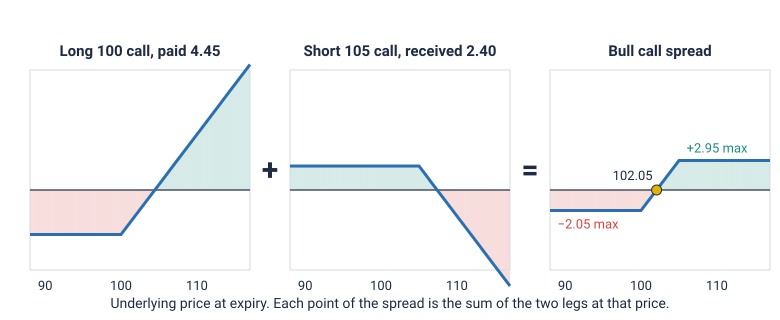

<head>
    <script type="application/ld+json">
        {JSON.stringify({
            "@context": "https://schema.org",
            "@type": "FAQPage",
            "mainEntity": [
                {
                    "@type": "Question",
                    "name": "What is an options payoff diagram?",
                    "acceptedAnswer": {
                        "@type": "Answer",
                        "text": "An options payoff diagram is a line chart of the profit or loss an option position makes at expiry, plotted against the price of the underlying asset at that date. It shows the position's breakeven prices, its maximum profit and maximum loss, and how the result changes as the price moves."
                    }
                },
                {
                    "@type": "Question",
                    "name": "What is the difference between payoff and profit for an option?",
                    "acceptedAnswer": {
                        "@type": "Answer",
                        "text": "The payoff is what the option is worth at expiry: max(S − K, 0) for a call and max(K − S, 0) for a put, where S is the underlying price and K the strike. For a buyer, profit is the payoff minus the premium paid; for a seller, it is the premium received minus the payoff. A profit diagram is the payoff diagram moved down by the premium for a buyer and up by it for a seller."
                    }
                },
                {
                    "@type": "Question",
                    "name": "How do you calculate the breakeven of an option?",
                    "acceptedAnswer": {
                        "@type": "Answer",
                        "text": "For a call, breakeven at expiry is the strike plus the premium; for a put, it is the strike minus the premium. A 100 call bought for 4.45 breaks even at 104.45, and a 100 put bought for 3.95 breaks even at 96.05. For a strategy with several legs, find the prices where the summed payoff crosses zero: a straddle has two, at the strike plus and minus the total premium."
                    }
                },
                {
                    "@type": "Question",
                    "name": "What does an iron condor payoff diagram look like?",
                    "acceptedAnswer": {
                        "@type": "Answer",
                        "text": "An iron condor payoff diagram has a flat top between the two short strikes, where the position keeps the whole net credit, sloping sides between each short strike and its long wing, and flat floors beyond the wings, where the loss is capped at the wing width minus the credit. With wings at 90, 95, 105 and 110 and a 2.35 credit, it earns at most 2.35, loses at most 2.65, and breaks even at 92.65 and 107.35."
                    }
                },
                {
                    "@type": "Question",
                    "name": "Why does the value of an option before expiry differ from the payoff diagram?",
                    "acceptedAnswer": {
                        "@type": "Answer",
                        "text": "Before expiry an option still has time value: the chance that the price moves further before the option expires. Its value curve, from a pricing model such as Black–Scholes, is a smooth curve that usually lies above the hockey-stick payoff of a bought option, and it sinks onto the payoff as expiry approaches. Higher volatility lifts the curve of a bought option; time passing lowers it."
                    }
                },
                {
                    "@type": "Question",
                    "name": "How do I draw an options payoff diagram in JavaScript?",
                    "acceptedAnswer": {
                        "@type": "Answer",
                        "text": "Sum each leg's profit at expiry over a grid of underlying prices, adding each strike and breakeven to the grid so the kinks stay sharp, and plot the result as a line with zero as the reference. In SciChart.js, a FastBandRenderableSeries with the payoff as y and zero as y1 shades profit and loss in two colours, a FastLineRenderableSeries adds the before-expiry value curve, and line annotations mark the breakevens and the maximum profit and loss."
                    }
                }
            ]
        })}
    </script>
</head>

# Options Payoff Diagram

## What is an options payoff diagram?

An **options payoff diagram** (also called a profit and loss diagram) is a line chart of the profit or loss an option position makes at expiry, plotted against the underlying asset's price on that date. It shows the breakeven prices, the maximum profit and maximum loss, and where the outcome changes direction.


*The profit or loss of a long 100 call at expiry, shaded green for profit and red for loss, with its value 45 days before expiry as a dashed curve (sample prices). [Try the interactive version](#how-to-create-an-options-payoff-diagram-in-javascript-react-or-angular).*

:::tip Key takeaways
- The x-axis is the underlying price at expiry and the y-axis is profit or loss; anything above the zero line is a gain.
- Payoff is what the option is worth at expiry; profit is the payoff minus the premium paid, or plus the premium received.
- Kinks sit at the strikes, and the slope of each segment is the position's delta at expiry.
- A multi-leg strategy's diagram is the sum of its legs' diagrams, price by price.
- Before expiry the position is worth more or less than the payoff line, because of time value and volatility.
:::

## Payoff vs profit: where the premium goes

An option's payoff is what it's worth at expiry, while its profit also counts the premium paid to buy it or received for selling it.


A **call** gives its buyer the right, but not the obligation, to buy the underlying at a fixed price, the **strike** (K), at any time up to the expiry date (American style) or only on it (European style). A **put** gives the right to sell at the strike. The price paid for that right is the **premium**. Writing S for the underlying price at expiry:

$$
\text{call payoff} = \max(S - K,\ 0) \qquad \text{put payoff} = \max(K - S,\ 0)
$$

The buyer's profit is the payoff minus the premium. The seller (or writer) of the same option takes the other side: the premium comes in at the start, and the payoff goes out at expiry. So the seller's diagram is the buyer's diagram flipped upside down, and what one gains the other loses.

Diagrams on this page are per share, and ignore commissions and interest on the premium. A standard US equity option contract covers 100 shares, so a premium of 4.45 costs 445 per contract and every profit or loss figure scales the same way. This page explains how payoff diagrams are built and read, and is not investment advice.

## The four basic option positions

Every strategy is built from four positions: buying or selling a call, and buying or selling a put.

The numbers below use a stock at 100 and options with 45 days to expiry, priced with the Black–Scholes model at 30% volatility and a 4% interest rate, rounded to 0.05: the 100 call costs 4.45 and the 100 put 3.95. They are the presets in the demo.

| Position | Profit at expiry | Breakeven | Max profit | Max loss | Example: K = 100 |
| --- | --- | --- | --- | --- | --- |
| Long call (buy a call) | max(S − K, 0) − c | K + c | Unlimited | c | Breakeven 104.45; loses at most 4.45 |
| Short call (sell a call) | c − max(S − K, 0) | K + c | c | Unlimited | Keeps at most 4.45; loses above 104.45 |
| Long put (buy a put) | max(K − S, 0) − p | K − p | K − p (if S falls to 0) | p | Breakeven 96.05; at most 96.05 profit, 3.95 loss |
| Short put (sell a put) | p − max(K − S, 0) | K − p | p | K − p | Keeps at most 3.95; loses up to 96.05 |

Here c and p are the call and put premiums. A long call and a short put both gain when the price rises, but in different ways: the call has a small fixed loss and an open-ended gain, while the put seller has a small fixed gain and a large loss if the price collapses.

## How to read a payoff diagram

Read a payoff diagram from left to right as a list of what-ifs: for each price the underlying could finish at, the line's height is the profit or loss.

- The zero line is breakeven. Above it the position makes money, below it it loses. The prices where the line crosses zero are the **breakevens**.
- Kinks sit at the strikes. Between two strikes no option changes from worthless to in the money, so the line is straight; it bends only where an option starts to pay out.
- Each slope is the position's **delta** at expiry: how much the profit changes when the price at expiry is 1.00 higher. A long call's line has slope 0 below the strike and 1 above it. A segment with slope 2 gains twice as fast as owning one share.
- A flat end means the profit or loss is capped in that direction. A line that keeps rising or falling at the edge of the chart means the gain or loss is open-ended; on the price side it stops at zero, because a share price can't go negative.
- The highest and lowest points of the line, including any flat segments, are the maximum profit and maximum loss.

To describe a diagram in one sentence: "This position loses at most [max loss] below [price], breaks even at [breakeven(s)], and makes at most [max profit] above [price]".

## Combining legs: add the payoffs

A strategy with several options (legs) has a payoff diagram equal to the sum of the legs' diagrams, taken one price at a time.



Take a bull call spread: buy the 100 call for 4.45 and sell the 105 call for 2.40. The net premium paid, or **net debit**, is 2.05.

| Price at expiry | Long 100 call | Short 105 call | Spread |
| --- | --- | --- | --- |
| 95 | −4.45 | +2.40 | −2.05 |
| 100 | −4.45 | +2.40 | −2.05 |
| 102.05 | −2.40 | +2.40 | 0.00 |
| 105 | +0.55 | +2.40 | +2.95 |
| 110 | +5.55 | −2.60 | +2.95 |

Above 105, every extra point the long call gains, the short call loses, so the two cancel and the line goes flat. Selling the 105 call cuts the cost of the trade and caps its profit at the gap between the strikes minus the debit: 5 − 2.05 = 2.95.

Because the sum is linear, a few rules follow. Buying and selling the same option cancels out. Doubling a leg doubles its slope. A share of stock is a straight line of slope 1 through its purchase price, which is why owning stock and selling a call (a covered call) has the same shape at expiry as selling a put.

## Common option strategies and their payoff diagrams

Most named strategies are two to four legs chosen to give a particular shape: a capped ramp, a V, a tent or a flat-topped plateau.

In the formulas, K1 < K2 < K3 < K4 are the strikes, D the net debit paid and C the net credit received. The examples use the same 100 stock and 45-day prices as above.

| Strategy | Legs | Shape at expiry | Max profit | Max loss | Breakeven(s) | Example (stock at 100) |
| --- | --- | --- | --- | --- | --- | --- |
| Covered call | Own the stock, sell a K call | Rises, then flat above K | K − S0 + c | S0 − c | S0 − c | Sell the 105 call for 2.40: max profit 7.40, max loss 97.60, breakeven 97.60 |
| Protective put | Own the stock, buy a K put | Flat below K, then rises | Unlimited | S0 − K + p | S0 + p | Buy the 95 put for 1.90: max loss 6.90, breakeven 101.90 |
| Bull call spread | Buy K1 call, sell K2 call | Flat, ramp up, flat | K2 − K1 − D | D | K1 + D | 100/105: debit 2.05, max profit 2.95, breakeven 102.05 |
| Bear put spread | Buy K2 put, sell K1 put | Flat, ramp down, flat | K2 − K1 − D | D | K2 − D | 100/95: debit 2.05, max profit 2.95, breakeven 97.95 |
| Long straddle | Buy a K call and a K put | V with its point at K | Unlimited above; K − D below | D | K − D and K + D | 100 call and put: debit 8.40, breakevens 91.60 and 108.40 |
| Long strangle | Buy a K1 put and a K2 call | Flat-bottomed V | Unlimited above; K1 − D below | D | K1 − D and K2 + D | 95 put and 105 call: debit 4.30, breakevens 90.70 and 109.30 |
| Long call butterfly | Buy K1 call, sell two K2 calls, buy K3 call (equal gaps) | Tent with its peak at K2 | K2 − K1 − D | D | K1 + D and K3 − D | 95/100/105: debit 0.90, max profit 4.10, breakevens 95.90 and 104.10 |
| Iron condor | Buy K1 put, sell K2 put, sell K3 call, buy K4 call | Flat-topped plateau between K2 and K3 | C | Wing width − C | K2 − C and K3 + C | 90/95/105/110: credit 2.35, max loss 2.65, breakevens 92.65 and 107.35 |

S0 is the price paid for the stock. Selling any of these strategies instead of buying it flips its diagram: a short straddle has a tent shape, keeps the premium if the price stays near the strike, and has a large loss on either side: open-ended above, and up to the strike minus the premium below.

### Worked example: an iron condor

An iron condor sells a put spread below the price and a call spread above it. With the stock at 100:

1. Buy the 90 put for 0.75 and sell the 95 put for 1.90.
2. Sell the 105 call for 2.40 and buy the 110 call for 1.20.
3. Net credit: 1.90 + 2.40 − 0.75 − 1.20 = 2.35.

Between 95 and 105 every option expires worthless and the whole 2.35 is kept, which gives the flat top. Below 95 the short put starts to cost money until the long 90 put takes over, so the loss stops growing at 5 − 2.35 = 2.65. The same happens above 105. The breakevens are 95 − 2.35 = 92.65 and 105 + 2.35 = 107.35. The position makes money if the stock finishes anywhere in a band about 15 points wide, and its maximum loss, 2.65, is larger than its maximum gain, 2.35.

## Before expiry: value curves and time decay

Before expiry, a position is worth its model value, not its payoff, so the diagram gains a smooth curve that sinks onto the payoff line as expiry approaches.

An option that hasn't expired still has **time value**: the price could move further before expiry. The standard way to price it is the Black–Scholes model, which gives the value of a European call on a stock paying no dividends as

$$
C = S\,N(d_1) - K e^{-rT} N(d_2), \qquad d_1 = \frac{\ln(S/K) + (r + \sigma^2/2)\,T}{\sigma\sqrt{T}}, \qquad d_2 = d_1 - \sigma\sqrt{T}
$$

where N is the standard normal cumulative distribution, T the time to expiry in years, r the interest rate and σ the volatility. A put's value follows from put–call parity. US equity options are American style, so for them, and for stocks that pay dividends, the formula is an approximation, which is close enough for the shape of the curve. Plotting the position's model value minus what was paid, across a range of prices, gives a before-expiry curve, often labelled "T+0" for today, or with the number of days left.

What the curve shows for the presets (stock at 100, 30% volatility, 4% interest rate):

- Time decay. A long straddle bought for 8.40 is worth about what was paid on day one. With the price still at 100, the same straddle shows a loss of 1.55 with 30 days left, 3.55 with 15 days left, 5.60 with 5 days left and the full 8.40 at expiry. The decay speeds up near the end.
- Volatility. If volatility rises from 30% to 40% straight after the trade, the straddle's value at 100 rises by about 2.8, to a profit of 2.78. Bought options gain from higher volatility and sold options lose.
- Delta today. The slope of the curve at today's price is the position's current delta. For the long 100 call it's 0.54 at 45 days, against a slope of 0 or 1 on the expiry line.

The volatility in the formula isn't directly observable: traders back it out of market prices, and it differs by strike and expiry. The [volatility surface](/learn/applications/volatility-surface/) guide explains how that implied volatility is charted.

## Payoff diagram vs P&L heatmap vs risk graph

Use the expiry payoff diagram for the shape of a strategy, a risk graph to compare dates, and a P&L heatmap to see price and time together.

| If you need to… | Use | What it shows |
| --- | --- | --- |
| See a strategy's shape, breakevens and limits | Payoff diagram at expiry | One piecewise-straight line against the underlying price |
| See how profit or loss changes as expiry approaches | Risk graph | The expiry line plus value curves for today and a few dates in between |
| See profit or loss for every price and date at once | P&L [heatmap](/learn/chart-types/cartesian/heatmap/) | A grid with price on one axis, date on the other, and colour for profit or loss |
| Check exact numbers at a few prices | P&L table | Rows of prices with the profit or loss of each leg and the total, as in the bull call spread table above |
| Price a position with several expiry dates, such as a calendar spread | Risk graph from a pricing model | Value curves; a single expiry line can't describe it |

## Common payoff diagram mistakes

Most mistakes come from treating the expiry line as the whole story.

- **Plotting payoff instead of profit.** A payoff line that never goes below zero looks risk-free. Subtract the premium paid, or add the premium received, before reading breakevens.
- **Forgetting the contract multiplier.** A loss of 2.65 per share is 265 per standard contract, and ten contracts lose ten times that.
- **Assuming you'll hold to expiry.** Many positions are closed or adjusted before expiry, at the value curve's price, not the payoff line's.
- **Ignoring early exercise and assignment.** American-style options can be exercised at any time, so a short leg can be assigned early, for example when a call is deep in the money just before a dividend. The other legs of a spread then no longer protect it in the same way.
- **Leaving out fees and the bid–ask spread.** A four-leg strategy pays the spread and commission on every leg, which moves the breakevens out and can eat a small credit.
- **Using one expiry line for several expiry dates.** Calendar and diagonal spreads mix expiries, so their shape depends on the value of the longer-dated option, which only a pricing model gives.

## How to create an options payoff diagram in JavaScript, React or Angular

The demo below sums up to six legs at about 320 underlying prices from 60 to 140, adds each strike and breakeven as exact points, and recomputes the Black–Scholes value of every leg at each price whenever you change a leg or move a slider; SciChart.js then redraws the band, the curve and the markers.

Choose a **Strategy** to load a preset, or edit the legs: set each one's side (long or short), quantity, type (call, put or stock), **Strike** and **Premium**, and use **Add leg** and **Remove** to build your own strategy. Drag **Days to expiry** towards 0 to watch the dashed value curve sink onto the expiry line, and move **Volatility** to see it lift or fall. The readout gives the net premium, maximum profit and loss, breakevens, and the profit and delta at today's price of 100. Scroll to zoom, drag to pan, double-click to reset, and hover for values.

<LiveDocSnippet maxWidth={'100%'} height={780} name="./Basic/demo" />

<LearnCta position="top" chart="options payoff diagram" demo="line-chart" demoLabel="line chart" docs="/2d-charts/chart-types/fast-line-renderable-series/" docsLabel="SciChart.js line series documentation" />

Here is the code for this demo. The option maths (payoffs, Black–Scholes values, breakevens and limits) is plain JavaScript; SciChart.js draws the shaded payoff, the value curve and the markers. The React and Angular versions below draw a payoff diagram from your own data.

<CodeSnippetBlock labels={["JavaScript", "React", "Angular"]}>
    ```ts showLineNumbers file=./Basic/demo.ts start=#region_A_start end=#region_A_end
    ```

    ```tsx
    import { SciChartReact } from "scichart-react";
    import {
        SciChartSurface,
        NumericAxis,
        FastBandRenderableSeries,
        FastLineRenderableSeries,
        XyyDataSeries,
        XyDataSeries,
        HorizontalLineAnnotation,
        VerticalLineAnnotation,
        SciChartJsNavyTheme,
        CursorModifier,
        MouseWheelZoomModifier,
        ZoomPanModifier,
        ZoomExtentsModifier
    } from "scichart";

    // Profit or loss at expiry (and optionally before it) against the underlying price
    const initChart = async (rootElement: string | HTMLDivElement) => {
        const { wasmContext, sciChartSurface } = await SciChartSurface.create(rootElement, {
            theme: new SciChartJsNavyTheme()
        });
        // prices: sorted underlying prices; expiryPnl and todayPnl: profit or loss at each one
        const { prices, expiryPnl, todayPnl, breakevens } = await getYourPayoffData();

        sciChartSurface.xAxes.add(new NumericAxis(wasmContext, { axisTitle: "Underlying price at expiry" }));
        sciChartSurface.yAxes.add(new NumericAxis(wasmContext, { axisTitle: "Profit / loss" }));
        sciChartSurface.renderableSeries.add(
            // y = profit or loss, y1 = 0: fillY1 colours where y > y1 (profit), fill where y < y1 (loss)
            new FastBandRenderableSeries(wasmContext, {
                dataSeries: new XyyDataSeries(wasmContext, {
                    xValues: prices,
                    yValues: expiryPnl,
                    y1Values: prices.map(() => 0)
                }),
                stroke: "#F2F5FA",
                strokeY1: "#00000000",
                fillY1: "#26A69A66",
                fill: "#EF535066",
                strokeThickness: 3
            }),
            new FastLineRenderableSeries(wasmContext, {
                dataSeries: new XyDataSeries(wasmContext, { xValues: prices, yValues: todayPnl }),
                stroke: "#50C7E0",
                strokeDashArray: [8, 4],
                strokeThickness: 2
            })
        );
        sciChartSurface.annotations.add(
            new HorizontalLineAnnotation({ y1: 0, stroke: "#C8D3E8" }),
            ...breakevens.map(
                (x: number) => new VerticalLineAnnotation({ x1: x, stroke: "#F5E663", showLabel: true, labelValue: x.toFixed(2) })
            )
        );
        sciChartSurface.chartModifiers.add(
            new CursorModifier({ showTooltip: true }),
            new MouseWheelZoomModifier(),
            new ZoomPanModifier(),
            new ZoomExtentsModifier()
        );
        return { sciChartSurface };
    };

    // SciChartReact creates the chart, sizes it to its parent and cleans it up
    export const PayoffDiagram = () => <SciChartReact initChart={initChart} style={{ width: "100%", height: 420 }} />;
    ```

    ```ts
    import { Component } from "@angular/core";
    import { ScichartAngularComponent } from "scichart-angular";
    import {
        SciChartSurface,
        NumericAxis,
        FastBandRenderableSeries,
        FastLineRenderableSeries,
        XyyDataSeries,
        XyDataSeries,
        HorizontalLineAnnotation,
        VerticalLineAnnotation,
        SciChartJsNavyTheme,
        CursorModifier,
        MouseWheelZoomModifier,
        ZoomPanModifier,
        ZoomExtentsModifier
    } from "scichart";

    // Profit or loss at expiry (and optionally before it) against the underlying price
    const initChart = async (rootElement: string | HTMLDivElement) => {
        const { wasmContext, sciChartSurface } = await SciChartSurface.create(rootElement, {
            theme: new SciChartJsNavyTheme()
        });
        // prices: sorted underlying prices; expiryPnl and todayPnl: profit or loss at each one
        const { prices, expiryPnl, todayPnl, breakevens } = await getYourPayoffData();

        sciChartSurface.xAxes.add(new NumericAxis(wasmContext, { axisTitle: "Underlying price at expiry" }));
        sciChartSurface.yAxes.add(new NumericAxis(wasmContext, { axisTitle: "Profit / loss" }));
        sciChartSurface.renderableSeries.add(
            // y = profit or loss, y1 = 0: fillY1 colours where y > y1 (profit), fill where y < y1 (loss)
            new FastBandRenderableSeries(wasmContext, {
                dataSeries: new XyyDataSeries(wasmContext, {
                    xValues: prices,
                    yValues: expiryPnl,
                    y1Values: prices.map(() => 0)
                }),
                stroke: "#F2F5FA",
                strokeY1: "#00000000",
                fillY1: "#26A69A66",
                fill: "#EF535066",
                strokeThickness: 3
            }),
            new FastLineRenderableSeries(wasmContext, {
                dataSeries: new XyDataSeries(wasmContext, { xValues: prices, yValues: todayPnl }),
                stroke: "#50C7E0",
                strokeDashArray: [8, 4],
                strokeThickness: 2
            })
        );
        sciChartSurface.annotations.add(
            new HorizontalLineAnnotation({ y1: 0, stroke: "#C8D3E8" }),
            ...breakevens.map(
                (x: number) => new VerticalLineAnnotation({ x1: x, stroke: "#F5E663", showLabel: true, labelValue: x.toFixed(2) })
            )
        );
        sciChartSurface.chartModifiers.add(
            new CursorModifier({ showTooltip: true }),
            new MouseWheelZoomModifier(),
            new ZoomPanModifier(),
            new ZoomExtentsModifier()
        );
        return { sciChartSurface };
    };

    @Component({
        selector: "app-payoff-diagram",
        standalone: true,
        imports: [ScichartAngularComponent],
        // scichart-angular creates the chart, sizes it and cleans it up
        template: `<scichart-angular [initChart]="initChart" style="display: block; width: 100%; height: 420px"></scichart-angular>`
    })
    export class PayoffDiagramComponent {
        initChart = initChart;
    }
    ```
</CodeSnippetBlock>

Key points:

- The expiry payoff is a [FastBandRenderableSeries](/2d-charts/chart-types/fast-band-renderable-series/) over an `XyyDataSeries`, with the profit or loss as y and zero as y1. The band fills with `fillY1` where y is above y1 and with `fill` where it is below, so profit and loss get their own colours with no palette code. Adding the breakevens to the x values makes the colour change exactly at zero.
- The value before expiry is a dashed [FastLineRenderableSeries](/2d-charts/chart-types/fast-line-renderable-series/) (`strokeDashArray`), recomputed from the Black–Scholes formula for every price on the x-axis when a slider moves.
- Breakevens are an `XyScatterRenderableSeries` with an `EllipsePointMarker`, labelled with `TextAnnotation`s. The maximum profit and loss are `HorizontalLineAnnotation`s with `showLabel`, hidden when the limit is unlimited.
- Nothing is rebuilt when a control changes: the demo clears and refills the data series (`clear` and `appendRange`) and moves the annotations.

**See it in the demo app:** [JavaScript line chart](https://www.scichart.com/demo/javascript/line-chart) · [React line chart](https://www.scichart.com/demo/react/line-chart) · [Angular line chart](https://www.scichart.com/demo/angular/line-chart). Related techniques: the [React mountain chart](https://www.scichart.com/demo/react/mountain-chart), [React chart annotations](https://www.scichart.com/demo/react/chart-annotations) and [React line splitting at thresholds](https://www.scichart.com/demo/react/line-splitting-thresholds).

**Go deeper:** [SciChart.js line series documentation](/2d-charts/chart-types/fast-line-renderable-series/), the [band series](/2d-charts/chart-types/fast-band-renderable-series/) and [horizontal line annotation](/2d-charts/annotations-api/horizontal-line-annotation/) documentation, and the learning center guides to the [line chart](/learn/chart-types/cartesian/line-chart/), the [area chart](/learn/chart-types/cartesian/area-chart/) and the [candlestick chart](/learn/chart-types/cartesian/candlestick-chart/). For how trading software uses SciChart, see [SciChart for financial and stock trading applications](https://www.scichart.com/why-scichart-best-for-financial-stock-trading-applications/).

## Building a full trading app?

[SciTrader.js](/financial-charts/overview/), SciChart's financial charts SDK, draws the price charts that sit beside an options tool: candlesticks, technical indicators, drawing tools and multiple panes, with live exchange data. It has no options payoff tool, so build the payoff diagram with SciChart.js as in the demo above and show it next to the underlying's price chart. See what SciChart offers for trading apps on the [JavaScript stock charts](https://www.scichart.com/javascript-stock-charts/) page.

## Frequently asked questions

### What is an options payoff diagram?

An options payoff diagram is a line chart of the profit or loss an option position makes at expiry, plotted against the price of the underlying asset at that date. It shows the position's breakeven prices, its maximum profit and maximum loss, and how the result changes as the price moves.

### What is the difference between payoff and profit for an option?

The payoff is what the option is worth at expiry: max(S − K, 0) for a call and max(K − S, 0) for a put, where S is the underlying price and K the strike. For a buyer, profit is the payoff minus the premium paid; for a seller, it is the premium received minus the payoff. A profit diagram is the payoff diagram moved down by the premium for a buyer and up by it for a seller.

### How do you calculate the breakeven of an option?

For a call, breakeven at expiry is the strike plus the premium; for a put, it is the strike minus the premium. A 100 call bought for 4.45 breaks even at 104.45, and a 100 put bought for 3.95 breaks even at 96.05. For a strategy with several legs, find the prices where the summed payoff crosses zero: a straddle has two, at the strike plus and minus the total premium.

### What does an iron condor payoff diagram look like?

An iron condor payoff diagram has a flat top between the two short strikes, where the position keeps the whole net credit, sloping sides between each short strike and its long wing, and flat floors beyond the wings, where the loss is capped at the wing width minus the credit. With wings at 90, 95, 105 and 110 and a 2.35 credit, it earns at most 2.35, loses at most 2.65, and breaks even at 92.65 and 107.35.

### Why does the value of an option before expiry differ from the payoff diagram?

Before expiry an option still has time value: the chance that the price moves further before the option expires. Its value curve, from a pricing model such as Black–Scholes, is a smooth curve that usually lies above the hockey-stick payoff of a bought option, and it sinks onto the payoff as expiry approaches. Higher volatility lifts the curve of a bought option; time passing lowers it.

### How do I draw an options payoff diagram in JavaScript?

Sum each leg's profit at expiry over a grid of underlying prices, adding each strike and breakeven to the grid so the kinks stay sharp, and plot the result as a line with zero as the reference. In SciChart.js, a FastBandRenderableSeries with the payoff as y and zero as y1 shades profit and loss in two colours, a FastLineRenderableSeries adds the before-expiry value curve, and line annotations mark the breakevens and the maximum profit and loss.

## Sources

- Hull, J. C. (2022), *Options, Futures, and Other Derivatives*, 11th edition. Pearson. Option payoffs and profit diagrams, trading strategies (spreads, straddles, strangles, butterflies), put–call parity and the Black–Scholes–Merton model.
- Black, F. and Scholes, M. (1973), [The pricing of options and corporate liabilities](https://doi.org/10.1086/260062). *Journal of Political Economy*, 81(3), 637–654. The option pricing formula used for the before-expiry curve.
- Merton, R. C. (1973), [Theory of rational option pricing](https://doi.org/10.2307/3003143). *The Bell Journal of Economics and Management Science*, 4(1), 141–183. Extensions of the model and the bounds on option prices.
- Options Clearing Corporation, [Characteristics and Risks of Standardized Options](https://www.theocc.com/company-information/documents-and-archives/options-disclosure-document). The options disclosure document: calls and puts, American and European exercise, assignment and the risks of buying and writing options.
- U.S. Securities and Exchange Commission, [Investor Bulletin: An Introduction to Options](https://www.investor.gov/news-alerts/investor-bulletins/investor-bulletin-introduction-options). Strikes, premiums, expiry and the 100-share contract.
- FINRA, [Trading Options: Understanding Assignment](https://www.finra.org/investors/insights/trading-options-understanding-assignment). Early exercise and assignment risk for option sellers.

<LearnCta position="bottom" chart="options payoff diagram" demo="line-chart" demoLabel="line chart" docs="/2d-charts/chart-types/fast-line-renderable-series/" docsLabel="SciChart.js line series documentation" />
