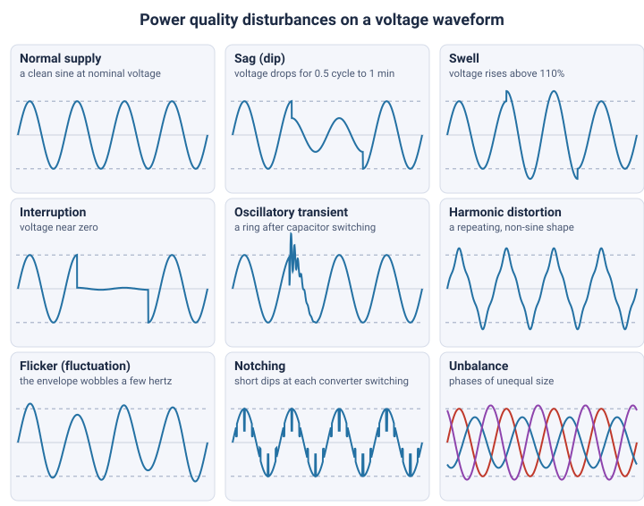
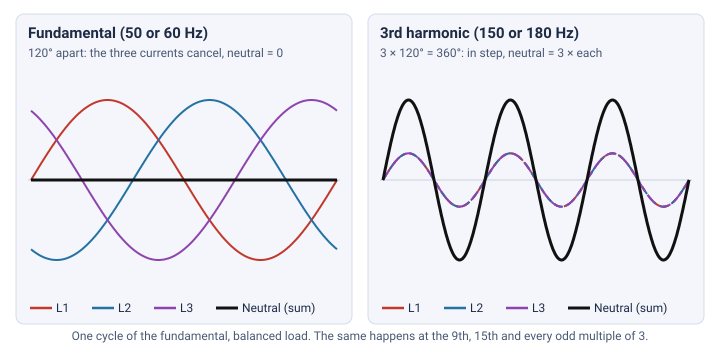

<head>
    <script type="application/ld+json">
        {JSON.stringify({
            "@context": "https://schema.org",
            "@type": "FAQPage",
            "mainEntity": [
                {
                    "@type": "Question",
                    "name": "What is power quality?",
                    "acceptedAnswer": {
                        "@type": "Answer",
                        "text": "Power quality is how closely the electricity at a point in a network matches an ideal supply: a sine wave of the right voltage and frequency, balanced across the phases and never interrupted. Poor power quality shows up as sags, swells, interruptions, transients, harmonic distortion, flicker and unbalance, which can trip, overheat or shorten the life of equipment."
                    }
                },
                {
                    "@type": "Question",
                    "name": "What is total harmonic distortion (THD)?",
                    "acceptedAnswer": {
                        "@type": "Answer",
                        "text": "Total harmonic distortion is the RMS sum of all the harmonics in a voltage or current, divided by the fundamental and given as a percentage. A pure sine wave has a THD of 0%. A 230 V supply with 3% third, 5% fifth and 3% seventh harmonics has a voltage THD of the square root of 3² + 5² + 3², about 6.6%."
                    }
                },
                {
                    "@type": "Question",
                    "name": "What is a good THD value?",
                    "acceptedAnswer": {
                        "@type": "Answer",
                        "text": "For voltage, IEEE 519 allows a THD of up to 8% on systems up to 1 kV and 5% from 1 kV to 69 kV, with no single harmonic above 5% and 3% respectively. EN 50160 also allows up to 8% on public networks in Europe. Current distortion is judged as total demand distortion (TDD), with limits from 5% to 20% depending on how strong the supply is compared with the load."
                    }
                },
                {
                    "@type": "Question",
                    "name": "What causes harmonics in power systems?",
                    "acceptedAnswer": {
                        "@type": "Answer",
                        "text": "Harmonics come from non-linear loads, which draw current in pulses rather than as a smooth sine wave. The main sources are rectifiers: variable-speed drives, LED drivers, computer and phone power supplies, battery chargers and UPS systems. Arc furnaces and saturated transformers add more. The current harmonics then distort the voltage as they flow through the network's impedance."
                    }
                },
                {
                    "@type": "Question",
                    "name": "What is the difference between a voltage sag and an interruption?",
                    "acceptedAnswer": {
                        "@type": "Answer",
                        "text": "In a sag, also called a dip, the voltage falls but stays on: typically to between 10% and 90% of nominal, for half a cycle up to a minute, usually because of a fault or a large motor starting elsewhere on the network. In an interruption the voltage falls almost to zero, below about 10% of nominal, because a breaker or fuse has disconnected the supply."
                    }
                },
                {
                    "@type": "Question",
                    "name": "How do I plot a harmonic spectrum in JavaScript?",
                    "acceptedAnswer": {
                        "@type": "Answer",
                        "text": "Take an FFT of a window holding a whole number of cycles of the waveform, such as 10 cycles at 50 Hz, read the amplitude at each harmonic's line, and divide by the fundamental to get percentages. With SciChart.js, put the orders and percentages in an XyDataSeries, draw them with a FastColumnRenderableSeries, and add a HorizontalLineAnnotation for the limit. For React or Angular, wrap the same code in scichart-react or scichart-angular."
                    }
                }
            ]
        })}
    </script>
</head>

# Power Quality

## What is power quality?

**Power quality** is how closely the electricity at a point in a network matches an ideal supply: a sine wave at the right voltage and frequency, balanced across the three phases and never interrupted. It is measured from the size and shape of the voltage and current, and judged by disturbances such as sags, harmonics and flicker.


*A simulated three-phase supply feeding LED drivers: voltage and current waveforms, phasors, the half-cycle RMS trace that catches a sag, and the harmonic spectrum (sample data). [Try the interactive version](#how-to-build-a-power-quality-analyser-display-in-javascript-react-or-angular).*

:::tip Key takeaways
- Power quality covers five things: voltage magnitude, frequency, waveform shape, balance between phases, and continuity of supply.
- Sags (dips) are among the most common causes of equipment trips; they're caught with an RMS value refreshed every half cycle.
- Harmonics come from loads that draw current in pulses. Total harmonic distortion (THD) sums them into one percentage.
- IEEE 519 and EN 50160 set the limits; IEC 61000-4-30 and IEC 61000-4-7 say how to measure, so two analysers agree.
- An analyser shows the same data five ways: waveforms, a harmonic bar chart, trends over days, RMS event plots and a phasor diagram.
:::

Utilities, factories, data centres, hospitals and anyone connecting solar, wind, batteries or electric vehicle chargers to the grid all measure it.

## What power quality covers

A perfect supply is a clean sine wave that never changes. Real supplies drift from it in five ways, and every power quality problem is one of them:

| Property | Ideal | What goes wrong |
| --- | --- | --- |
| Voltage magnitude | The nominal voltage, for example 230 V or 120 V phase to neutral | Slow under- or overvoltage, short sags and swells, fast fluctuations that cause flicker |
| Frequency | Exactly 50 Hz or 60 Hz | Small deviations when generation and demand don't match |
| Waveform shape | A pure sine wave | Harmonics, interharmonics, notching, transients |
| Balance | Three phases of equal size, 120° apart | Unbalance from uneven single-phase loads |
| Continuity | Always on | Short and long interruptions |

The voltage is mostly the network operator's responsibility. The current is mostly the customer's: what a building's loads draw decides its current harmonics and power factor, and those currents then distort the voltage for everyone on the same feeder.

## Power quality disturbances and their causes

Power quality disturbances are grouped by how long they last and how far they move the voltage, from microsecond transients to sustained interruptions.



IEEE 1159 sorts disturbances by how long they last and how large they are. The table follows its categories; the thresholds are those used by most analysers.

| Disturbance | What it looks like | Typical size and duration | Common causes |
| --- | --- | --- | --- |
| Sag (dip) | RMS voltage falls but stays on | 10% to 90% of nominal, half a cycle to 1 minute | Faults elsewhere on the network, large motors starting, transformer energising |
| Swell | RMS voltage rises | 110% to 180%, half a cycle to 1 minute | The healthy phases during a fault from one phase to earth; large loads switching off |
| Interruption | Voltage near zero | Below about 10% of nominal; up to 1 minute (momentary or temporary), or sustained beyond that. EN 50160 puts the line between short and long interruptions at 3 minutes instead | Breakers, fuses and reclosers clearing faults; planned outages |
| Under- and overvoltage | RMS steadily too low or too high | Beyond ±10% for over a minute | Overloaded or lightly loaded feeders, wrong transformer taps, solar export on a weak line |
| Transient | A spike or ring lasting microseconds to milliseconds | Impulsive (lightning) or oscillatory (switching), peaks up to several times normal | Lightning, capacitor bank switching, switching of inductive loads |
| Harmonics | A repeating, non-sinusoidal waveform | Distortion at whole multiples of 50 or 60 Hz | Non-linear loads: rectifiers, drives, LED drivers, computer power supplies |
| Interharmonics | Distortion at frequencies between harmonics | Usually small | Arc furnaces, cycloconverters, some drives and inverters |
| Flicker (voltage fluctuation) | The RMS wobbles at a few hertz | Changes of a fraction of a per cent to a few per cent, repeated | Arc furnaces, welders, sawmills, wind turbines, any load that cycles quickly |
| Notching | Short dips at each switching instant of a converter | Every half cycle or more often | Thyristor and diode rectifiers commutating |
| Unbalance | Phases of unequal size or angle | A few per cent of negative-sequence voltage | Single-phase loads unevenly spread, a blown fuse in a capacitor bank |
| Frequency deviation | Cycles slightly too long or short | Fractions of a hertz on big grids, more on small or islanded ones | Loss of a large generator or load; weak island grids |

Sags are a common reason for a process to stop, because contactors drop out and drives trip on low DC-bus voltage within a few cycles. Harmonics rarely trip anything at once; they heat transformers, cables, motors and capacitors and shorten their lives.

## Voltage sags, swells and interruptions: how they're measured

A sag is defined by two numbers: its residual voltage (the lowest RMS value reached, as a percentage of nominal) and its duration. Both come from an RMS value updated far faster than a multimeter's.

IEC 61000-4-30, the standard for power quality measurement methods, uses $U_{rms(1/2)}$: the RMS over one cycle, recalculated every half cycle. On each phase:

- A dip starts when $U_{rms(1/2)}$ falls below the dip threshold, typically 90% of the declared voltage, and ends when it rises back above the threshold plus a hysteresis, typically 2%.
- On a three-phase system, the dip starts when the first phase drops and ends when the last phase recovers.
- Swells use a threshold of 110%, and interruptions a threshold of a few per cent, typically 5% or 10%.

Because each value covers a whole cycle, a measured event can look up to about a cycle longer than the disturbance itself. In the demo, a five-cycle sag on a 50 Hz supply (100 ms) is reported as 110 ms.

Results from many sites are usually plotted as a scatter of residual voltage against duration, often over a grid of ranges from EN 50160 or a tolerance curve. The ITIC (formerly CBEMA) curve is the best-known tolerance curve; it shows which sags typical IT equipment should ride through.

## What are harmonics in power systems?

A **harmonic** is a sine wave at a whole multiple of the supply frequency, called its order: on a 50 Hz supply, the 3rd harmonic is 150 Hz, the 5th 250 Hz and the 7th 350 Hz. Any distorted waveform that repeats every cycle can be split into a fundamental and a set of harmonics, which is what a [fast Fourier transform (FFT)](/learn/applications/signal-processing/fast-fourier-transform/) does.

Harmonics start in the current. A linear load, such as a heater or a filament lamp, draws a current the same shape as the voltage. A non-linear load doesn't:

- A rectifier with a smoothing capacitor charges the capacitor only near the peak of each half cycle, so it draws narrow, tall current pulses. LED drivers, computer and phone power supplies, and battery chargers without power factor correction work this way. Their current is rich in odd harmonics, including the 3rd.
- A six-pulse rectifier, the front end of most variable-speed drives (VFDs) and many UPS systems, draws current in blocks from each pair of phases. Its harmonics fall at orders $6k \pm 1$: the 5th, 7th, 11th, 13th and so on. A 12-pulse rectifier cancels the 5th and 7th, leaving $12k \pm 1$.
- Arc furnaces, welders and saturated transformers add harmonics, interharmonics and even orders.

The current harmonics flow back through the supply's impedance and drop a voltage at each frequency. So a building's current distortion becomes voltage distortion for the whole feeder, and a supply's impedance at each harmonic rises with the order, because its reactance is proportional to frequency.

### Harmonic sequence

In a balanced three-phase system, each harmonic also has a phase sequence:

| Sequence | Orders | Effect |
| --- | --- | --- |
| Positive (rotates like the fundamental) | 1, 4, 7, 10, 13 | Extra heating |
| Negative (rotates backwards) | 2, 5, 8, 11, 14 | A torque against a motor's rotation, extra heating in motors |
| Zero (all phases in step) | 3, 6, 9, 12, 15 | Adds up in the neutral; circulates in delta windings of transformers |

## Total harmonic distortion (THD)

**Total harmonic distortion** is the RMS sum of all the harmonics of a voltage or current, as a fraction of the fundamental. For a voltage with harmonic RMS values $V_2, V_3, \ldots$ and fundamental $V_1$:

$$
\mathrm{THD}_V = \frac{\sqrt{V_2^2 + V_3^2 + V_4^2 + \cdots + V_{50}^2}}{V_1} \times 100\%
$$

The current version, $\mathrm{THD}_I$, uses the current harmonics. Most standards sum the harmonics up to the 40th or 50th order.

A worked example: a 230 V supply with a fundamental of 230 V, a 3rd harmonic of 6.9 V (3%), a 5th of 11.5 V (5%) and a 7th of 6.9 V (3%) has

$$
\mathrm{THD}_V = \frac{\sqrt{6.9^2 + 11.5^2 + 6.9^2}}{230} = \frac{15.08}{230} = 6.56\%
$$

Its total RMS voltage is $230\sqrt{1 + 0.0656^2} = 230.5$ V, almost unchanged. A voltmeter reading 230.5 V gives no hint of distortion that already takes the 5th harmonic to IEEE 519's single-harmonic limit.

Two related measures are also in use:

- THD measured against the total RMS rather than the fundamental is sometimes used in audio. It can't exceed 100%, while the power-systems version can: the current of an LED driver without power factor correction can have a THD above 100%.
- Total demand distortion (TDD), used by IEEE 519 for current, divides by the site's maximum demand current instead of the present fundamental. A lightly loaded building with a small, distorted current then doesn't look worse than it is.

## Triplen harmonics and neutral current

Triplen harmonics, the 3rd, 9th, 15th and other odd multiples of three, add up in the neutral of a three-phase system instead of cancelling.



The fundamental currents of a balanced three-phase load are 120° apart and cancel in the neutral. The 3rd harmonic of each phase is shifted by $3 \times 120° = 360°$, a full turn, so all three are in step and add. The same holds for every odd multiple of three: the **triplen harmonics** (3rd, 9th, 15th).

So a neutral carrying single-phase non-linear loads can carry more current than any phase. With the demo's LED drivers on all three phases, each phase carries 57.5 A RMS with a 3rd harmonic of 32 A; the neutral carries 3 × 32 = 96 A of 3rd harmonic alone, and 97.7 A in all. Neutrals and the cables and transformers that feed such loads are sized for this, or derated. Triplen currents also circulate inside the delta winding of a delta-star transformer, heating it without reaching the supply side.

## Power factor: displacement and distortion

**Power factor** is the ratio of real power $P$ (watts, doing work) to apparent power $S$ (volt-amperes, the product of RMS voltage and current). With distortion it has two parts:

$$
\mathrm{PF} = \frac{P}{S} = \underbrace{\cos\varphi_1}_{\text{displacement}} \times \underbrace{\frac{1}{\sqrt{1 + \mathrm{THD}_I^2}}}_{\text{distortion}}
$$

- The displacement power factor, $\cos\varphi_1$, is the cosine of the angle between the fundamental voltage and current. Motors make the current lag; capacitors make it lead. Capacitor banks correct it.
- The distortion factor comes from harmonic current, which adds to the RMS current but carries almost no real power. Capacitors can't correct it; filters and better rectifiers can. The formula assumes the voltage is close to a sine wave.

A worked example: a load with a displacement power factor of 0.95 and a current THD of 80% has a distortion factor of $1/\sqrt{1 + 0.8^2} = 0.781$, so its true power factor is $0.95 \times 0.781 = 0.74$. A utility meter that bills on true power factor sees 0.74, not 0.95.

## Flicker and grid frequency

Flicker is the visible flickering of lighting when the voltage fluctuates by a fraction of a per cent at a few hertz. The eye is most sensitive to fluctuations of about 8.8 Hz. IEC 61000-4-15 defines a flickermeter that models a lamp, the eye and the brain, and gives two numbers: the short-term severity $P_{st}$ over 10 minutes, where 1 is the level most people find irritating, and the long-term severity $P_{lt}$ over 2 hours.

Grid frequency, also called utility or mains frequency, is 50 Hz in Europe, most of Asia, Africa and Australia, and 60 Hz in most of the Americas and part of Japan; Argentina, Chile, Uruguay, Paraguay and Bolivia use 50 Hz. It falls when demand exceeds generation and rises when generation exceeds demand, so it is the grid operator's real-time measure of balance. On large interconnected grids it rarely moves more than a few tenths of a hertz; EN 50160 allows ±1% for 99.5% of a year on connected European networks.

## Power quality standards: IEEE 519, EN 50160 and IEC 61000

Some standards set limits; others set measurement methods, so that every analyser gives the same answer for the same supply.

| Standard | What it sets | Key numbers |
| --- | --- | --- |
| IEEE 519-2022 | Harmonic limits at the point of common coupling (PCC) between a customer and the utility | Voltage THD 8% up to 1 kV (5% per harmonic); 5% from 1 to 69 kV (3% per harmonic). Current TDD from 5% to 20%, higher where the supply is stronger relative to the load |
| EN 50160:2022 | Voltage characteristics a European public network should deliver | Voltage within ±10% of nominal for 95% of 10-minute averages in a week; THD up to 8% (up to the 40th harmonic); $P_{lt}$ no more than 1 for 95% of the week; unbalance up to 2%; 50 Hz ±1% for 99.5% of a year |
| IEC 61000-4-30 | How to measure power quality parameters, in Class A (for contracts and compliance) and Class S | Basic intervals of 10 cycles (50 Hz) or 12 cycles (60 Hz), aggregated to 150/180 cycles, 10 minutes and 2 hours; $U_{rms(1/2)}$ for dips and swells; flagging of values measured during an event |
| IEC 61000-4-7 | How to measure harmonics and interharmonics | A window of 10 or 12 cycles (about 200 ms, 5 Hz between lines), synchronised to the supply; harmonic groups to the 50th order |
| IEC 61000-4-15 | The flickermeter | $P_{st}$ and $P_{lt}$ |
| IEEE 1159 | Recommended practice for monitoring power quality | The categories of disturbance, with typical sizes and durations |

IEEE 519 is assessed statistically. The 95th percentile of 10-minute values over a week must meet the limits, and short bursts may go higher, so a single snapshot can't show compliance.

The IEC 61000-4-7 window is why the harmonic analysis uses a whole number of cycles. With exactly 10 cycles in the window, every harmonic lands on an FFT line, and a rectangular window gives exact amplitudes. A tapered [window function](/learn/applications/signal-processing/window-functions/) such as Hann is only needed when the window falls out of step with the supply frequency.

## How a power quality analyser displays data

A power quality analyser samples three voltages and three or four currents thousands of times a second, computes the quantities above, logs them for days or weeks and captures waveforms when an event occurs. Its screens, and the software that reviews its recordings, show five views:

| View | What it shows | Chart type |
| --- | --- | --- |
| Waveform capture | A few cycles of every voltage and current, before, during and after an event | Line chart against time, phases in standard colours |
| Harmonic spectrum | The size of each harmonic, in volts, amps or % of the fundamental, against the standard's limits | Bar chart against harmonic order |
| Trend | RMS, THD, frequency, flicker, power and unbalance, as 10-minute or 1-minute values over days | Line chart with min/max bands over time |
| RMS event plot | The half-cycle RMS of each phase through a sag, swell or interruption | Line chart against time, with threshold lines |
| Phasor diagram | The size and angle of each phase's fundamental voltage and current | Polar chart with arrows |

The phasor diagram is also the first check after connecting an analyser. Three voltages 120° apart in the right order, with each current a short way behind its voltage, mean the clamps and leads are on correctly. A current pointing the opposite way means a clamp is on backwards. SciChart.js draws it with a [polar line chart](/2d-charts/chart-types/polar-line-renderable-series/); the guide to [HMI and SCADA](/learn/applications/hmi-scada/) covers the control-room trend displays where power quality data often ends up.

## How to reduce harmonics

Mitigation starts with the loads, then moves to the network:

- Line reactors or DC-link chokes in a drive smooth its current and cut the 5th and 7th harmonics noticeably, for little cost.
- 12- and 18-pulse rectifiers cancel the lowest harmonics using phase-shifted transformer windings.
- Active front ends replace a drive's diode rectifier with switched transistors that draw a near-sinusoidal current.
- Passive filters are tuned capacitor-reactor branches that give harmonic currents a low-impedance path, usually tuned just below the 5th.
- Active harmonic filters measure the load's harmonic current and inject its opposite.
- Power factor correction inside LED drivers and power supplies keeps their current close to a sine wave. IEC 61000-3-2 limits the harmonic current of equipment rated up to 16 A per phase.

Plain power factor correction capacitors are the one fix that can make harmonics worse. With the supply's inductance, they form a parallel resonance at order $h_r \approx \sqrt{S_{sc} / Q_c}$, where $S_{sc}$ is the short-circuit power at the busbar and $Q_c$ is the capacitor rating. A 0.8 Mvar bank on a 20 MVA busbar resonates at $\sqrt{25} = 5$: right on the 5th harmonic, which it then amplifies. Detuned banks, with a reactor in series with each capacitor, avoid this.

## Power quality analyser vs power meter vs oscilloscope

A power quality analyser measures every parameter to a standard, a power meter logs energy and power, and an oscilloscope shows raw waveforms in detail.

| | Power quality analyser | Power meter or energy logger | [Oscilloscope](/learn/applications/oscilloscope/) |
| --- | --- | --- | --- |
| Measures | Every power quality parameter, to IEC 61000-4-30 | kWh, power, power factor, sometimes THD | Raw waveforms at high bandwidth |
| Records | Weeks of trends plus every event | Long-term energy and load profiles | Short captures |
| Catches sags and transients | Yes, with thresholds and waveform capture | Rarely | Only if triggered at the right moment |
| Standards compliance reports | Yes (EN 50160, IEEE 519) | No | No |
| Use it when | Investigating trips, failures or a compliance question | Sizing loads, saving energy, billing | Debugging a converter or a circuit, at kHz to MHz |

## Common power quality measurement mistakes

Most power quality measurement mistakes come from the wrong instrument, the wrong reference or too short a recording.

- **Using an average-responding meter.** A meter that isn't true RMS reads the peaky current of rectifier loads well below its real value. Use a true-RMS meter or an analyser.
- **Judging current distortion by THD at light load.** A small load current with a high THD can be harmless. IEEE 519 uses TDD, relative to the maximum demand current, for this reason.
- **Measuring for an hour.** Limits apply to a week of 10-minute values, and many problems follow a daily or weekly cycle of load. Record at least a full week.
- **A harmonic window that isn't a whole number of cycles.** The harmonics then fall between FFT lines and leak into their neighbours. Synchronise the window to the supply, or use a Hann window and accept wider lines.
- **Sizing the neutral for the phase current.** With single-phase rectifier loads, triplen harmonics can make the neutral current the largest in the system.
- **Adding capacitors without a resonance check.** Power factor correction can tune the network to a harmonic already present. Work out $h_r$ first, or fit detuned banks.
- **Trusting the setup without checking the phasors.** A clamp on backwards, or two phases swapped, gives wrong power, power factor and unbalance readings.

## How to build a power quality analyser display in JavaScript, React or Angular

Every time you change a setting, the demo below rebuilds the whole record and recomputes its RMS trace, phasors and harmonic spectrum. It simulates a three-phase, four-wire supply at 256 samples per cycle and computes everything in the browser: the waveforms, the $U_{rms(1/2)}$ event trace, a phasor diagram, and the harmonics of a 10-cycle (50 Hz) or 12-cycle (60 Hz) window as IEC 61000-4-7 specifies.

Choose a **Load**: a resistive heater draws a clean sine, a six-pulse drive adds the 5th and 7th, and LED drivers draw narrow pulses with a strong 3rd that piles up in the neutral. Adjust the **3rd**, **5th** and **7th** harmonic sliders, and watch the voltage spectrum cross the IEEE 519 line and the power factor fall. Lower the **L3 load** to unbalance the phases, switch the **Mains** between 50 Hz and 60 Hz, and **Inject event** to see a sag, swell, interruption or capacitor-switching transient in the waveforms and the RMS trace. Hover any chart to read values; the mouse wheel zooms, dragging pans and a double-click resets the view.

<LiveDocSnippet maxWidth={'100%'} height={980} name="./Basic/demo" />

<LearnCta position="top" chart="power quality analyser" demo="audio-analyzer-fft-example" demoLabel="audio analyzer" docs="/2d-charts/chart-types/fast-line-renderable-series/" docsLabel="SciChart.js line chart documentation" />

Here is the code for this demo. The supply simulation, the FFT and the event detection are plain JavaScript; SciChart.js draws the waveforms, the RMS trace, the harmonic bar chart and the phasors. The React and Angular versions below draw the harmonic bar chart on its own.

<CodeSnippetBlock labels={["JavaScript", "React", "Angular"]}>
    ```ts showLineNumbers file=./Basic/demo.ts start=#region_A_start end=#region_A_end
    ```

    ```tsx
    import { SciChartReact } from "scichart-react";
    import {
        SciChartSurface,
        NumericAxis,
        NumberRange,
        EAutoRange,
        ELabelPlacement,
        FastColumnRenderableSeries,
        XyDataSeries,
        HorizontalLineAnnotation,
        SciChartJsNavyTheme,
        CursorModifier
    } from "scichart";

    // A harmonic spectrum: each harmonic's voltage as a % of the fundamental, with the IEEE 519 limit
    const initChart = async (rootElement: string | HTMLDivElement) => {
        const { wasmContext, sciChartSurface } = await SciChartSurface.create(rootElement, {
            theme: new SciChartJsNavyTheme(),
            title: "Voltage harmonics (% of fundamental)"
        });
        // orders = [2, 3, ... 25], percent = each harmonic's RMS / the fundamental's RMS * 100
        const { orders, percent } = await getYourHarmonicData();

        sciChartSurface.xAxes.add(
            new NumericAxis(wasmContext, {
                axisTitle: "Harmonic order",
                visibleRange: new NumberRange(1.5, 25.5),
                autoTicks: false,
                majorDelta: 1
            })
        );
        sciChartSurface.yAxes.add(
            new NumericAxis(wasmContext, { axisTitle: "% of fundamental", autoRange: EAutoRange.Always, growBy: new NumberRange(0, 0.2) })
        );
        sciChartSurface.renderableSeries.add(
            new FastColumnRenderableSeries(wasmContext, {
                dataSeries: new XyDataSeries(wasmContext, { xValues: orders, yValues: percent }),
                fill: "#50C7E0CC",
                stroke: "#50C7E0",
                cornerRadius: 8,
                dataPointWidth: 0.6
            })
        );
        // IEEE 519: no single voltage harmonic above 5% on systems up to 1 kV
        sciChartSurface.annotations.add(
            new HorizontalLineAnnotation({
                y1: 5,
                stroke: "#F48420",
                strokeDashArray: [4, 4],
                showLabel: true,
                labelPlacement: ELabelPlacement.TopRight,
                labelValue: "IEEE 519 limit, 5%",
                axisLabelFill: "#F48420"
            })
        );
        sciChartSurface.chartModifiers.add(new CursorModifier({ showTooltip: true }));
        return { sciChartSurface };
    };

    // SciChartReact creates the chart, sizes it to its parent and cleans it up
    export const HarmonicSpectrum = () => <SciChartReact initChart={initChart} style={{ width: "100%", height: 400 }} />;
    ```

    ```ts
    import { Component } from "@angular/core";
    import { ScichartAngularComponent } from "scichart-angular";
    import {
        SciChartSurface,
        NumericAxis,
        NumberRange,
        EAutoRange,
        ELabelPlacement,
        FastColumnRenderableSeries,
        XyDataSeries,
        HorizontalLineAnnotation,
        SciChartJsNavyTheme,
        CursorModifier
    } from "scichart";

    // A harmonic spectrum: each harmonic's voltage as a % of the fundamental, with the IEEE 519 limit
    const initChart = async (rootElement: string | HTMLDivElement) => {
        const { wasmContext, sciChartSurface } = await SciChartSurface.create(rootElement, {
            theme: new SciChartJsNavyTheme(),
            title: "Voltage harmonics (% of fundamental)"
        });
        // orders = [2, 3, ... 25], percent = each harmonic's RMS / the fundamental's RMS * 100
        const { orders, percent } = await getYourHarmonicData();

        sciChartSurface.xAxes.add(
            new NumericAxis(wasmContext, {
                axisTitle: "Harmonic order",
                visibleRange: new NumberRange(1.5, 25.5),
                autoTicks: false,
                majorDelta: 1
            })
        );
        sciChartSurface.yAxes.add(
            new NumericAxis(wasmContext, { axisTitle: "% of fundamental", autoRange: EAutoRange.Always, growBy: new NumberRange(0, 0.2) })
        );
        sciChartSurface.renderableSeries.add(
            new FastColumnRenderableSeries(wasmContext, {
                dataSeries: new XyDataSeries(wasmContext, { xValues: orders, yValues: percent }),
                fill: "#50C7E0CC",
                stroke: "#50C7E0",
                cornerRadius: 8,
                dataPointWidth: 0.6
            })
        );
        // IEEE 519: no single voltage harmonic above 5% on systems up to 1 kV
        sciChartSurface.annotations.add(
            new HorizontalLineAnnotation({
                y1: 5,
                stroke: "#F48420",
                strokeDashArray: [4, 4],
                showLabel: true,
                labelPlacement: ELabelPlacement.TopRight,
                labelValue: "IEEE 519 limit, 5%",
                axisLabelFill: "#F48420"
            })
        );
        sciChartSurface.chartModifiers.add(new CursorModifier({ showTooltip: true }));
        return { sciChartSurface };
    };

    @Component({
        selector: "app-harmonic-spectrum",
        standalone: true,
        imports: [ScichartAngularComponent],
        // scichart-angular creates the chart, sizes it and cleans it up
        template: `<scichart-angular [initChart]="initChart" style="display: block; width: 100%; height: 400px"></scichart-angular>`
    })
    export class HarmonicSpectrumComponent {
        initChart = initChart;
    }
    ```
</CodeSnippetBlock>

Key points:

- The waveforms are `FastLineRenderableSeries`, one per phase and one dashed for the neutral. Each holds 7,680 samples and is redrawn in full on every change; the three time axes follow each other through `visibleRangeChanged`, so zooming one zooms all three.
- The harmonic bar chart is two `FastColumnRenderableSeries`, voltage and current, offset either side of each order and plotted against left and right y-axes. The IEEE 519 line is a `HorizontalLineAnnotation` on the voltage axis.
- The phasor diagram is a `SciChartPolarSurface` with an angular and a radial `PolarNumericAxis`. Each phasor is a `PolarLineRenderableSeries` of five points, the shaft and two barbs, with `interpolateLine: false` so the lines stay straight.
- The FFT, harmonic analysis, power factor and dip detection are about 120 lines of plain JavaScript. For a live feed, analyse each new 10- or 12-cycle block and replace the data series' values.

**See it in the demo app:** [JavaScript FFT spectrum analyser](https://www.scichart.com/demo/javascript/audio-analyzer-fft-example) · [React FFT spectrum analyser](https://www.scichart.com/demo/react/audio-analyzer-fft-example) · [Angular FFT spectrum analyser](https://www.scichart.com/demo/angular/audio-analyzer-fft-example). Related techniques: the [React realtime ghosted traces chart](https://www.scichart.com/demo/react/realtime-ghosted-traces-chart), [React line chart with threshold colours](https://www.scichart.com/demo/react/line-splitting-thresholds), [React synchronised multi-chart](https://www.scichart.com/demo/react/sync-multi-chart) and [React polar gauge dashboard](https://www.scichart.com/demo/react/polar-gauge-fifo-dashboard).

**Go deeper:** [SciChart.js line chart documentation](/2d-charts/chart-types/fast-line-renderable-series/), the [column chart](/2d-charts/chart-types/fast-column-renderable-series/column-series-type/), the [polar line chart](/2d-charts/chart-types/polar-line-renderable-series/), the [horizontal line annotation](/2d-charts/annotations-api/horizontal-line-annotation/), and the learning center guides to the [fast Fourier transform](/learn/applications/signal-processing/fast-fourier-transform/), [window functions](/learn/applications/signal-processing/window-functions/), [signal-to-noise ratio](/learn/applications/signal-processing/signal-to-noise-ratio/) and [HMI and SCADA](/learn/applications/hmi-scada/). For the industry, see SciChart for [HMI and SCADA](https://www.scichart.com/scada-big-data/) and [instrumentation](https://www.scichart.com/best-instrumentation-engineering-software/).

## Frequently asked questions

### What is power quality?

Power quality is how closely the electricity at a point in a network matches an ideal supply: a sine wave of the right voltage and frequency, balanced across the phases and never interrupted. Poor power quality shows up as sags, swells, interruptions, transients, harmonic distortion, flicker and unbalance, which can trip, overheat or shorten the life of equipment.

### What is total harmonic distortion (THD)?

Total harmonic distortion is the RMS sum of all the harmonics in a voltage or current, divided by the fundamental and given as a percentage. A pure sine wave has a THD of 0%. A 230 V supply with 3% third, 5% fifth and 3% seventh harmonics has a voltage THD of the square root of 3² + 5² + 3², about 6.6%.

### What is a good THD value?

For voltage, IEEE 519 allows a THD of up to 8% on systems up to 1 kV and 5% from 1 kV to 69 kV, with no single harmonic above 5% and 3% respectively. EN 50160 also allows up to 8% on public networks in Europe. Current distortion is judged as total demand distortion (TDD), with limits from 5% to 20% depending on how strong the supply is compared with the load.

### What causes harmonics in power systems?

Harmonics come from non-linear loads, which draw current in pulses rather than as a smooth sine wave. The main sources are rectifiers: variable-speed drives, LED drivers, computer and phone power supplies, battery chargers and UPS systems. Arc furnaces and saturated transformers add more. The current harmonics then distort the voltage as they flow through the network's impedance.

### What is the difference between a voltage sag and an interruption?

In a sag, also called a dip, the voltage falls but stays on: typically to between 10% and 90% of nominal, for half a cycle up to a minute, usually because of a fault or a large motor starting elsewhere on the network. In an interruption the voltage falls almost to zero, below about 10% of nominal, because a breaker or fuse has disconnected the supply.

### How do I plot a harmonic spectrum in JavaScript?

Take an FFT of a window holding a whole number of cycles of the waveform, such as 10 cycles at 50 Hz, read the amplitude at each harmonic's line, and divide by the fundamental to get percentages. With SciChart.js, put the orders and percentages in an XyDataSeries, draw them with a FastColumnRenderableSeries, and add a HorizontalLineAnnotation for the limit. For React or Angular, wrap the same code in scichart-react or scichart-angular.

## Sources

- IEEE (2022), [IEEE 519-2022 Standard for Harmonic Control in Electric Power Systems](https://standards.ieee.org/ieee/519/10677/). Voltage distortion limits and current TDD limits at the point of common coupling, and how they are assessed.
- IEEE (2019), [IEEE 1159-2019 Recommended Practice for Monitoring Electric Power Quality](https://standards.ieee.org/ieee/1159/6124/). Categories, typical sizes and durations of power quality disturbances.
- IEC (2025), [IEC 61000-4-30 Testing and measurement techniques — Power quality measurement methods](https://webstore.iec.ch/en/publication/71611). Class A measurement, aggregation intervals, $U_{rms(1/2)}$ and the detection of dips, swells and interruptions; harmonics measured as in IEC 61000-4-7.
- IEC (2002, amended 2008), [IEC 61000-4-7 Testing and measurement techniques — General guide on harmonics and interharmonics measurements and instrumentation](https://webstore.iec.ch/en/publication/4228). The 10- or 12-cycle measurement window, harmonic groups and interharmonics.
- IEC (2010), [IEC 61000-4-15 Testing and measurement techniques — Flickermeter — Functional and design specifications](https://webstore.iec.ch/en/publication/4173). The flickermeter and the $P_{st}$ and $P_{lt}$ flicker severity values.
- CENELEC (2022), EN 50160:2022 [Voltage characteristics of electricity supplied by public electricity networks](https://knowledge.bsigroup.com/products/voltage-characteristics-of-electricity-supplied-by-public-electricity-networks-1) (BSI edition). Supply voltage, frequency, harmonic, flicker and unbalance limits for European networks.
- Dugan, R. C., McGranaghan, M. F., Santoso, S. and Beaty, H. W. (2012), [Electrical Power Systems Quality](https://www.accessengineeringlibrary.com/content/book/9780071761550), 3rd edition. McGraw-Hill. Harmonic sources, sequence, triplen currents, power factor with distortion, capacitor resonance and mitigation.

<LearnCta position="bottom" chart="power quality analyser" demo="audio-analyzer-fft-example" demoLabel="audio analyzer" docs="/2d-charts/chart-types/fast-line-renderable-series/" docsLabel="SciChart.js line chart documentation" />
