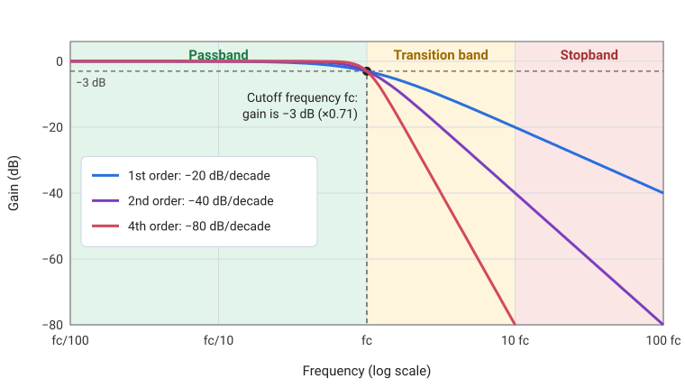
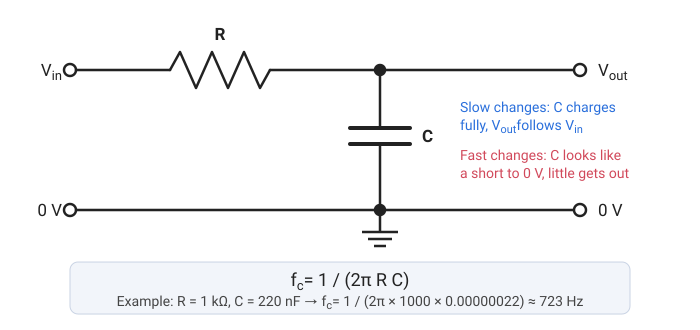

<head>
    <script type="application/ld+json">
        {JSON.stringify({
            "@context": "https://schema.org",
            "@type": "FAQPage",
            "mainEntity": [
                {
                    "@type": "Question",
                    "name": "What does a low-pass filter do?",
                    "acceptedAnswer": { "@type": "Answer", "text": "A low-pass filter lets slow changes in a signal through and reduces fast ones. Frequencies below its cutoff pass almost unchanged, and frequencies above it are made smaller, more so the higher they are. The result is a smoother signal: hiss, hum, jitter and sensor noise are reduced, while the underlying trend is kept." }
                },
                {
                    "@type": "Question",
                    "name": "How do you calculate the cutoff frequency of a low-pass filter?",
                    "acceptedAnswer": { "@type": "Answer", "text": "For a resistor-capacitor (RC) low-pass filter, the cutoff frequency is fc = 1 / (2πRC), with R in ohms, C in farads and fc in hertz. For example, 1 kΩ and 220 nF give 1 / (2π × 1000 × 0.00000022), which is about 723 Hz. At that frequency the output is 3 dB down, about 71% of the input amplitude." }
                },
                {
                    "@type": "Question",
                    "name": "What is the difference between a low-pass and a high-pass filter?",
                    "acceptedAnswer": { "@type": "Answer", "text": "A low-pass filter keeps frequencies below its cutoff and reduces those above it, so it smooths a signal. A high-pass filter does the opposite: it keeps frequencies above its cutoff and removes slow changes such as drift or a DC offset. Using one after the other gives a band-pass filter." }
                },
                {
                    "@type": "Question",
                    "name": "Is a moving average a low-pass filter?",
                    "acceptedAnswer": { "@type": "Answer", "text": "Yes. A moving average replaces each sample with the mean of the last M samples, which is a simple FIR low-pass filter. It is the optimal filter for reducing random white noise while keeping the sharpest step response, but it is a poor frequency separator: its response has ripples above the cutoff that let some high frequencies through." }
                },
                {
                    "@type": "Question",
                    "name": "What is a Butterworth low-pass filter?",
                    "acceptedAnswer": { "@type": "Answer", "text": "A Butterworth low-pass filter has the flattest possible passband, with no ripple and a gain of −3 dB at the cutoff whatever its order. Above the cutoff its gain falls by 20 dB per decade for each order, so a 4th-order Butterworth falls at 80 dB per decade." }
                },
                {
                    "@type": "Question",
                    "name": "How do I make a low-pass filter in JavaScript?",
                    "acceptedAnswer": { "@type": "Answer", "text": "For a simple low-pass filter, apply exponential smoothing to each sample: y = y + alpha × (x - y), with alpha between 0 and 1. For a sharper filter, convolve the samples with a windowed-sinc kernel. In SciChart.js, put the raw samples in an XyDataSeries and wrap your filter in an XyCustomFilter, which recalculates as new data arrives; for a plain moving average, the built-in XyMovingAverageFilter does it with no code." }
                }
            ]
        })}
    </script>
</head>

# Low-Pass Filter

## What is a low-pass filter?

A **low-pass filter** (LPF, also written lowpass) is a filter that lets the low frequencies in a signal through and reduces the high ones. Slow changes pass almost untouched, while fast wiggles such as noise, hiss and hum are made smaller. The frequency where it starts to cut is the **cutoff frequency**.


*A noisy signal before and after a low-pass filter (top), and the filter's frequency response (bottom). [Try the interactive version](#how-to-build-a-low-pass-filter-in-javascript-react-or-angular).*

:::tip Key takeaways
- A low-pass filter keeps slow changes and removes fast ones: it smooths noise, hum and hiss.
- The cutoff frequency is where the output has dropped by 3 dB (half the power, about 71% of the amplitude). For an RC circuit, $f_c = 1/(2\pi RC)$.
- Above the cutoff, the gain falls by 20 dB per decade for each order of the filter.
- In code, the common types are the moving average, the windowed-sinc FIR and the single-pole IIR (exponential smoothing).
- Every causal low-pass filter delays the signal. Sharper filters usually delay it more.
:::

## How a low-pass filter works

Any signal can be thought of as a sum of sine waves at different frequencies (that's the idea behind the [Fourier transform](/learn/applications/signal-processing/fourier-transform/)). A low-pass filter scales each of those waves by a different amount: by almost exactly 1 at low frequencies, and by less and less as the frequency rises. The chart of that scaling against frequency is the filter's **frequency response**.



The terms you'll meet on every data sheet and filter design tool:

| Term | What it means |
| --- | --- |
| Passband | The low frequencies the filter lets through, ideally with a gain of 1 (0 dB) |
| Cutoff frequency ($f_c$) | The edge of the passband, usually where the gain is −3 dB: the output has half the power and about 71% of the amplitude of the input. Also called the corner or −3 dB frequency |
| Transition band | The frequencies between the passband and the stopband, where the gain is falling |
| Stopband | The high frequencies the filter is meant to block, reduced by at least a stated amount, such as −60 dB (0.1%) |
| Roll-off | How fast the gain falls above the cutoff, in dB per decade (each tenfold rise in frequency) or dB per octave (each doubling) |
| Order | How many energy-storing parts (capacitors, inductors) or feedback terms the filter has. Each order adds 20 dB per decade (about 6 dB per octave) of roll-off |

**Decibels** make the numbers easier to read: −3 dB is 71% of the amplitude, −20 dB is 10%, −40 dB is 1% and −60 dB is 0.1%. Gain in dB is $20 \log_{10}(A_{out}/A_{in})$.

An ideal low-pass filter would pass everything below the cutoff and nothing above it, a "brick wall". No real filter can, because that would need the filter to react to input it hasn't received yet. Real filters trade off three things: how steep the transition is, how flat the passband stays, and how much they delay and distort the signal's shape.

## What low-pass filters are used for

Common uses:

- audio: the low-pass control on a synthesiser or equaliser darkens the sound by removing treble; a subwoofer's crossover sends it only the bass, often below about 80 to 120 Hz;
- sensor smoothing: temperature, pressure, accelerometer and load-cell readings carry electrical noise that is much faster than the quantity being measured;
- anti-aliasing: before an analogue-to-digital converter samples a signal, a low-pass filter removes anything above half the sample rate (the [Nyquist frequency](/learn/applications/signal-processing/nyquist-and-aliasing/)), which would otherwise fold back as false low frequencies;
- downsampling: the same rule applies in software. Filter before you keep every Mth sample (see [decimation and anti-aliasing](/learn/big-data/downsampling/#downsampling-in-signal-processing-decimation-and-anti-aliasing));
- power supplies: an RC or LC filter smooths the ripple left after rectifying AC into DC;
- trading and analytics: a moving average of a price is a low-pass filter on the price series, showing the trend under the day-to-day swings;
- images: blurring is a two-dimensional low-pass filter, and some cameras put an optical low-pass filter in front of the sensor to prevent moiré patterns.

## The RC low-pass filter circuit

The simplest analogue low-pass filter is a resistor followed by a capacitor to ground: a **first-order RC filter**. A capacitor needs time to charge through the resistor. Slow changes give it that time, so the output follows the input. Fast changes don't, so the capacitor smooths them away.



### How to calculate the cutoff frequency

The cutoff frequency of an RC low-pass filter is:

$$
f_c = \frac{1}{2\pi R C}
$$

with $R$ in ohms, $C$ in farads and $f_c$ in hertz. $RC$ is the circuit's **time constant**, $\tau$: after a sudden step at the input, the output covers about 63% of the step in one time constant.

For example, with $R = 1\ \text{k}\Omega$ and $C = 220\ \text{nF}$:

$$
f_c = \frac{1}{2\pi \times 1000 \times 220 \times 10^{-9}} = \frac{1}{0.001382} \approx 723\ \text{Hz}
$$

The time constant is $1000 \times 220 \times 10^{-9} = 0.22$ ms. At a tenth of the cutoff (72 Hz) the gain is −0.04 dB, almost exactly 1. At the cutoff it is −3 dB. At ten times the cutoff (7.2 kHz) it is −20 dB, a tenth of the amplitude.

To work backwards from a cutoff you want, pick a convenient capacitor, then $R = 1/(2\pi f_c C)$. For 1 kHz with a 100 nF capacitor, $R = 1/(2\pi \times 1000 \times 10^{-7}) \approx 1.59\ \text{k}\Omega$. The nearest standard value of 1.5 kΩ gives about 1.06 kHz.

Some example pairs, worked out with the formula above:

| R | C | Time constant RC | Cutoff $f_c$ | Typical use |
| --- | --- | --- | --- | --- |
| 10 kΩ | 1.5 µF | 15 ms | 10.6 Hz | Smoothing a slow sensor |
| 10 kΩ | 100 nF | 1 ms | 159 Hz | Removing audio-band noise from a slow control or sensor signal (mains hum at 50 or 60 Hz still gets through) |
| 1 kΩ | 220 nF | 0.22 ms | 723 Hz | The worked example |
| 1.6 kΩ | 10 nF | 16 µs | 9.95 kHz | Taming hiss on a voice or audio line |
| 330 Ω | 22 nF | 7.3 µs | 21.9 kHz | Just above the range of human hearing |

The live demo [below](#how-to-build-a-low-pass-filter-in-javascript-react-or-angular) has a small low-pass filter calculator: type R and C, and it works out $f_c$ and can apply it as the cutoff of a digital filter.

### The RC filter's transfer function

A filter's **transfer function**, $H$, is the ratio of output to input at each frequency. For the RC low-pass filter, written with the Laplace variable $s$:

$$
H(s) = \frac{1}{1 + sRC}
$$

Its size (magnitude) and phase at a frequency $f$ are:

$$
|H(f)| = \frac{1}{\sqrt{1 + (f/f_c)^2}}, \qquad \varphi(f) = -\arctan(f/f_c)
$$

At $f = f_c$, the magnitude is $1/\sqrt{2} \approx 0.707$ (−3 dB) and the output lags the input by 45°. Far above the cutoff, doubling the frequency halves the output: −6 dB per octave, or −20 dB per decade. Plotted on log axes, gain and phase against frequency make a [Bode plot](/learn/applications/signal-processing/bode-plot/), the usual way to show a filter's response.

## First-order, second-order and Butterworth low-pass filters

A first-order filter's gentle 20 dB per decade often isn't enough. If the noise is only five times the cutoff frequency, a first-order filter reduces it to about 20% (−14 dB). Higher orders roll off faster:

- **Second-order** filters (an RLC circuit, or an active filter built around an op-amp) fall at 40 dB per decade. They have a **quality factor**, Q, which sets how sharp the corner is: a high Q gives a peak just before the cutoff.
- **Butterworth** filters have the flattest possible passband, with no ripple, for a given order, and are −3 dB at the cutoff whatever the order. A 2nd-order Butterworth filter is a second-order filter with $Q \approx 0.707$. For the formula and how to choose the order, see [what is a Butterworth filter?](/learn/applications/signal-processing/fir-vs-iir-filters/#what-is-a-butterworth-filter)
- **Chebyshev** and **elliptic** filters accept ripple in the passband or stopband in return for a steeper transition.
- **Bessel** filters roll off more gently but delay all low frequencies by nearly the same time, so a pulse or step keeps its shape.

Stacking two identical first-order RC stages (with a buffer between them) does not give a second-order filter with the same cutoff: their −3 dB point moves down to about 0.64 $f_c$, because each stage is already −3 dB at $f_c$.

## Types of digital low-pass filter

In software, a filter works on samples taken at a **sample rate**, $f_s$. The cutoff must be below half the sample rate. Most digital low-pass filters fall into two families:

- **FIR (finite impulse response)** filters compute each output as a weighted sum of the latest inputs. The list of weights is the filter's **kernel**, and applying it is a [convolution](/learn/applications/signal-processing/convolution/). FIR filters are always stable and, with a symmetric kernel, delay every frequency by the same time.
- **IIR (infinite impulse response)** filters also feed back their own previous outputs. They reach a given sharpness with far fewer calculations, but delay different frequencies by different amounts.

### Moving average filter

The **moving average** is the simplest FIR low-pass filter: each output is the mean of the last $M$ inputs.

$$
y[n] = \frac{1}{M} \sum_{k=0}^{M-1} x[n-k]
$$

Its −3 dB cutoff is close to $0.443 \, f_s / M$, so a longer average gives a lower cutoff. It reduces random noise very well while keeping steps sharp. In the frequency domain it is a weak filter, though: its response has lobes above the cutoff, with nulls at multiples of $f_s/M$, so some high frequencies leak through.

### Windowed-sinc FIR filter

The ideal brick-wall low-pass filter has an impulse response shaped like a **sinc function**, $\sin(x)/x$. It goes on for ever in both directions, so a **windowed-sinc** filter cuts it to $M+1$ points and tapers the ends with a window (such as Blackman or Hamming). For a cutoff $f_c$ given as a fraction of the sample rate:

$$
h[i] = \frac{\sin\big(2\pi f_c (i - M/2)\big)}{i - M/2} \, w[i], \qquad i = 0 \dots M
$$

then the weights are scaled to add up to 1. The transition band is roughly $4/M$ of the sample rate wide with a Blackman window, so a longer kernel gives a sharper filter. Its stopband can be very deep: with a Blackman window, below −70 dB. It costs $M+1$ multiplications per sample and $M/2$ samples of delay.

### Single-pole IIR filter (exponential smoothing)

The single-pole filter is the digital twin of the RC circuit. Each output moves a fraction $\alpha$ of the way from the previous output towards the new input:

$$
y[n] = y[n-1] + \alpha \big(x[n] - y[n-1]\big), \qquad \alpha \approx 1 - e^{-2\pi f_c / f_s}
$$

It is also called **exponential smoothing** or an exponential moving average (EMA). Written this way, it takes one multiplication per sample and one stored value, which makes it the usual choice on microcontrollers and for live data. Like the RC circuit, it rolls off at about 20 dB per decade.

### Butterworth and other digital IIR filters

Higher-order analogue designs such as Butterworth, Chebyshev and Bessel can be turned into digital IIR filters, usually with the **bilinear transform**, a substitution that maps the analogue filter's frequency axis onto the digital one. They are normally built as a chain of second-order sections (**biquads**, small IIR filters with two feedback terms each), which keeps them numerically stable. A 4th-order digital Butterworth filter uses two biquads, about ten multiplications per sample, to get a roll-off a short FIR filter can't match. For both designs side by side, see [FIR vs IIR filters](/learn/applications/signal-processing/fir-vs-iir-filters/).

## Which low-pass filter should you use?

Use a moving average for quick smoothing, a single-pole filter for live data on little hardware, and a windowed-sinc or Butterworth filter when the cutoff has to be sharp.

| Filter | Type | Roll-off and stopband | Delay | Best for |
| --- | --- | --- | --- | --- |
| RC circuit | Analogue, 1st order | 20 dB/decade | Phase lag, 45° at $f_c$ | Anti-aliasing before an ADC, simple hardware smoothing |
| Moving average | FIR | Weak: lobes let some high frequencies through | $(M-1)/2$ samples | Smoothing noisy data while keeping steps sharp; easiest to explain |
| Windowed-sinc | FIR | Sharp, with a stopband below −70 dB | $M/2$ samples, the same for every frequency | Separating close frequencies; offline analysis where delay doesn't matter |
| Single pole (EMA) | IIR, 1st order | About 20 dB/decade | Small at low frequencies | Live data, microcontrollers, trends with little lag |
| Butterworth | Analogue or IIR, any order | 20 dB/decade per order, flat passband | Grows with order; not the same for every frequency | A general-purpose sharp filter with little computation |
| Bessel | Analogue or IIR | Gentle | Nearly the same for every low frequency | Pulses and waveforms whose shape must be kept |

## Delay and phase lag

A low-pass filter that runs in real time can only use samples it has already seen, so it always lags the input. The smoother or sharper you make it, the more past samples it relies on, and the longer the lag.

For the demo's settings (a 500 Hz sample rate, a cutoff of 10 Hz and 50 Hz mains hum), the three digital filters compare like this:

| Filter at a 10 Hz cutoff | Delay | Gain at 50 Hz (the hum) |
| --- | --- | --- |
| 22-point moving average | 21 ms | −21 dB (about 9% left) |
| 201-tap windowed-sinc | 200 ms | Below −70 dB (gone) |
| Single pole, $\alpha = 0.118$ | 15 ms at low frequencies | −14 dB (about 20% left) |

The windowed-sinc filter removes the hum completely but is ten times slower to respond than the others. That's fine when you analyse a recording, and a problem in a control loop or an alarm. Offline, you can remove the delay altogether: shift a symmetric FIR filter's output back by $M/2$ samples, or run any filter forwards and then backwards over the data (zero-phase filtering).

## Low-pass vs high-pass filter

A [high-pass filter](/learn/applications/signal-processing/high-pass-filter/) is the mirror image of a low-pass filter.

| | Low-pass filter | High-pass filter |
| --- | --- | --- |
| Passes | Frequencies below the cutoff | Frequencies above the cutoff |
| Removes | Noise, hiss, hum and fast jitter | Drift, DC offset and slow wander |
| RC circuit | Resistor in series, capacitor to ground | Capacitor in series, resistor to ground |
| Effect on a signal | Smooths it | Keeps the detail and centres it on zero |
| Typical use | Sensor smoothing, anti-aliasing, a subwoofer feed | Removing baseline drift, tweeter feeds, AC coupling |

Put one after the other and you get a [band-pass filter](/learn/applications/signal-processing/band-pass-filter/), which keeps only the band between the two cutoffs. To see what a filter does to each frequency in a real signal, compare its spectrum before and after with an [FFT](/learn/applications/signal-processing/fast-fourier-transform/).

## Common low-pass filter mistakes

Most low-pass mistakes are about where the cutoff sits and what the filter's delay does to the data.

- **Setting the cutoff at the noise frequency.** At the cutoff, 71% of the amplitude still gets through. Put the cutoff well below the noise, so the noise falls in the stopband, and check the gain there.
- **Forgetting the delay.** A heavily smoothed reading is an old reading. In control loops, alarms and live dashboards, choose the lowest-lag filter that removes enough noise.
- **Using a moving average to remove a specific frequency.** Its lobes leak. Unless the unwanted frequency sits exactly on one of its nulls, a windowed-sinc or Butterworth filter removes it far better.
- **Downsampling without filtering first.** Keeping every Mth sample folds high frequencies down into false slow waves (aliasing). Low-pass filter below the new Nyquist frequency first.
- **Mixing up frequency units.** Digital filter tools may want the cutoff in hertz, as a fraction of the sample rate, or as a fraction of half the sample rate. A cutoff out by a factor of two is a common bug.
- **Ignoring what's connected to an RC filter.** A load resistance in parallel with the capacitor, or the resistance of the source driving it, shifts the cutoff. Buffer the output with an op-amp when it matters.
- **Starting from zero.** A filter whose memory starts at zero makes a false ramp at the start of the data. Start it from the first sample, as the demo does.

## How to build a low-pass filter in JavaScript, React or Angular

The demo applies a moving average, a windowed-sinc or a single-pole filter to 2 seconds of a 500 Hz-sampled signal with 50 Hz hum, and recomputes the output and the frequency response each time you change the cutoff. Choose a filter type, drag the cutoff and watch the orange line and the frequency response change. Try the RC calculator and **Use as cutoff**. Hover to read values, scroll to zoom, drag to pan, and double-click to reset.

<LiveDocSnippet maxWidth={'100%'} height={720} name="./Basic/demo" />

<LearnCta position="top" chart="low-pass filter" demo="trend-ma-ratio" demoLabel="trendline and moving average filters" docs="/2d-charts/chart-types/data-filters-api/moving-average-filter/" docsLabel="SciChart.js moving average filter documentation" />

Here is the code for this chart. The live demo runs each filter on the chart's data with an `XyCustomFilter`; the React and Angular versions show the same pattern on live, streaming data, next to the built-in moving average:

<CodeSnippetBlock labels={["JavaScript", "React", "Angular"]}>
    ```ts showLineNumbers file=./Basic/demo.ts start=#region_A_start end=#region_A_end
    ```

    ```tsx
    import { SciChartReact } from "scichart-react";
    import {
        SciChartSurface,
        NumericAxis,
        EAutoRange,
        XyDataSeries,
        XyCustomFilter,
        XyMovingAverageFilter,
        FastLineRenderableSeries,
        LegendModifier,
        SciChartJsNavyTheme
    } from "scichart";

    // A single-pole low-pass filter as an XyCustomFilter filter function. SciChart.js calls it for each point
    // in index order: from 0 when it recalculates everything, and only for the new points when data is
    // appended, so it can carry its last output from one call to the next.
    const singlePoleLowPass = (cutoff: number, sampleRate: number) => {
        const alpha = 1 - Math.exp((-2 * Math.PI * cutoff) / sampleRate);
        let previous = 0;
        return (index: number, y: number) => {
            previous = index === 0 ? y : previous + alpha * (y - previous);
            return previous;
        };
    };

    // initChart builds the chart; SciChartReact creates it, sizes it and cleans it up
    const initChart = async (rootElement: string | HTMLDivElement) => {
        const { wasmContext, sciChartSurface } = await SciChartSurface.create(rootElement, {
            theme: new SciChartJsNavyTheme()
        });
        sciChartSurface.xAxes.add(new NumericAxis(wasmContext, { axisTitle: "Time (s)", autoRange: EAutoRange.Always }));
        sciChartSurface.yAxes.add(new NumericAxis(wasmContext, { axisTitle: "Amplitude", autoRange: EAutoRange.Always }));

        const sampleRate = 500; // samples per second
        const raw = new XyDataSeries(wasmContext, { dataSeriesName: "Raw" });
        // Your own low-pass filter, run by SciChart.js on the raw series
        const lowPass = new XyCustomFilter(raw, {
            filterFunction: singlePoleLowPass(10, sampleRate), // 10 Hz cutoff
            dataSeriesName: "Low-pass (single pole)"
        });
        // The zero-code option: a built-in moving average (22 points is about a 10 Hz cutoff at 500 samples/s)
        const movingAverage = new XyMovingAverageFilter(raw, { length: 22, dataSeriesName: "Moving average" });

        sciChartSurface.renderableSeries.add(
            new FastLineRenderableSeries(wasmContext, { dataSeries: raw, stroke: "#50C7E077" }),
            new FastLineRenderableSeries(wasmContext, { dataSeries: lowPass, stroke: "#F48420", strokeThickness: 3 }),
            new FastLineRenderableSeries(wasmContext, { dataSeries: movingAverage, stroke: "#68BCAE", strokeThickness: 3 })
        );
        sciChartSurface.chartModifiers.add(new LegendModifier());

        // Append new samples as they arrive: both filters update themselves
        const timer = setInterval(() => {
            const { time, values } = getYourNewSamples();
            raw.appendRange(time, values);
        }, 50);
        sciChartSurface.addDeletable({ delete: () => clearInterval(timer) });
        return { sciChartSurface };
    };

    export const LowPassFilterChart = () => (
        <SciChartReact initChart={initChart} style={{ width: "100%", height: 400 }} />
    );
    ```

    ```ts
    import { Component } from "@angular/core";
    import { ScichartAngularComponent } from "scichart-angular";
    import {
        SciChartSurface,
        NumericAxis,
        EAutoRange,
        XyDataSeries,
        XyCustomFilter,
        XyMovingAverageFilter,
        FastLineRenderableSeries,
        LegendModifier,
        SciChartJsNavyTheme
    } from "scichart";

    // A single-pole low-pass filter as an XyCustomFilter filter function. SciChart.js calls it for each point
    // in index order: from 0 when it recalculates everything, and only for the new points when data is
    // appended, so it can carry its last output from one call to the next.
    const singlePoleLowPass = (cutoff: number, sampleRate: number) => {
        const alpha = 1 - Math.exp((-2 * Math.PI * cutoff) / sampleRate);
        let previous = 0;
        return (index: number, y: number) => {
            previous = index === 0 ? y : previous + alpha * (y - previous);
            return previous;
        };
    };

    @Component({
        selector: "app-low-pass-filter-chart",
        standalone: true,
        imports: [ScichartAngularComponent],
        template: `<scichart-angular [initChart]="initChart" style="display: block; width: 100%; height: 400px"></scichart-angular>`
    })
    export class LowPassFilterChartComponent {
        // initChart builds the chart; scichart-angular creates it, sizes it and cleans it up
        initChart = async (rootElement: string | HTMLDivElement) => {
            const { wasmContext, sciChartSurface } = await SciChartSurface.create(rootElement, {
                theme: new SciChartJsNavyTheme()
            });
            sciChartSurface.xAxes.add(new NumericAxis(wasmContext, { axisTitle: "Time (s)", autoRange: EAutoRange.Always }));
            sciChartSurface.yAxes.add(new NumericAxis(wasmContext, { axisTitle: "Amplitude", autoRange: EAutoRange.Always }));

            const sampleRate = 500; // samples per second
            const raw = new XyDataSeries(wasmContext, { dataSeriesName: "Raw" });
            // Your own low-pass filter, run by SciChart.js on the raw series
            const lowPass = new XyCustomFilter(raw, {
                filterFunction: singlePoleLowPass(10, sampleRate), // 10 Hz cutoff
                dataSeriesName: "Low-pass (single pole)"
            });
            // The zero-code option: a built-in moving average (22 points is about a 10 Hz cutoff at 500 samples/s)
            const movingAverage = new XyMovingAverageFilter(raw, { length: 22, dataSeriesName: "Moving average" });

            sciChartSurface.renderableSeries.add(
                new FastLineRenderableSeries(wasmContext, { dataSeries: raw, stroke: "#50C7E077" }),
                new FastLineRenderableSeries(wasmContext, { dataSeries: lowPass, stroke: "#F48420", strokeThickness: 3 }),
                new FastLineRenderableSeries(wasmContext, { dataSeries: movingAverage, stroke: "#68BCAE", strokeThickness: 3 })
            );
            sciChartSurface.chartModifiers.add(new LegendModifier());

            // Append new samples as they arrive: both filters update themselves
            const timer = setInterval(() => {
                const { time, values } = getYourNewSamples();
                raw.appendRange(time, values);
            }, 50);
            sciChartSurface.addDeletable({ delete: () => clearInterval(timer) });
            return { sciChartSurface };
        };
    }
    ```
</CodeSnippetBlock>

Key points:

- Each filter is a **difference equation**, $y[n] = \sum_k b_k \, x[n-k] + a_1 \, y[n-1]$: a moving average and a windowed-sinc are just different weights $b$, and the single-pole filter adds the feedback term $a_1$.
- **Your own filter on live data:** an [XyCustomFilter](/2d-charts/chart-types/data-filters-api/custom-filter/) wraps a source `XyDataSeries` and calls your `filterFunction(index, y)` for each point, in index order. It starts from index 0 when it recalculates everything (when the series is created or `filterFunction` is set), and runs only the new points when data is appended. So the function can read earlier samples from the source series and keep the last output for the single-pole filter's feedback. In the demo, each control change sets a new `filterFunction`, and the chart redraws.
- **The zero-code option:** for a plain moving average, the built-in [XyMovingAverageFilter](/2d-charts/chart-types/data-filters-api/moving-average-filter/) takes your `XyDataSeries` and a `length`. It is a trailing average (the first `length − 1` points are left empty), it needs x values in ascending order, and it also updates itself as data is appended.
- The frequency response is calculated in plain JavaScript from the filter's weights. It uses a `LogarithmicAxis` for frequency and a gain axis in dB, the layout of a Bode plot; a `VerticalLineAnnotation` marks the cutoff and a `HorizontalLineAnnotation` marks −3 dB.

**See it in the demo app:** [JavaScript trendline and moving average filters](https://www.scichart.com/demo/javascript/trend-ma-ratio) · [React trendline and moving average filters](https://www.scichart.com/demo/react/trend-ma-ratio) · [Angular trendline and moving average filters](https://www.scichart.com/demo/angular/trend-ma-ratio), which uses the built-in moving average filter, the simplest low-pass. For a live signal and its spectrum, see the [JavaScript audio analyzer](https://www.scichart.com/demo/javascript/audio-analyzer-fft-example) · [React audio analyzer](https://www.scichart.com/demo/react/audio-analyzer-fft-example) · [Angular audio analyzer](https://www.scichart.com/demo/angular/audio-analyzer-fft-example).

**Go deeper:** [SciChart.js moving average filter documentation](/2d-charts/chart-types/data-filters-api/moving-average-filter/), [creating a custom filter](/2d-charts/chart-types/data-filters-api/custom-filter/), the [data filters API overview](/2d-charts/chart-types/data-filters-api/data-filters-api-overview/), and the next guides in this section: [high-pass filter](/learn/applications/signal-processing/high-pass-filter/), [convolution](/learn/applications/signal-processing/convolution/) and the [FFT](/learn/applications/signal-processing/fast-fourier-transform/).

## Frequently asked questions

### What does a low-pass filter do?

A low-pass filter lets slow changes in a signal through and reduces fast ones. Frequencies below its cutoff pass almost unchanged, and frequencies above it are made smaller, more so the higher they are. The result is a smoother signal: hiss, hum, jitter and sensor noise are reduced, while the underlying trend is kept.

### How do you calculate the cutoff frequency of a low-pass filter?

For a resistor-capacitor (RC) low-pass filter, the cutoff frequency is fc = 1 / (2πRC), with R in ohms, C in farads and fc in hertz. For example, 1 kΩ and 220 nF give 1 / (2π × 1000 × 0.00000022), which is about 723 Hz. At that frequency the output is 3 dB down, about 71% of the input amplitude.

### What is the difference between a low-pass and a high-pass filter?

A low-pass filter keeps frequencies below its cutoff and reduces those above it, so it smooths a signal. A high-pass filter does the opposite: it keeps frequencies above its cutoff and removes slow changes such as drift or a DC offset. Using one after the other gives a band-pass filter.

### Is a moving average a low-pass filter?

Yes. A moving average replaces each sample with the mean of the last M samples, which is a simple FIR low-pass filter. It is the optimal filter for reducing random white noise while keeping the sharpest step response, but it is a poor frequency separator: its response has ripples above the cutoff that let some high frequencies through.

### What is a Butterworth low-pass filter?

A Butterworth low-pass filter has the flattest possible passband, with no ripple and a gain of −3 dB at the cutoff whatever its order. Above the cutoff its gain falls by 20 dB per decade for each order, so a 4th-order Butterworth falls at 80 dB per decade.

### How do I make a low-pass filter in JavaScript?

For a simple low-pass filter, apply exponential smoothing to each sample: y = y + alpha × (x - y), with alpha between 0 and 1. For a sharper filter, convolve the samples with a windowed-sinc kernel. In SciChart.js, put the raw samples in an XyDataSeries and wrap your filter in an XyCustomFilter, which recalculates as new data arrives; for a plain moving average, the built-in XyMovingAverageFilter does it with no code.

## Sources

- Smith, S. W. (1997), [*The Scientist and Engineer's Guide to Digital Signal Processing*](https://www.dspguide.com/pdfbook.htm), California Technical Publishing. Chapters 14 (introduction to digital filters), 15 (moving average filters), 16 (windowed-sinc filters) and 19 (recursive filters, including the single-pole filter).
- Oppenheim, A. V. and Schafer, R. W. (2010), *Discrete-Time Signal Processing*, 3rd edition, Pearson. FIR and IIR filter design, and the bilinear transform.
- Butterworth, S. (1930), "On the Theory of Filter Amplifiers", *Experimental Wireless and the Wireless Engineer*, 7, pp. 536–541. The original maximally flat filter.
- Smith, J. O. (2007), [*Introduction to Digital Filters with Audio Applications*](https://ccrma.stanford.edu/~jos/filters/), Center for Computer Research in Music and Acoustics (CCRMA), Stanford University. Difference equations, transfer functions and frequency response.
- Oppenheim, A. V. (2011), [*Signals and Systems*, RES.6-007](https://ocw.mit.edu/courses/res-6-007-signals-and-systems-spring-2011/), MIT OpenCourseWare. Lectures on filtering, the frequency response and Butterworth filters.

<LearnCta position="bottom" chart="low-pass filter" demo="trend-ma-ratio" demoLabel="trendline and moving average filters" docs="/2d-charts/chart-types/data-filters-api/moving-average-filter/" docsLabel="SciChart.js moving average filter documentation" />
