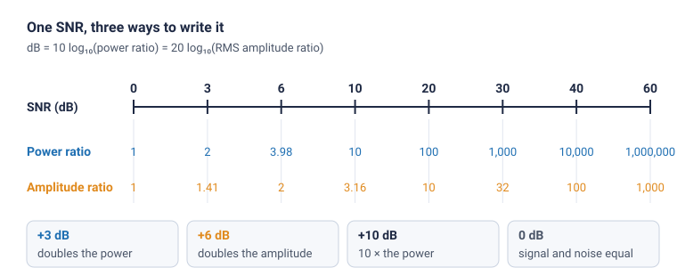

<head>
    <script type="application/ld+json">
        {JSON.stringify({
            "@context": "https://schema.org",
            "@type": "FAQPage",
            "mainEntity": [
                {
                    "@type": "Question",
                    "name": "What is a good signal-to-noise ratio?",
                    "acceptedAnswer": { "@type": "Answer", "text": "It depends on the job. A detail in an image needs an SNR of about 5 to be seen reliably (the Rose criterion). In analytical chemistry, a peak at 3:1 counts as detected and one at 10:1 can be quantified. An ideal 16-bit audio converter reaches about 98 dB. In general, higher is better, and the SNR only means something when its bandwidth and units are stated." }
                },
                {
                    "@type": "Question",
                    "name": "Is a higher or lower signal-to-noise ratio better?",
                    "acceptedAnswer": { "@type": "Answer", "text": "Higher is better. A high SNR means the signal is much stronger than the noise, so it is clean and easy to measure or decode. A low SNR means the noise is close to the signal, or stronger than it when the SNR is below 0 dB, so the signal is hard to detect without averaging, filtering or a more sensitive measurement." }
                },
                {
                    "@type": "Question",
                    "name": "How do you calculate SNR in dB?",
                    "acceptedAnswer": { "@type": "Answer", "text": "Work out the power ratio, signal over noise, then take 10 × log10 of it. If you have RMS voltages or amplitudes instead of powers, use 20 × log10 of their ratio. For example, a signal of 1 V RMS over noise of 10 mV RMS is an amplitude ratio of 100, which is 40 dB. To convert back, a power ratio is 10^(dB/10) and an amplitude ratio is 10^(dB/20)." }
                },
                {
                    "@type": "Question",
                    "name": "What is the difference between signal-to-noise ratio and noise-to-signal ratio?",
                    "acceptedAnswer": { "@type": "Answer", "text": "The noise-to-signal ratio is the inverse of the signal-to-noise ratio: noise power divided by signal power. An SNR of 100 is a noise-to-signal ratio of 0.01. In decibels only the sign changes, so an SNR of 20 dB is a noise-to-signal ratio of -20 dB. Lower is better for noise-to-signal ratio." }
                },
                {
                    "@type": "Question",
                    "name": "How does averaging improve the signal-to-noise ratio?",
                    "acceptedAnswer": { "@type": "Answer", "text": "When a signal repeats exactly and the noise in each repetition is random and independent, averaging M repetitions leaves the signal unchanged and divides the noise power by M. The SNR improves by M as a power ratio, or the square root of M in amplitude: 10 × log10(M) dB. Each doubling of the number of averages adds about 3 dB." }
                },
                {
                    "@type": "Question",
                    "name": "How do I calculate and plot SNR in JavaScript?",
                    "acceptedAnswer": { "@type": "Answer", "text": "Compute the power of each part as its mean square: the sum of the squared samples divided by their number. Measure the noise with the signal switched off, then SNR in dB = 10 × Math.log10(signalPower / noisePower). To plot the signal, its average and its spectrum, put the samples in XyDataSeries and draw them with FastLineRenderableSeries in SciChart.js, using a LogarithmicAxis for frequency." }
                }
            ]
        })}
    </script>
</head>

# Signal-to-Noise Ratio (SNR)

## What is signal-to-noise ratio?

**Signal-to-noise ratio** (SNR, also written S/N) is the power of a wanted signal divided by the power of the noise that comes with it. It says how clearly a signal stands out. It is usually given in decibels: 0 dB means the signal and noise are equally strong, and each extra 10 dB is ten times more signal power.


*A weak signal in noise before and after averaging (top), and its power spectrum with the signal peak and noise floor (bottom). [Try the interactive version](#how-to-measure-and-chart-snr-in-javascript-react-or-angular).*

:::tip Key takeaways
- SNR = signal power ÷ noise power. In decibels it is $10 \log_{10}(P_s/P_n)$, or $20 \log_{10}$ of a ratio of RMS amplitudes.
- Higher is better. 0 dB means equal power; a negative SNR means the noise is stronger than the signal.
- Noise power grows with bandwidth, so an SNR is only meaningful with its bandwidth stated. Filtering out unused bandwidth raises it.
- Averaging $M$ repeats of a signal improves the SNR by $10 \log_{10} M$ dB: about 3 dB per doubling.
- An ideal $N$-bit converter has an SNR of about $6.02N + 1.76$ dB.
:::

## The signal-to-noise ratio formula

As a plain ratio of powers:

$$
\text{SNR} = \frac{P_\text{signal}}{P_\text{noise}}
$$

Both powers must be measured in the same place, in the same units and over the same bandwidth. For a voltage, current or a list of samples, "power" means the **mean square**: square each value and take the average. Its square root is the **RMS** (root mean square) value.

Because SNRs range from below 1 to many millions, they are almost always written in **decibels** (dB):

$$
\text{SNR}_\text{dB} = 10 \log_{10}\!\left(\frac{P_s}{P_n}\right) = 20 \log_{10}\!\left(\frac{A_{s,\text{rms}}}{A_{n,\text{rms}}}\right)
$$

### Why 10 log for power and 20 log for amplitude?

The decibel is defined for power ratios, with a factor of 10. Power is proportional to amplitude squared, and $\log(x^2) = 2\log(x)$, so a ratio of RMS amplitudes (volts, pascals, pixel values) takes a factor of 20. Both forms give the same number of dB for the same situation: an amplitude ratio of 10 is a power ratio of 100, and both are 20 dB.



To go back from decibels to a ratio, undo the logarithm:

$$
\frac{P_s}{P_n} = 10^{\,\text{SNR}_\text{dB}/10}, \qquad \frac{A_s}{A_n} = 10^{\,\text{SNR}_\text{dB}/20}
$$

When both powers are already in dB units (dBm, dBV or dBFS), the SNR is a subtraction: a signal at −50 dBm over noise at −80 dBm has an SNR of 30 dB.

### Worked examples: how to calculate SNR

| You know | Working | SNR |
| --- | --- | --- |
| Signal power 2 mW, noise power 0.02 mW | $10 \log_{10}(2 / 0.02) = 10 \log_{10}(100)$ | 20 dB (power ratio 100) |
| Signal 1 V RMS, noise 10 mV RMS | $20 \log_{10}(1 / 0.01) = 20 \log_{10}(100)$ | 40 dB (amplitude ratio 100, power ratio 10,000) |
| Sine wave with a 0.5 V peak, noise 1 V RMS | Signal RMS is $0.5/\sqrt{2} = 0.354$ V, so $20 \log_{10}(0.354 / 1)$ | −9.0 dB (power ratio 0.125) |
| An SNR of 30 dB | Power ratio $10^{30/10}$, amplitude ratio $10^{30/20}$ | 1,000 : 1 in power, 31.6 : 1 in amplitude |
| Signal −50 dBm, noise floor −80 dBm | $-50 - (-80)$ | 30 dB |

### Noise-to-signal ratio and other forms

- **Noise-to-signal ratio** (NSR) is the inverse, $P_n/P_s$. In dB only the sign flips: an SNR of 20 dB is an NSR of −20 dB. Lower is better.
- **Mean over standard deviation.** For a signal that is a steady level, such as a pixel in an image or a repeated reading, SNR is often defined as $\mu/\sigma$: the mean divided by the standard deviation of the noise. It is an amplitude ratio, so it converts to dB with $20 \log_{10}$.
- **Peak instead of RMS.** Some fields (pulse detection, imaging, radar) use the peak signal rather than its RMS. A sine wave's peak is $\sqrt{2}$ times its RMS, so a peak-based SNR is about 3 dB higher. Say which you used.

## What is a good signal-to-noise ratio?

A high SNR means a clean signal that is easy to measure or decode. A low SNR means the noise is close to the signal, and below 0 dB it is stronger than the signal. Higher is better, but how much you need depends on the task. Published figures, each with its source:

| Field | Threshold | Where it comes from |
| --- | --- | --- |
| Seeing a detail in an image | SNR of about 5 (amplitude) | The Rose criterion (Rose, 1948) |
| Analytical chemistry, [chromatography](/learn/applications/chromatogram/) | 3 : 1 to detect a peak; at least 10 : 1 to quantify it | ICH Q2(R2) guideline: limit of detection (LOD) and limit of quantitation (LOQ) |
| An ideal 16-bit audio converter (CD) | 98 dB | $6.02 \times 16 + 1.76$ for a full-scale sine (Kester, MT-001) |
| An ideal 12-bit converter | 74 dB | The same formula |
| A data link at 0 dB SNR | Up to 1 bit per second per hertz of bandwidth | Shannon capacity, $\log_2(1 + 1)$ |

For Wi-Fi, cable modems and other digital links, the SNR needed rises with the data rate: each step up in modulation (for example from 64-QAM to 256-QAM) packs more bits into each symbol and needs a cleaner signal. Equipment makers publish the minimum SNR for each rate; use those figures for your hardware rather than a single "good" number.

## SNR in different fields

Each field defines signal and noise in its own way, so check the convention before comparing figures.

| Field | What "signal" and "noise" are | Usual form |
| --- | --- | --- |
| Audio and electronics | A reference tone (often full scale or 1 kHz) vs the noise with no input, over the audio band (20 Hz to 20 kHz), sometimes A-weighted | dB, power ratio. Often quoted with SINAD or THD+N (below) |
| Imaging and cameras | Mean pixel level vs the standard deviation of pixel noise (shot, read and dark noise) | $\mu/\sigma$, or dB with $20\log_{10}$ |
| Image and video compression | The largest possible pixel value vs the error after compression: peak signal-to-noise ratio (PSNR) | $\text{PSNR} = 10 \log_{10}(\text{MAX}^2/\text{MSE})$, with MAX = 255 for 8-bit images |
| Radio, Wi-Fi, cable and DSL | Received signal strength vs the noise floor in the channel's bandwidth | dB, often RSSI in dBm minus the noise floor in dBm. Cable modems report it per channel ("downstream SNR") |
| Chromatography and spectroscopy | Peak height vs the baseline noise next to it | A ratio such as 10 : 1. Conventions for measuring the noise (peak-to-peak or RMS) differ between pharmacopoeias, so state which |

Outside engineering, "signal-to-noise ratio" is also an idiom for how much useful information there is among the distraction around it, with no number attached.

## How to measure signal-to-noise ratio

There are two common ways.

### Method 1: signal on, signal off

Measure the RMS (or power) with the signal present, then again with the signal switched off but everything else the same, which gives the noise. Signal and noise powers add when the noise is uncorrelated, so:

$$
P_s = P_\text{on} - P_\text{off}, \qquad \text{SNR} = \frac{P_\text{on} - P_\text{off}}{P_\text{off}}
$$

When the SNR is high, the subtraction makes little difference; when it's near 0 dB, leaving it out overstates the SNR.

### Method 2: from a spectrum

Take an [FFT](/learn/applications/signal-processing/fast-fourier-transform/) or a [power spectral density](/learn/applications/signal-processing/power-spectral-density/) of the signal. The signal power is the sum of the bins in its peak. The noise power is the noise floor's density integrated over the bandwidth you care about:


$$
P_n = \int_{f_1}^{f_2} S_n(f)\, df \approx N_0 \times B
$$

where $S_n(f)$ is the noise PSD, $N_0$ its average level in units² per hertz, and $B = f_2 - f_1$ the bandwidth. A spectrum makes it easy to leave out hum, harmonics or interference you want to count separately (they belong in SINAD, below).

**Don't read the SNR off the height of the peak above the floor.** Each FFT bin holds only the noise in its own narrow band, so the floor drops 3 dB every time you double the FFT length, while a sine's peak stays put. With an $N$-point FFT, no window and a tone centred on a bin, the peak sits about $10 \log_{10}(N/2)$ dB further above the floor than the true SNR: 27 dB for a 1,024-point FFT. That gap is the FFT's **processing gain**. For example, one 1,024-point sweep of the −9 dB sine from the worked examples puts the peak about 18 dB above the floor: 27 dB higher than its true SNR.

## How to improve the signal-to-noise ratio

You can make the signal bigger, or the noise smaller.

### Narrow the bandwidth: noise power scales with bandwidth

For **white noise**, which has the same power in every hertz, noise power is proportional to bandwidth. Halve the bandwidth and you halve the noise power: +3 dB of SNR. Thermal (Johnson–Nyquist) noise in a resistor is the textbook case: its available power is $kTB$, about −174 dBm per hertz at room temperature (290 K), so a 20 MHz radio channel starts with a noise floor of about $-174 + 10\log_{10}(2 \times 10^7) \approx -101$ dBm before any amplifier adds more.

So the first step to a better SNR is to keep only the bandwidth the signal uses. A [low-pass filter](/learn/applications/signal-processing/low-pass-filter/) that cuts a 512 Hz band down to 50 Hz improves the SNR by $10\log_{10}(512/50) \approx 10$ dB, as long as the signal itself lies below 50 Hz. Cut into the signal and you lose signal power too. The same principle is behind the anti-aliasing filter before an analogue-to-digital converter: noise above the [Nyquist frequency](/learn/applications/signal-processing/nyquist-and-aliasing/) would otherwise fold down into the band you keep.

### Average repeated measurements: SNR grows with √M {#average-repeated-measurements-snr-grows-with-n}

When a signal repeats exactly (a triggered sweep, a stimulus and its response, an NMR or radar pulse) and the noise in each repeat is random and independent, averaging $M$ repeats keeps the signal the same and divides the noise power by $M$:

$$
\text{SNR}_M = M \times \text{SNR}_1 \quad\Longleftrightarrow\quad \text{SNR}_{M,\text{dB}} = \text{SNR}_{1,\text{dB}} + 10 \log_{10} M
$$

In amplitude, the noise RMS falls by $\sqrt{M}$. That's +3 dB for each doubling: 4 averages give +6 dB, 16 give +12 dB, 64 give +18 dB and 256 give +24 dB. The returns diminish, because each further 3 dB costs as many repeats as all the ones before.

Averaging only works if the repeats line up in time (they are **coherent**). Jitter in the trigger smears and shrinks the signal. Noise that is the same in every repeat, such as mains hum locked to the trigger, is not reduced at all. A **moving average** applies the same idea along a single record: averaging $M$ neighbouring samples reduces white noise by $\sqrt{M}$ in amplitude, at the cost of smoothing the signal.

### Other ways

- More signal: a stronger source, a more sensitive sensor, more light or a longer exposure, using the converter's full range.
- Less noise at the source: shielding, twisted pairs and short cables against interference; cooling a sensor to cut thermal and dark noise; a low-noise amplifier as the first stage, since the first stage's noise dominates.
- Correlation: when you know the shape of the signal, correlating against it (a matched filter) concentrates its energy and recovers signals far below the noise. Spread-spectrum radio and radar rely on this; see [autocorrelation](/learn/applications/signal-processing/autocorrelation/).

## SNR vs SINAD, THD+N, dynamic range and ENOB

Data sheets for converters, amplifiers and audio equipment quote several related figures. They differ in what counts as "noise":

| Figure | Ratio of | Includes harmonics and spurs? |
| --- | --- | --- |
| SNR | Signal power to noise power, excluding the harmonics of the test tone (and DC) | No |
| SINAD (signal-to-noise-and-distortion) | Signal power to everything else: noise plus distortion | Yes |
| THD+N | Everything except the signal, to the signal: the inverse of SINAD, often in % or as a negative dB value | Yes |
| Dynamic range | The largest signal the system can handle to its noise floor (or its smallest detectable signal) | Depends on the definition |
| SFDR (spurious-free dynamic range) | The signal to the largest single spur | Only the largest spur |
| ENOB (effective number of bits) | SINAD, expressed as the bits of an ideal converter with the same SINAD | Yes |

SNR describes an actual signal; dynamic range describes the system's limits. A recorder with 100 dB of dynamic range playing a quiet passage 40 dB below full scale gives at most about 60 dB of SNR.

**PSNR** (peak signal-to-noise ratio) compares the largest possible value, not the signal's actual power, with the mean squared error (MSE) between an original and a processed copy. It is the usual score for lossy image and video compression, and for comparing denoising methods.

### SNR of an ideal converter: 6.02N + 1.76 dB {#snr-of-an-ideal-converter}

Rounding a full-scale sine wave to $N$ bits adds quantisation noise, and the best SNR it can reach is:

$$
\text{SNR}_\text{ideal} \approx 6.02\,N + 1.76 \text{ dB}
$$

measured over the full band from 0 Hz to half the [sample rate](/learn/applications/signal-processing/nyquist-and-aliasing/). That's 74.0 dB for 12 bits, 98.1 dB for 16 bits and 146.2 dB for 24 bits. Real converters fall short, so their measured SINAD is turned into an **effective number of bits**:

$$
\text{ENOB} = \frac{\text{SINAD} - 1.76}{6.02}
$$

A 16-bit converter with a measured SINAD of 86 dB has an ENOB of about 14.0 bits. **Oversampling** helps for the bandwidth reason above: sampling 4 times faster than needed and filtering back to the original band spreads the same quantisation noise over 4 times the bandwidth, then removes three quarters of it, for +6 dB.

## SNR and channel capacity: the Shannon–Hartley theorem

SNR also sets the limit on how much data a channel can carry. Shannon showed that the maximum error-free data rate of a channel with bandwidth $B$ and white Gaussian noise is:

$$
C = B \log_2(1 + \text{SNR})
$$

with $C$ in bits per second, $B$ in hertz and SNR as a power ratio (not dB). A 20 MHz channel at 30 dB (a ratio of 1,000) can carry at most $20 \times 10^6 \times \log_2(1001) \approx 199$ Mbit/s. Doubling the bandwidth doubles the capacity, while doubling the SNR (+3 dB) adds only about one bit per second per hertz at high SNR. So faster Wi-Fi and cellular standards widen their channels and add antennas.

## Common SNR mistakes

Most SNR mistakes come from mixing power and amplitude, or from measuring signal and noise in different bandwidths.

- **Mixing power and amplitude dB.** Using $10\log_{10}$ on a voltage ratio halves the answer; using $20\log_{10}$ on a power ratio doubles it. Square amplitudes first, or use 20 log.
- **Not stating the bandwidth.** "SNR = 90 dB" means nothing without "over 20 Hz to 20 kHz" or "in a 1 Hz bin". The same system gives a different number in a different bandwidth.
- **Too short a measurement.** An SNR estimated from a few hundred noise samples can be out by about a third of a decibel (a standard error of about 0.34 dB from 300 samples of white noise), and by more if the noise isn't white. Average more data, or several measurements, before trusting the last decimal place.

## How to measure and chart SNR in JavaScript, React or Angular

The demo averages up to 256 one-second sweeps of 1,024 samples, takes the FFT of the average, and recomputes the SNR each time you move a slider. Choose a sine or a pulse, set the signal amplitude and noise level, and move the **Averages** slider: each doubling adds about 3 dB to the measured SNR in the readout. Then pick a **low-pass filter** to cut the bandwidth. On the spectrum, watch the noise floor fall while the signal peak stays put. Hover over the spectrum to read the floor and the peak; scroll to zoom, drag to pan, and double-click to reset.

<LiveDocSnippet maxWidth={'100%'} height={760} name="./Basic/demo" />

<LearnCta position="top" chart="signal-to-noise ratio chart" demo="audio-analyzer-fft-example" demoLabel="audio spectrum analyzer chart" docs="/2d-charts/chart-types/fast-line-renderable-series/" docsLabel="SciChart.js line series documentation" />

Here is the code. The live demo averages up to 256 sweeps of seeded noise, filters in the frequency domain with a radix-2 FFT and measures the SNR from the samples; the React and Angular versions show the core pattern with your own recorded sweeps:

<CodeSnippetBlock labels={["JavaScript", "React", "Angular"]}>
    ```ts showLineNumbers file=./Basic/demo.ts start=#region_A_start end=#region_A_end
    ```

    ```tsx
    import { SciChartReact } from "scichart-react";
    import {
        SciChartSurface,
        NumericAxis,
        XyDataSeries,
        FastLineRenderableSeries,
        LegendModifier,
        SciChartJsNavyTheme
    } from "scichart";

    // Power is the mean square of the samples; SNR in dB is 10 log10 of a power ratio
    const meanSquare = (values: number[]) => values.reduce((sum, v) => sum + v * v, 0) / values.length;
    const snrDb = (signalPower: number, noisePower: number) => 10 * Math.log10(signalPower / noisePower);

    // Coherent averaging: the mean of repeated, time-aligned sweeps of the same signal
    const averageSweeps = (sweeps: number[][]) =>
        sweeps[0].map((_, i) => sweeps.reduce((sum, sweep) => sum + sweep[i], 0) / sweeps.length);

    // initChart builds the chart; SciChartReact creates it, sizes it and cleans it up
    const initChart = async (rootElement: string | HTMLDivElement) => {
        // Your data: repeated sweeps of a signal, and one recording with the signal switched off
        const { time, sweeps, noiseOnly } = getYourSweeps();
        const noisePower = meanSquare(noiseOnly);
        const signalPower = meanSquare(sweeps[0]) - noisePower; // signal and noise powers add
        const rawSnr = snrDb(signalPower, noisePower);
        const averagedSnr = snrDb(signalPower, noisePower / sweeps.length); // independent noise power falls by N

        const { wasmContext, sciChartSurface } = await SciChartSurface.create(rootElement, {
            theme: new SciChartJsNavyTheme(),
            title: `SNR ${rawSnr.toFixed(1)} dB raw, ${averagedSnr.toFixed(1)} dB after ${sweeps.length} averages`
        });
        sciChartSurface.xAxes.add(new NumericAxis(wasmContext, { axisTitle: "Time (s)" }));
        sciChartSurface.yAxes.add(new NumericAxis(wasmContext, { axisTitle: "Amplitude" }));
        sciChartSurface.renderableSeries.add(
            new FastLineRenderableSeries(wasmContext, {
                dataSeries: new XyDataSeries(wasmContext, { xValues: time, yValues: sweeps[0], dataSeriesName: "One raw sweep" }),
                stroke: "#50C7E066"
            }),
            new FastLineRenderableSeries(wasmContext, {
                dataSeries: new XyDataSeries(wasmContext, { xValues: time, yValues: averageSweeps(sweeps), dataSeriesName: "Averaged" }),
                stroke: "#F48420",
                strokeThickness: 2
            })
        );
        sciChartSurface.chartModifiers.add(new LegendModifier({ showCheckboxes: true }));
        return { sciChartSurface };
    };

    export const SnrChart = () => <SciChartReact initChart={initChart} style={{ width: "100%", height: 400 }} />;
    ```

    ```ts
    import { Component } from "@angular/core";
    import { ScichartAngularComponent } from "scichart-angular";
    import {
        SciChartSurface,
        NumericAxis,
        XyDataSeries,
        FastLineRenderableSeries,
        LegendModifier,
        SciChartJsNavyTheme
    } from "scichart";

    // Power is the mean square of the samples; SNR in dB is 10 log10 of a power ratio
    const meanSquare = (values: number[]) => values.reduce((sum, v) => sum + v * v, 0) / values.length;
    const snrDb = (signalPower: number, noisePower: number) => 10 * Math.log10(signalPower / noisePower);

    // Coherent averaging: the mean of repeated, time-aligned sweeps of the same signal
    const averageSweeps = (sweeps: number[][]) =>
        sweeps[0].map((_, i) => sweeps.reduce((sum, sweep) => sum + sweep[i], 0) / sweeps.length);

    @Component({
        selector: "app-snr-chart",
        standalone: true,
        imports: [ScichartAngularComponent],
        template: `<scichart-angular [initChart]="initChart" style="display: block; width: 100%; height: 400px"></scichart-angular>`
    })
    export class SnrChartComponent {
        // initChart builds the chart; scichart-angular creates it, sizes it and cleans it up
        initChart = async (rootElement: string | HTMLDivElement) => {
            // Your data: repeated sweeps of a signal, and one recording with the signal switched off
            const { time, sweeps, noiseOnly } = getYourSweeps();
            const noisePower = meanSquare(noiseOnly);
            const signalPower = meanSquare(sweeps[0]) - noisePower; // signal and noise powers add
            const rawSnr = snrDb(signalPower, noisePower);
            const averagedSnr = snrDb(signalPower, noisePower / sweeps.length); // independent noise power falls by N

            const { wasmContext, sciChartSurface } = await SciChartSurface.create(rootElement, {
                theme: new SciChartJsNavyTheme(),
                title: `SNR ${rawSnr.toFixed(1)} dB raw, ${averagedSnr.toFixed(1)} dB after ${sweeps.length} averages`
            });
            sciChartSurface.xAxes.add(new NumericAxis(wasmContext, { axisTitle: "Time (s)" }));
            sciChartSurface.yAxes.add(new NumericAxis(wasmContext, { axisTitle: "Amplitude" }));
            sciChartSurface.renderableSeries.add(
                new FastLineRenderableSeries(wasmContext, {
                    dataSeries: new XyDataSeries(wasmContext, { xValues: time, yValues: sweeps[0], dataSeriesName: "One raw sweep" }),
                    stroke: "#50C7E066"
                }),
                new FastLineRenderableSeries(wasmContext, {
                    dataSeries: new XyDataSeries(wasmContext, { xValues: time, yValues: averageSweeps(sweeps), dataSeriesName: "Averaged" }),
                    stroke: "#F48420",
                    strokeThickness: 2
                })
            );
            sciChartSurface.chartModifiers.add(new LegendModifier({ showCheckboxes: true }));
            return { sciChartSurface };
        };
    }
    ```
</CodeSnippetBlock>

Key points:

- SNR from samples: power is the mean square, so `10 * Math.log10(signalPower / noisePower)` gives the SNR in dB. The demo measures the noise the "signal off" way: averaging and filtering are linear, so it processes the noise on its own and compares it with the processed clean signal.
- Two charts, one update: each control change clears and refills `XyDataSeries` with `appendRange` on both charts. The time chart uses `FastLineRenderableSeries` with a dashed line (`strokeDashArray`) for the clean signal.
- The spectrum uses a [LogarithmicAxis](/2d-charts/axis-api/axis-types/logarithmic-axis/) for frequency and a dB axis for power. A [HorizontalLineAnnotation](/2d-charts/annotations-api/horizontal-line-annotation/) marks the signal peak and the predicted noise floor, with live labels (`labelValue`), and a `VerticalLineAnnotation` marks the filter cutoff.
- The FFT, the brick-wall filter and the noise generator are plain JavaScript in the demo (a seeded random generator, so the chart is the same on every load). Swap in your own recorded sweeps to measure a real system.

**See it in the demo app:** [JavaScript audio spectrum analyzer chart](https://www.scichart.com/demo/javascript/audio-analyzer-fft-example) · [React audio spectrum analyzer chart](https://www.scichart.com/demo/react/audio-analyzer-fft-example) · [Angular audio spectrum analyzer chart](https://www.scichart.com/demo/angular/audio-analyzer-fft-example), a live audio waveform with its FFT spectrum and spectrogram. For a real-time medical signal, see the [JavaScript ECG chart](https://www.scichart.com/demo/javascript/vital-signs-ecg-medical-chart-example) · [React ECG chart](https://www.scichart.com/demo/react/vital-signs-ecg-medical-chart-example) · [Angular ECG chart](https://www.scichart.com/demo/angular/vital-signs-ecg-medical-chart-example).

**Go deeper:** [SciChart.js line series documentation](/2d-charts/chart-types/fast-line-renderable-series/), the [logarithmic axis](/2d-charts/axis-api/axis-types/logarithmic-axis/), [horizontal line annotations](/2d-charts/annotations-api/horizontal-line-annotation/), and the related guides in this section: [power spectral density](/learn/applications/signal-processing/power-spectral-density/), [FFT](/learn/applications/signal-processing/fast-fourier-transform/) and [low-pass filter](/learn/applications/signal-processing/low-pass-filter/).

## Frequently asked questions

### What is a good signal-to-noise ratio?

It depends on the job. A detail in an image needs an SNR of about 5 to be seen reliably (the Rose criterion). In analytical chemistry, a peak at 3:1 counts as detected and one at 10:1 can be quantified. An ideal 16-bit audio converter reaches about 98 dB. In general, higher is better, and the SNR only means something when its bandwidth and units are stated.

### Is a higher or lower signal-to-noise ratio better?

Higher is better. A high SNR means the signal is much stronger than the noise, so it is clean and easy to measure or decode. A low SNR means the noise is close to the signal, or stronger than it when the SNR is below 0 dB, so the signal is hard to detect without averaging, filtering or a more sensitive measurement.

### How do you calculate SNR in dB?

Work out the power ratio, signal over noise, then take 10 × log10 of it. If you have RMS voltages or amplitudes instead of powers, use 20 × log10 of their ratio. For example, a signal of 1 V RMS over noise of 10 mV RMS is an amplitude ratio of 100, which is 40 dB. To convert back, a power ratio is 10^(dB/10) and an amplitude ratio is 10^(dB/20).

### What is the difference between signal-to-noise ratio and noise-to-signal ratio?

The noise-to-signal ratio is the inverse of the signal-to-noise ratio: noise power divided by signal power. An SNR of 100 is a noise-to-signal ratio of 0.01. In decibels only the sign changes, so an SNR of 20 dB is a noise-to-signal ratio of -20 dB. Lower is better for noise-to-signal ratio.

### How does averaging improve the signal-to-noise ratio?

When a signal repeats exactly and the noise in each repetition is random and independent, averaging M repetitions leaves the signal unchanged and divides the noise power by M. The SNR improves by M as a power ratio, or the square root of M in amplitude: 10 × log10(M) dB. Each doubling of the number of averages adds about 3 dB.

### How do I calculate and plot SNR in JavaScript?

Compute the power of each part as its mean square: the sum of the squared samples divided by their number. Measure the noise with the signal switched off, then SNR in dB = 10 × Math.log10(signalPower / noisePower). To plot the signal, its average and its spectrum, put the samples in XyDataSeries and draw them with FastLineRenderableSeries in SciChart.js, using a LogarithmicAxis for frequency.

## Sources

- Smith, S. W. (1997), [*The Scientist and Engineer's Guide to Digital Signal Processing*](https://www.dspguide.com/pdfbook.htm), California Technical Publishing. Chapter 2 (noise, mean and standard deviation, SNR as mean over standard deviation) and chapter 15 (moving average filters: noise reduced by the square root of the number of points).
- Kester, W. (2009), [*Taking the Mystery out of the Infamous Formula, "SNR = 6.02N + 1.76dB"*](https://www.analog.com/media/en/training-seminars/tutorials/MT-001.pdf), tutorial MT-001, and [*Understand SINAD, ENOB, SNR, THD, THD + N, and SFDR*](https://www.analog.com/media/en/training-seminars/tutorials/MT-003.pdf), tutorial MT-003, Analog Devices.
- Shannon, C. E. (1949), "Communication in the Presence of Noise", *Proceedings of the IRE*, 37(1), pp. 10–21. Channel capacity in terms of bandwidth and SNR.
- Nyquist, H. (1928), "Thermal Agitation of Electric Charge in Conductors", *Physical Review*, 32, pp. 110–113, and Johnson, J. B. (1928), "Thermal Agitation of Electricity in Conductors", *Physical Review*, 32, pp. 97–109. Thermal noise power proportional to bandwidth.
- Rose, A. (1948), "The Sensitivity Performance of the Human Eye on an Absolute Scale", *Journal of the Optical Society of America*, 38(2), pp. 196–208. The SNR of about 5 needed to detect an object in an image.
- International Council for Harmonisation (2023), [*ICH Q2(R2): Validation of Analytical Procedures*](https://database.ich.org/sites/default/files/ICH_Q2%28R2%29_Guideline_2023_1130.pdf), section 3.2.3.2. A signal-to-noise ratio of 3:1 for the detection limit and at least 10:1 for the quantitation limit.
- Oppenheim, A. V. and Schafer, R. W. (2010), *Discrete-Time Signal Processing*, 3rd edition, Pearson. Quantisation noise, oversampling and spectrum analysis with the DFT.

<LearnCta position="bottom" chart="signal-to-noise ratio chart" demo="audio-analyzer-fft-example" demoLabel="audio spectrum analyzer chart" docs="/2d-charts/chart-types/fast-line-renderable-series/" docsLabel="SciChart.js line series documentation" />
