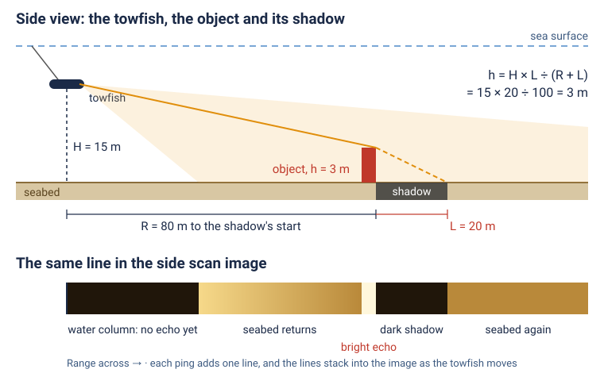

<head>
    <script type="application/ld+json">
        {JSON.stringify({
            "@context": "https://schema.org",
            "@type": "FAQPage",
            "mainEntity": [
                {
                    "@type": "Question",
                    "name": "What does sonar stand for?",
                    "acceptedAnswer": {
                        "@type": "Answer",
                        "text": "Sonar stands for sound navigation and ranging. It is the use of sound underwater to find, locate and identify objects, measure depth and navigate. The term was coined in the United States during the Second World War; earlier British equipment of the same kind was called ASDIC."
                    }
                },
                {
                    "@type": "Question",
                    "name": "How does sonar work?",
                    "acceptedAnswer": {
                        "@type": "Answer",
                        "text": "An active sonar sends a short pulse of sound, a ping, into the water and listens for echoes. Sound travels at about 1,500 m/s in seawater, so the time an echo takes to return gives the range: range equals speed times time divided by two, because the sound goes out and back. An echo after 0.4 seconds comes from 300 m away. The direction the echo arrives from gives the bearing."
                    }
                },
                {
                    "@type": "Question",
                    "name": "What is the difference between active and passive sonar?",
                    "acceptedAnswer": {
                        "@type": "Answer",
                        "text": "Active sonar transmits its own pulse and times the echo, so it measures range and bearing, but anyone listening can hear it. Passive sonar only listens for sound made by the target, such as engines and propellers. It is silent and hears far-off sources, but a single array gives only the bearing, so range has to be worked out from how the bearing changes over time."
                    }
                },
                {
                    "@type": "Question",
                    "name": "Can humans hear sonar?",
                    "acceptedAnswer": {
                        "@type": "Answer",
                        "text": "Some sonar is audible and some is not. People hear roughly 20 Hz to 20 kHz. Naval mid-frequency sonars work between 1 and 10 kHz, for example 2.6 and 3.3 kHz, so their pings are audible to a diver or through a hull. Fish finders and side scan sonars use 20 kHz up to 1 MHz or more, which is ultrasound, above human hearing."
                    }
                },
                {
                    "@type": "Question",
                    "name": "Is a pregnancy ultrasound scan the same as sonar?",
                    "acceptedAnswer": {
                        "@type": "Answer",
                        "text": "It uses the same principle. Medical ultrasound sends high-frequency sound into the body and builds an image from the echoes, as an active sonar does in water. It works at megahertz frequencies and over centimetres rather than kilometres, which is why the image is sometimes called a sonogram."
                    }
                },
                {
                    "@type": "Question",
                    "name": "How do I make a sonar display in JavaScript?",
                    "acceptedAnswer": {
                        "@type": "Answer",
                        "text": "Store echo strength in a 2D array with one row per range cell and one column per bearing, and draw it on a polar chart as a polar heatmap, with bearing on the angular axis and range on the radial axis. Update the columns the beam has just passed and redraw. For a passive waterfall, draw a normal heatmap with bearing across and time down, and add a new row at the top as data arrives. With SciChart.js, use a PolarUniformHeatmapRenderableSeries and a UniformHeatmapRenderableSeries."
                    }
                }
            ]
        })}
    </script>
</head>

# Sonar

## What is sonar?

**Sonar** (sound navigation and ranging) is the use of sound underwater to detect, locate and identify objects. An active sonar sends a pulse of sound and times its echo to find the range and bearing of whatever reflected it. A passive sonar only listens, for the noise that ships, submarines and animals make. Sound is used because light and radio waves fade within metres in seawater.


*A simulated scanning sonar picture (left) and passive sonar waterfall (right) from one stopped vessel. [Try the interactive version](#how-to-build-a-sonar-display-in-javascript-react-or-angular).*

:::tip Key takeaways
- Sonar finds things underwater with sound, because sound travels far in water and light and radio don't.
- Range = speed × time ÷ 2. At about 1,500 m/s in seawater, an echo after 0.4 s is 300 m away.
- Active sonar pings and measures range; passive sonar listens, stays silent and gives bearing only.
- Higher frequencies give sharper pictures over shorter ranges; lower frequencies reach further.
- Every sonar display is a map of echo strength or noise against range, bearing, depth or time: read the axes first.
:::

## What is sonar used for?

Sonar is the main way to see and measure anything under the water:

- Charting and survey. Echo sounders and multibeam sonars measure depth for nautical charts; side scan sonars image the seabed to find wrecks, rocks and other hazards.
- Navigation. Every ship's depth sounder is a simple sonar, and forward-looking sonars warn of shallow water ahead.
- Defence. Navies use active and passive sonar to detect and track submarines, and sonar on mine countermeasure vessels finds mines on the seabed.
- Fishing and fisheries science. Fish finders and scanning sonars show fish under and around a boat; research ships use calibrated echo sounders to estimate how many fish there are.
- Science and engineering. Sonar maps the deep ocean, tracks marine animals, guides underwater vehicles and inspects pipelines, dams and harbour walls.

Medical ultrasound uses the same pulse-echo principle inside the body: see [how ultrasound works and how to read an ultrasound image](/learn/applications/ultrasound/).

## How does sonar work?

An active sonar works in three steps:

1. A transducer, a device that turns an electrical signal into sound and back, sends a short pulse of sound into the water. This is the ping.
2. The pulse spreads out. Anything with a different density from the water, such as the seabed, a hull, a rock or a fish's air-filled swim bladder, reflects part of it back.
3. The transducer listens. The time the echo takes to return gives the range, and the direction it arrives from gives the bearing.

The sound goes out and back, so the range $R$ is half the distance the sound travels in the time $t$:

$$
R = \frac{c\,t}{2}
$$

where $c$ is the speed of sound in water. With $c$ = 1,500 m/s, an echo after 0.4 s comes from 300 m away, and one after 1 s from 750 m. A depth sounder in 40 m of water hears the bottom echo after 2 × 40 ÷ 1,500 = 0.053 s, or 53 ms.

The time to wait for each echo also limits how often a sonar can ping. A sonar looking out to 1,000 m must wait 2 × 1,000 ÷ 1,500 = 1.33 s before the next ping, or a late echo from the first ping would be mistaken for an early one from the second. A sonar that turns one narrow beam in 3° steps, one ping per step, would take 120 × 1.33 = 160 s to look all the way round, so modern scanning sonars form many beams at once.

### Speed of sound in water

Sound travels at about 1,500 m/s in seawater, roughly four and a half times faster than in air. The exact speed changes by a few per cent with three things:

| Factor | Effect on the speed of sound | Example (Mackenzie equation) |
| --- | --- | --- |
| Temperature | Up by about 4 m/s per °C in cold water, falling to about 2.5 m/s per °C in warm water | 1,490 m/s at 10 °C; 1,522 m/s at 20 °C (salinity 35, at the surface) |
| Salinity | Up by about 1.3 m/s per unit of salinity (parts per thousand) | Fresh water is slower than seawater at the same temperature |
| Depth (pressure) | Up by about 1.6 m/s per 100 m | 1,483 m/s at 1,000 m and 4 °C: the cold offsets the pressure |

Surveyors measure a sound speed profile, the speed at each depth, before they work. A sonar set to 1,500 m/s in water where sound really travels at 1,480 m/s puts a target 300 m away at 296 m, an error of 1.3%. Because the speed changes with depth, sound also bends (refracts) towards slower water, so beams curve and some regions, called shadow zones, receive almost no sound at all.

## Active vs passive sonar

Active sonar transmits and listens for echoes; passive sonar only listens.

| | Active sonar | Passive sonar |
| --- | --- | --- |
| How it works | Sends a ping and times the echo | Listens for sound the target makes: engines, propellers, pumps, whale calls |
| What it measures | Range and bearing directly | Bearing, and the sound's frequencies; range must be worked out |
| Can the target tell? | Yes: the ping can be heard further away than the echo can | No: it makes no sound |
| Range | Limited by the echo's two-way trip | Can hear loud sources a long way off |
| Main uses | Depth sounding, seabed mapping, fish finding, mine hunting, finding quiet submarines | Submarine and ship tracking, marine mammal research, monitoring underwater noise |

With passive sonar, one listening array hears bearings, not ranges. Operators find range and course by watching how the bearing changes over time as both vessels move, a process called target motion analysis (TMA), or by combining bearings from several arrays.

## Frequency, range and resolution

The frequency of a sonar sets how far it can see and how much detail it shows. Seawater absorbs sound more at higher frequencies, so high-frequency sonars have short ranges. But higher frequencies have shorter wavelengths ($\lambda = c/f$), which give narrower beams from a transducer of the same size and finer detail.

| Frequency | Wavelength at 1,500 m/s | Absorption in seawater (10 °C) | Typical use |
| --- | --- | --- | --- |
| 1 kHz | 1.5 m | 0.06 dB/km | Long-range naval passive and active sonar |
| 3.3 kHz | 45 cm | 0.2 dB/km | Naval hull-mounted mid-frequency sonar |
| 50 kHz | 3 cm | 16 dB/km | Fish finder wide beam; deep-water echo sounders |
| 200 kHz | 7.5 mm | 56 dB/km | Fish finder narrow beam; shallow-water survey |
| 500 kHz | 3 mm | 130 dB/km | Side scan sonar, high detail over about 100 m |

Two numbers follow from this:

- Beam width. A transducer of width $L$ gives a beam roughly $\lambda / L$ radians wide. A 15 cm transducer makes a beam about 3° wide at 200 kHz, but about 11° wide at 50 kHz. A narrow beam separates targets side by side.
- Range resolution. Two targets one behind the other show as separate echoes only if they are further apart than half the pulse length in the water, $c\tau/2$. A 1 ms pulse resolves 0.75 m; a 0.1 ms pulse resolves 7.5 cm. Modern sonars send frequency sweeps (chirps) and compress them, to get fine resolution from a long, powerful pulse.

## Types of sonar display

Every sonar display is a picture of signal strength, painted in colour or brightness, against two of range, bearing, depth and time. Reading the axes first tells you which display you're looking at.

| Display | Across | Down or around | Colour or brightness | Used for |
| --- | --- | --- | --- | --- |
| Scanning sonar (sector or plan position indicator, PPI) | Bearing, around a circle | Range, out from the centre | Echo strength | Seeing all round a vessel: fish, obstacles, other vessels |
| Side scan sonar | Range out to each side | Distance travelled, as the image scrolls | Echo strength | Pictures of the seabed: wrecks, rocks, debris, sediment |
| Echo sounder or fish finder | Time, scrolling | Depth | Echo strength | Depth, the bottom and fish under the boat |
| Bearing-time display (passive waterfall) | Bearing | Time, scrolling | Noise level | Tracking ships and submarines by the sound they make |
| Frequency-time display (LOFAR gram) | Frequency | Time, scrolling | Noise level | Identifying a source from its tones, such as propeller blade rate |

## How to read a scanning sonar display

A scanning sonar display is a plan view with your vessel at the centre. Bearing goes round the circle, with 000° at the bow on a head-up display, and range goes outwards; the circles are range rings. A line turns round the screen like a clock hand. This line is the beam. As it passes each bearing, the sonar paints the echoes it has just heard along that line, and older returns fade, so you see one complete picture that updates bearing by bearing. The live example [below](#how-to-build-a-sonar-display-in-javascript-react-or-angular) works this way.

What targets look like:

- The seabed. A scanning sonar's beam is tilted slightly down, so it meets the bottom some distance out. Inside that range the water is dark; beyond it, the bottom shows as a broad band of returns, strongest where the beam first touches. If the seabed slopes, the band is nearer on the shallow side.
- A wreck or rock. A strong, compact echo, often with a dark patch behind it where its shadow hides the seabed.
- A fish school. A patchy cloud of weaker echoes in mid-water, which changes shape from sweep to sweep.
- A moving contact. A compact, strong echo that sits somewhere new on each sweep, leaving a fading trail behind it. A contact whose bearing stays the same while its range shrinks is heading for you, the same rule mariners use to judge risk of collision.

Close to the centre, a bright ring of clutter is surface reverberation: sound scattered back by waves and bubbles near the vessel. It hides small targets close in.

## How to read side scan sonar images

**Side scan sonar** sends a narrow, fan-shaped beam to one or both sides of a towfish (a streamlined body towed behind a ship) or a hull. Each ping returns one line of echoes across the track, from near to far; as the towfish moves, the lines stack up into an image of the seabed that looks like an aerial photograph lit from the side. Side scan works at high frequencies, typically 100 to 500 kHz, and up to about 1 MHz for the most detailed images.



Reading a side scan image:

- The dark strip down the middle is the water column: the time before the first echo from the seabed. Its width is the towfish's height above the bottom.
- Hard, rough and rising surfaces, such as rock, gravel, metal and slopes facing the towfish, return strong echoes. Mud and smooth sand return weak ones.
- Anything standing up from the seabed casts an acoustic shadow behind it, on the side away from the towfish, where no sound reaches. The shadow is often easier to spot than the object itself.
- The shadow gives the object's height. With the towfish $H$ above the seabed, an object at horizontal range $R$ casting a shadow $L$ long is $h = H L / (R + L)$ high. In the diagram, $15 \times 20 \div 100 = 3$ m. Survey agencies use shadow lengths this way to estimate the height of wrecks and obstructions.

Colour conventions differ: older paper records and some software show strong echoes as dark and shadows as light, while many modern displays show strong echoes bright. Check which before reading an image. Side scan doesn't measure depth; a multibeam echo sounder does that.

## How to read a passive sonar waterfall

A **bearing-time display**, often called a waterfall, is how a passive sonar operator follows ships and submarines by sound. Bearing runs across the screen and time runs down it: each new line, at the top, shows how much noise is arriving from every bearing right now, and older lines scroll down. A noise source draws a trace down the screen.

- A steady, vertical trace is a source whose bearing isn't changing: it's far away, or heading straight towards or away from you.
- A slanting trace is a source moving across your line of sight. The steeper the slant, the faster the bearing is changing.
- A trace that curves, slow then fast then slow, is a contact passing close by. Its bearing changes fastest at the closest point of approach. In the live example, a contact passing 350 m away at 3 m/s swings about 29° a minute as it passes, but less than 1° a minute when it's 2 km off.
- A wide, bright band astern is your own vessel's noise. That sector, called the baffles, is where a hull-mounted array is deaf, and contacts fade out as they enter it.

Usage varies: in some navy training material, "waterfall" means a frequency-time display for one beam, and the bearing-time plot is called a bearing time history. Both usually put the newest data at the top.

## How to read a fish finder

A fish finder is an echo sounder for anglers: it pings straight down and draws what it hears as a scrolling picture, with depth down the side and time across, newest on the right. Fish finders work at about 20 to 200 kHz; a lower frequency such as 50 kHz has a wider beam and reaches deeper, and 200 kHz has a narrower beam and shows more detail.


- The bottom is the brightest, most continuous line. A hard bottom such as rock returns a strong, thin line; a soft bottom such as mud returns a weaker, thicker one.
- Arches are fish. The beam is a cone, so the boat is a little further from a fish when it enters the edge of the cone than when it's straight below. The echo comes from slightly deeper at the start and end, so a fish passing through the beam draws an arch. A fish only partly in the beam, or a slow boat, draws half an arch or a line instead.
- Clouds and balls of echoes are schools of small fish. Fish finders see fish mostly by the air in their swim bladders.
- A faint copy of the bottom at twice the depth is the second bottom echo: the sound bounced off the bottom, then the surface, then the bottom again.
- A faint horizontal band in open water is often a thermocline, a layer where the temperature changes quickly, because the change in density scatters a little sound.
- Speckle near the top is surface clutter from waves, wake and bubbles.

## Common sonar artefacts and mistakes

Most misreadings of sonar come from echoes that are real but don't come from a target, or from a wrong setting.

- **Reading reverberation as a target.** Surface, volume and bottom reverberation are sound scattered back by waves, bubbles, plankton and the seabed. They fill the screen with speckle that can hide or mimic a small target. A real target is usually more compact, stronger and in the same place on the next ping.
- **Mistaking a dense layer of animals for the bottom.** A deep scattering layer, a band of small fish and plankton, can reflect enough sound to look like a false bottom. It moves up at night and down by day; the seabed doesn't.
- **Missing multipath echoes.** Sound can reach a target by more than one path, for example straight and via the surface. The same target then appears twice, or a second bottom appears at twice the depth.
- **Looking for the object instead of the shadow.** On side scan, a low object can be faint but its shadow clear. A shadow with no echo can also be a hollow in the seabed.
- **Using the wrong sound speed.** Range and depth are only as accurate as the speed of sound you use. Measure it, especially in fresh water, warm surface layers or estuaries.
- **Too much gain.** Turning up the gain fills the screen with noise and saturates strong echoes, so a fish school and the bottom merge into one blob. Most sonars add time-varied gain (TVG), which boosts later echoes to make up for spreading and absorption.
- **Forgetting the blind spots.** Passive arrays are deaf in their baffles, side scan sees nothing directly below the towfish, and a fish finder sees only the cone under the boat.

## How to build a sonar display in JavaScript, React or Angular

SciChart.js draws polar and Cartesian heatmaps with WebGL, so a scanning sonar display can repaint tens of thousands of cells every frame (90,000 in this example) and stay smooth. The example below simulates a stopped vessel with two sonars. On the left, an active scanning sonar paints echo strength by bearing and range as its beam sweeps round: a sloping seabed, a wreck with its shadow, a fish school, surface reverberation close in, and one submerged contact moving down the starboard side, which lands somewhere new on each sweep. On the right, a passive sonar waterfall shows the same contact as a curving trace, a distant ship on an almost steady bearing, and the vessel's own noise in the baffles astern.

All the data is simulated: there are no real vessels, places or systems here, and time is sped up so that each sweep stands for 30 seconds. Hover over either display for the bearing, range or time, the signal level and what it is. Scroll to zoom, drag to pan, double-click to reset, and press **Pause** to freeze the sweep.

<LiveDocSnippet maxWidth={'100%'} height={640} name="./Basic/demo" />

<LearnCta position="top" chart="sonar display" demo="polar-uniform-heatmap-chart" demoLabel="polar heatmap chart" docs="/2d-charts/chart-types/polar-uniform-heatmap-renderable-series/" docsLabel="SciChart.js polar heatmap documentation" />

Here is the code for this example. The sonar simulation is plain JavaScript; SciChart.js draws the polar heatmap, the sweep line and the waterfall. The React and Angular versions below draw a scanning sonar display from your own data.

<CodeSnippetBlock labels={["JavaScript", "React", "Angular"]}>
    ```ts showLineNumbers file=./Basic/demo.ts start=#region_A_start end=#region_A_end
    ```

    ```tsx
    import { SciChartReact } from "scichart-react";
    import {
        SciChartPolarSurface,
        PolarNumericAxis,
        EPolarAxisMode,
        EAutoRange,
        NumberRange,
        UniformHeatmapDataSeries,
        PolarUniformHeatmapRenderableSeries,
        HeatmapColorMap,
        SciChartJsNavyTheme,
        PolarMouseWheelZoomModifier,
        PolarPanModifier,
        PolarZoomExtentsModifier
    } from "scichart";

    // A scanning sonar display: echo strength by bearing (columns) and range (rows)
    const initChart = async (rootElement: string | HTMLDivElement) => {
        const { sciChartSurface, wasmContext } = await SciChartPolarSurface.create(rootElement, {
            theme: new SciChartJsNavyTheme()
        });
        // zValues[rangeIndex][bearingIndex], with the range step in metres
        const { zValues, rangeStep } = await getYourSonarData();
        const maxRange = zValues.length * rangeStep;

        sciChartSurface.xAxes.add(
            new PolarNumericAxis(wasmContext, {
                polarAxisMode: EPolarAxisMode.Angular,
                visibleRange: new NumberRange(0, 360),
                autoRange: EAutoRange.Never,
                startAngle: Math.PI / 2, // 0° at the top
                flippedCoordinates: true, // bearings increase clockwise
                autoTicks: false,
                majorDelta: 30
            })
        );
        sciChartSurface.yAxes.add(
            new PolarNumericAxis(wasmContext, {
                polarAxisMode: EPolarAxisMode.Radial,
                visibleRange: new NumberRange(0, maxRange),
                autoRange: EAutoRange.Never,
                startAngle: Math.PI / 2,
                labelPostfix: " m"
            })
        );
        sciChartSurface.renderableSeries.add(
            new PolarUniformHeatmapRenderableSeries(wasmContext, {
                dataSeries: new UniformHeatmapDataSeries(wasmContext, {
                    xStart: 0,
                    xStep: 360 / zValues[0].length,
                    yStart: 0,
                    yStep: rangeStep,
                    zValues
                }),
                colorMap: new HeatmapColorMap({
                    minimum: 0,
                    maximum: 40,
                    gradientStops: [
                        { offset: 0, color: "#0B1E3F" },
                        { offset: 0.5, color: "#3FBF7F" },
                        { offset: 0.75, color: "#F2D24B" },
                        { offset: 1, color: "#FFF4E6" }
                    ]
                })
            })
        );
        sciChartSurface.chartModifiers.add(
            new PolarMouseWheelZoomModifier(),
            new PolarPanModifier(),
            new PolarZoomExtentsModifier()
        );
        return { sciChartSurface };
    };

    // SciChartReact creates the chart, sizes it to its parent and cleans it up
    export const SonarDisplay = () => <SciChartReact initChart={initChart} style={{ width: "100%", height: 500 }} />;
    ```

    ```ts
    import { Component } from "@angular/core";
    import { ScichartAngularComponent } from "scichart-angular";
    import {
        SciChartPolarSurface,
        PolarNumericAxis,
        EPolarAxisMode,
        EAutoRange,
        NumberRange,
        UniformHeatmapDataSeries,
        PolarUniformHeatmapRenderableSeries,
        HeatmapColorMap,
        SciChartJsNavyTheme,
        PolarMouseWheelZoomModifier,
        PolarPanModifier,
        PolarZoomExtentsModifier
    } from "scichart";

    // A scanning sonar display: echo strength by bearing (columns) and range (rows)
    const initChart = async (rootElement: string | HTMLDivElement) => {
        const { sciChartSurface, wasmContext } = await SciChartPolarSurface.create(rootElement, {
            theme: new SciChartJsNavyTheme()
        });
        // zValues[rangeIndex][bearingIndex], with the range step in metres
        const { zValues, rangeStep } = await getYourSonarData();
        const maxRange = zValues.length * rangeStep;

        sciChartSurface.xAxes.add(
            new PolarNumericAxis(wasmContext, {
                polarAxisMode: EPolarAxisMode.Angular,
                visibleRange: new NumberRange(0, 360),
                autoRange: EAutoRange.Never,
                startAngle: Math.PI / 2, // 0° at the top
                flippedCoordinates: true, // bearings increase clockwise
                autoTicks: false,
                majorDelta: 30
            })
        );
        sciChartSurface.yAxes.add(
            new PolarNumericAxis(wasmContext, {
                polarAxisMode: EPolarAxisMode.Radial,
                visibleRange: new NumberRange(0, maxRange),
                autoRange: EAutoRange.Never,
                startAngle: Math.PI / 2,
                labelPostfix: " m"
            })
        );
        sciChartSurface.renderableSeries.add(
            new PolarUniformHeatmapRenderableSeries(wasmContext, {
                dataSeries: new UniformHeatmapDataSeries(wasmContext, {
                    xStart: 0,
                    xStep: 360 / zValues[0].length,
                    yStart: 0,
                    yStep: rangeStep,
                    zValues
                }),
                colorMap: new HeatmapColorMap({
                    minimum: 0,
                    maximum: 40,
                    gradientStops: [
                        { offset: 0, color: "#0B1E3F" },
                        { offset: 0.5, color: "#3FBF7F" },
                        { offset: 0.75, color: "#F2D24B" },
                        { offset: 1, color: "#FFF4E6" }
                    ]
                })
            })
        );
        sciChartSurface.chartModifiers.add(
            new PolarMouseWheelZoomModifier(),
            new PolarPanModifier(),
            new PolarZoomExtentsModifier()
        );
        return { sciChartSurface };
    };

    @Component({
        selector: "app-sonar-display",
        standalone: true,
        imports: [ScichartAngularComponent],
        // scichart-angular creates the chart, sizes it and cleans it up
        template: `<scichart-angular [initChart]="initChart" style="display: block; width: 100%; height: 500px"></scichart-angular>`
    })
    export class SonarDisplayComponent {
        initChart = initChart;
    }
    ```
</CodeSnippetBlock>

Key points:

- The scanning sonar is a `PolarUniformHeatmapRenderableSeries` on a `SciChartPolarSurface`. The angular `PolarNumericAxis` holds bearing, with `startAngle` and `flippedCoordinates` putting 000° at the top and increasing clockwise; the radial axis holds range, and its grid lines are the range rings.
- The sweep repaints only the columns the beam has passed, then calls `setZValues` once per frame; the fade is a per-column dimming by the time since the beam last passed.
- The sweep line is a two-point `PolarLineRenderableSeries`, moved by clearing and appending its data series.
- The waterfall is a `UniformHeatmapRenderableSeries` with a flipped y-axis, so the newest row is at the top; each new row is added to the front of the array and the oldest dropped.
- A `CustomChartModifier2D` converts the mouse position to bearing and range with the polar axis's `reverseTransform`, for the readout. The animation stops when the chart is deleted.

**See it in the demo app:** [JavaScript polar heatmap chart](https://www.scichart.com/demo/javascript/polar-uniform-heatmap-chart) · [React polar heatmap chart](https://www.scichart.com/demo/react/polar-uniform-heatmap-chart) · [Angular polar heatmap chart](https://www.scichart.com/demo/angular/polar-uniform-heatmap-chart). Related techniques: the [React heatmap chart](https://www.scichart.com/demo/react/heatmap-chart) and [React polar line chart](https://www.scichart.com/demo/react/polar-line-chart).

**Go deeper:** [SciChart.js polar heatmap documentation](/2d-charts/chart-types/polar-uniform-heatmap-renderable-series/), the [uniform heatmap](/2d-charts/chart-types/uniform-heatmap-renderable-series/uniform-heatmap-chart-type/), and the learning center guides to the [weather radar](/learn/applications/weather-radar/), [non-destructive testing](/learn/applications/non-destructive-testing/), which uses the same echo timing in steel, and the [heatmap](/learn/chart-types/cartesian/heatmap/). For the industry, see SciChart for [aerospace and defence](https://www.scichart.com/why-scichart-aerospace-defence/).

## Frequently asked questions

### What does sonar stand for?

Sonar stands for sound navigation and ranging. It is the use of sound underwater to find, locate and identify objects, measure depth and navigate. The term was coined in the United States during the Second World War; earlier British equipment of the same kind was called ASDIC.

### How does sonar work?

An active sonar sends a short pulse of sound, a ping, into the water and listens for echoes. Sound travels at about 1,500 m/s in seawater, so the time an echo takes to return gives the range: range equals speed times time divided by two, because the sound goes out and back. An echo after 0.4 seconds comes from 300 m away. The direction the echo arrives from gives the bearing.

### What is the difference between active and passive sonar?

Active sonar transmits its own pulse and times the echo, so it measures range and bearing, but anyone listening can hear it. Passive sonar only listens for sound made by the target, such as engines and propellers. It is silent and hears far-off sources, but a single array gives only the bearing, so range has to be worked out from how the bearing changes over time.

### Can humans hear sonar?

Some sonar is audible and some is not. People hear roughly 20 Hz to 20 kHz. Naval mid-frequency sonars work between 1 and 10 kHz, for example 2.6 and 3.3 kHz, so their pings are audible to a diver or through a hull. Fish finders and side scan sonars use 20 kHz up to 1 MHz or more, which is ultrasound, above human hearing.

### Is a pregnancy ultrasound scan the same as sonar?

It uses the same principle. Medical ultrasound sends high-frequency sound into the body and builds an image from the echoes, as an active sonar does in water. It works at megahertz frequencies and over centimetres rather than kilometres, which is why the image is sometimes called a sonogram.

### How do I make a sonar display in JavaScript?

Store echo strength in a 2D array with one row per range cell and one column per bearing, and draw it on a polar chart as a polar heatmap, with bearing on the angular axis and range on the radial axis. Update the columns the beam has just passed and redraw. For a passive waterfall, draw a normal heatmap with bearing across and time down, and add a new row at the top as data arrives. With SciChart.js, use a PolarUniformHeatmapRenderableSeries and a UniformHeatmapRenderableSeries.

## Sources

- NOAA Ocean Service, [What is sonar?](https://oceanservice.noaa.gov/facts/sonar.html) The name, and active and passive sonar.
- NOAA Ocean Exploration, [Sonar](https://oceanexplorer.noaa.gov/technology/sonar/sonar.html), [Side scan sonar](https://oceanexplorer.noaa.gov/technology/sonar/side-scan.html) and [Multibeam sonar](https://oceanexplorer.noaa.gov/technology/sonar/multibeam.html). How sonars work, side scan frequencies, two-way travel time.
- NOAA Office of Coast Survey (2020), [Field Procedures Manual](https://nauticalcharts.noaa.gov/publications/docs/standards-and-requirements/fpm/field_procedures_manual_2020.pdf), section 3.3.1. Side scan frequencies of 100 to 500 kHz, acoustic shadows and object heights from shadow lengths.
- Discovery of Sound in the Sea (DOSITS), University of Rhode Island: [speed of sound](https://dosits.org/tutorials/science/tutorial-speed), [reverberation](https://dosits.org/science/movement/how-does-sound-move/reverberation), [locating fish](https://dosits.org/people-and-sound/fishing/how-is-sound-used-to-locate-fish) and [mid-frequency active sonar](https://dosits.org/galleries/technology-gallery/locating-objects-using-sonar/mfa/).
- Mackenzie, K. V. (1981), [Nine-term equation for sound speed in the oceans](https://doi.org/10.1121/1.386920). *Journal of the Acoustical Society of America* 70(3), 807–812. The sound speeds in the table.
- Ainslie, M. A. and McColm, J. G. (1998), [A simplified formula for viscous and chemical absorption in sea water](https://doi.org/10.1121/1.421258). *Journal of the Acoustical Society of America* 103(3), 1671–1672. The absorption values in the frequency table.
- US Naval Academy and Federation of American Scientists, *Introduction to Naval Weapons Engineering*: [underwater acoustics](https://man.fas.org/dod-101/navy/docs/es310/uw_acous/uw_acous.htm) and [ASW systems](https://man.fas.org/dod-101/navy/docs/es310/asw_sys/asw_sys.htm). Bearing-time and waterfall displays, bearing rate and baffles.
- NOAA Ocean Exploration, [What is the deep scattering layer?](https://oceanexplorer.noaa.gov/facts/dsl.html) False bottoms and daily migration.
- Urick, R. J. (1983), *Principles of Underwater Sound*, 3rd edition. McGraw-Hill. The standard text on sonar equations, reverberation and propagation.

<LearnCta position="bottom" chart="sonar display" demo="polar-uniform-heatmap-chart" demoLabel="polar heatmap chart" docs="/2d-charts/chart-types/polar-uniform-heatmap-renderable-series/" docsLabel="SciChart.js polar heatmap documentation" />
