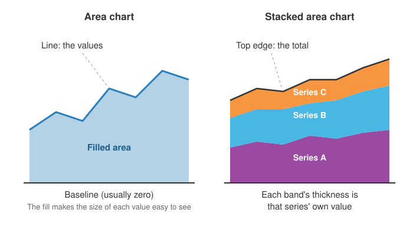

<head>
    <script type="application/ld+json">
        {JSON.stringify({
            "@context": "https://schema.org",
            "@type": "FAQPage",
            "mainEntity": [
                {
                    "@type": "Question",
                    "name": "What is an area chart used for?",
                    "acceptedAnswer": { "@type": "Answer", "text": "An area chart is used to show how a quantity changes over time when its size matters, such as revenue, website visitors, energy use or rainfall. Stacked area charts are used to show how several parts make up a changing total, for example visitors by device or sales by product line." }
                },
                {
                    "@type": "Question",
                    "name": "What is a stacked area chart?",
                    "acceptedAnswer": { "@type": "Answer", "text": "A stacked area chart draws several series as coloured bands piled on top of each other, each band starting where the one beneath it ends. The thickness of a band is that series' value, and the top edge of the whole stack is the total of all the series at that point in time." }
                },
                {
                    "@type": "Question",
                    "name": "How do you read a stacked area chart?",
                    "acceptedAnswer": { "@type": "Answer", "text": "Read the top edge of the stack for the total. Read the bottom band straight off the y-axis, because it sits on zero. For every band above it, measure its thickness, the distance between its lower and upper edges, not the height of its upper edge, which includes all the bands below." }
                },
                {
                    "@type": "Question",
                    "name": "What is the difference between an area chart and a line chart?",
                    "acceptedAnswer": { "@type": "Answer", "text": "Both show change over time. A line chart draws only the line, so it is clearer for comparing several series, and its y-axis can start at any value. An area chart fills the space under the line, which emphasises size and allows stacking to show a total, but its y-axis must start at zero." }
                },
                {
                    "@type": "Question",
                    "name": "What is a 100% stacked area chart?",
                    "acceptedAnswer": { "@type": "Answer", "text": "A 100% stacked area chart rescales each point in time so the stack always fills the chart from 0% to 100%. Each band then shows that series' share of the total rather than its actual value. It shows how the mix changes, but hides whether the total itself grew or shrank." }
                },
                {
                    "@type": "Question",
                    "name": "How do I make an area chart in JavaScript?",
                    "acceptedAnswer": { "@type": "Answer", "text": "With SciChart.js, create a SciChartSurface with an x-axis and a y-axis, then add a FastMountainRenderableSeries with an XyDataSeries holding your x and y values. For a stacked area chart, add one StackedMountainRenderableSeries per layer to a StackedMountainCollection. The same chart works in React with scichart-react and in Angular with scichart-angular." }
                }
            ]
        })}
    </script>
</head>

# Area Chart

## What is an area chart?

An **area chart** (also called an area graph or mountain chart) is a line chart with the space between the line and the horizontal axis filled with colour. It shows how a quantity changes over time, and the filled area makes its size easy to judge. A **stacked area chart** piles several series up to show a changing total.


*An area chart of daily website visitors over three months (sample data). [Try the interactive version](#how-to-create-an-area-chart-in-javascript-react-or-angular).*

:::tip Key takeaways
- An area chart is a **line chart with the area below the line filled in**, so it shows both the trend and the size of a value.
- Its y-axis must **start at zero**, because the filled area stands for the amount.
- A **stacked area chart** shows parts adding up to a total: read the **top edge for the total** and each **band's thickness** for its part.
- A **100% stacked area chart** shows each part's **share**, but hides whether the total grew.
- Keep stacks to **about five layers**, with the steadiest series at the bottom.
:::

## How to read an area chart



- **The x-axis** is usually time, running left to right.
- **The line along the top** of the coloured area is the value at each point, read just as you would read a [line graph](/learn/line-chart/).
- **The filled area** reaches down to the **baseline**, normally zero. Its height at any moment is the size of the value, so a taller area means more.
- **The shape tells the story.** Rising ground is growth, a peak is a high point, and a valley is a dip.
- **Check the y-axis starts at zero.** If it starts higher, the area no longer matches the amount and small changes look huge.

## Types of area chart

| Type | What it looks like | Use it for |
| --- | --- | --- |
| Area chart | One filled area under a line | The trend and size of a single value over time |
| Overlapping area chart | Two or three semi-transparent areas, each from zero | Comparing a couple of series; more becomes hard to read |
| [Stacked area chart](/2d-charts/chart-types/stacked-mountain-renderable-series/) | Bands piled on top of each other | How parts add up to a total over time, such as visitors by device |
| [100% stacked area chart](/2d-charts/chart-types/stacked-mountain-renderable-series/) | A stack rescaled so the top is always 100% | How each part's share of the total changes over time |
| [Step area chart](/2d-charts/chart-types/fast-mountain-area-digital-renderable-series/) | Flat runs and vertical jumps, filled underneath | Values that change suddenly and then hold, such as prices or capacity |
| [Smoothed (spline) area chart](/2d-charts/chart-types/spline-mountain-renderable-series/) | A curve instead of straight segments | A softer look; the curve between points is drawn, not measured |
| [Band chart](/2d-charts/chart-types/fast-band-renderable-series/) | The space between two lines filled | A range, such as a forecast's upper and lower limits |

## How to read a stacked area chart

The chart below stacks two years of monthly website visitors by device (sample data). Hover to see each layer's value, and use the legend to identify the layers.

<LiveDocSnippet maxWidth={'100%'} name="./Stacked/demo" />

1. **Read the total from the top edge.** The outline of the whole stack is the sum of all the layers.
2. **Read the bottom layer straight off the axis.** It sits on zero, like an ordinary area chart.
3. **Measure every other layer by its thickness.** The upper edge of the middle band includes everything beneath it, so it isn't that layer's value. Mobile's top edge here is desktop plus mobile.
4. **Watch for bands that widen or narrow.** A band getting thicker is a part that's growing, even if the total is flat.
5. **Hover or untick layers when you need exact values.** Bands in the middle of a stack are the hardest part of any area chart to judge by eye.

### How to describe a stacked area chart

Use this template, from the total down to the parts:

> The total **[rose / fell / held steady]** from **[start]** to **[end]**. **[Main part]** drove the change, **[growing / shrinking]** from **[x]** to **[y]**, while **[other parts]** **[changed how]**.

**Worked example,** using the chart above: "Total monthly visitors grew from 57,000 in January 2024 to 77,000 in December 2025. Mobile drove the growth, more than doubling from 20,000 to 43,000 and overtaking desktop in October 2024. Desktop drifted down from 30,000 to 26,000, and tablet stayed small and level at 6,000 to 8,000 a month."

## When to use an area chart

Use an area chart when the data is a **trend over time** and the **size** of the value, or how **parts make up a total**, matters as much as its direction.

| Your question | Best chart |
| --- | --- |
| How big is this value, and how has it changed? | **Area chart** |
| How has a total changed, and which parts drove it? | **Stacked area chart** |
| How has each part's share of the total changed? | **100% stacked area chart** |
| How do several series compare, precisely, or do they cross often? | [Line chart](/learn/line-chart/) |
| How do parts of a total compare for a few separate periods or categories? | [Stacked column chart](/2d-charts/chart-types/stacked-column-renderable-series/) |
| What share does each part have at a single moment? | [Pie chart](/learn/pie-chart/) |

**A quick test:** if your values can't sensibly be added together (temperatures, prices, averages, percentages of different things), don't stack them. Use a line chart instead.

## Stacked vs 100% stacked area chart

A 100% stacked area chart uses the same data as a stacked one, but rescales every point in time so the layers always fill the chart from 0% to 100%. The two answer different questions:

| | Stacked area chart | 100% stacked area chart |
| --- | --- | --- |
| The top edge shows | The real total | Always 100% |
| Each band shows | Its real value | Its share of the total |
| Best for | Growth in the total and in each part | Changes in the mix |
| Hides | Small changes in share | Whether the total grew or shrank |

Here is the visitors data from above as a 100% stacked area chart. Mobile's share rises from about 35% to 56%, and desktop's falls from 53% to 34%. What the chart no longer shows is that total visitors grew by about a third over the same two years.

<LiveDocSnippet maxWidth={'100%'} name="./PercentStacked/demo" />

## Common area chart mistakes

- **A y-axis that doesn't start at zero.** The filled area stands for the amount, so a cut-off axis exaggerates every change. A [line chart](/learn/line-chart/) can start anywhere; an area chart can't.
- **Reading a middle band's top edge as its value.** In a stack, only the bottom layer sits on zero. Measure the thickness of the others.
- **Stacking values that don't add up.** Averages, rates and temperatures make a meaningless total. Stack only counts and amounts.
- **Too many layers.** Beyond about five, thin bands become unreadable. Group the smallest into "Other".
- **A jumpy series at the bottom.** Every layer above inherits the bottom layer's ups and downs, so put the steadiest series at the bottom and the most variable at the top.
- **Opaque overlapping areas.** In an overlapping (not stacked) area chart, a solid front area hides the ones behind it. Use semi-transparent fills, or a line chart.
- **A 100% stack when the total matters.** If readers need to know whether the whole grew, use an ordinary stacked chart.
- **Few data points or categories on the x-axis.** A filled shape implies a continuous flow. For a handful of separate categories, use a [bar chart](/learn/bar-chart/).

## How to create an area chart in JavaScript, React or Angular

SciChart.js calls area charts **mountain charts** and draws them with WebGL and WebGPU, so they stay smooth to zoom and pan with large data sets and real-time updates. Try the chart below: scroll to zoom, drag to pan, double-click to reset, and hover to see the values.

<LiveDocSnippet maxWidth={'100%'} name="./Basic/demo" />

<LearnCta position="top" chart="area chart" demo="mountain-chart" docs="/2d-charts/chart-types/fast-mountain-area-renderable-series/" />

Here is the code for this chart:

<CodeSnippetBlock labels={["JavaScript", "React", "Angular"]}>
    ```ts showLineNumbers file=./Basic/demo.ts start=#region_A_start end=#region_A_end
    ```

    ```tsx
    import { SciChartReact } from "scichart-react";
    import {
        SciChartSurface,
        DateTimeNumericAxis,
        NumericAxis,
        FastMountainRenderableSeries,
        XyDataSeries,
        SciChartJsNavyTheme
    } from "scichart";

    // initChart builds the chart; SciChartReact creates it, sizes it and cleans it up
    const initChart = async (rootElement: string | HTMLDivElement) => {
        const { wasmContext, sciChartSurface } = await SciChartSurface.create(rootElement, {
            theme: new SciChartJsNavyTheme()
        });
        sciChartSurface.xAxes.add(new DateTimeNumericAxis(wasmContext));
        sciChartSurface.yAxes.add(new NumericAxis(wasmContext));

        const { xValues, yValues } = getYourXyData();
        sciChartSurface.renderableSeries.add(
            new FastMountainRenderableSeries(wasmContext, {
                dataSeries: new XyDataSeries(wasmContext, { xValues, yValues }),
                stroke: "#50C7E0",
                strokeThickness: 2,
                fill: "rgba(80, 199, 224, 0.5)",
                zeroLineY: 0
            })
        );
        return { sciChartSurface };
    };

    export const AreaChart = () => (
        <SciChartReact initChart={initChart} style={{ width: "100%", height: 400 }} />
    );
    ```

    ```ts
    import { Component } from "@angular/core";
    import { ScichartAngularComponent } from "scichart-angular";
    import {
        SciChartSurface,
        DateTimeNumericAxis,
        NumericAxis,
        FastMountainRenderableSeries,
        XyDataSeries,
        SciChartJsNavyTheme
    } from "scichart";

    @Component({
        selector: "app-area-chart",
        standalone: true,
        imports: [ScichartAngularComponent],
        template: `<scichart-angular [initChart]="initChart" style="display: block; width: 100%; height: 400px"></scichart-angular>`
    })
    export class AreaChartComponent {
        // initChart builds the chart; scichart-angular creates it, sizes it and cleans it up
        initChart = async (rootElement: string | HTMLDivElement) => {
            const { wasmContext, sciChartSurface } = await SciChartSurface.create(rootElement, {
                theme: new SciChartJsNavyTheme()
            });
            sciChartSurface.xAxes.add(new DateTimeNumericAxis(wasmContext));
            sciChartSurface.yAxes.add(new NumericAxis(wasmContext));

            const { xValues, yValues } = getYourXyData();
            sciChartSurface.renderableSeries.add(
                new FastMountainRenderableSeries(wasmContext, {
                    dataSeries: new XyDataSeries(wasmContext, { xValues, yValues }),
                    stroke: "#50C7E0",
                    strokeThickness: 2,
                    fill: "rgba(80, 199, 224, 0.5)",
                    zeroLineY: 0
                })
            );
            return { sciChartSurface };
        };
    }
    ```
</CodeSnippetBlock>

Key points:

- An [XyDataSeries](https://www.scichart.com/documentation/js/current/typedoc/classes/xydataseries.html) holds one x value and one y value per point.
- A [FastMountainRenderableSeries](https://www.scichart.com/documentation/js/current/typedoc/classes/fastmountainrenderableseries.html) draws the area. `stroke` sets the line colour, `fill` a solid fill and `fillLinearGradient` a gradient fill.
- `zeroLineY` sets the baseline the area is filled down to. Start the y-axis at zero too, as the JavaScript code above does with `visibleRange`, so the area is in proportion.
- For a **stacked area chart**, create one [StackedMountainRenderableSeries](https://www.scichart.com/documentation/js/current/typedoc/classes/stackedmountainrenderableseries.html) per layer, add them to a `StackedMountainCollection`, and add the collection to the chart. Set `isOneHundredPercent: true` on the collection for a 100% stacked area chart. This is the code for the stacked chart above:

```ts showLineNumbers file=./Stacked/demo.ts start=#region_A_start end=#region_A_end
```

**See it in the demo app:** [JavaScript area chart](https://www.scichart.com/demo/javascript/mountain-chart) · [React area chart](https://www.scichart.com/demo/react/mountain-chart) · [Angular area chart](https://www.scichart.com/demo/angular/mountain-chart)

**Stacked:** [JavaScript stacked area chart](https://www.scichart.com/demo/javascript/stacked-mountain-chart) · [React stacked area chart](https://www.scichart.com/demo/react/stacked-mountain-chart) · [Angular stacked area chart](https://www.scichart.com/demo/angular/stacked-mountain-chart)

**Go deeper:** [SciChart.js area chart documentation](/2d-charts/chart-types/fast-mountain-area-renderable-series/), including gradient fills and gaps, and the [SciChart.js stacked area chart documentation](/2d-charts/chart-types/stacked-mountain-renderable-series/), including 100% stacking.

## Frequently asked questions

### What is an area chart used for?

An area chart is used to show how a quantity changes over time when its size matters, such as revenue, website visitors, energy use or rainfall. Stacked area charts are used to show how several parts make up a changing total, for example visitors by device or sales by product line.

### What is a stacked area chart?

A stacked area chart draws several series as coloured bands piled on top of each other, each band starting where the one beneath it ends. The thickness of a band is that series' value, and the top edge of the whole stack is the total of all the series at that point in time.

### How do you read a stacked area chart?

Read the top edge of the stack for the total. Read the bottom band straight off the y-axis, because it sits on zero. For every band above it, measure its thickness, the distance between its lower and upper edges, not the height of its upper edge, which includes all the bands below.

### What is the difference between an area chart and a line chart?

Both show change over time. A line chart draws only the line, so it is clearer for comparing several series, and its y-axis can start at any value. An area chart fills the space under the line, which emphasises size and allows stacking to show a total, but its y-axis must start at zero.

### What is a 100% stacked area chart?

A 100% stacked area chart rescales each point in time so the stack always fills the chart from 0% to 100%. Each band then shows that series' share of the total rather than its actual value. It shows how the mix changes, but hides whether the total itself grew or shrank.

### How do I make an area chart in JavaScript?

With SciChart.js, create a `SciChartSurface` with an x-axis and a y-axis, then add a `FastMountainRenderableSeries` with an `XyDataSeries` holding your x and y values. For a stacked area chart, add one `StackedMountainRenderableSeries` per layer to a `StackedMountainCollection`. The same chart works in React with `scichart-react` and in Angular with `scichart-angular`.

## Sources

- Cleveland, W. S. and McGill, R. (1984), [Graphical perception: theory, experimentation, and application to the development of graphical methods](https://doi.org/10.1080/01621459.1984.10478080). *Journal of the American Statistical Association*, 79(387). Why values on a shared baseline (the bottom layer) are judged more accurately than values without one (the middle layers).
- Byron, L. and Wattenberg, M. (2008), [Stacked graphs: geometry and aesthetics](https://doi.org/10.1109/TVCG.2008.166). *IEEE Transactions on Visualization and Computer Graphics*, 14(6). How the order of layers and the choice of baseline change how readable a stacked area chart is.
- Wikipedia, [Area chart](https://en.wikipedia.org/wiki/Area_chart). Variants of the area chart, and William Playfair's early area charts of trade and national debt (1786).

<LearnCta position="bottom" chart="area chart" demo="mountain-chart" docs="/2d-charts/chart-types/fast-mountain-area-renderable-series/" />
