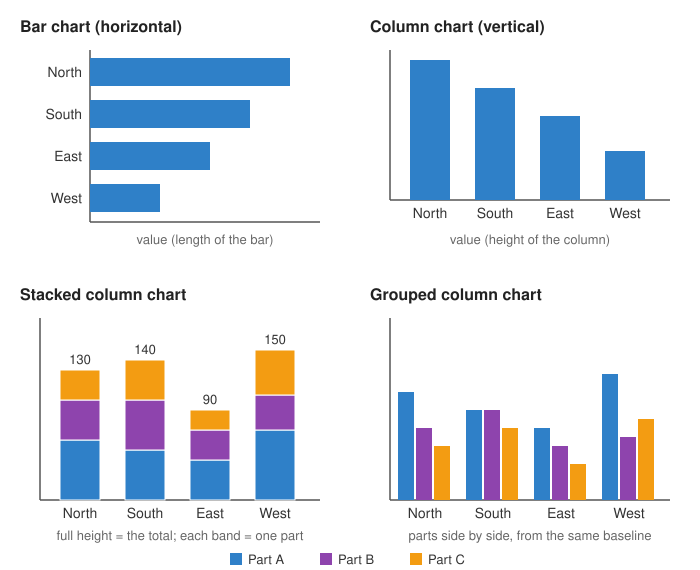

<head>
    <script type="application/ld+json">
        {JSON.stringify({
            "@context": "https://schema.org",
            "@type": "FAQPage",
            "mainEntity": [
                {
                    "@type": "Question",
                    "name": "What is a bar chart?",
                    "acceptedAnswer": { "@type": "Answer", "text": "A bar chart, also called a bar graph, compares values across categories using rectangular bars. The length of each bar is proportional to the value it stands for, so the longest bar is the largest value." }
                },
                {
                    "@type": "Question",
                    "name": "What is the difference between a bar chart and a column chart?",
                    "acceptedAnswer": { "@type": "Answer", "text": "A column chart is a bar chart with vertical bars: the categories run along the bottom and the values go up the side. Many tools, including Excel, call horizontal bars a bar chart and vertical bars a column chart. In everyday use, \"bar chart\" covers both." }
                },
                {
                    "@type": "Question",
                    "name": "What is a stacked bar chart?",
                    "acceptedAnswer": { "@type": "Answer", "text": "A stacked bar chart splits each bar into segments, one for each part, placed end to end. The whole bar shows the total and each segment shows one part of it. In a 100% stacked bar chart every bar is the same length, so you compare each part's share instead of the totals." }
                },
                {
                    "@type": "Question",
                    "name": "When should you use a bar graph?",
                    "acceptedAnswer": { "@type": "Answer", "text": "Use a bar graph to compare one value across separate categories, such as sales by region, answers to a survey question or counts per group. Use horizontal bars when the category names are long or there are many categories, and vertical columns when the categories have a natural order, such as months." }
                },
                {
                    "@type": "Question",
                    "name": "Is a histogram a bar graph?",
                    "acceptedAnswer": { "@type": "Answer", "text": "No, although they look alike. In a bar graph each bar is a separate category, so the bars have gaps between them and can be put in any order. In a histogram each bar is a range of one numeric variable, so the bars touch and must stay in numeric order." }
                },
                {
                    "@type": "Question",
                    "name": "How do I make a bar chart in JavaScript?",
                    "acceptedAnswer": { "@type": "Answer", "text": "With SciChart.js, create a SciChartSurface, add two NumericAxis objects, then add a FastColumnRenderableSeries with an XyDataSeries holding one x value per category and one y value per bar. A TextLabelProvider shows category names on the axis. For horizontal bars, set the X axis axisAlignment to Left. The same chart works in React with scichart-react and in Angular with scichart-angular." }
                }
            ]
        })}
    </script>
</head>

# Bar Chart

:::info Looking for the SciChart.js API?
See the [SciChart.js bar chart documentation](/2d-charts/chart-types/fast-column-renderable-series/column-series-type/) for `FastColumnRenderableSeries`, and the [stacked column series documentation](/2d-charts/chart-types/stacked-column-renderable-series/) for stacked and grouped bars.
:::

A **bar chart** (or **bar graph**) compares values across **categories** using rectangular bars. The **length** of each bar is proportional to the value it stands for, so you can rank the categories at a glance. Bars can run sideways (a **horizontal bar chart**) or upwards (a **column chart**), and can be split into parts (a **stacked bar chart**).

Try the interactive chart below. Scroll to zoom, drag to pan, double-click to reset, and hover over a bar to see its value.

<LiveDocSnippet maxWidth={'100%'} name="./Basic/demo" />

<LearnCta position="top" chart="bar chart" demo="column-chart" docs="/2d-charts/chart-types/fast-column-renderable-series/column-series-type/" />

## How to read a bar chart



- **One axis lists the categories,** such as regions, products or survey answers. The other axis shows the **value** for each one.
- **Compare the lengths.** The longer the bar, the bigger the value. Because length carries the value, the value axis should **start at zero**; a bar chart whose axis starts higher exaggerates the differences.
- **The order is up to you.** The categories are separate, so you can sort the bars from largest to smallest (as in the chart above) to make ranking easy, or keep a natural order such as months.
- **The gaps between bars** show that each bar is a separate category. Bars that touch usually mean a [histogram](/learn/histogram/), where each bar is a range of numbers.

### Bar chart vs column chart

A **column chart** is a bar chart with vertical bars. Many tools, including Excel, use "bar chart" for horizontal bars and "column chart" for vertical ones, but in everyday use "bar chart" covers both.

| | Horizontal bar chart | Column chart (vertical) |
| --- | --- | --- |
| **Categories** | Down the side | Along the bottom |
| **Values** | Along the bottom or top | Up the side |
| **Best when** | Category names are long, or there are many categories | Categories have a natural order, such as months or years |
| **Reads like** | A ranked list | A sequence from left to right |

### Types of bar chart

| Type | What it looks like | Use it to |
| --- | --- | --- |
| Simple bar or column chart | One bar per category | Compare one value across categories |
| Grouped (clustered) bar chart | Several bars side by side in each category, one per series | Compare the parts within each category, and each part across categories |
| Stacked bar or column chart | Each bar split into segments, one per part, end to end | Show each category's total and roughly how it divides into parts |
| 100% stacked bar chart | Every bar the same length, split by percentage | Compare each part's share, not the totals |

In a stacked chart only the first segment and the total share a common baseline, so the middle segments are hard to compare across bars. If comparing the parts matters more than the totals, use a grouped chart.

## When to use a bar chart

Use a bar chart when you want to **compare one value across separate categories**, and the reader cares about which is bigger and by how much.

| Chart | Best for |
| --- | --- |
| **Bar or column chart** | Comparing values across categories; ranking; showing parts of each total with stacked bars |
| [Line chart](/learn/line-chart/) | How a value changes over continuous time, especially with many points or several series |
| [Histogram](/learn/histogram/) | How a single numeric variable is distributed, counted into ranges (bins) |
| [Pie chart](/learn/pie-chart/) | One whole split into a few parts; a bar chart is usually easier to compare accurately |

## How to create a bar chart in JavaScript, React or Angular

SciChart.js draws bar and column charts with WebGL and WebGPU, so they stay smooth with large datasets and live updates. SciChart.js has no separate horizontal bar series: you draw a column series and put the X (category) axis on the left. Here is the code for the chart above:

<CodeSnippetBlock labels={["JavaScript", "React", "Angular"]}>
    ```ts showLineNumbers file=./Basic/demo.ts start=#region_A_start end=#region_A_end
    ```

    ```tsx
    import { SciChartReact } from "scichart-react";
    import {
        SciChartSurface,
        NumericAxis,
        FastColumnRenderableSeries,
        XyDataSeries,
        TextLabelProvider,
        EAxisAlignment,
        NumberRange,
        SciChartJsNavyTheme
    } from "scichart";

    // initChart builds the chart; SciChartReact creates it, sizes it and cleans it up
    const initChart = async (rootElement: string | HTMLDivElement) => {
        const { wasmContext, sciChartSurface } = await SciChartSurface.create(rootElement, {
            theme: new SciChartJsNavyTheme()
        });

        const { categories, values } = getYourCategoryData();

        // Category axis on the left gives horizontal bars; leave out axisAlignment for vertical columns
        sciChartSurface.xAxes.add(
            new NumericAxis(wasmContext, {
                axisAlignment: EAxisAlignment.Left,
                labelProvider: new TextLabelProvider({ labels: categories }),
                autoTicks: false,
                majorDelta: 1,
                growBy: new NumberRange(0.05, 0.05)
            })
        );
        sciChartSurface.yAxes.add(
            new NumericAxis(wasmContext, { axisAlignment: EAxisAlignment.Top, flippedCoordinates: true })
        );

        sciChartSurface.renderableSeries.add(
            new FastColumnRenderableSeries(wasmContext, {
                dataSeries: new XyDataSeries(wasmContext, {
                    xValues: categories.map((_, index) => index),
                    yValues: values
                }),
                fill: "#29aade",
                dataPointWidth: 0.7
            })
        );
        return { sciChartSurface };
    };

    export const BarChart = () => (
        <SciChartReact initChart={initChart} style={{ width: "100%", height: 400 }} />
    );
    ```

    ```ts
    import { Component } from "@angular/core";
    import { ScichartAngularComponent } from "scichart-angular";
    import {
        SciChartSurface,
        NumericAxis,
        FastColumnRenderableSeries,
        XyDataSeries,
        TextLabelProvider,
        EAxisAlignment,
        NumberRange,
        SciChartJsNavyTheme
    } from "scichart";

    @Component({
        selector: "app-bar-chart",
        standalone: true,
        imports: [ScichartAngularComponent],
        template: `<scichart-angular [initChart]="initChart" style="display: block; width: 100%; height: 400px"></scichart-angular>`
    })
    export class BarChartComponent {
        // initChart builds the chart; scichart-angular creates it, sizes it and cleans it up
        initChart = async (rootElement: string | HTMLDivElement) => {
            const { wasmContext, sciChartSurface } = await SciChartSurface.create(rootElement, {
                theme: new SciChartJsNavyTheme()
            });

            const { categories, values } = getYourCategoryData();

            // Category axis on the left gives horizontal bars; leave out axisAlignment for vertical columns
            sciChartSurface.xAxes.add(
                new NumericAxis(wasmContext, {
                    axisAlignment: EAxisAlignment.Left,
                    labelProvider: new TextLabelProvider({ labels: categories }),
                    autoTicks: false,
                    majorDelta: 1,
                    growBy: new NumberRange(0.05, 0.05)
                })
            );
            sciChartSurface.yAxes.add(
                new NumericAxis(wasmContext, { axisAlignment: EAxisAlignment.Top, flippedCoordinates: true })
            );

            sciChartSurface.renderableSeries.add(
                new FastColumnRenderableSeries(wasmContext, {
                    dataSeries: new XyDataSeries(wasmContext, {
                        xValues: categories.map((_, index) => index),
                        yValues: values
                    }),
                    fill: "#29aade",
                    dataPointWidth: 0.7
                })
            );
            return { sciChartSurface };
        };
    }
    ```
</CodeSnippetBlock>

Key points:

- A [FastColumnRenderableSeries](https://www.scichart.com/documentation/js/current/typedoc/classes/fastcolumnrenderableseries.html) draws the bars. Its [XyDataSeries](https://www.scichart.com/documentation/js/current/typedoc/classes/xydataseries.html) holds one x value per category (0, 1, 2, …) and one y value per bar. `dataPointWidth` sets how much of each slot a bar fills.
- A [TextLabelProvider](https://www.scichart.com/documentation/js/current/typedoc/classes/textlabelprovider.html) on a `NumericAxis` shows a category name at each x value.
- For **horizontal bars**, set the X axis `axisAlignment` to `Left` and the Y axis to `Top`, and set `flippedCoordinates` on the Y axis so values grow from left to right. See [vertical charts](/2d-charts/axis-api/multi-axis-and-layout/vertical-charts-rotate-transpose-axis/). Leave both out for an ordinary column chart.
- For **stacked or grouped bars**, add [StackedColumnRenderableSeries](/2d-charts/chart-types/stacked-column-renderable-series/) to a `StackedColumnCollection`. Series with the same `stackedGroupId` stack; series with different ids sit side by side. Set `isOneHundredPercent` on the collection for a 100% stacked chart.

**See it in the demo app:** [JavaScript column chart](https://www.scichart.com/demo/javascript/column-chart) · [React column chart](https://www.scichart.com/demo/react/column-chart) · [Angular column chart](https://www.scichart.com/demo/angular/column-chart)

**Stacked bars:** [JavaScript stacked column chart](https://www.scichart.com/demo/javascript/stacked-column-chart) · [React stacked column chart](https://www.scichart.com/demo/react/stacked-column-chart) · [Angular stacked column chart](https://www.scichart.com/demo/angular/stacked-column-chart)

**Rotated charts:** [JavaScript vertical charts](https://www.scichart.com/demo/javascript/vertical-charts), which put the X axis on the left as in the horizontal bar chart above.

**Go deeper:** [SciChart.js bar chart documentation](/2d-charts/chart-types/fast-column-renderable-series/column-series-type/), including gaps, point markers and colouring individual bars, and the [SciChart.js stacked column chart documentation](/2d-charts/chart-types/stacked-column-renderable-series/).

## Frequently asked questions

### What is a bar chart?

A bar chart, also called a bar graph, compares values across categories using rectangular bars. The length of each bar is proportional to the value it stands for, so the longest bar is the largest value.

### What is the difference between a bar chart and a column chart?

A column chart is a bar chart with vertical bars: the categories run along the bottom and the values go up the side. Many tools, including Excel, call horizontal bars a bar chart and vertical bars a column chart. In everyday use, "bar chart" covers both.

### What is a stacked bar chart?

A stacked bar chart splits each bar into segments, one for each part, placed end to end. The whole bar shows the total and each segment shows one part of it. In a 100% stacked bar chart every bar is the same length, so you compare each part's share instead of the totals.

### When should you use a bar graph?

Use a bar graph to compare one value across separate categories, such as sales by region, answers to a survey question or counts per group. Use horizontal bars when the category names are long or there are many categories, and vertical columns when the categories have a natural order, such as months.

### Is a histogram a bar graph?

No, although they look alike. In a bar graph each bar is a separate category, so the bars have gaps between them and can be put in any order. In a histogram each bar is a range of one numeric variable, so the bars touch and must stay in numeric order. See our [histogram guide](/learn/histogram/).

### How do I make a bar chart in JavaScript?

With SciChart.js, create a `SciChartSurface`, add two `NumericAxis` objects, then add a `FastColumnRenderableSeries` with an `XyDataSeries` holding one x value per category and one y value per bar. A `TextLabelProvider` shows category names on the axis. For horizontal bars, set the X axis `axisAlignment` to `Left`. The same chart works in React with `scichart-react` and in Angular with `scichart-angular`. See the code above.

<LearnCta position="bottom" chart="bar chart" demo="column-chart" docs="/2d-charts/chart-types/fast-column-renderable-series/column-series-type/" />
