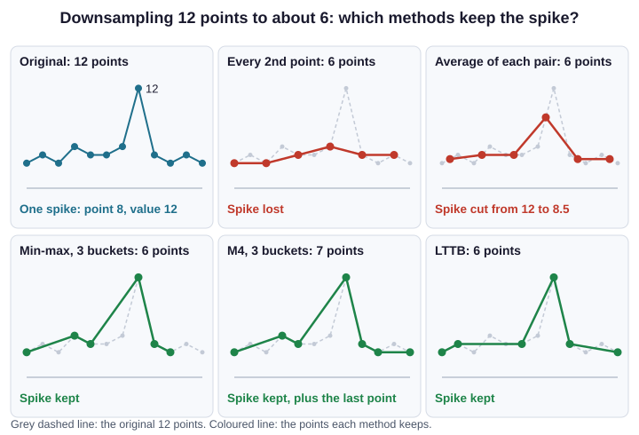
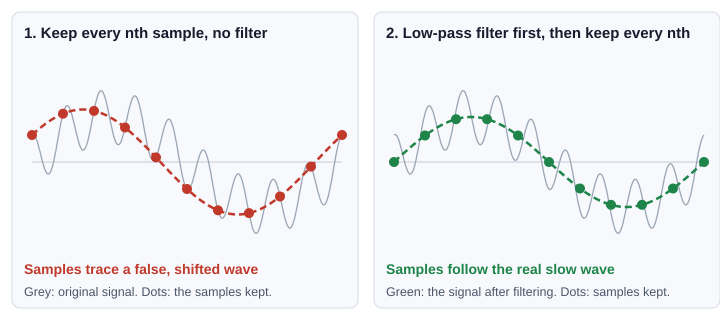

<head>
    <script type="application/ld+json">
        {JSON.stringify({
            "@context": "https://schema.org",
            "@type": "FAQPage",
            "mainEntity": [
                {
                    "@type": "Question",
                    "name": "What does downsampling mean?",
                    "acceptedAnswer": { "@type": "Answer", "text": "Downsampling means reducing the number of samples in a dataset, a signal or an image while keeping what matters about it. On a chart, it means drawing a smaller set of points chosen so the line looks the same. In signal processing, it means lowering the sample rate, usually after a low-pass filter." }
                },
                {
                    "@type": "Question",
                    "name": "Is downsampling the same as decimation?",
                    "acceptedAnswer": { "@type": "Answer", "text": "Nearly. In signal processing, downsampling by a factor M keeps every Mth sample, and decimation usually means the full process: a low-pass anti-aliasing filter, then downsampling. Some people use the two words for the same thing, and subsampling is another name for plain downsampling." }
                },
                {
                    "@type": "Question",
                    "name": "What is the difference between upsampling and downsampling?",
                    "acceptedAnswer": { "@type": "Answer", "text": "Downsampling reduces the number of samples, for example from 1,000 a second to 100 a second. Upsampling increases it, by inserting new samples between the existing ones and filling them in by interpolation. Changing a rate by a fraction, such as 48 kHz to 44.1 kHz, uses both: upsample by 147, then downsample by 160." }
                },
                {
                    "@type": "Question",
                    "name": "How does the LTTB algorithm work?",
                    "acceptedAnswer": { "@type": "Answer", "text": "Largest-Triangle-Three-Buckets keeps the first and last points, splits the rest into equal buckets, and keeps one point per bucket: the one that forms the largest triangle with the point kept in the previous bucket and the average of the next bucket. Large triangles mean sharp changes, so peaks and turns survive." }
                },
                {
                    "@type": "Question",
                    "name": "Does downsampling lose data?",
                    "acceptedAnswer": { "@type": "Answer", "text": "The downsampled copy has fewer points, so it holds less information than the original. Good chart downsampling chooses the points so the drawn line looks the same, and keeps the full data for zooming, statistics and export. Never run calculations on the downsampled copy." }
                },
                {
                    "@type": "Question",
                    "name": "How do I downsample data for a chart in JavaScript?",
                    "acceptedAnswer": { "@type": "Answer", "text": "Either write a helper, such as LTTB or min-max, that reduces your arrays before you pass them to the chart, or use a chart library that resamples for you. SciChart.js resamples line series automatically for each view, so you can pass millions of raw points to an XyDataSeries and leave resamplingMode at Auto." }
                }
            ]
        })}
    </script>
</head>

# Downsampling

## What is downsampling?

**Downsampling** (also called subsampling or, for charts, data reduction or resampling) is reducing the number of samples in a dataset, signal or image while keeping what matters about it. In data visualisation it means drawing a smaller, carefully chosen set of points, so a chart of millions of values looks the same but draws far faster.


*A signal of 1,000,000 points with 12 short spikes (sample data), drawn with automatic resampling. [Try the interactive version](#how-to-downsample-data-for-a-chart-in-javascript-react-or-angular).*

:::tip Key takeaways
- A chart can only show as many columns of detail as it has pixels across, so drawing more points than that adds work, not information.
- Every nth point and averaging are simple but lose or shrink spikes. Min-max, M4 and LTTB keep them.
- Min-max and M4 keep every peak and the full spread of noise; LTTB keeps the overall shape with fewer points.
- In signal processing, downsampling needs a low-pass (anti-aliasing) filter first, or fast signals turn into false slow ones.
- Downsample only for display. Keep the full data for zooming, statistics and alerts.
:::

## Why downsample data for a chart?

Pixels, not points, are the limit. A line chart 1,000 pixels wide has 1,000 columns. Give it 1,000,000 points and about 1,000 of them land in each column. The screen can only show one vertical stroke per column, from the lowest value in it to the highest, so most of those points change nothing you can see.

Drawing them still costs time. Each point has to be sent, transformed to screen coordinates and drawn, every time the chart redraws. With millions of points, that can make zooming, panning and live updates slow, especially in a browser on an ordinary laptop.

Downsampling cuts the points to roughly what the chart can display, typically one to four per pixel column. Done well, the picture doesn't change. Done badly, it hides exactly the events people are looking for.

For the wider picture, including rendering technology and server-side aggregation, see [big data visualisation](/learn/big-data/big-data-visualization/) and our blog post [How to Visualize Millions of Data Points Efficiently](https://www.scichart.com/blog/how-to-visualize-millions-of-data-points-efficiently/).

## What goes wrong with naive downsampling

The obvious approach is to keep every nth point: with 1,000,000 points and room for 1,000, keep points 1, 1,001, 2,001 and so on. It's fast, and on smooth data it works. On real data it causes two problems.

- Missed peaks. A spike that lasts one or two samples sits between the points you keep, so it vanishes. In monitoring data, that spike is often the fault, the trade or the heartbeat you needed to see.
- Aliasing. If the data repeats faster than the gap between kept points, the kept points can trace a slower pattern that isn't really there. The same effect makes wheels look as if they spin backwards on film. See [Downsampling in signal processing](#downsampling-in-signal-processing-decimation-and-anti-aliasing) below.

Averaging each bucket is the next idea. It does better on noise, but it shrinks spikes: a spike of 12 averaged with a neighbour of 5 becomes 8.5, and averaged over a thousand samples it disappears into the line.

### Worked example: 12 points down to about 6

Here is a short series with one spike at point 8, reduced to about half its size by each of the five methods on this page. Points are numbered 1 to 12.

| Point | 1 | 2 | 3 | 4 | 5 | 6 | 7 | 8 | 9 | 10 | 11 | 12 |
| --- | --- | --- | --- | --- | --- | --- | --- | --- | --- | --- | --- | --- |
| Value | 3 | 4 | 3 | 5 | 4 | 4 | 5 | 12 | 4 | 3 | 4 | 3 |

| Method | Points kept (point: value) | Highest value kept | Spike |
| --- | --- | --- | --- |
| Every 2nd point | 1: 3, 3: 3, 5: 4, 7: 5, 9: 4, 11: 4 | 5 | Lost |
| Average of each pair | 3.5, 4, 4, 8.5, 3.5, 3.5 | 8.5 | Shrunk to 8.5 |
| Min-max, 3 buckets of 4 | 1: 3, 4: 5, 5: 4, 8: 12, 9: 4, 10: 3 | 12 | Kept |
| M4, 3 buckets of 4 | 1: 3, 4: 5, 5: 4, 8: 12, 9: 4, 10: 3, 12: 3 | 12 | Kept |
| LTTB, 6 points | 1: 3, 2: 4, 6: 4, 8: 12, 9: 4, 12: 3 | 12 | Kept |



Every method kept about the same number of points. What differs is which points they keep. The methods that look at every value in a bucket (min-max, M4, LTTB) find the spike, and the methods that don't (every nth) or that blend values together (average) lose it.

## Downsampling methods for time series

All five methods below take a series sorted by time (or any x value), split it into buckets, and keep one or more points from each bucket. They differ in which points they keep.

| Method | Points kept per bucket | Keeps spikes? | Keeps the spread of noise? | Best for |
| --- | --- | --- | --- | --- |
| Every nth point | 1 (whichever comes up) | No | No | Smooth data, quick previews |
| Average (bucket mean) | 1 (the mean) | No: shrinks them | No: smooths it | Trends, when spikes are noise |
| Min-max | 2 (lowest and highest) | Yes | Yes | Monitoring, signals, finance |
| M4 | Up to 4 (first, lowest, highest, last) | Yes | Yes | Exact line charts at a known width |
| LTTB | 1 (largest triangle) | Usually | Partly | Smaller outputs that keep the shape |

### Every nth point

Keep one point in every *n*, where *n* is the number of points divided by the target. It needs no maths and almost no time, and on smooth, slowly changing data it looks fine. Anything that happens between the points it keeps is invisible to it, so use it only when the data has no short events, or as a quick preview.

### Average (bucket mean)

Split the data into equal buckets and keep the mean of each. Averaging smooths out random noise, which can help show a trend. It also smooths out spikes, dips and sudden steps, and the result has values that never occurred in the data. Variants keep the median, or the first or last value of each bucket, with similar trade-offs.

### Min-max

Make one bucket per pixel column and keep the lowest and highest point in each, in time order. Since a line chart draws each column as a stroke from its lowest to its highest value, min-max keeps exactly what the screen would show: every peak, every trough and the full thickness of a noisy band. It's fast, needs only one pass over the data, and is the usual choice for oscilloscope-style and monitoring charts. Its output is two points per column, so a 1,000-pixel chart needs about 2,000 points.

### M4

M4, from a 2014 paper by Jugel and colleagues, keeps four points per pixel column: the first, the lowest, the highest and the last. The extra first and last points make the short lines that join one column to the next land in the right place, so the paper shows the reduced line draws the same pixels as the full data at that chart width. It's a stricter version of min-max, at up to twice the points, and is often run inside a database query so only the reduced data leaves the server.

### LTTB (Largest-Triangle-Three-Buckets)

LTTB was described by Sveinn Steinarsson in his 2013 master's thesis at the University of Iceland, and is now widely used in charting and time-series tools. It works like this:

1. Always keep the first and the last point.
2. Split the points between them into equal buckets, one per point you want to keep.
3. Work through the buckets from left to right. In each one, consider the point you kept in the previous bucket (A) and the average of the next bucket (C).
4. Keep the point B in the current bucket that makes the largest triangle A-B-C. A big triangle means the line turns sharply at B, so peaks, dips and corners win.

LTTB gives a smooth, faithful shape with one point per bucket, half as many as min-max. It has two weaknesses. When a bucket holds both a high spike and a low one, it can keep only one of them; and on dense, noisy data it can understate how wide the noise is, because one point per bucket can't show both its top and its bottom. Each choice depends on the one before, so it runs as a single pass from left to right.

## See the methods on a million points

The chart below has 1,000,000 points: 1,000 samples a second for 1,000 seconds, with 12 spikes that each last one to three samples. The faint blue line is all of the raw data. The orange line is the downsampled copy. Pick a method and a target number of points; the line under the buttons counts how many spikes the orange line still reaches.

Things to try:
- **Every nth** at 1,000 points misses every spike. At 5,000 points it catches one, by luck.
- **Average** keeps the slow waves but loses the spikes and the noise.
- **Min-max** and **M4** match the raw line: same spikes, same thickness.
- **LTTB** keeps all 12 spikes, with one point per bucket instead of two.
- **Zoom in** on a spike (scroll). The orange line was computed once for the full view, so it turns blocky. The blue line stays sharp because the chart library resamples it again for every view. That's why charts should downsample for the current view, not once in advance.

<LiveDocSnippet maxWidth={'100%'} name="./Compare/demo" />

## How to choose a downsampling method

Choose by what the chart must not lose: min-max or M4 when every spike matters, LTTB for a small overview that keeps the shape, and an average only when you want the noise gone.

| If you need… | Use | Why |
| --- | --- | --- |
| Every spike and dip, exactly as the full data would draw | Min-max or M4 | They keep each pixel column's extremes, so nothing visible is lost |
| A small, smooth overview that keeps the shape | LTTB | One point per bucket, chosen to keep turns and peaks |
| A trend, with noise removed on purpose | Average or a [moving average](/learn/chart-types/cartesian/line-chart/) | Smoothing is the goal, not a side effect |
| A quick preview of smooth data | Every nth point | Fastest, and fine when nothing happens between samples |
| A lower sample rate for further signal processing | Anti-alias filter, then keep every nth (decimation) | Removes frequencies that would otherwise alias |

Two rules of thumb:
- Size the target to the chart, not to a round number: about two points per pixel column for min-max, four for M4.
- Recompute when the view changes. A reduction made for the whole range is too coarse once someone zooms in.

## Downsampling in signal processing: decimation and anti-aliasing

In digital signal processing (audio, sensors, radio), **downsampling by a factor M** means keeping every Mth sample, which divides the **sample rate** by M. Recording at 96,000 samples a second and keeping every second sample gives 48,000 samples a second.

Downsampling also lowers the [Nyquist limit](/learn/signal-processing/nyquist-and-aliasing/). A signal sampled at a rate *f*<sub>s</sub> can only represent frequencies below *f*<sub>s</sub>/2. After downsampling by M, that limit falls to *f*<sub>s</sub>/(2M). Any part of the signal above the new limit doesn't disappear. It **aliases**: it folds back and shows up as a false, lower frequency that can't be told apart from real content.



The fix is to remove those frequencies first, with a **low-pass anti-aliasing filter** whose cutoff is at or below the new Nyquist limit. Filter, then keep every Mth sample. That two-step process is usually called **decimation**.

- Downsampling (or subsampling): keep every Mth sample.
- Decimation: low-pass filter, then downsample.
- **Upsampling:** insert samples between the existing ones and fill them in by interpolation.
- Changing by a fraction: upsample by L, filter, then downsample by M. For example, 48 kHz to 44.1 kHz is a factor of 147/160.

### How is decimation different from chart downsampling?

Decimation aims to keep a valid, evenly spaced signal for more processing, so it deliberately removes fast content, spikes included. Chart downsampling aims to keep what the eye should see, so it deliberately keeps spikes. Use decimation before analysis, and min-max, M4 or LTTB for display.

## Downsampling in images and machine learning

The word has two other common meanings:

- Images: reducing an image's resolution, for example from 4000 × 3000 pixels to 800 × 600. Blurring slightly before shrinking plays the role of the anti-aliasing filter; without it, fine patterns turn into moiré. In neural networks, pooling and strided layers downsample feature maps in the same sense.
- Imbalanced data in machine learning: reducing the number of examples in the majority class, for example keeping a random 5% of normal transactions so they don't swamp the rare fraud cases. The model's predicted probabilities can then be corrected for the changed proportions.

Both share the idea of keeping fewer samples, but the methods on this page are for time series and charts.

## Common downsampling mistakes

Most downsampling mistakes come from a method that drops spikes, or from using the reduced copy for anything other than drawing.

- **Using every nth point on spiky data.** It's the default in many quick scripts, and it silently hides short events. Use min-max, M4 or LTTB.
- **Running statistics on the downsampled copy.** Means, standard deviations, peak counts and thresholds all change. Calculate on the full data, then downsample only to draw.
- **Treating unevenly spaced data as evenly spaced.** Buckets by count assume regular sampling. With gaps or bursts, split buckets by time instead.
- **Not telling readers.** If a chart shows reduced or smoothed data, say so in the caption or tooltip, especially in reports.

## How to downsample data for a chart in JavaScript, React or Angular

The demo hands all 1,000,000 raw points to a single line series and leaves SciChart.js to resample them for each view, keeping every peak and trough; it contains no downsampling code. Zoom into a spike with the mouse wheel, drag to pan, double-click to reset, and hover to see values. Switch resampling to **None** and the picture stays the same; only the work behind each frame changes.

<LiveDocSnippet maxWidth={'100%'} name="./Basic/demo" />

<LearnCta position="top" chart="chart with millions of points" demo="chart-performance-load-one-million-points" demoLabel="1 million point chart" docs="/2d-charts/chart-types/data-series-api/resampling/" docsLabel="SciChart.js resampling documentation" />

Here is the code for this chart:

<CodeSnippetBlock labels={["JavaScript", "React", "Angular"]}>
    ```ts showLineNumbers file=./Basic/demo.ts start=#region_A_start end=#region_A_end
    ```

    ```tsx
    import { SciChartReact } from "scichart-react";
    import {
        SciChartSurface,
        NumericAxis,
        FastLineRenderableSeries,
        XyDataSeries,
        EResamplingMode,
        SciChartJsNavyTheme,
        MouseWheelZoomModifier,
        ZoomPanModifier,
        ZoomExtentsModifier
    } from "scichart";

    // initChart builds the chart; SciChartReact creates it, sizes it and cleans it up
    const initChart = async (rootElement: string | HTMLDivElement) => {
        const { wasmContext, sciChartSurface } = await SciChartSurface.create(rootElement, {
            theme: new SciChartJsNavyTheme()
        });
        sciChartSurface.xAxes.add(new NumericAxis(wasmContext, { axisTitle: "Time (s)" }));
        sciChartSurface.yAxes.add(new NumericAxis(wasmContext, { axisTitle: "Signal" }));

        // All the raw points: SciChart.js downsamples them for each view
        const { xValues, yValues } = getYourLargeData();
        sciChartSurface.renderableSeries.add(
            new FastLineRenderableSeries(wasmContext, {
                dataSeries: new XyDataSeries(wasmContext, {
                    xValues,
                    yValues,
                    dataIsSortedInX: true,
                    dataEvenlySpacedInX: true,
                    containsNaN: false
                }),
                stroke: "#50C7E0",
                resamplingMode: EResamplingMode.Auto // the default
            })
        );
        sciChartSurface.chartModifiers.add(new MouseWheelZoomModifier(), new ZoomPanModifier(), new ZoomExtentsModifier());
        return { sciChartSurface };
    };

    export const MillionPointChart = () => (
        <SciChartReact initChart={initChart} style={{ width: "100%", height: 400 }} />
    );
    ```

    ```ts
    import { Component } from "@angular/core";
    import { ScichartAngularComponent } from "scichart-angular";
    import {
        SciChartSurface,
        NumericAxis,
        FastLineRenderableSeries,
        XyDataSeries,
        EResamplingMode,
        SciChartJsNavyTheme,
        MouseWheelZoomModifier,
        ZoomPanModifier,
        ZoomExtentsModifier
    } from "scichart";

    @Component({
        selector: "app-million-point-chart",
        standalone: true,
        imports: [ScichartAngularComponent],
        template: `<scichart-angular [initChart]="initChart" style="display: block; width: 100%; height: 400px"></scichart-angular>`
    })
    export class MillionPointChartComponent {
        // initChart builds the chart; scichart-angular creates it, sizes it and cleans it up
        initChart = async (rootElement: string | HTMLDivElement) => {
            const { wasmContext, sciChartSurface } = await SciChartSurface.create(rootElement, {
                theme: new SciChartJsNavyTheme()
            });
            sciChartSurface.xAxes.add(new NumericAxis(wasmContext, { axisTitle: "Time (s)" }));
            sciChartSurface.yAxes.add(new NumericAxis(wasmContext, { axisTitle: "Signal" }));

            // All the raw points: SciChart.js downsamples them for each view
            const { xValues, yValues } = getYourLargeData();
            sciChartSurface.renderableSeries.add(
                new FastLineRenderableSeries(wasmContext, {
                    dataSeries: new XyDataSeries(wasmContext, {
                        xValues,
                        yValues,
                        dataIsSortedInX: true,
                        dataEvenlySpacedInX: true,
                        containsNaN: false
                    }),
                    stroke: "#50C7E0",
                    resamplingMode: EResamplingMode.Auto // the default
                })
            );
            sciChartSurface.chartModifiers.add(new MouseWheelZoomModifier(), new ZoomPanModifier(), new ZoomExtentsModifier());
            return { sciChartSurface };
        };
    }
    ```
</CodeSnippetBlock>

Key points:

- Resampling is on by default (`resamplingMode: EResamplingMode.Auto`). SciChart.js picks an algorithm from the series type and the data, and runs it again whenever the view changes, so zoomed-in views get full detail.
- Setting `dataIsSortedInX`, `dataEvenlySpacedInX` and `containsNaN` tells SciChart.js how the data is laid out, so it doesn't have to check each time you add data.
- `resamplingPrecision` raises the number of points kept per pixel, which can look better on very noisy data at some cost in speed. `EResamplingMode.None` turns resampling off for one series.
- Your statistics, exports and alerts still see every raw point: resampling only affects what is drawn.

### Downsampling helpers for any chart library

If your chart library doesn't resample, or you need to reduce data before sending it from a server, these functions implement every method on this page. They're the ones the comparison chart above uses. Each takes sorted x and y arrays and a target number of points, and returns `{ x, y }`.

```ts showLineNumbers file=./Compare/demo.ts start=#region_B_start end=#region_B_end
```

**See it in the demo app:** [JavaScript 1 million point chart](https://www.scichart.com/demo/javascript/chart-performance-load-one-million-points) · [React 1 million point chart](https://www.scichart.com/demo/react/chart-performance-load-one-million-points) · [Angular 1 million point chart](https://www.scichart.com/demo/angular/chart-performance-load-one-million-points)

**Go deeper:** [SciChart.js resampling documentation](/2d-charts/chart-types/data-series-api/resampling/), including the resampling modes and precision, and the [performance tips and tricks](/2d-charts/performance-tips/performance-tips-and-tricks/).

## Frequently asked questions

### What does downsampling mean?

Downsampling means reducing the number of samples in a dataset, a signal or an image while keeping what matters about it. On a chart, it means drawing a smaller set of points chosen so the line looks the same. In signal processing, it means lowering the sample rate, usually after a low-pass filter.

### Is downsampling the same as decimation?

Nearly. In signal processing, downsampling by a factor M keeps every Mth sample, and decimation usually means the full process: a low-pass anti-aliasing filter, then downsampling. Some people use the two words for the same thing, and subsampling is another name for plain downsampling.

### What is the difference between upsampling and downsampling?

Downsampling reduces the number of samples, for example from 1,000 a second to 100 a second. Upsampling increases it, by inserting new samples between the existing ones and filling them in by interpolation. Changing a rate by a fraction, such as 48 kHz to 44.1 kHz, uses both: upsample by 147, then downsample by 160.

### How does the LTTB algorithm work?

Largest-Triangle-Three-Buckets keeps the first and last points, splits the rest into equal buckets, and keeps one point per bucket: the one that forms the largest triangle with the point kept in the previous bucket and the average of the next bucket. Large triangles mean sharp changes, so peaks and turns survive.

### Does downsampling lose data?

The downsampled copy has fewer points, so it holds less information than the original. Good chart downsampling chooses the points so the drawn line looks the same, and keeps the full data for zooming, statistics and export. Never run calculations on the downsampled copy.

### How do I downsample data for a chart in JavaScript?

Either write a helper, such as LTTB or min-max, that reduces your arrays before you pass them to the chart, or use a chart library that resamples for you. SciChart.js resamples line series automatically for each view, so you can pass millions of raw points to an `XyDataSeries` and leave `resamplingMode` at `Auto`.

## Sources

- Steinarsson, S. (2013), [Downsampling Time Series for Visual Representation](http://hdl.handle.net/1946/15343). MSc thesis, University of Iceland. The original description of LTTB.
- Jugel, U., Jerzak, Z., Hackenbroich, G. and Markl, V. (2014), [M4: A Visualization-Oriented Time Series Data Aggregation](https://www.vldb.org/pvldb/vol7/p797-jugel.pdf). *Proceedings of the VLDB Endowment*, 7(10). The M4 method and why it draws the same pixels as the full data.
- Smith, S. W. (1997), [The Scientist and Engineer's Guide to Digital Signal Processing, chapter 3, ADC and DAC, section 3.2: The Sampling Theorem](https://www.dspguide.com/ch3/2.htm). California Technical Publishing. The Nyquist limit and aliasing.

<LearnCta position="bottom" chart="chart with millions of points" demo="chart-performance-load-one-million-points" demoLabel="1 million point chart" docs="/2d-charts/chart-types/data-series-api/resampling/" docsLabel="SciChart.js resampling documentation" />
