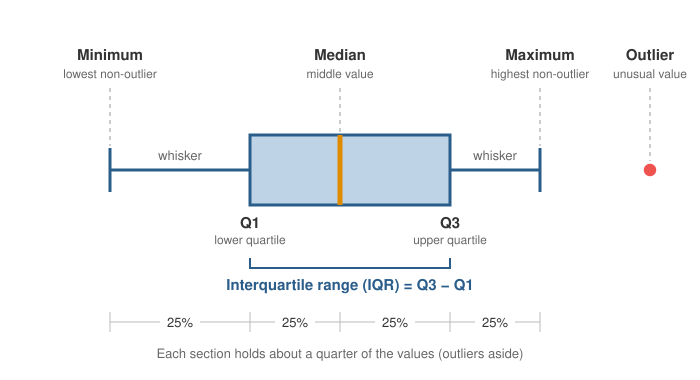

<head>
    <script type="application/ld+json">
        {JSON.stringify({
            "@context": "https://schema.org",
            "@type": "FAQPage",
            "mainEntity": [
                {
                    "@type": "Question",
                    "name": "What does a box plot show?",
                    "acceptedAnswer": { "@type": "Answer", "text": "A box plot shows how a set of numbers is spread out: where the middle value (the median) lies, how spread out the middle half of the values is (the box), how far the rest reach (the whiskers), and which values are unusually high or low (the outliers). It is most useful for comparing several groups side by side." }
                },
                {
                    "@type": "Question",
                    "name": "What are the 5 points on a box and whisker plot?",
                    "acceptedAnswer": { "@type": "Answer", "text": "The five points are the five-number summary: the minimum, the first quartile (Q1), the median, the third quartile (Q3) and the maximum. The box runs from Q1 to Q3 with a line at the median, and the whiskers reach out to the minimum and maximum, leaving out any outliers drawn as separate dots." }
                },
                {
                    "@type": "Question",
                    "name": "How do you find Q1 and Q3 for a box plot?",
                    "acceptedAnswer": { "@type": "Answer", "text": "Sort the values and find the median. Q1 is the median of the lower half of the values and Q3 is the median of the upper half. With an odd number of values, leave the median itself out of both halves. Software often interpolates between values instead, which can give slightly different quartiles." }
                },
                {
                    "@type": "Question",
                    "name": "How do you find the IQR on a box plot?",
                    "acceptedAnswer": { "@type": "Answer", "text": "The interquartile range (IQR) is the length of the box: subtract the first quartile (the bottom or left edge of the box) from the third quartile (the top or right edge). For example, if Q1 is 55 and Q3 is 70, the IQR is 15." }
                },
                {
                    "@type": "Question",
                    "name": "Should I use a box plot or a histogram?",
                    "acceptedAnswer": { "@type": "Answer", "text": "Use a histogram to see the full shape of one dataset, including gaps and whether it has more than one peak. Use a box plot to compare the median, spread and outliers of several groups side by side, where several histograms would take too much space." }
                },
                {
                    "@type": "Question",
                    "name": "How do I make a box plot in JavaScript?",
                    "acceptedAnswer": { "@type": "Answer", "text": "With SciChart.js, create a SciChartSurface with two NumericAxis axes, then add a FastBoxPlotRenderableSeries with a BoxPlotDataSeries holding an x value plus the minimum, lower quartile, median, upper quartile and maximum for each box. Draw outliers with an XyScatterRenderableSeries. The same chart works in React with scichart-react and in Angular with scichart-angular." }
                }
            ]
        })}
    </script>
</head>

# Box Plot (Box and Whisker Plot)

## What is a box plot?

A **box plot** (also called a box and whisker plot) is a chart that summarises how a set of numbers is spread out. A **box** covers the middle half of the values, a line inside it marks the **median**, and **whiskers** reach out to the lowest and highest typical values. Dots beyond the whiskers mark **outliers**.


*Box plots comparing exam scores for five classes of about 60 students (sample data). [Try the interactive version](#how-to-create-a-box-plot-in-javascript-react-or-angular).*

:::tip Key takeaways
- A box plot draws the **five-number summary**: minimum, first quartile (Q1), median, third quartile (Q3) and maximum.
- The **box** holds the middle 50% of values. Its length is the **interquartile range (IQR)**.
- Values more than **1.5 × IQR** beyond the box are usually drawn as separate **outlier** dots.
- Box plots are best for **comparing several groups** side by side.
- A box plot **hides the shape** of the data: two very different datasets can have the same box.
:::

## How to read a box plot



Read a box plot from the middle outwards:

1. **The median** is the line inside the box. Half the values are above it and half below.
2. **The box** runs from the **first quartile (Q1)**, below which a quarter of the values fall, to the **third quartile (Q3)**, below which three-quarters fall. So the box holds the middle 50% of the values. Its length, Q3 − Q1, is the **interquartile range (IQR)**: a short box means the values are close together, a long one means they are spread out.
3. **The whiskers** show how far the rest of the values reach. In the simplest form they go to the minimum and maximum. In the most common form, introduced by the statistician John Tukey, they stop at the furthest value within 1.5 × IQR of the box. The charts on this page use this rule.
4. **Outliers** are the dots beyond the whiskers. Check them: they may be mistakes in the data, or the most interesting values in it.

Each of the four parts (lower whisker, lower half of the box, upper half of the box, upper whisker) holds about a quarter of the values. A part that looks longer doesn't hold more values; it means those values are more spread out.

### What the shape of a box plot tells you

| What you see | What it means | In the chart above |
| --- | --- | --- |
| Median near the middle of the box, whiskers about equal | The values are roughly **symmetric** | Class E |
| Median near the bottom of the box, longer upper whisker | **Right-skewed** (positively skewed): most values are low, with a tail of high ones | Class D |
| Median near the top of the box, longer lower whisker | **Left-skewed** (negatively skewed): most values are high, with a tail of low ones | |
| One box much higher than another | That group's values are generally higher | Class E against Class D |
| One box much longer than another | That group's values are more spread out | Class D against Class E |
| Dots beyond the whiskers | **Outliers**: unusually high or low values | Classes A, B, C and E |

## How to make a box plot: a worked example

Here is how to work out a box plot by hand. Take the number of minutes 11 deliveries arrived late:

> 13, 5, 9, 35, 7, 12, 3, 18, 8, 15, 11

1. **Sort the values:** 3, 5, 7, 8, 9, **11**, 12, 13, 15, 18, 35.
2. **Find the median.** With 11 values, it is the 6th: **11**.
3. **Find the quartiles.** Q1 is the median of the lower half (3, 5, 7, 8, 9): **7**. Q3 is the median of the upper half (12, 13, 15, 18, 35): **15**.
4. **Work out the IQR:** 15 − 7 = **8**.
5. **Set the outlier limits (fences):** 1.5 × 8 = 12, so the lower fence is 7 − 12 = −5 and the upper fence is 15 + 12 = 27.
6. **Draw the whiskers** to the furthest values inside the fences: **3** and **18**.
7. **Mark outliers:** 35 is above 27, so it is drawn as a dot.

The five-number summary is 3, 7, 11, 15, 18, with one outlier at 35. Without the outlier rule, the upper whisker would stretch to 35 and make the deliveries look far less reliable than most of them were.

Software often calculates quartiles a little differently, by interpolating between values. For this data that gives Q1 = 7.5 and Q3 = 14. Both are correct; there are several accepted methods, and the difference shrinks as the dataset grows.

## How to describe a box plot

When you describe a box plot, or compare two, cover four things: the **centre** (median), the **spread** (IQR or box length), the **shape** (symmetric or skewed) and any **outliers**. Use this template:

> The median of **[group]** is **[value]**, **[higher / lower]** than **[other group]**. Its scores are **[more / less]** spread out (IQR **[value]**), the distribution is **[symmetric / right-skewed / left-skewed]**, and there **[are / are no]** outliers.

**Worked example,** comparing Class D and Class E in the chart above: "Class E's median score is 78, much higher than Class D's 48. Class E's scores are also far more consistent, with an IQR of about 7 against about 25 for Class D. Class D is right-skewed: half of its students scored below about 48, with a long tail of higher marks. Class E has one low outlier, at 52."

## When to use a box plot

Use a box plot to **compare the distribution of a value across several groups**: test scores by class, response times by server, measurements by production batch, salaries by department.

| Chart | Best for |
| --- | --- |
| **Box plot** | Comparing the median, spread and outliers of several groups side by side |
| [Histogram](/learn/histogram/) | The full shape of one dataset, including gaps and more than one peak, which a box plot hides |
| [Bar chart](/learn/bar-chart/) | One summary number per group, such as an average or a total, when the spread doesn't matter |
| [Scatter plot](/learn/scatter-plot/) | Every individual value, when there are few enough points to see them all |

A box plot works best with **at least a few dozen values per group**. With only a handful, quartiles mean little, so plot the individual points instead, or on top of the boxes.

## What a box plot can hide

A box plot boils a whole dataset down to five numbers, so very different data can produce the same box. The chart below shows waiting times for 120 patients at each of two clinics (sample data). The two box plots are almost identical: both medians are about 32 minutes, with similar boxes and whiskers.

The dots tell a different story. At Clinic A, waits are spread evenly from about 8 to 58 minutes. Clinic B has two kinds of patient: those with appointments wait about 18 minutes and walk-ins about 48. Almost nobody at Clinic B waits the median time. Untick **Individual patients** in the legend to see how much the boxes alone hide.

<LiveDocSnippet maxWidth={'100%'} name="./Distribution/demo" />

To avoid being misled, plot the individual points over the box (with a small sideways "jitter" so they don't overlap) when there are few enough of them, or check each group's [histogram](/learn/histogram/) before relying on its box plot.

## Common box plot mistakes

- **Not saying what the whiskers mean.** Some charts draw whiskers to the minimum and maximum, others to 1.5 × IQR, others to percentiles. State the rule in a note.
- **Too few values.** With fewer than about 20 values per group, quartiles jump around. Show the individual points as well.
- **Treating outliers as errors.** Check them before removing them. An outlier may be the most important value in the data.
- **Reading a skew from the box alone.** A long whisker can come from one extreme value. Look at where the median sits in the box as well.
- **Assuming overlapping boxes mean "no difference", or separate boxes mean a real one.** A box plot shows spread, not statistical significance; test the difference if it matters.
- **Hiding group sizes.** A box from 5 values looks as solid as one from 5,000. Add the count (n) to each label.

## How to create a box plot in JavaScript, React or Angular

SciChart.js draws box plots with WebGL and WebGPU, so you can compare many groups, zoom in and update the data live. You calculate the five-number summary for each group, and SciChart.js draws the boxes, whiskers and outliers. Try the chart below: scroll to zoom, drag to pan, double-click to reset, and hover over a box to see its values.

<LiveDocSnippet maxWidth={'100%'} name="./Basic/demo" />

<LearnCta position="top" chart="box plot" demo="box-plot-chart" docs="/2d-charts/chart-types/fast-box-plot-renderable-series/" />

Here is the code for this chart:

<CodeSnippetBlock labels={["JavaScript", "React", "Angular"]}>
    ```ts showLineNumbers file=./Basic/demo.ts start=#region_A_start end=#region_A_end
    ```

    ```tsx
    import { SciChartReact } from "scichart-react";
    import {
        SciChartSurface,
        NumericAxis,
        FastBoxPlotRenderableSeries,
        BoxPlotDataSeries,
        SciChartJsNavyTheme
    } from "scichart";

    // initChart builds the chart; SciChartReact creates it, sizes it and cleans it up
    const initChart = async (rootElement: string | HTMLDivElement) => {
        const { wasmContext, sciChartSurface } = await SciChartSurface.create(rootElement, {
            theme: new SciChartJsNavyTheme()
        });
        sciChartSurface.xAxes.add(new NumericAxis(wasmContext));
        sciChartSurface.yAxes.add(new NumericAxis(wasmContext));

        // One x value per box, plus its five-number summary
        const { xValues, minimumValues, lowerQuartileValues, medianValues, upperQuartileValues, maximumValues } =
            getYourBoxPlotData();
        sciChartSurface.renderableSeries.add(
            new FastBoxPlotRenderableSeries(wasmContext, {
                dataSeries: new BoxPlotDataSeries(wasmContext, {
                    xValues,
                    minimumValues,
                    lowerQuartileValues,
                    medianValues,
                    upperQuartileValues,
                    maximumValues
                }),
                dataPointWidth: 0.5,
                fill: "#4682b4aa",
                stroke: "#c6e2ff",
                whiskers: { stroke: "#c6e2ff", strokeThickness: 2 },
                cap: { stroke: "#c6e2ff", strokeThickness: 2, dataPointWidth: 0.25 },
                medianLine: { stroke: "#ffb000", strokeThickness: 3 }
            })
        );
        return { sciChartSurface };
    };

    export const BoxPlot = () => (
        <SciChartReact initChart={initChart} style={{ width: "100%", height: 400 }} />
    );
    ```

    ```ts
    import { Component } from "@angular/core";
    import { ScichartAngularComponent } from "scichart-angular";
    import {
        SciChartSurface,
        NumericAxis,
        FastBoxPlotRenderableSeries,
        BoxPlotDataSeries,
        SciChartJsNavyTheme
    } from "scichart";

    @Component({
        selector: "app-box-plot",
        standalone: true,
        imports: [ScichartAngularComponent],
        template: `<scichart-angular [initChart]="initChart" style="display: block; width: 100%; height: 400px"></scichart-angular>`
    })
    export class BoxPlotComponent {
        // initChart builds the chart; scichart-angular creates it, sizes it and cleans it up
        initChart = async (rootElement: string | HTMLDivElement) => {
            const { wasmContext, sciChartSurface } = await SciChartSurface.create(rootElement, {
                theme: new SciChartJsNavyTheme()
            });
            sciChartSurface.xAxes.add(new NumericAxis(wasmContext));
            sciChartSurface.yAxes.add(new NumericAxis(wasmContext));

            // One x value per box, plus its five-number summary
            const { xValues, minimumValues, lowerQuartileValues, medianValues, upperQuartileValues, maximumValues } =
                getYourBoxPlotData();
            sciChartSurface.renderableSeries.add(
                new FastBoxPlotRenderableSeries(wasmContext, {
                    dataSeries: new BoxPlotDataSeries(wasmContext, {
                        xValues,
                        minimumValues,
                        lowerQuartileValues,
                        medianValues,
                        upperQuartileValues,
                        maximumValues
                    }),
                    dataPointWidth: 0.5,
                    fill: "#4682b4aa",
                    stroke: "#c6e2ff",
                    whiskers: { stroke: "#c6e2ff", strokeThickness: 2 },
                    cap: { stroke: "#c6e2ff", strokeThickness: 2, dataPointWidth: 0.25 },
                    medianLine: { stroke: "#ffb000", strokeThickness: 3 }
                })
            );
            return { sciChartSurface };
        };
    }
    ```
</CodeSnippetBlock>

Key points:

- A [BoxPlotDataSeries](https://www.scichart.com/documentation/js/current/typedoc/classes/boxplotdataseries.html) holds one x value per box plus its `minimumValues`, `lowerQuartileValues` (Q1), `medianValues`, `upperQuartileValues` (Q3) and `maximumValues`. You supply the summary; the full demo code includes a small helper that works it out with the 1.5 × IQR whisker rule.
- [FastBoxPlotRenderableSeries](https://www.scichart.com/documentation/js/current/typedoc/classes/fastboxplotrenderableseries.html) styles each part separately: `fill` and `stroke` for the box, `whiskers`, `cap` for the whisker ends, and `medianLine`.
- Outliers are a separate `XyScatterRenderableSeries`, so you can style and hover over them on their own. The same approach draws jittered individual points, as in the clinic chart above.
- A `TextLabelProvider` on the x-axis names each group. To draw the boxes horizontally, swap the axis alignments, as shown in the documentation.

**See it in the demo app:** [JavaScript box plot](https://www.scichart.com/demo/javascript/box-plot-chart) · [React box plot](https://www.scichart.com/demo/react/box-plot-chart) · [Angular box plot](https://www.scichart.com/demo/angular/box-plot-chart)

**Go deeper:** [SciChart.js box plot documentation](/2d-charts/chart-types/fast-box-plot-renderable-series/), including horizontal box plots and data point width modes.

## Frequently asked questions

### What does a box plot show?

A box plot shows how a set of numbers is spread out: where the middle value (the median) lies, how spread out the middle half of the values is (the box), how far the rest reach (the whiskers), and which values are unusually high or low (the outliers). It is most useful for comparing several groups side by side.

### What are the 5 points on a box and whisker plot?

The five points are the five-number summary: the minimum, the first quartile (Q1), the median, the third quartile (Q3) and the maximum. The box runs from Q1 to Q3 with a line at the median, and the whiskers reach out to the minimum and maximum, leaving out any outliers drawn as separate dots.

### How do you find Q1 and Q3 for a box plot?

Sort the values and find the median. Q1 is the median of the lower half of the values and Q3 is the median of the upper half. With an odd number of values, leave the median itself out of both halves. Software often interpolates between values instead, which can give slightly different quartiles.

### How do you find the IQR on a box plot?

The interquartile range (IQR) is the length of the box: subtract the first quartile (the bottom or left edge of the box) from the third quartile (the top or right edge). For example, if Q1 is 55 and Q3 is 70, the IQR is 15.

### Should I use a box plot or a histogram?

Use a histogram to see the full shape of one dataset, including gaps and whether it has more than one peak. Use a box plot to compare the median, spread and outliers of several groups side by side, where several histograms would take too much space.

### How do I make a box plot in JavaScript?

With SciChart.js, create a `SciChartSurface` with two `NumericAxis` axes, then add a `FastBoxPlotRenderableSeries` with a `BoxPlotDataSeries` holding an x value plus the minimum, lower quartile, median, upper quartile and maximum for each box. Draw outliers with an `XyScatterRenderableSeries`. The same chart works in React with `scichart-react` and in Angular with `scichart-angular`.

## Sources

- NIST/SEMATECH, [e-Handbook of Statistical Methods: Box Plot](https://www.itl.nist.gov/div898/handbook/eda/section3/boxplot.htm). How box plots are built and used to compare groups.
- McGill, R., Tukey, J. W. and Larsen, W. A. (1978), [Variations of Box Plots](https://doi.org/10.1080/00031305.1978.10479236). *The American Statistician*, 32(1), 12–16. Notched and variable-width box plots.
- Hyndman, R. J. and Fan, Y. (1996), [Sample Quantiles in Statistical Packages](https://doi.org/10.1080/00031305.1996.10473566). *The American Statistician*, 50(4), 361–365. Why different software calculates slightly different quartiles.

<LearnCta position="bottom" chart="box plot" demo="box-plot-chart" docs="/2d-charts/chart-types/fast-box-plot-renderable-series/" />
