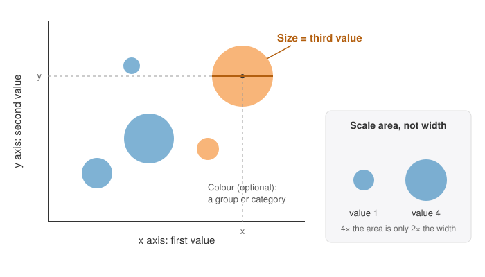

<head>
    <script type="application/ld+json">
        {JSON.stringify({
            "@context": "https://schema.org",
            "@type": "FAQPage",
            "mainEntity": [
                {
                    "@type": "Question",
                    "name": "What is a bubble chart used for?",
                    "acceptedAnswer": { "@type": "Answer", "text": "A bubble chart is used to compare items that each have three numeric values, such as countries by income, life expectancy and population, or stores by advertising spend, sales and number of customers. Two values set each bubble's position and the third sets its size, so you can see a relationship and which items are biggest at the same time." }
                },
                {
                    "@type": "Question",
                    "name": "What is the difference between a scatter plot and a bubble chart?",
                    "acceptedAnswer": { "@type": "Answer", "text": "A scatter plot shows two values per item, with every dot the same size. A bubble chart adds a third value by changing the size of each dot. Choose a scatter plot when the third value doesn't matter or when there are many points, because equal dots are easier to read and overlap less." }
                },
                {
                    "@type": "Question",
                    "name": "How do you interpret a bubble chart?",
                    "acceptedAnswer": { "@type": "Answer", "text": "Read the position first, as on a scatter plot: further right means a larger x value and higher up means a larger y value. Then compare the bubble sizes for the third value. Finally, check whether the big bubbles collect in one part of the chart, which tells you how the third value relates to the other two." }
                },
                {
                    "@type": "Question",
                    "name": "Should bubble size show area or diameter?",
                    "acceptedAnswer": { "@type": "Answer", "text": "Area. People judge a circle by how much space it covers, so a value twice as large should get twice the area. If the diameter is made proportional to the value instead, a value twice as large covers four times the area. To scale by area, make each diameter proportional to the square root of the value." }
                },
                {
                    "@type": "Question",
                    "name": "How do you make a bubble chart?",
                    "acceptedAnswer": { "@type": "Answer", "text": "Put your data in three columns: the x value, the y value and the size value for each item. Choose which value goes on each axis and which sets the size, scale the bubbles by area, label both axes with units, say what bubble size means, and use semi-transparent fills so overlapping bubbles stay visible." }
                },
                {
                    "@type": "Question",
                    "name": "How do I make a bubble chart in JavaScript?",
                    "acceptedAnswer": { "@type": "Answer", "text": "With SciChart.js, create a SciChartSurface with two NumericAxis objects, then add a FastBubbleRenderableSeries with an XyzDataSeries holding your x, y and z values, where z sets each bubble's diameter in pixels, and a point marker such as EllipsePointMarker. The same chart works in React with scichart-react and in Angular with scichart-angular." }
                }
            ]
        })}
    </script>
</head>

# Bubble Chart

## What is a bubble chart?

A **bubble chart** (also called a bubble graph or bubble plot) is a chart that shows three numeric values for each item. Like a [scatter plot](/learn/scatter-plot/), two of the values set where each bubble sits across and up the chart. The third sets the **size** of the bubble. Colour can add a fourth, such as a group.


*A bubble chart of advertising spend, sales and customers for 36 stores in three regions (sample data). [Try the interactive version](#how-to-create-a-bubble-chart-in-javascript-react-or-angular).*

:::tip Key takeaways
- A bubble chart shows **three values per item**: two as position, one as bubble size.
- Read **position first**, then **size**, then check where the big bubbles sit.
- Size bubbles by **area**, not width: make the diameter proportional to the **square root** of the value.
- Sizes are good for "much bigger" or "about the same", not for exact values.
- Keep to a few dozen bubbles. With more, use a plain [scatter plot](/learn/scatter-plot/).
:::

## How to read a bubble chart



1. **Check what each part shows.** Find the value along the bottom (x), the value up the side (y), and what bubble size stands for. A good chart says all three, with units.
2. **Read the position.** Further right means a larger x value; higher up means a larger y value. Bubbles rising from bottom left to top right show that x and y increase together (a **positive correlation**, explained on the [scatter plot](/learn/scatter-plot/#how-to-read-a-scatter-plot) page).
3. **Compare the sizes.** A bigger bubble means a larger third value. Pick out the largest few, as they are usually the items that matter most.
4. **Look for where big bubbles sit.** If the big bubbles collect in one corner, the third value is related to the other two. If big and small bubbles are mixed everywhere, it isn't.
5. **Use colour, if there is any,** to compare groups: is one group further right, higher up or bigger than another?

Treat sizes as rough comparisons. Research on how people read charts has found that we judge position much more accurately than area. Use the tooltip or a table when exact numbers matter.

## How to describe a bubble chart

To summarise a bubble chart in a report or an exam answer, cover the relationship first and the bubble size second:

> There is a **[strong / weak]**, **[positive / negative / no]** relationship between **[x]** and **[y]**. **[Size value]** **[is larger where… / shows no clear pattern]**. **[Name any group or item that stands out.]**

**Worked example,** using the store chart above: "There is a strong, positive relationship between advertising spend and sales: stores that spend more sell more, at about $3.80 of extra sales for each extra dollar spent. The number of customers shows no clear pattern, as large and small bubbles appear at every level of spend. West stores spend and sell the most, North stores the least."

| What you see | What it means |
| --- | --- |
| Bubbles rise from left to right and get bigger as they go | All three values increase together |
| Bubbles rise from left to right, with big and small bubbles mixed | x and y are related; the size value isn't related to either |
| A few very large bubbles in one corner | A few big items drive that part of the chart; check them first |
| Each colour sits in its own area | The groups differ; describe each group's position and size |

## When to use a bubble chart

Use a bubble chart when each item has **three numeric values** and you want to see how two of them relate while also comparing the third. Classic examples are countries by income, life expectancy and population, as made famous by the Gapminder project, and products by price, rating and units sold.

| Chart | Best for |
| --- | --- |
| **Bubble chart** | Three values per item, for up to a few dozen items, when the third value is about size or importance |
| [Scatter plot](/learn/scatter-plot/) | Two values per item, or many points; equal dots are easier to read and overlap less |
| Scatter plot coloured by the third value | A third value that is a level rather than an amount, such as temperature, and many points |
| [Bar chart](/learn/bar-chart/) | Comparing one value exactly across items, when the relationship between values doesn't matter |
| [Heatmap](/learn/heatmap/) | Very dense two-value data, where colour shows how many points fall in each cell |

If the third value isn't important, a scatter plot is clearer. If you only need to compare the third value, a bar chart is more precise.

## Sizing bubbles: area, not diameter

The most common bubble chart mistake is scaling the bubble's **width** (diameter) to the value. A circle twice as wide covers **four times** the area, and the eye compares circles by area. So a value twice as large looks four times as big, and the differences in the data are exaggerated.

The fix is to make each bubble's **area** proportional to its value. In practice, set the diameter to the **square root** of the value multiplied by a constant. A value four times as large then gets a bubble twice as wide.

The chart below shows the same four values, 1, 2, 4 and 8, sized both ways. In the top row (area) the 8 looks about eight times the 1. In the bottom row (diameter) it looks about 64 times bigger. Untick a row in the legend to look at the other on its own.

<LiveDocSnippet maxWidth={'100%'} name="./Scaling/demo" />

| Value | Diameter when sized by area | Diameter when sized by width | Area when sized by width |
| --- | --- | --- | --- |
| 1 | 1 | 1 | 1 |
| 2 | 1.41 | 2 | 4 |
| 4 | 2 | 4 | 16 |
| 8 | 2.83 | 8 | 64 |

## Common bubble chart mistakes

Run through this checklist before you publish a bubble chart:

- **Bubbles scaled by width instead of area.** Use the square root of the value for the diameter (see above).
- **No key for size.** Readers can't tell what a big bubble means. Say what size shows in the title, the legend or a note, and add two or three reference circles if exact sizes matter.
- **Too many bubbles.** Large bubbles overlap and hide the small ones behind them. Keep to a few dozen, use semi-transparent fills, draw small bubbles on top, or switch to a scatter plot.
- **Zero or negative values as size.** A circle can't have a negative area. Show the sign with colour, or use a different chart.
- **Bubbles squashed into a corner.** One huge item can push the rest into a cluster. Check the axis ranges, and consider a logarithmic axis for values that span several orders of magnitude.
- **Reading cause into the pattern.** As with any scatter plot, two values that move together don't prove that one causes the other.

## How to create a bubble chart in JavaScript, React or Angular

SciChart.js draws bubble charts with WebGL and WebGPU, so they stay smooth to zoom and pan with large datasets and live updates. Try the chart below: scroll to zoom, drag to pan, double-click to reset, and hover to see each region's nearest store and its number of customers.

<LiveDocSnippet maxWidth={'100%'} name="./Basic/demo" />

<LearnCta position="top" chart="bubble chart" demo="bubble-chart" docs="/2d-charts/chart-types/fast-bubble-renderable-series/" />

Here is the code for this chart:

<CodeSnippetBlock labels={["JavaScript", "React", "Angular"]}>
    ```ts showLineNumbers file=./Basic/demo.ts start=#region_A_start end=#region_A_end
    ```

    ```tsx
    import { SciChartReact } from "scichart-react";
    import {
        SciChartSurface,
        NumericAxis,
        XyzDataSeries,
        FastBubbleRenderableSeries,
        EllipsePointMarker,
        SciChartJsNavyTheme
    } from "scichart";

    // initChart builds the chart; SciChartReact creates it, sizes it and cleans it up
    const initChart = async (rootElement: string | HTMLDivElement) => {
        const { wasmContext, sciChartSurface } = await SciChartSurface.create(rootElement, {
            theme: new SciChartJsNavyTheme()
        });
        sciChartSurface.xAxes.add(new NumericAxis(wasmContext, { axisTitle: "Advertising spend ($k)" }));
        sciChartSurface.yAxes.add(new NumericAxis(wasmContext, { axisTitle: "Sales ($k)" }));

        const { xValues, yValues, sizeValues } = getYourXyzData();
        // z is the bubble's diameter in pixels: use the square root so area matches the value
        const zValues = sizeValues.map((value) => Math.sqrt(value) * 0.9);
        sciChartSurface.renderableSeries.add(
            new FastBubbleRenderableSeries(wasmContext, {
                dataSeries: new XyzDataSeries(wasmContext, { xValues, yValues, zValues }),
                pointMarker: new EllipsePointMarker(wasmContext, {
                    width: 64,
                    height: 64,
                    strokeThickness: 0,
                    fill: "#50C7E099"
                })
            })
        );
        return { sciChartSurface };
    };

    export const BubbleChart = () => (
        <SciChartReact initChart={initChart} style={{ width: "100%", height: 400 }} />
    );
    ```

    ```ts
    import { Component } from "@angular/core";
    import { ScichartAngularComponent } from "scichart-angular";
    import {
        SciChartSurface,
        NumericAxis,
        XyzDataSeries,
        FastBubbleRenderableSeries,
        EllipsePointMarker,
        SciChartJsNavyTheme
    } from "scichart";

    @Component({
        selector: "app-bubble-chart",
        standalone: true,
        imports: [ScichartAngularComponent],
        template: `<scichart-angular [initChart]="initChart" style="display: block; width: 100%; height: 400px"></scichart-angular>`
    })
    export class BubbleChartComponent {
        // initChart builds the chart; scichart-angular creates it, sizes it and cleans it up
        initChart = async (rootElement: string | HTMLDivElement) => {
            const { wasmContext, sciChartSurface } = await SciChartSurface.create(rootElement, {
                theme: new SciChartJsNavyTheme()
            });
            sciChartSurface.xAxes.add(new NumericAxis(wasmContext, { axisTitle: "Advertising spend ($k)" }));
            sciChartSurface.yAxes.add(new NumericAxis(wasmContext, { axisTitle: "Sales ($k)" }));

            const { xValues, yValues, sizeValues } = getYourXyzData();
            // z is the bubble's diameter in pixels: use the square root so area matches the value
            const zValues = sizeValues.map((value) => Math.sqrt(value) * 0.9);
            sciChartSurface.renderableSeries.add(
                new FastBubbleRenderableSeries(wasmContext, {
                    dataSeries: new XyzDataSeries(wasmContext, { xValues, yValues, zValues }),
                    pointMarker: new EllipsePointMarker(wasmContext, {
                        width: 64,
                        height: 64,
                        strokeThickness: 0,
                        fill: "#50C7E099"
                    })
                })
            );
            return { sciChartSurface };
        };
    }
    ```
</CodeSnippetBlock>

Key points:

- An [XyzDataSeries](https://www.scichart.com/documentation/js/current/typedoc/classes/xyzdataseries.html) holds an x value, a y value and a z value per bubble.
- A [FastBubbleRenderableSeries](https://www.scichart.com/documentation/js/current/typedoc/classes/fastbubblerenderableseries.html) uses the z value as each bubble's **diameter in pixels**, so pass the square root of your size value. Its `zMultiplier` property scales every bubble at once.
- The `pointMarker` sets the bubble's shape and colour. Draw it large (here 64 × 64) with no stroke: SciChart scales it to each bubble, and a stroke would be scaled too.
- For several groups, add one series per group, each with its own colour, as the demo does. Its tooltip template looks up the number of customers, so readers see the real value rather than the size in pixels.

**See it in the demo app:** [JavaScript bubble chart](https://www.scichart.com/demo/javascript/bubble-chart) · [React bubble chart](https://www.scichart.com/demo/react/bubble-chart) · [Angular bubble chart](https://www.scichart.com/demo/angular/bubble-chart)

**Go deeper:** [SciChart.js bubble chart documentation](/2d-charts/chart-types/fast-bubble-renderable-series/), including scaling bubbles with zoom and colouring individual bubbles.

## Frequently asked questions

### What is a bubble chart used for?

A bubble chart is used to compare items that each have three numeric values, such as countries by income, life expectancy and population, or stores by advertising spend, sales and number of customers. Two values set each bubble's position and the third sets its size, so you can see a relationship and which items are biggest at the same time.

### What is the difference between a scatter plot and a bubble chart?

A scatter plot shows two values per item, with every dot the same size. A bubble chart adds a third value by changing the size of each dot. Choose a scatter plot when the third value doesn't matter or when there are many points, because equal dots are easier to read and overlap less.

### How do you interpret a bubble chart?

Read the position first, as on a scatter plot: further right means a larger x value and higher up means a larger y value. Then compare the bubble sizes for the third value. Finally, check whether the big bubbles collect in one part of the chart, which tells you how the third value relates to the other two.

### Should bubble size show area or diameter?

Area. People judge a circle by how much space it covers, so a value twice as large should get twice the area. If the diameter is made proportional to the value instead, a value twice as large covers four times the area. To scale by area, make each diameter proportional to the square root of the value.

### How do you make a bubble chart?

Put your data in three columns: the x value, the y value and the size value for each item. Choose which value goes on each axis and which sets the size, scale the bubbles by area, label both axes with units, say what bubble size means, and use semi-transparent fills so overlapping bubbles stay visible.

### How do I make a bubble chart in JavaScript?

With SciChart.js, create a `SciChartSurface` with two `NumericAxis` objects, then add a `FastBubbleRenderableSeries` with an `XyzDataSeries` holding your x, y and z values, where z sets each bubble's diameter in pixels, and a point marker such as `EllipsePointMarker`. The same chart works in React with `scichart-react` and in Angular with `scichart-angular`. See the code above.

## Sources

- Cleveland, W. S. and McGill, R. (1984), [Graphical Perception: Theory, Experimentation, and Application to the Development of Graphical Methods](https://doi.org/10.1080/01621459.1984.10478080). *Journal of the American Statistical Association*, 79(387), 531–554. Experiments showing that people judge position more accurately than area.
- Gapminder, [Gapminder Tools](https://www.gapminder.org/tools/). The interactive bubble chart of income, life expectancy and population by country, popularised by Hans Rosling.

<LearnCta position="bottom" chart="bubble chart" demo="bubble-chart" docs="/2d-charts/chart-types/fast-bubble-renderable-series/" />
