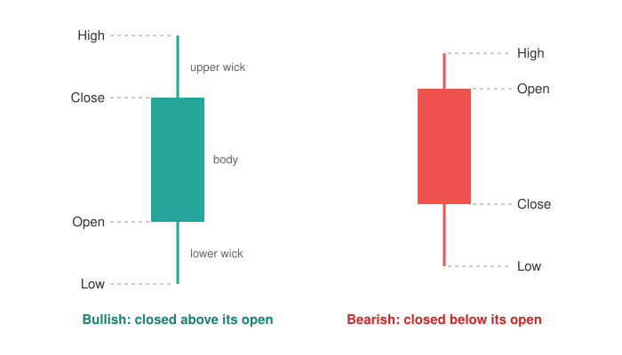

<head>
    <script type="application/ld+json">
        {JSON.stringify({
            "@context": "https://schema.org",
            "@type": "FAQPage",
            "mainEntity": [
                {
                    "@type": "Question",
                    "name": "How do you read a candlestick chart?",
                    "acceptedAnswer": { "@type": "Answer", "text": "Each candle is one period, such as a day. The thick body runs from the opening price to the closing price, and the thin wicks reach the highest and lowest prices of the period. A green candle closed higher than it opened; a red candle closed lower. Read the candles from left to right to follow the price over time." }
                },
                {
                    "@type": "Question",
                    "name": "What do green and red candles mean?",
                    "acceptedAnswer": { "@type": "Answer", "text": "A green (bullish) candle closed higher than it opened, so the price rose during the period. A red (bearish) candle closed lower than it opened, so the price fell. Some charts use hollow and filled candles, or other colours, instead, so check the chart's key." }
                },
                {
                    "@type": "Question",
                    "name": "What is a doji candlestick?",
                    "acceptedAnswer": { "@type": "Answer", "text": "A doji is a candle whose open and close are almost equal, so its body is a thin line, often with wicks on both sides. It shows that the price moved during the period but ended about where it started: buyers and sellers finished roughly balanced." }
                },
                {
                    "@type": "Question",
                    "name": "What is a hammer candlestick?",
                    "acceptedAnswer": { "@type": "Answer", "text": "A hammer has a small body near the top of its range and a long lower wick, at least two times as long as the body. It shows that sellers pushed the price well down during the period but buyers pushed it back up before the close. Traders watch for it after a fall, as a possible sign of a turn." }
                },
                {
                    "@type": "Question",
                    "name": "What is the difference between a candlestick chart and an OHLC chart?",
                    "acceptedAnswer": { "@type": "Answer", "text": "Both show the open, high, low and close for each period. An OHLC chart draws each period as a vertical bar with a tick to the left for the open and a tick to the right for the close. A candlestick chart fills the range between open and close as a coloured body, which makes rising and falling periods easier to see at a glance." }
                },
                {
                    "@type": "Question",
                    "name": "How do I make a candlestick chart in JavaScript?",
                    "acceptedAnswer": { "@type": "Answer", "text": "With SciChart.js, create a SciChartSurface, add a CategoryAxis and a NumericAxis, then add a FastCandlestickRenderableSeries with an OhlcDataSeries holding your x, open, high, low and close values. The same chart works in React with scichart-react and in Angular with scichart-angular." }
                }
            ]
        })}
    </script>
</head>

# Candlestick Chart

## What is a candlestick chart?

A **candlestick chart** (also called a Japanese candlestick chart or K-line chart) is a price chart in which each "candle" sums up one period (say, a day) with four prices: the **open**, **high**, **low** and **close**. The body spans the open and close, the wicks reach the high and low, and the colour shows whether the price rose or fell.


*A candlestick chart of 150 days of prices (sample data), with green candles for rising days and red for falling days. [Try the interactive version](#how-to-create-a-candlestick-chart-in-javascript-react-or-angular).*

:::tip Key takeaways
- Each candle shows **four prices for one period**: open, high, low and close.
- The **body** runs from open to close; the **wicks** reach the high and low. **Green** means the price closed higher, **red** that it closed lower.
- Describe a candle in a sentence: "opened at *$100*, traded between *$98* and *$108*, and closed *up* at *$106*".
- **The timeframe changes the picture:** four hourly candles merge into one four-hour candle that can look completely different.
- Candlestick **patterns describe what happened**. They are not reliable predictions on their own.
:::

## How to read a candlestick chart



1. **Check the timeframe.** Each candle covers one period: a minute, an hour, a day or a week. The time axis or the chart's settings tell you which.
2. **Read the colour.** A **green** (bullish) candle closed above its open, so the price rose. A **red** (bearish) candle closed below its open, so it fell. Some charts use hollow (rising) and filled (falling) candles instead.
3. **Read the body.** It spans the open and the close. On a green candle the open is at the bottom of the body and the close at the top; on a red candle it's the other way round. A **long body** means a strong move in one direction; a **short body** means little net change.
4. **Read the wicks.** The thin lines above and below the body, also called **shadows**, reach the period's **high** and **low**. A **long wick** means the price got that far but was pushed back before the period ended.
5. **Read the sequence.** Follow the candles from left to right. A run of mostly green candles stepping upwards is an uptrend; mostly red candles stepping down is a downtrend.

## How to describe a candlestick

Every candle can be put into words with the same template:

> The price opened at **[open]**, traded between **[low]** and **[high]**, and closed **[up / down]** at **[close]**: a **[bullish / bearish]** candle with a **[long / short]** body and **[long / short]** wicks.

**Worked example:** a day with open $100, high $108, low $98 and close $106.

| Measure | Calculation | Value |
| --- | --- | --- |
| Direction | Close above open | Bullish (green) |
| Range (high − low) | 108 − 98 | $10 |
| Body (close − open) | 106 − 100 | $6, or 60% of the range |
| Upper wick (high − top of body) | 108 − 106 | $2 |
| Lower wick (bottom of body − low) | 100 − 98 | $2 |

"The price opened at $100, traded between $98 and $108, and closed up at $106: a bullish candle with a long body and short wicks." The body takes up most of the range, so buyers were in control for most of the day.

Comparing the body with the range is the quickest way to classify a candle. A body that fills almost the whole range is a strong one-way move. A body that is tiny compared with the range (a doji or a spinning top) means the price went up and down but ended near where it started.

## How the timeframe changes the candles

The same prices look different depending on how long each candle covers. A longer candle is built from the shorter ones inside it:

- **open:** the open of the first short candle;
- **high:** the highest high of all of them;
- **low:** the lowest low of all of them;
- **close:** the close of the last short candle.

**Worked example:** four one-hour candles merged into one four-hour candle.

| Candle | Open | High | Low | Close | Direction |
| --- | --- | --- | --- | --- | --- |
| 09:00–10:00 | 100 | 103 | 99 | 102 | Up |
| 10:00–11:00 | 102 | 104 | 100 | 101 | Down |
| 11:00–12:00 | 101 | 102 | 97 | 98 | Down |
| 12:00–13:00 | 98 | 101 | 96 | 100 | Up |
| **09:00–13:00 (merged)** | **100** | **104** | **96** | **100** | **Unchanged: a doji** |

On the hourly chart there is a rise, a two-hour fall and a recovery. On the four-hour chart the same morning is a single doji with long wicks on both sides. Neither view is wrong, but a pattern seen on one timeframe may not exist on another. Always say which timeframe you're looking at.

## Common candlestick patterns

Traders give names to candles and small groups of candles with a recognisable shape. The table describes what each one shows about the period. Studies of candlestick trading rules on real market data have found little evidence that these patterns predict prices reliably on their own (see [Sources](#sources)), so treat them as descriptions, not signals.

| Pattern | What it looks like | What it shows |
| --- | --- | --- |
| Doji | Open and close almost equal, so the body is a thin line | The price moved but ended where it started; neither side won the period |
| Hammer | Small body near the top, long lower wick | Sellers drove the price well down, then buyers pushed it back up; watched for after a fall |
| Shooting star | Small body near the bottom, long upper wick | The mirror image of a hammer: buyers drove the price up, then sellers pushed it back down; watched for after a rise |
| Bullish engulfing | A green body that completely covers the previous red body | Buyers more than reversed the previous period's fall |
| Bearish engulfing | A red body that completely covers the previous green body | Sellers more than reversed the previous period's rise |
| Marubozu | A long body with almost no wicks | One side was in control from open to close |

## When to use a candlestick chart

Use a candlestick chart when your data has an **open, high, low and close for each period**, and the reader cares about how the price moved within each period, not just where it ended. Candlestick charts are standard for stocks, forex, crypto and commodities, and are often shown with **volume bars** underneath and **technical indicators** such as moving averages on top. If you'd rather see the same four prices as thin bars with open and close ticks, read [OHLC chart vs candlestick chart](/learn/ohlc-chart/#ohlc-chart-vs-candlestick-chart).

| If the reader needs to… | Use |
| --- | --- |
| See the direction and range of each period, and spot patterns | **Candlestick chart** |
| See the same four prices in a thinner, more compact form, with many periods on screen | [OHLC chart](/learn/ohlc-chart/) |
| Follow the long-term trend, or compare several prices on one chart | [Line chart](/learn/line-chart/) of the closing price |
| Compare the spread of measured values across groups (not prices over time) | [Box plot](/learn/box-plot/), which looks similar but shows quartiles, not open and close |

## Candlestick chart mistakes to avoid

- **Mixing timeframes.** A "hammer" on a 5-minute chart and a hammer on a weekly chart describe very different things. Check the timeframe before reading any pattern.
- **Assuming the colours.** Green-up, red-down is common but not universal. Some platforms and markets use other colours or hollow candles, so check the chart's key.
- **Gaps on the time axis.** A plain date axis leaves empty spaces for weekends and holidays when markets are closed. An axis that spaces candles evenly by index closes those gaps.
- **Reading one candle in isolation.** A single candle says what happened in one period. Its meaning depends on the trend before it, the volume behind it and the timeframe.
- **Treating patterns as predictions.** Patterns are labels for shapes, not forecasts. Test any trading idea on historical data before relying on it.
- **Too many candles on screen.** With years of daily data, candles shrink to slivers and the bodies disappear. Zoom in, or switch to a longer timeframe or a line chart for the long view.

## How to create a candlestick chart in JavaScript, React or Angular

SciChart.js draws candlestick charts with WebGL and WebGPU, so they stay smooth to zoom and pan with years of data and live, tick-by-tick updates. Try the chart below: scroll to zoom, drag to pan, double-click to reset, and hover over a candle to see its open, high, low and close.

<LiveDocSnippet maxWidth={'100%'} name="./Basic/demo" />

<LearnCta position="top" chart="candlestick chart" demo="candlestick-chart" docs="/2d-charts/chart-types/fast-candlestick-renderable-series/" />

Here is the code for this chart:

<CodeSnippetBlock labels={["JavaScript", "React", "Angular"]}>
    ```ts showLineNumbers file=./Basic/demo.ts start=#region_A_start end=#region_A_end
    ```

    ```tsx
    import { SciChartReact } from "scichart-react";
    import {
        SciChartSurface,
        CategoryAxis,
        NumericAxis,
        FastCandlestickRenderableSeries,
        OhlcDataSeries,
        SciChartJsNavyTheme
    } from "scichart";

    // initChart builds the chart; SciChartReact creates it, sizes it and cleans it up
    const initChart = async (rootElement: string | HTMLDivElement) => {
        const { wasmContext, sciChartSurface } = await SciChartSurface.create(rootElement, {
            theme: new SciChartJsNavyTheme()
        });
        const xAxis = new CategoryAxis(wasmContext);
        // Show dates as day and month, e.g. "21 Jan"
        xAxis.labelProvider.formatLabel = (unixSeconds) =>
            new Date(unixSeconds * 1000).toLocaleDateString("en-GB", { day: "numeric", month: "short", timeZone: "UTC" });
        sciChartSurface.xAxes.add(xAxis);
        sciChartSurface.yAxes.add(new NumericAxis(wasmContext, { labelPrefix: "$", labelPrecision: 2 }));

        const { xValues, openValues, highValues, lowValues, closeValues } = getYourOhlcData();
        sciChartSurface.renderableSeries.add(
            new FastCandlestickRenderableSeries(wasmContext, {
                dataSeries: new OhlcDataSeries(wasmContext, { xValues, openValues, highValues, lowValues, closeValues }),
                brushUp: "#26a69a",
                strokeUp: "#26a69a",
                brushDown: "#ef5350",
                strokeDown: "#ef5350"
            })
        );
        return { sciChartSurface };
    };

    export const CandlestickChart = () => (
        <SciChartReact initChart={initChart} style={{ width: "100%", height: 400 }} />
    );
    ```

    ```ts
    import { Component } from "@angular/core";
    import { ScichartAngularComponent } from "scichart-angular";
    import {
        SciChartSurface,
        CategoryAxis,
        NumericAxis,
        FastCandlestickRenderableSeries,
        OhlcDataSeries,
        SciChartJsNavyTheme
    } from "scichart";

    @Component({
        selector: "app-candlestick-chart",
        standalone: true,
        imports: [ScichartAngularComponent],
        template: `<scichart-angular [initChart]="initChart" style="display: block; width: 100%; height: 400px"></scichart-angular>`
    })
    export class CandlestickChartComponent {
        // initChart builds the chart; scichart-angular creates it, sizes it and cleans it up
        initChart = async (rootElement: string | HTMLDivElement) => {
            const { wasmContext, sciChartSurface } = await SciChartSurface.create(rootElement, {
                theme: new SciChartJsNavyTheme()
            });
            const xAxis = new CategoryAxis(wasmContext);
            // Show dates as day and month, e.g. "21 Jan"
            xAxis.labelProvider.formatLabel = (unixSeconds) =>
                new Date(unixSeconds * 1000).toLocaleDateString("en-GB", { day: "numeric", month: "short", timeZone: "UTC" });
            sciChartSurface.xAxes.add(xAxis);
            sciChartSurface.yAxes.add(new NumericAxis(wasmContext, { labelPrefix: "$", labelPrecision: 2 }));

            const { xValues, openValues, highValues, lowValues, closeValues } = getYourOhlcData();
            sciChartSurface.renderableSeries.add(
                new FastCandlestickRenderableSeries(wasmContext, {
                    dataSeries: new OhlcDataSeries(wasmContext, { xValues, openValues, highValues, lowValues, closeValues }),
                    brushUp: "#26a69a",
                    strokeUp: "#26a69a",
                    brushDown: "#ef5350",
                    strokeDown: "#ef5350"
                })
            );
            return { sciChartSurface };
        };
    }
    ```
</CodeSnippetBlock>

Key points:

- An [OhlcDataSeries](https://www.scichart.com/documentation/js/current/typedoc/classes/ohlcdataseries.html) holds your data: one x value (a Unix timestamp in seconds) plus open, high, low and close values per candle.
- A [CategoryAxis](https://www.scichart.com/documentation/js/current/typedoc/classes/categoryaxis.html) spaces candles evenly and closes gaps for weekends and holidays. Its `labelProvider.formatLabel` sets how the dates read, here day and month ("21 Jan"). For 24/7 markets such as crypto, a `DateTimeNumericAxis` works too.
- A [FastCandlestickRenderableSeries](https://www.scichart.com/documentation/js/current/typedoc/classes/fastcandlestickrenderableseries.html) draws the candles. `brushUp`, `brushDown`, `strokeUp` and `strokeDown` set the bullish and bearish colours, and `dataPointWidth` sets how much of each slot a candle fills.
- `CursorModifier` adds the tooltip; `MouseWheelZoomModifier`, `ZoomPanModifier` and `ZoomExtentsModifier` add zooming, panning and the double-click reset.

**See it in the demo app:** [JavaScript candlestick chart](https://www.scichart.com/demo/javascript/candlestick-chart) · [React candlestick chart](https://www.scichart.com/demo/react/candlestick-chart) · [Angular candlestick chart](https://www.scichart.com/demo/angular/candlestick-chart)

**Go deeper:** [SciChart.js candlestick chart documentation](/2d-charts/chart-types/fast-candlestick-renderable-series/), including volume bars and colouring individual candles.

## Building a full trading chart?

[SciTrader.js](/financial-charts/overview/), SciChart's financial charts SDK, gives you a ready-made trading chart built around candlesticks: live Binance and Coinbase feeds, 30+ technical indicators, drawing tools and multiple panes, in JavaScript, TypeScript and React. See what it can do on the [JavaScript stock charts](https://www.scichart.com/javascript-stock-charts/) page.

## Frequently asked questions

### How do you read a candlestick chart?

Each candle is one period, such as a day. The thick body runs from the opening price to the closing price, and the thin wicks reach the highest and lowest prices of the period. A green candle closed higher than it opened; a red candle closed lower. Read the candles from left to right to follow the price over time.

### What do green and red candles mean?

A green (bullish) candle closed higher than it opened, so the price rose during the period. A red (bearish) candle closed lower than it opened, so the price fell. Some charts use hollow and filled candles, or other colours, instead, so check the chart's key.

### What is a doji candlestick?

A doji is a candle whose open and close are almost equal, so its body is a thin line, often with wicks on both sides. It shows that the price moved during the period but ended about where it started: buyers and sellers finished roughly balanced.

### What is a hammer candlestick?

A hammer has a small body near the top of its range and a long lower wick, at least two times as long as the body. It shows that sellers pushed the price well down during the period but buyers pushed it back up before the close. Traders watch for it after a fall, as a possible sign of a turn.

### What is the difference between a candlestick chart and an OHLC chart?

Both show the open, high, low and close for each period. An OHLC chart draws each period as a vertical bar with a tick to the left for the open and a tick to the right for the close. A candlestick chart fills the range between open and close as a coloured body, which makes rising and falling periods easier to see at a glance.

### How do I make a candlestick chart in JavaScript?

With SciChart.js, create a `SciChartSurface`, add a `CategoryAxis` and a `NumericAxis`, then add a `FastCandlestickRenderableSeries` with an `OhlcDataSeries` holding your x, open, high, low and close values. The same chart works in React with `scichart-react` and in Angular with `scichart-angular`.

## Sources

- Wikipedia, [Candlestick chart](https://en.wikipedia.org/wiki/Candlestick_chart). Other names for the chart, how bodies and wicks are defined, and its history from Japanese rice trading to Steve Nison's *Japanese Candlestick Charting Techniques* (1991).
- Wikipedia, [Open-high-low-close chart](https://en.wikipedia.org/wiki/Open-high-low-close_chart). The bar-and-tick alternative that shows the same four prices.
- Marshall, B. R., Young, M. R. and Rose, L. C. (2006), [Candlestick technical trading strategies: Can they create value for investors?](https://doi.org/10.1016/j.jbankfin.2005.08.001) *Journal of Banking & Finance*, 30(8), 2303–2323. A test of candlestick trading strategies on the Dow Jones Industrial Average stocks from 1992 to 2002, which found that they did not create value for investors.

<LearnCta position="bottom" chart="candlestick chart" demo="candlestick-chart" docs="/2d-charts/chart-types/fast-candlestick-renderable-series/" />
