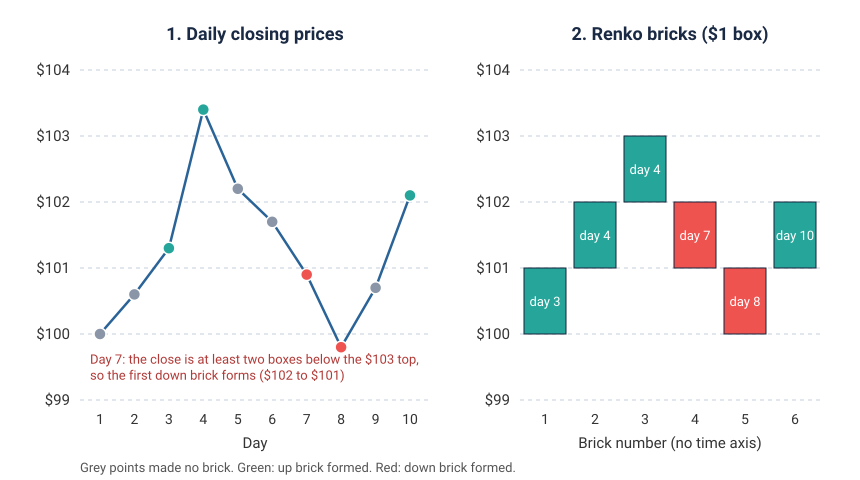

<head>
    <script type="application/ld+json">
        {JSON.stringify({
            "@context": "https://schema.org",
            "@type": "FAQPage",
            "mainEntity": [
                {
                    "@type": "Question",
                    "name": "How do you read a Renko chart?",
                    "acceptedAnswer": { "@type": "Answer", "text": "Each brick stands for a price move of one box size. A green (up) brick means the price rose by a full box; a red (down) brick means it fell by a full box. A run of same-colour bricks is a trend, and a change of colour is a reversal of at least two boxes. The horizontal axis counts bricks, not days, so the width of the chart says nothing about how long the moves took." }
                },
                {
                    "@type": "Question",
                    "name": "What box size should I use for a Renko chart?",
                    "acceptedAnswer": { "@type": "Answer", "text": "Start from the instrument's volatility. A box equal to the 14-period average true range (ATR) is a common default, because it sizes bricks to the typical daily range. A smaller box shows more detail and more reversals; a larger one shows only the main trend. A fixed price or a percentage of price also work, and the right size depends on the timeframe you trade or analyse." }
                },
                {
                    "@type": "Question",
                    "name": "Why does a Renko reversal need two bricks?",
                    "acceptedAnswer": { "@type": "Answer", "text": "A new brick starts from the edge of the last brick. After an up brick from 101 to 102, the next down brick runs from 101 to 100, so the price has to fall to 100: two boxes below the top of the last brick. Continuing the trend needs one box; reversing it needs two. That gap is what filters out small back-and-forth moves." }
                },
                {
                    "@type": "Question",
                    "name": "Is a Renko chart better than a candlestick chart?",
                    "acceptedAnswer": { "@type": "Answer", "text": "They answer different questions. A candlestick chart shows what happened in each period of time, with the open, high, low and close. A Renko chart drops time and small moves to show the direction and size of the larger moves. You can keep both on screen: candles for timing and detail, Renko for the trend." }
                },
                {
                    "@type": "Question",
                    "name": "What is ATR Renko?",
                    "acceptedAnswer": { "@type": "Answer", "text": "ATR Renko is a Renko chart whose box size is set from the average true range, a measure of how far the price typically moves in one period, usually over 14 periods. The box is worked out once from the ATR and then stays fixed while the bricks are drawn, so a more volatile instrument gets larger bricks automatically." }
                },
                {
                    "@type": "Question",
                    "name": "How do I make a Renko chart in JavaScript?",
                    "acceptedAnswer": { "@type": "Answer", "text": "Compute the bricks from your prices with a short function (box size, last brick top and bottom, one brick per box crossed), then draw them in SciChart.js as a FastRectangleRenderableSeries with an XyxyDataSeries holding each brick's left and right edges and top and bottom prices. Use one series for up bricks and one for down bricks. SciTrader.js, SciChart's financial charts SDK, also has a ready-made RenkoStudy." }
                }
            ]
        })}
    </script>
</head>

# Renko Chart

## What is a Renko chart?

A **Renko chart** is a price chart made of equal-sized bricks, where each brick stands for a fixed price move (the box size) and time is ignored. A new brick is drawn only when the price moves a full box beyond the last one, up (green) or down (red), so small moves disappear and the trend stands out.


*Sample prices as daily candles (top) and as Renko bricks with a \$2 box (bottom). [Try the interactive version](#how-to-create-a-renko-chart-in-javascript-react-or-angular).*

:::tip Key takeaways
- Every brick is the same height: one box size. The horizontal axis counts bricks, not days.
- A brick continues the trend after a move of one box, and reverses it after a move of two boxes.
- The box size decides what you see. Set it as a fixed price, from the average true range (ATR) or as a percentage of price.
- Renko hides time, volume, wicks and every move smaller than a box. Read it beside a time-based chart.
- Bricks describe past moves. They don't predict future ones.
:::

The name comes from *renga*, the Japanese word for brick. Steve Nison described it in English, with the three-line break and kagi charts, in his 1994 book *Beyond Candlesticks* (see [Sources](#sources)). This page explains how the charts are built and read; it is not investment advice.

## How Renko bricks form

Renko bricks form from price moves alone: nothing is drawn until the price has moved a full box. Building the chart takes three rules:

1. Choose a box size, for example \$1.
2. Draw an up brick each time the price reaches the top of the last brick plus one box. Draw a down brick each time it reaches the bottom of the last brick minus one box.
3. Each new brick starts at the edge of the one before, one column to the right. A move of several boxes in one period draws several bricks.

Rule 2 means a reversal needs a bigger move than a continuation. After an up brick from \$101 to \$102, another up brick needs \$103, one box higher. A down brick, though, has to start from the bottom of the last brick, \$101, and run to \$100. So the price has to fall two boxes from the top before the chart turns red. The same applies in reverse in a downtrend. This two-box reversal is what keeps the chart from flipping colour on every wobble.

### A worked example with a \$1 box

Ten daily closing prices, turned into bricks with a \$1 box, starting from \$100:

| Day | Close | Rule checked | Bricks drawn |
| --- | --- | --- | --- |
| 1 | \$100.00 | Starting point | None |
| 2 | \$100.60 | Needs \$101 (up) or \$99 (down) | None |
| 3 | \$101.30 | Reached \$101 | Up: \$100–101 |
| 4 | \$103.40 | Reached \$102 and \$103 | Up: \$101–102 and \$102–103 |
| 5 | \$102.20 | Needs \$104 (up) or \$101 (down) | None |
| 6 | \$101.70 | Same | None |
| 7 | \$100.90 | Reached \$101, two boxes below the \$103 top | Down: \$102–101 |
| 8 | \$99.80 | Reached \$100 | Down: \$101–100 |
| 9 | \$100.70 | Needs \$102 (up) or \$99 (down) | None |
| 10 | \$102.10 | Reached \$102, two boxes above the \$100 bottom | Up: \$101–102 |



Ten days became six bricks. Days 2, 5, 6 and 9 drew nothing, and day 4 drew two bricks at once. The bricks also hide that the price touched \$103.40 on day 4 and \$99.80 on day 8: only whole boxes count. The `buildBricks` function in the code section further down reproduces these six bricks.

## How to read a Renko chart

Read a Renko chart by its box size, the colour of each brick and the length of each run, never by its horizontal axis.

1. Check the box size first. A brick is a move of one box, so a chart with a \$0.50 box and one with a \$5 box can tell different stories about the same prices.
2. Read the colour. Green (or hollow) bricks are rises of one box; red (or filled) bricks are falls of one box.
3. Read the runs. A long staircase of same-colour bricks is a trend. Short alternating runs are a sideways market, where the price keeps reversing by just over two boxes.
4. Read the turns. A change of colour means the price has moved at least two boxes against the trend. Turning points tend to cluster at the same price levels, which shows where support (a floor buyers defend) and resistance (a ceiling sellers defend) sit.
5. Remember what the horizontal axis is. Ten bricks may have taken one hour or six months. To see when a brick formed, check the date on a time-based chart.

## Choosing the Renko box size

The box size is the one setting that shapes a Renko chart. Too small, and it reproduces every wiggle of a line chart; too large, and it draws only a handful of bricks a year.

| Method | How the box is set | Example | Good for |
| --- | --- | --- | --- |
| Fixed price | A price you choose, such as \$1 or 10 pips | \$2 box on a \$100 stock | One instrument you know well; levels line up with round numbers |
| ATR-based | The average true range over a lookback, usually 14 periods, worked out once | 14-day ATR of \$2.56, so a \$2.56 box | Matching the box to how much the price normally moves; comparing instruments of different volatility |
| Percentage | A share of the price, such as 1% | 1% of \$100 is a \$1 box | Instruments at very different price levels, and long histories where the price has changed a lot |

The average true range, from J. Welles Wilder Jr. (1978), averages each period's true range: the largest of high minus low, high minus the previous close, and the previous close minus low. Including the previous close counts overnight gaps as part of the move. Charting tools differ on when they calculate the ATR box: once when the chart is opened, or again when the chart is rebuilt with new data. Whichever they use, all bricks on one chart share a single box size, so a fresh ATR value can redraw the whole history.

In the demo's sample data, a \$1 box gives 147 bricks and 27 reversals from 250 days, while a \$4 box gives 20 bricks and 3 reversals. The 14-day ATR box (\$2.56) sits between them with 36 bricks.

## Close or high-low: which price makes the bricks?

Renko charts are built from either the closing price of each period or its full range.

- **Close-based bricks** use one price per period. They ignore everything that happened during the period, so they draw fewer bricks and fewer false turns. This is the classic method and the usual default.
- **High-low bricks** use the high to extend rising bricks and the low to extend falling ones. They react to intraday spikes, so they draw more bricks and reverse more often. When a single period's range could both extend and reverse the trend, the rule has to pick one; a common choice is to check the trend's own direction first.

With the demo's sample prices and a \$2 box, the close gives 56 bricks with 9 reversals, and the high-low range gives 76 bricks with 23 reversals.

## What a Renko chart shows and what it hides

A Renko chart makes the direction and length of a trend easy to see, at the cost of time and of every move smaller than a box.

| Shows clearly | Hides or distorts |
| --- | --- |
| The direction of the trend and how long it has lasted, in bricks | Time: a brick may take minutes or months to form |
| Support and resistance, where turns cluster at the same levels | Volume and open interest |
| Breakouts from a sideways range, as the first brick beyond it | Any move smaller than a box, and wicks above and below the bricks |
| The size of each move in fixed units | The actual traded prices: brick edges are round box levels, and a gap through several levels draws bricks at prices that never traded |

Renko also lags. A reversal brick appears only after the price has already moved two boxes against the trend, so the turn on the chart comes later than the turn in the market. The larger the box, the longer the delay.

## Renko vs candlestick, point and figure, Heikin-Ashi and line break charts

Renko is one of several charts that reshape price data to make trends easier to see. The first two in the table keep time on the horizontal axis; the last three drop it.

| Chart | Horizontal axis | What each mark shows | Choose it when you need to… |
| --- | --- | --- | --- |
| [Candlestick chart](/learn/chart-types/cartesian/candlestick-chart/) | Time | Open, high, low and close of one period | See exactly what happened in each period, and when |
| Heikin-Ashi | Time | A smoothed candle: averages of this period's and the previous period's prices | Smooth noise but keep the time axis and every period |
| Renko chart | Brick count | A fixed move of one box size | Show the trend in fixed price steps, with small moves removed |
| Point and figure chart | Column count | A column of X (rising) or O (falling) boxes; usually a three-box reversal | Count the extent of each move in a compact grid, with several boxes per column |
| Line break chart | Line count | A block from the previous close to a new high or low close; reverses when the close passes the last three blocks | Follow closes with blocks of varying height, set by the market rather than a box size |

For the same four prices drawn as bars with ticks instead of bodies, see the [OHLC chart](/learn/chart-types/cartesian/ohlc-chart/) guide. For the long-term path of the closing price alone, a [line chart](/learn/chart-types/cartesian/line-chart/) is simpler than any of these.

## Common Renko chart mistakes

Most Renko mistakes come from forgetting that the bricks ignore time, or from a box size that was chosen badly.

- **Reading the horizontal axis as time.** Bricks are evenly spaced however long they took. A steep-looking run of bricks may have taken months; check the dates.
- **Choosing the box size after the fact.** A box picked because it made past signals look clean is fitted to the past. Choose it from volatility (ATR) or the trading timeframe, and keep it.
- **Treating brick edges as trade prices.** The price may have jumped through several box levels in one move. Bricks drawn in that jump show levels that nobody traded at.
- **Building bricks from unadjusted prices.** A stock split or a large dividend drops the quoted price overnight, and an unadjusted history turns that drop into a run of false down bricks. Use split- and dividend-adjusted prices.
- **Comparing charts with different settings.** Two Renko charts of the same instrument with different box sizes, or close versus high-low bricks, are different charts. Write the box size and price source in the chart's title or caption.
- **Using a box close to the price step or spread.** If the box is only a few ticks, or near the gap between bid and ask prices, bricks follow quote noise rather than real moves. Keep the box many times larger than the smallest price step.

## How to create a Renko chart in JavaScript, React or Angular

Core SciChart.js has no Renko series, so this example computes the bricks with a short function and draws them as rectangles, in a second chart under the 250 daily candles they were built from. To show Renko bricks in SciTrader.js, SciChart's financial charts SDK, see the [SciTrader.js price chart types documentation](/financial-charts/studies-and-indicators/price-chart-types/#renko-and-point-and-figure), which has a ready-made `RenkoStudy`.

Try the chart below. Use **Box size** to switch between a fixed size and one set from the 14-day ATR, and drag **Fixed size** to change the box. **Price source** builds the bricks from the close or the high-low range. **Renko x-axis** switches between brick number and the date each brick formed, which shows how bricks ignore time. Hover a brick to mark the day it formed on the candles, or hover a candle to see the latest brick at that point. Scroll to zoom, drag to pan and double-click to reset.

<LiveDocSnippet maxWidth={'100%'} height={720} name="./Basic/demo" />

<LearnCta position="top" chart="Renko chart" demo="candlestick-chart" demoLabel="candlestick chart" docs="/financial-charts/studies-and-indicators/price-chart-types/" docsLabel="SciTrader.js price chart types documentation" />

Here is the code for this chart:

<CodeSnippetBlock labels={["JavaScript", "React", "Angular"]}>
    ```ts showLineNumbers file=./Basic/demo.ts start=#region_A_start end=#region_A_end
    ```

    ```tsx
    import { SciChartReact } from "scichart-react";
    import {
        SciChartSurface,
        NumericAxis,
        FastRectangleRenderableSeries,
        XyxyDataSeries,
        EColumnMode,
        EColumnYMode,
        SciChartJsNavyTheme
    } from "scichart";

    // Builds bricks from closing prices: one up brick per box above the last top, one down brick per box below the last bottom
    function buildBricks(closes: number[], boxSize: number) {
        const bricks: { bottom: number; top: number; up: boolean }[] = [];
        let top = Math.round(closes[0] / boxSize) * boxSize;
        let bottom = top;
        for (const price of closes) {
            while (price >= top + boxSize) { bricks.push({ bottom: top, top: top + boxSize, up: true }); bottom = top; top += boxSize; }
            while (price <= bottom - boxSize) { bricks.push({ bottom: bottom - boxSize, top: bottom, up: false }); top = bottom; bottom -= boxSize; }
        }
        return bricks;
    }

    // initChart builds the chart; SciChartReact creates it, sizes it and cleans it up
    const initChart = async (rootElement: string | HTMLDivElement) => {
        const { wasmContext, sciChartSurface } = await SciChartSurface.create(rootElement, {
            theme: new SciChartJsNavyTheme()
        });
        sciChartSurface.xAxes.add(new NumericAxis(wasmContext, { axisTitle: "Brick number" }));
        sciChartSurface.yAxes.add(new NumericAxis(wasmContext, { labelPrefix: "$", labelPrecision: 0 }));

        const bricks = buildBricks(getYourClosingPrices(), 2);
        for (const up of [true, false]) {
            const dataSeries = new XyxyDataSeries(wasmContext);
            bricks.forEach((b, i) => {
                if (b.up === up) dataSeries.append(i + 0.05, b.top, i + 0.95, b.bottom);
            });
            sciChartSurface.renderableSeries.add(
                new FastRectangleRenderableSeries(wasmContext, {
                    dataSeries,
                    columnXMode: EColumnMode.StartEnd,
                    columnYMode: EColumnYMode.TopBottom,
                    fill: up ? "#26a69a" : "#ef5350",
                    stroke: "#14233C"
                })
            );
        }
        return { sciChartSurface };
    };

    export const RenkoChart = () => (
        <SciChartReact initChart={initChart} style={{ width: "100%", height: 400 }} />
    );
    ```

    ```ts
    import { Component } from "@angular/core";
    import { ScichartAngularComponent } from "scichart-angular";
    import {
        SciChartSurface,
        NumericAxis,
        FastRectangleRenderableSeries,
        XyxyDataSeries,
        EColumnMode,
        EColumnYMode,
        SciChartJsNavyTheme
    } from "scichart";

    // Builds bricks from closing prices: one up brick per box above the last top, one down brick per box below the last bottom
    function buildBricks(closes: number[], boxSize: number) {
        const bricks: { bottom: number; top: number; up: boolean }[] = [];
        let top = Math.round(closes[0] / boxSize) * boxSize;
        let bottom = top;
        for (const price of closes) {
            while (price >= top + boxSize) { bricks.push({ bottom: top, top: top + boxSize, up: true }); bottom = top; top += boxSize; }
            while (price <= bottom - boxSize) { bricks.push({ bottom: bottom - boxSize, top: bottom, up: false }); top = bottom; bottom -= boxSize; }
        }
        return bricks;
    }

    @Component({
        selector: "app-renko-chart",
        standalone: true,
        imports: [ScichartAngularComponent],
        template: `<scichart-angular [initChart]="initChart" style="display: block; width: 100%; height: 400px"></scichart-angular>`
    })
    export class RenkoChartComponent {
        // initChart builds the chart; scichart-angular creates it, sizes it and cleans it up
        initChart = async (rootElement: string | HTMLDivElement) => {
            const { wasmContext, sciChartSurface } = await SciChartSurface.create(rootElement, {
                theme: new SciChartJsNavyTheme()
            });
            sciChartSurface.xAxes.add(new NumericAxis(wasmContext, { axisTitle: "Brick number" }));
            sciChartSurface.yAxes.add(new NumericAxis(wasmContext, { labelPrefix: "$", labelPrecision: 0 }));

            const bricks = buildBricks(getYourClosingPrices(), 2);
            for (const up of [true, false]) {
                const dataSeries = new XyxyDataSeries(wasmContext);
                bricks.forEach((b, i) => {
                    if (b.up === up) dataSeries.append(i + 0.05, b.top, i + 0.95, b.bottom);
                });
                sciChartSurface.renderableSeries.add(
                    new FastRectangleRenderableSeries(wasmContext, {
                        dataSeries,
                        columnXMode: EColumnMode.StartEnd,
                        columnYMode: EColumnYMode.TopBottom,
                        fill: up ? "#26a69a" : "#ef5350",
                        stroke: "#14233C"
                    })
                );
            }
            return { sciChartSurface };
        };
    }
    ```
</CodeSnippetBlock>

Key points:

- The bricks are computed in plain JavaScript: `buildBricks` keeps the last brick's top and bottom and adds one brick for every box the price crosses. That one rule gives the one-box continuation and the two-box reversal.
- A [FastRectangleRenderableSeries](https://www.scichart.com/documentation/js/current/typedoc/classes/fastrectanglerenderableseries.html) draws the bricks from an [XyxyDataSeries](https://www.scichart.com/documentation/js/current/typedoc/classes/xyxydataseries.html). With `columnXMode: EColumnMode.StartEnd` and `columnYMode: EColumnYMode.TopBottom`, each point is a brick's left and right edge and its top and bottom price. One series per colour keeps up and down bricks apart.
- A plain `NumericAxis` holds the brick number. For the "date formed" view, the demo puts each brick at its day instead, and a `SciChartVerticalGroup` lines the two charts up so their x-axes match.
- A small custom modifier (`CustomChartModifier2D`) links the charts on hover; `MouseWheelZoomModifier`, `ZoomPanModifier` and `ZoomExtentsModifier` add zooming, panning and the double-click reset.

**See it in the demo app:** [JavaScript candlestick chart](https://www.scichart.com/demo/javascript/candlestick-chart) · [React candlestick chart](https://www.scichart.com/demo/react/candlestick-chart) · [Angular candlestick chart](https://www.scichart.com/demo/angular/candlestick-chart)

**Go deeper:** [SciTrader.js price chart types documentation](/financial-charts/studies-and-indicators/price-chart-types/), covering Renko, point and figure and Heikin-Ashi in SciTrader.js, and the [SciChart.js rectangle series documentation](/2d-charts/chart-types/fast-rectangle-renderable-series/) for drawing bricks yourself.

## Building a full trading chart?

[SciTrader.js](/financial-charts/overview/), SciChart's financial charts SDK, adds Renko and point and figure panes to a trading chart with one call each (`RenkoStudy` and `PointAndFigureStudy`), next to candlestick, OHLC, line, mountain and Heikin-Ashi price series, live exchange feeds, technical indicators and drawing tools. See what it can do on the [JavaScript stock charts](https://www.scichart.com/javascript-stock-charts/) page.

## Frequently asked questions

### How do you read a Renko chart?

Each brick stands for a price move of one box size. A green (up) brick means the price rose by a full box; a red (down) brick means it fell by a full box. A run of same-colour bricks is a trend, and a change of colour is a reversal of at least two boxes. The horizontal axis counts bricks, not days, so the width of the chart says nothing about how long the moves took.

### What box size should I use for a Renko chart?

Start from the instrument's volatility. A box equal to the 14-period average true range (ATR) is a common default, because it sizes bricks to the typical daily range. A smaller box shows more detail and more reversals; a larger one shows only the main trend. A fixed price or a percentage of price also work, and the right size depends on the timeframe you trade or analyse.

### Why does a Renko reversal need two bricks?

A new brick starts from the edge of the last brick. After an up brick from 101 to 102, the next down brick runs from 101 to 100, so the price has to fall to 100: two boxes below the top of the last brick. Continuing the trend needs one box; reversing it needs two. That gap is what filters out small back-and-forth moves.

### Is a Renko chart better than a candlestick chart?

They answer different questions. A candlestick chart shows what happened in each period of time, with the open, high, low and close. A Renko chart drops time and small moves to show the direction and size of the larger moves. You can keep both on screen: candles for timing and detail, Renko for the trend.

### What is ATR Renko?

ATR Renko is a Renko chart whose box size is set from the average true range, a measure of how far the price typically moves in one period, usually over 14 periods. The box is worked out once from the ATR and then stays fixed while the bricks are drawn, so a more volatile instrument gets larger bricks automatically.

### How do I make a Renko chart in JavaScript?

Compute the bricks from your prices with a short function (box size, last brick top and bottom, one brick per box crossed), then draw them in SciChart.js as a `FastRectangleRenderableSeries` with an `XyxyDataSeries` holding each brick's left and right edges and top and bottom prices. Use one series for up bricks and one for down bricks. SciTrader.js, SciChart's financial charts SDK, also has a ready-made `RenkoStudy`.

## Sources

- Wikipedia, [Renko chart](https://en.wikipedia.org/wiki/Renko_chart). How bricks are constructed (whole bricks only, each in a new column) and the name from the Japanese *renga* (brick).
- Nison, S. (1994), *Beyond Candlesticks: New Japanese Charting Techniques Revealed*. John Wiley & Sons. The book that introduced Renko, three-line break and kagi charts in English.
- Wilder, J. W. Jr. (1978), *New Concepts in Technical Trading Systems*. Trend Research. The original definition of true range and the average true range; summarised in Wikipedia, [Average true range](https://en.wikipedia.org/wiki/Average_true_range).
- Wikipedia, [Point and figure chart](https://en.wikipedia.org/wiki/Point_and_figure_chart). Columns of X and O boxes and the three-box reversal.

<LearnCta position="bottom" chart="Renko chart" demo="candlestick-chart" demoLabel="candlestick chart" docs="/financial-charts/studies-and-indicators/price-chart-types/" docsLabel="SciTrader.js price chart types documentation" />
