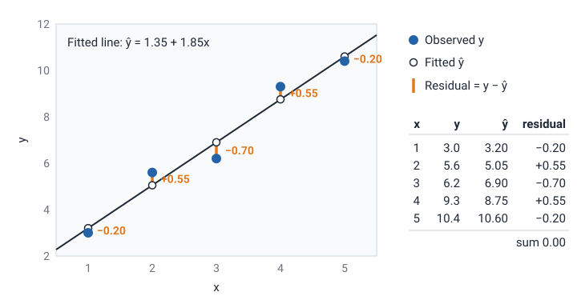

<head>
    <script type="application/ld+json">
        {JSON.stringify({
            "@context": "https://schema.org",
            "@type": "FAQPage",
            "mainEntity": [
                {
                    "@type": "Question",
                    "name": "What does a residual plot tell you?",
                    "acceptedAnswer": { "@type": "Answer", "text": "A residual plot tells you whether a regression model has captured the pattern in the data. If the residuals scatter randomly in an even band around zero, the model's form and its assumption of constant spread are reasonable. A curve means the model is missing a term, a funnel means the spread changes with the fitted value, and isolated points far from zero are outliers worth checking." }
                },
                {
                    "@type": "Question",
                    "name": "What does a good residual plot look like?",
                    "acceptedAnswer": { "@type": "Answer", "text": "A good residual plot looks like random noise: points spread evenly above and below the zero line, with roughly the same vertical spread from left to right, no curve or trend, no clusters, and no single point far from the rest. A smoothing line through the points should stay close to zero across the whole range." }
                },
                {
                    "@type": "Question",
                    "name": "How do you read a Q-Q plot?",
                    "acceptedAnswer": { "@type": "Answer", "text": "Check whether the points follow the straight reference line. Points on the line mean the data match the reference distribution, usually the normal. If the low end bends below the line and the high end above it, the data have heavy tails. If both ends sit above the line in a bow, the data are skewed to the right; both ends below means skewed to the left. A few points off the line at one end are possible outliers." }
                },
                {
                    "@type": "Question",
                    "name": "What is the difference between a Q-Q plot and a normal probability plot?",
                    "acceptedAnswer": { "@type": "Answer", "text": "A Q-Q (quantile-quantile) plot compares the quantiles of a sample with the quantiles of any reference distribution, or of a second sample. A normal probability plot is a Q-Q plot whose reference is the normal distribution. In regression, the normal Q-Q plot of the residuals and the normal probability plot of the residuals are the same chart, though some tools swap the axes." }
                },
                {
                    "@type": "Question",
                    "name": "Do residuals need to be normally distributed?",
                    "acceptedAnswer": { "@type": "Answer", "text": "Least-squares estimates do not need normal residuals to be unbiased. Normality matters for the confidence intervals, p-values and prediction intervals that come with a regression, and mostly in small samples. With large samples, moderate departures from normality matter less than a curved residual plot or a funnel, which bias the model or its error estimates whatever the sample size." }
                },
                {
                    "@type": "Question",
                    "name": "How do I make a residual plot in JavaScript?",
                    "acceptedAnswer": { "@type": "Answer", "text": "Fit the regression in plain JavaScript (least squares), compute each residual as the observed value minus the fitted value, then draw the residuals against the fitted values with SciChart.js as an XyScatterRenderableSeries, with a HorizontalLineAnnotation at zero. For a Q-Q plot, sort the standardised residuals and plot them against normal quantiles of the plotting positions. The charts can be used in React through scichart-react and in Angular through scichart-angular." }
                }
            ]
        })}
    </script>
</head>

# Residual Plot and Q-Q Plot

## What is a residual plot?

A **residual plot** is a scatter plot of a regression model's residuals, the gaps between each observed value and the value the model predicts, usually drawn against the fitted values. If the model suits the data, the points form a shapeless band around zero. A curve, a funnel or a stray point shows where the model goes wrong.


*A straight-line fit to 100 simulated readings, its residuals vs fitted plot and the normal Q-Q plot of its residuals. [Try the interactive version](#how-to-make-a-residual-plot-and-q-q-plot-in-javascript-react-or-angular).*

:::tip Key takeaways
- A residual is observed minus fitted. The residuals vs fitted plot should show an even, patternless band around zero.
- A curve means a missing term, a funnel means the spread changes with the fitted value, and a lone far-off point is an outlier.
- A Q-Q plot compares sorted residuals with the values a normal distribution would give. Points on the line mean the residuals look normal.
- A high R² doesn't prove a good model. A curved residual plot can sit behind an R² of 0.90.
- Check the four standard diagnostics together: residuals vs fitted, scale-location, normal Q-Q and residuals vs leverage.
:::

## What is a residual?

A regression model gives a fitted (predicted) value, written ŷ, for each observation. The **residual** is what the model didn't explain:

$$
e_i = y_i - \hat{y}_i
$$

A positive residual means the point sits above the fitted line; a negative one, below it. In least-squares regression with an intercept, the residuals always add up to zero.

Here are five readings and the least-squares line through them, ŷ = 1.35 + 1.85x:



| x | Observed y | Fitted ŷ | Residual y − ŷ |
| --- | --- | --- | --- |
| 1 | 3.0 | 3.20 | −0.20 |
| 2 | 5.6 | 5.05 | +0.55 |
| 3 | 6.2 | 6.90 | −0.70 |
| 4 | 9.3 | 8.75 | +0.55 |
| 5 | 10.4 | 10.60 | −0.20 |

The residuals add up to 0. Their squares add up to 1.175, the **sum of squared errors** that least squares makes as small as possible. Dividing by the degrees of freedom (5 points minus 2 fitted coefficients) and taking the square root gives the **residual standard deviation**, s = √(1.175 / 3) ≈ 0.63: the typical size of a residual, in the units of y. The R² of this fit is 0.967.

Plotting those five residuals against the fitted values (3.20 to 10.60) is a residual plot. With five points it shows very little; residual plots become useful from a few dozen points up.

## How to read a residual plot

The most used residual plot is **residuals vs fitted**: fitted value on the x-axis, residual on the y-axis, and a horizontal line at zero. Read it in four passes:

1. Centre. Do the points balance above and below zero all the way across, or does one region sit mostly above or below? A smoothing line through the points makes this easy to see: it should stay flat near zero.
2. Spread. Is the vertical spread roughly the same from left to right? Constant spread is called **homoscedasticity**; spread that changes is **heteroscedasticity**.
3. Shape. Is there a curve, a trend or separate clusters? Any shape means the model has missed some structure.
4. Stray points. Is any point much further from zero than the rest? A standardised residual (roughly, the residual divided by s; software usually also adjusts for leverage, giving the internally studentised residual) beyond about ±3 deserves a look.

For a model with one input, residuals vs x shows the same picture as residuals vs fitted, mirrored if the slope is negative. With several inputs, plot the residuals against each input too: a curve against one input says which variable needs a different form.

## Residual plot patterns: curves, funnels, clusters and outliers

Each common pattern in a residual plot points to a different problem with the model, so name the pattern before you change anything.


| Pattern in residuals vs fitted | What it means | Usual next step |
| --- | --- | --- |
| Even, shapeless band around 0 | The model's form and constant-spread assumption look reasonable | Check the Q-Q plot and leverage, then use the model |
| U shape or arch | Non-linearity: the model is missing a curve | Add a squared term, transform x or y, or fit a non-linear model |
| Funnel or fan (spread grows or shrinks) | Heteroscedasticity: the error depends on the size of the value | Transform y (log, square root), use weighted least squares, or robust standard errors |
| Separate clusters or bands | A missing category (machine, batch, operator) or a discrete y | Add the grouping variable to the model |
| Trend with time order | The residuals aren't independent | Plot residuals vs order; consider a time-series model |
| A lone point far from 0 | An outlier in y | Check it for a recording error before changing the model |
| Points on parallel diagonal lines | y takes only a few values (counts, ratings) | A model for counts or categories may fit better |

A description of a residual plot might read: "The residuals vs fitted plot shows an even band around zero from 4 to 16, with no curve or funnel. The largest standardised residual is −2.9, so no point stands out as an outlier."

## Residuals vs order: checking independence

Least-squares regression assumes that each error is independent of the others. When data are collected over time, or along a production line, plot the residuals in the order they were collected.

- A random sequence around zero means no sign of dependence.
- Long runs above zero followed by long runs below mean **positive autocorrelation**: one error predicts the next. It is common in sensor data, where a slow drift carries over from reading to reading.
- A steady trend means something changed during the run that the model doesn't include, such as instrument drift or temperature.
- A saw-tooth (up, down, up) means negative autocorrelation, often from over-correction in a control loop.

The residuals vs fitted plot can look perfect while residuals vs order shows strong dependence, because sorting by fitted value scrambles the time order. The [autocorrelation guide](/learn/applications/signal-processing/autocorrelation/) explains how to measure it by lag, and the Durbin-Watson test gives a single number for lag 1. With autocorrelated errors, the coefficients may be fine, but their standard errors are usually too small and p-values too optimistic.

## What is a Q-Q plot?

A **Q-Q plot** (quantile-quantile plot) is a scatter plot that compares the quantiles of a sample with the quantiles of a reference distribution. In regression, it compares the sorted residuals with the values a normal distribution would give for the same number of points. When the residuals are close to normal, the points fall along a straight line. A normal Q-Q plot is also called a **normal probability plot**.

### How a Q-Q plot is built

1. Sort the n residuals from smallest to largest. Standardise them by dividing by s, so they are on the same scale as a standard normal.
2. Give each sorted residual a plotting position, the share of a normal distribution expected below it. A common choice is Blom's formula, (i − 0.375) / (n + 0.25) for the i-th smallest. NIST uses Filliben's medians, which are very close.
3. Turn each plotting position into a theoretical normal quantile, z, with the inverse of the normal cumulative distribution.
4. Plot sample (standardised residual) against theoretical (z), and add a reference line. For standardised residuals the line is y = x; some tools draw it through the first and third quartiles instead.

For the five residuals in the worked example (s = 0.63):

| Rank i | Sorted residual | Standardised | Plotting position (i − 0.375) / 5.25 | Normal quantile z |
| --- | --- | --- | --- | --- |
| 1 | −0.70 | −1.12 | 0.119 | −1.18 |
| 2 | −0.20 | −0.32 | 0.310 | −0.50 |
| 3 | −0.20 | −0.32 | 0.500 | 0.00 |
| 4 | +0.55 | +0.88 | 0.690 | +0.50 |
| 5 | +0.55 | +0.88 | 0.881 | +1.18 |

The middle point sits below the line (−0.32 against 0) and the fourth above it (0.88 against 0.50). Five points can't say much about a distribution's shape, which is why Q-Q plots are read from about 20 points up.

## How to read a Q-Q plot

Read a Q-Q plot by where the points leave the reference line: at one end, at both ends in opposite directions, or along a curve.


| Q-Q plot shape | What the residuals look like | Histogram of the residuals |
| --- | --- | --- |
| Points on the line, a little wobble at the ends | Close to normal | A symmetric bell |
| Low end below the line, high end above (steeper at both ends) | Heavy tails: more extreme values than a normal gives | A sharp peak with long tails |
| Low end above, high end below (flatter at both ends) | Light tails: fewer extreme values | Flat-topped, short tails |
| Bow with both ends above the line (convex) | Right-skewed: a long tail of large positive residuals | Bunched on the left, tail to the right |
| Arch with both ends below the line (concave) | Left-skewed | Tail to the left |
| One or two points far off at an end | Possible outliers | Isolated bars |
| Steps or flat runs | Rounded or discrete data | Gaps between bars |

The points at the very ends always scatter more than those in the middle, because extreme order statistics are noisy. Judge the overall shape, not the last point or two. With 30 points, a Q-Q plot of truly normal residuals still wobbles; with 1,000, small departures are easy to see but may not matter.

### Q-Q plot vs histogram of residuals

A [histogram](/learn/chart-types/cartesian/histogram/) of the residuals shows the same distribution as a bell (or not), and it's easier for a general audience to read. A Q-Q plot is better for checking normality:

- It doesn't depend on a bin width. A histogram of 30 residuals can look skewed or bimodal only because of where the bin edges fall.
- It shows the tails clearly, where the differences between distributions are. A histogram squashes the tails into a few short bars.
- Every point is plotted, so a single outlier is visible and identifiable.

A [box plot](/learn/chart-types/cartesian/box-plot/) of the residuals gives a quick summary of skew and outliers, but says nothing about the shape between the quartiles.

## The four standard regression diagnostic plots

Statistics software usually draws four diagnostic plots for a linear regression. Each checks something different:

| Plot | Axes | Checks | Good looks like |
| --- | --- | --- | --- |
| Residuals vs fitted | Residual against fitted value | Linearity, and gross changes in spread | Even band around 0, flat smoothing line |
| Normal Q-Q | Standardised residual against normal quantile | Normality of the errors | Points along the reference line |
| Scale-location (spread-location) | √\|standardised residual\| against fitted value | Constant spread (homoscedasticity) | Flat smoothing line, even scatter |
| Residuals vs leverage | Standardised residual against leverage, with Cook's distance contours | Points that pull the fit (influence) | No point beyond the Cook's distance 0.5 or 1 contours |

Scale-location takes the square root of the absolute standardised residual, which folds the negative half up onto the positive and evens out the skew, so a rising smoothing line shows a funnel more clearly than the residuals vs fitted plot does.

### Outliers, leverage and influence

These three are different, and the residuals vs leverage plot separates them:

- An **outlier** has a large residual: its y is far from the model's prediction.
- A **high-leverage** point has an unusual x value, far from the others. Leverage, written hᵢᵢ, measures how much a point's own y pulls its fitted value. The average leverage is p/n, where p is the number of coefficients; Penn State's regression course flags values above 3p/n (some texts use 2p/n).
- An **influential** point changes the fitted model noticeably when removed. **Cook's distance** combines residual and leverage into one number; above 0.5 is worth investigating, and above 1 is likely to be influential.

A high-leverage point can have a small residual because it has dragged the line towards itself. In the live demo, with 100 points and a straight-line fit, a mid-range outlier has a standardised residual of about 6 but a Cook's distance of only 0.19, and the slope barely moves (1.222 to 1.224). A single high-leverage point at x = 16 has a leverage of 0.16 (8 times the average), a Cook's distance of 4.2, and pulls the slope from 1.22 to 1.08.

## How to fix a model when the residuals show a pattern

Find the cause before changing the model. A residual pattern is a symptom, and the right fix depends on why it's there.

- Curve. Add the missing term (x², an interaction, or a variable you left out), or transform x. If theory says the relationship is exponential or a power law, fit that form, or take logs of both sides.
- Funnel. If the spread grows in proportion to the value, a log transform of y often fixes both the funnel and a right skew. Otherwise use weighted least squares, with weights inversely proportional to the variance, or keep the fit and report heteroscedasticity-consistent (robust) standard errors.
- Skewed or heavy-tailed residuals. Transform y, or use a model with a different error distribution. With large samples and a good residuals vs fitted plot, mild non-normality often matters little for the coefficients.
- Outlier. Check the raw data and the measurement. If it's a recording error, correct or remove it and say so; otherwise report the fit with and without it, or use robust regression.
- High-leverage or influential point. Check it, then decide whether it belongs in the population you're modelling. A more flexible model doesn't fix it. In the live demo, switching to a quadratic bends the curve down towards the high-leverage point and shrinks its residual from −8.7 to −2.8, so the point no longer stands out although it still drives the fit.
- Autocorrelation. Add the time-related variable that's missing, or move to a time-series model with correlated errors.

After any change, refit and draw the residual plots again.

## Common residual plot and Q-Q plot mistakes

Most mistakes come from trusting a single number or a single plot instead of reading the residuals themselves.

- **Trusting R² instead of the residual plot.** A high R² means the model explains much of the variation; it says nothing about whether the model has the right form. In the live demo, a straight line fitted to the curved relationship gives R² = 0.90, and only the U-shaped residual plot shows that a quadratic is better (R² = 0.95, residual SD down from 1.51 to 1.04).
- **Plotting residuals against observed y.** Residuals are correlated with observed y by construction, so that plot always shows an upward slope, even for a perfect model. Plot against the fitted values.
- **Reading patterns into noise.** With 20 or 30 points, random residuals often look as if they curve or fan. Use a smoothing line, and only act on patterns that are clear or that you have a reason to expect.
- **Testing normality of the raw y instead of the residuals.** The normality assumption is about the errors. A y that is skewed because x is skewed can still give perfectly normal residuals.
- **Trusting a normality test over the plot.** With large samples, tests such as Shapiro-Wilk flag departures too small to matter; with small samples, they miss large ones. Read the Q-Q plot alongside any test.
- **Deleting outliers to tidy the plot.** An outlier can be the most interesting point in the data, such as the first sign of a failing sensor or an effect the model doesn't include.
- **Checking only one diagnostic.** A clean residuals vs fitted plot can hide autocorrelation (check residuals vs order) and influential points (check leverage).

## How to make a residual plot and Q-Q plot in JavaScript, React or Angular

The demo below draws three linked charts from one simulated regression: the data with its fitted line, the residuals against the fitted values, and a normal Q-Q plot. Each time you change a control, it refits the model in the browser, recomputes the residuals, the smoothing line and the Q-Q points for 30 to 1,000 points, and redraws all three charts.

Pick the **True relationship** (straight or curved), the **Noise** (normal, funnel, heavy-tailed or skewed), an **Extra point** (an outlier or a high-leverage point) and the **Sample size**, or tick **Fit a quadratic** to change the model. The line above the charts gives the fitted equation, R² and the residual standard deviation. Hover any chart for values; scroll to zoom, drag to pan and double-click to reset.

<LiveDocSnippet maxWidth={'100%'} height={720} name="./Basic/demo" />

<LearnCta position="top" chart="residual plot" demo="scatter-chart" demoLabel="scatter chart" docs="/2d-charts/chart-types/xy-scatter-renderable-series/" docsLabel="SciChart.js scatter chart documentation" />

Here is the code for these charts. The regression and the statistics are plain JavaScript; SciChart.js draws each chart as scatter and line series with a zero-line annotation.

<CodeSnippetBlock labels={["JavaScript", "React", "Angular"]}>
    ```ts showLineNumbers file=./Basic/demo.ts start=#region_A_start end=#region_A_end
    ```

    ```tsx
    import { SciChartReact } from "scichart-react";
    import {
        SciChartSurface,
        NumericAxis,
        NumberRange,
        XyDataSeries,
        XyScatterRenderableSeries,
        EllipsePointMarker,
        HorizontalLineAnnotation,
        SciChartJsNavyTheme,
        CursorModifier,
        ZoomExtentsModifier
    } from "scichart";

    // Least-squares straight line y = a + b x, and the residuals observed - fitted
    const residualsOfLine = (x: number[], y: number[]) => {
        const n = x.length;
        const mx = x.reduce((s, v) => s + v, 0) / n;
        const my = y.reduce((s, v) => s + v, 0) / n;
        let sxy = 0, sxx = 0;
        for (let i = 0; i < n; i++) {
            sxy += (x[i] - mx) * (y[i] - my);
            sxx += (x[i] - mx) ** 2;
        }
        const b = sxy / sxx;
        const a = my - b * mx;
        const fitted = x.map((xi) => a + b * xi);
        return { fitted, residuals: y.map((yi, i) => yi - fitted[i]) };
    };

    // initChart builds the chart; SciChartReact creates it, sizes it and cleans it up
    const initChart = async (rootElement: string | HTMLDivElement) => {
        const { wasmContext, sciChartSurface } = await SciChartSurface.create(rootElement, {
            theme: new SciChartJsNavyTheme(),
            title: "Residuals vs fitted"
        });
        sciChartSurface.xAxes.add(new NumericAxis(wasmContext, { axisTitle: "Fitted value", growBy: new NumberRange(0.05, 0.05) }));
        sciChartSurface.yAxes.add(new NumericAxis(wasmContext, { axisTitle: "Residual", growBy: new NumberRange(0.1, 0.1) }));

        const { x, y } = getYourRegressionData(); // e.g. x: [1, 2, 3], y: [3.0, 5.6, 6.2]
        const { fitted, residuals } = residualsOfLine(x, y);
        sciChartSurface.renderableSeries.add(
            new XyScatterRenderableSeries(wasmContext, {
                dataSeries: new XyDataSeries(wasmContext, { xValues: fitted, yValues: residuals }),
                pointMarker: new EllipsePointMarker(wasmContext, { width: 7, height: 7, fill: "#50C7E0AA", strokeThickness: 0 })
            })
        );
        // The zero line: residuals should scatter evenly above and below it
        sciChartSurface.annotations.add(new HorizontalLineAnnotation({ y1: 0, stroke: "#FFFFFF", strokeDashArray: [6, 4] }));
        sciChartSurface.chartModifiers.add(new CursorModifier({ showTooltip: true }), new ZoomExtentsModifier());
        return { sciChartSurface };
    };

    export const ResidualPlot = () => <SciChartReact initChart={initChart} style={{ width: "100%", height: 400 }} />;
    ```

    ```ts
    import { Component } from "@angular/core";
    import { ScichartAngularComponent } from "scichart-angular";
    import {
        SciChartSurface,
        NumericAxis,
        NumberRange,
        XyDataSeries,
        XyScatterRenderableSeries,
        EllipsePointMarker,
        HorizontalLineAnnotation,
        SciChartJsNavyTheme,
        CursorModifier,
        ZoomExtentsModifier
    } from "scichart";

    // Least-squares straight line y = a + b x, and the residuals observed - fitted
    const residualsOfLine = (x: number[], y: number[]) => {
        const n = x.length;
        const mx = x.reduce((s, v) => s + v, 0) / n;
        const my = y.reduce((s, v) => s + v, 0) / n;
        let sxy = 0, sxx = 0;
        for (let i = 0; i < n; i++) {
            sxy += (x[i] - mx) * (y[i] - my);
            sxx += (x[i] - mx) ** 2;
        }
        const b = sxy / sxx;
        const a = my - b * mx;
        const fitted = x.map((xi) => a + b * xi);
        return { fitted, residuals: y.map((yi, i) => yi - fitted[i]) };
    };

    @Component({
        selector: "app-residual-plot",
        standalone: true,
        imports: [ScichartAngularComponent],
        template: `<scichart-angular [initChart]="initChart" style="display: block; width: 100%; height: 400px"></scichart-angular>`
    })
    export class ResidualPlotComponent {
        // initChart builds the chart; scichart-angular creates it, sizes it and cleans it up
        initChart = async (rootElement: string | HTMLDivElement) => {
            const { wasmContext, sciChartSurface } = await SciChartSurface.create(rootElement, {
                theme: new SciChartJsNavyTheme(),
                title: "Residuals vs fitted"
            });
            sciChartSurface.xAxes.add(new NumericAxis(wasmContext, { axisTitle: "Fitted value", growBy: new NumberRange(0.05, 0.05) }));
            sciChartSurface.yAxes.add(new NumericAxis(wasmContext, { axisTitle: "Residual", growBy: new NumberRange(0.1, 0.1) }));

            const { x, y } = getYourRegressionData(); // e.g. x: [1, 2, 3], y: [3.0, 5.6, 6.2]
            const { fitted, residuals } = residualsOfLine(x, y);
            sciChartSurface.renderableSeries.add(
                new XyScatterRenderableSeries(wasmContext, {
                    dataSeries: new XyDataSeries(wasmContext, { xValues: fitted, yValues: residuals }),
                    pointMarker: new EllipsePointMarker(wasmContext, { width: 7, height: 7, fill: "#50C7E0AA", strokeThickness: 0 })
                })
            );
            // The zero line: residuals should scatter evenly above and below it
            sciChartSurface.annotations.add(new HorizontalLineAnnotation({ y1: 0, stroke: "#FFFFFF", strokeDashArray: [6, 4] }));
            sciChartSurface.chartModifiers.add(new CursorModifier({ showTooltip: true }), new ZoomExtentsModifier());
            return { sciChartSurface };
        };
    }
    ```
</CodeSnippetBlock>

Key points:

- Each chart is an `XyScatterRenderableSeries` with an `EllipsePointMarker`; the fitted model, the smoothing line and the Q-Q reference line are `FastLineRenderableSeries`, dashed with `strokeDashArray`.
- The zero line is a `HorizontalLineAnnotation` at `y1: 0`, so it stays put when you zoom or pan.
- The extra point is a second scatter series with a larger orange marker, so it stays visible on all three charts and in the legend.
- On a control change, the demo calls `clear()` and `appendRange()` on each `XyDataSeries`, then `zoomExtents()`; there's no need to rebuild the charts.

**See it in the demo app:** [JavaScript scatter chart](https://www.scichart.com/demo/javascript/scatter-chart) · [React scatter chart](https://www.scichart.com/demo/react/scatter-chart) · [Angular scatter chart](https://www.scichart.com/demo/angular/scatter-chart). For a fitted line on its own chart, see the [React line chart](https://www.scichart.com/demo/react/line-chart), and for labelled reference lines, [React chart annotations](https://www.scichart.com/demo/react/chart-annotations).

**Go deeper:** [SciChart.js scatter chart documentation](/2d-charts/chart-types/xy-scatter-renderable-series/), and how SciChart is used for calibration and test data in [design, emulation and test](https://www.scichart.com/design-emulation-test/) and in [diagnostics and life sciences](https://www.scichart.com/why-scichart-diagnostics-lifesciences/).

## Frequently asked questions

### What does a residual plot tell you?

A residual plot tells you whether a regression model has captured the pattern in the data. If the residuals scatter randomly in an even band around zero, the model's form and its assumption of constant spread are reasonable. A curve means the model is missing a term, a funnel means the spread changes with the fitted value, and isolated points far from zero are outliers worth checking.

### What does a good residual plot look like?

A good residual plot looks like random noise: points spread evenly above and below the zero line, with roughly the same vertical spread from left to right, no curve or trend, no clusters, and no single point far from the rest. A smoothing line through the points should stay close to zero across the whole range.

### How do you read a Q-Q plot?

Check whether the points follow the straight reference line. Points on the line mean the data match the reference distribution, usually the normal. If the low end bends below the line and the high end above it, the data have heavy tails. If both ends sit above the line in a bow, the data are skewed to the right; both ends below means skewed to the left. A few points off the line at one end are possible outliers.

### What is the difference between a Q-Q plot and a normal probability plot?

A Q-Q (quantile-quantile) plot compares the quantiles of a sample with the quantiles of any reference distribution, or of a second sample. A normal probability plot is a Q-Q plot whose reference is the normal distribution. In regression, the normal Q-Q plot of the residuals and the normal probability plot of the residuals are the same chart, though some tools swap the axes.

### Do residuals need to be normally distributed?

Least-squares estimates do not need normal residuals to be unbiased. Normality matters for the confidence intervals, p-values and prediction intervals that come with a regression, and mostly in small samples. With large samples, moderate departures from normality matter less than a curved residual plot or a funnel, which bias the model or its error estimates whatever the sample size.

### How do I make a residual plot in JavaScript?

Fit the regression in plain JavaScript (least squares), compute each residual as the observed value minus the fitted value, then draw the residuals against the fitted values with SciChart.js as an XyScatterRenderableSeries, with a HorizontalLineAnnotation at zero. For a Q-Q plot, sort the standardised residuals and plot them against normal quantiles of the plotting positions. The charts can be used in React through scichart-react and in Angular through scichart-angular.

## Sources

- NIST/SEMATECH, *e-Handbook of Statistical Methods*: [How can I tell if a model fits my data?](https://www.itl.nist.gov/div898/handbook/pmd/section4/pmd44.htm), [Residual plots](https://www.itl.nist.gov/div898/handbook/pmd/section6/pmd614.htm), [Normal probability plot](https://www.itl.nist.gov/div898/handbook/eda/section3/normprpl.htm) and [Quantile-quantile plot](https://www.itl.nist.gov/div898/handbook/eda/section3/qqplot.htm).
- Penn State STAT 462, Applied Regression Analysis: [Residuals vs. fits plot](https://online.stat.psu.edu/stat462/node/117/), [Identifying specific problems using residual plots](https://online.stat.psu.edu/stat462/node/120/), [Using leverages to help identify extreme x values](https://online.stat.psu.edu/stat462/node/171/) and [Identifying influential data points](https://online.stat.psu.edu/stat462/node/173/).
- Cook, R. D. (1977), Detection of influential observation in linear regression. *Technometrics*, 19(1), 15–18.
- Blom, G. (1958), *Statistical Estimates and Transformed Beta-Variables*, Wiley. The (i − 3/8) / (n + 1/4) plotting positions.
- Durbin, J. and Watson, G. S. (1950), Testing for serial correlation in least squares regression. *Biometrika*, 37(3–4), 409–428.

<LearnCta position="bottom" chart="residual plot" demo="scatter-chart" demoLabel="scatter chart" docs="/2d-charts/chart-types/xy-scatter-renderable-series/" docsLabel="SciChart.js scatter chart documentation" />
