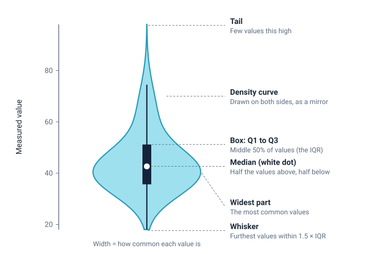
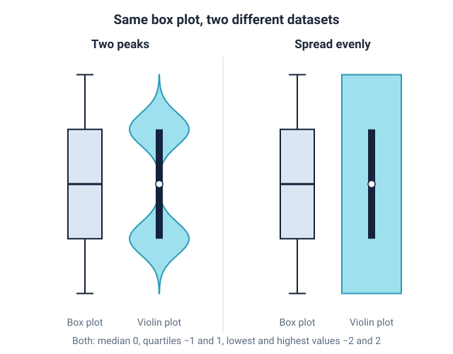

<head>
    <script type="application/ld+json">
        {JSON.stringify({
            "@context": "https://schema.org",
            "@type": "FAQPage",
            "mainEntity": [
                {
                    "@type": "Question",
                    "name": "What does a violin plot show?",
                    "acceptedAnswer": { "@type": "Answer", "text": "A violin plot shows the full shape of how values are spread out in each group: where they cluster, how many peaks there are, how far they reach and whether one side has a long tail. The wider the violin at a value, the more common that value is. Most violin plots also show the median and quartiles as a small box plot inside." }
                },
                {
                    "@type": "Question",
                    "name": "What does the width of a violin plot represent?",
                    "acceptedAnswer": { "@type": "Answer", "text": "The width at any value is the estimated density there: how common values near that point are, compared with the rest of the group. Wide means many values, thin means few. The width is usually scaled so every violin has the same maximum width, so it shows the shape of each group, not how many values each group has." }
                },
                {
                    "@type": "Question",
                    "name": "What is the difference between a box plot and a violin plot?",
                    "acceptedAnswer": { "@type": "Answer", "text": "A box plot draws five summary numbers: the minimum, first quartile, median, third quartile and maximum. A violin plot adds the shape of the data between them, drawn as a smoothed density curve mirrored on both sides. Two datasets can have the same box plot but very different violins, for example when one of them has two peaks." }
                },
                {
                    "@type": "Question",
                    "name": "What does bimodal look like on a violin plot?",
                    "acceptedAnswer": { "@type": "Answer", "text": "A bimodal group looks like two bulges joined by a narrow waist, like an hourglass or a real violin's body. Each bulge is a cluster of values, and the waist between them is a range where few values fall. The median often lands in that waist, so the typical value of the group is one that hardly ever occurs." }
                },
                {
                    "@type": "Question",
                    "name": "Are violin plots good?",
                    "acceptedAnswer": { "@type": "Answer", "text": "Violin plots are good for comparing the shape of several groups with enough data, from a few dozen values each. They show peaks, gaps and skew that a box plot hides. They are less good for small samples, where the smooth shape is mostly guesswork, and for readers who have not seen one before, who may need the box plot inside to anchor them." }
                },
                {
                    "@type": "Question",
                    "name": "How do I make a violin plot in JavaScript?",
                    "acceptedAnswer": { "@type": "Answer", "text": "With SciChart.js, calculate a kernel density estimate for each group, then add a FastBandRenderableSeries per group with an XyyDataSeries: the x values are the measured values, and the two y values are the group's position plus and minus the scaled density. Swap the axis alignments to make the violins vertical. The same chart works in React with scichart-react and in Angular with scichart-angular." }
                }
            ]
        })}
    </script>
</head>

# Violin Plot

## What is a violin plot?

A **violin plot** (also called a violin chart or violin graph) is a chart that shows how the values in one or more groups are spread out. Each group gets a symmetrical shape whose width shows how common each value is: wide where values cluster, thin where they are rare. Most violin plots also draw a small box plot inside.


*Violin plots comparing page load times for four servers, 400 requests each (sample data). [Try the interactive version](#how-to-create-a-violin-plot-in-javascript-react-or-angular).*

:::tip Key takeaways
- A violin plot is a **box plot plus the shape of the data**: a smoothed curve, mirrored on both sides, shows where values cluster.
- **Wide means common, thin means rare.** Two bulges mean the group holds two clusters of values.
- The white dot is the **median** and the dark bar is the box from the **first to the third quartile**.
- A violin shows **peaks, gaps and skew that a box plot hides**: two very different groups can share the same box.
- The shape is an **estimate**. It depends on a smoothing setting (the bandwidth) and needs a few dozen values per group to be trusted.
:::

## How to read a violin plot



Read a violin plot from the inside out:

1. **Find the median.** The white dot marks the middle value: half the group is above it and half below.
2. **Read the box.** The thick bar runs from the **first quartile (Q1)** to the **third quartile (Q3)**, so it holds the middle half of the values. The thin line (the whisker) reaches out to the furthest typical values, as on a [box plot](/learn/chart-types/cartesian/box-plot/).
3. **Read the width.** The outline is a **density curve**: a smoothed version of a histogram, drawn on both sides so the shape is easy to see. The widest point is the most common value. Where the violin is thin, few values fall.
4. **Count the bulges.** One bulge means one cluster of values. Two bulges with a narrow waist between them mean the group is really two groups mixed together.
5. **Look at the ends.** A long, thin tail means a few values reach far from the rest. On most violin plots, including the ones on this page, the outline stops at the lowest and highest values.

Then compare the groups: which sits higher, which is more spread out, and which have a different shape.

**What the width doesn't tell you:** how many values each group has. Most charts, including this one, scale every violin to the same maximum width, so a group of 50 values and a group of 5,000 look equally solid. Add the count to each group's label when it differs.

### What the shape of a violin tells you

| Shape | What it means | In the chart above |
| --- | --- | --- |
| One bulge, roughly symmetric | Values cluster around one typical value | Server A |
| Bulge near the bottom, long thin tail upwards | **Right-skewed**: most values are low, with a few much higher | Server B |
| Two bulges with a narrow waist | **Bimodal**: two clusters, such as two kinds of request or customer | Server C |
| About the same width from end to end | Values are **spread evenly** across the range | Server D |
| Short and wide | Values are consistent: close together | Server A |
| Tall and thin | Values vary a lot | Server B |

## How to describe a violin plot

Describe four things: the **centre** (median), the **spread** (the box and the overall height), the **shape** (one peak or more, skewed or symmetric) and anything unusual in the **tails**. Use this template:

> **[Group]** has a median of **[value]** and its middle half runs from **[Q1]** to **[Q3]**. Its shape is **[one peak / two peaks at … and … / skewed towards high values / flat]**, and **[there is / there is no]** long tail.

**Worked example,** from the chart at the top: "Server C's median load time is 433 ms and its middle half runs from 301 to 625 ms. But its shape has two peaks, at about 300 and 620 ms, with a narrow waist between them: requests are either fast or slow, and almost none take the median time. Server D has a similar median and box, but its violin is almost flat: load times are spread evenly from 140 to 780 ms."

## Violin plot vs box plot

A box plot sums each group up in five numbers. A violin plot keeps those numbers and adds the shape between them. That matters whenever the shape is not a single, tidy hump.



The live chart on this page has the same pattern. **Servers C and D have almost the same box:** medians of 433 and 455 ms, first quartiles of about 300 ms and third quartiles of about 600 to 625 ms. Their violins are completely different. Not one of Server C's 400 requests took within 25 ms of its median, because its requests come in two kinds, perhaps fast responses served from a cache and slow ones that miss it. Server D's requests are spread evenly. A box plot alone would report the two servers as alike.

| | Box plot | Violin plot |
| --- | --- | --- |
| Shows | Median, quartiles, whiskers, outliers | The same, plus the full shape of each group |
| Reveals two peaks or gaps | No | Yes |
| Works with few values (under about 20) | Yes, though quartiles jump around | Not well: the shape is mostly guesswork |
| Easy for a general audience | Fairly, once explained | Less so: needs the box inside, or a note |
| Depends on a setting you choose | Whisker rule | Whisker rule and bandwidth |

## When to use a violin plot

Use a violin plot to **compare the shape of a value across several groups**, each with at least a few dozen values: response times by server, test scores by school, gene expression by cell type, delivery times by route.

| Chart | Best for |
| --- | --- |
| **Violin plot** | Comparing several groups when the shape matters: peaks, gaps, skew |
| [Box plot](/learn/chart-types/cartesian/box-plot/) | Comparing the median, spread and outliers of many groups compactly, or groups with few values |
| [Density plot](/learn/chart-types/cartesian/density-plot/) | The shape of one group, or two or three groups overlaid on the same axis |
| [Histogram](/learn/chart-types/cartesian/histogram/) | The shape of one group with actual counts, and no smoothing to choose |
| [Scatter plot](/learn/chart-types/cartesian/scatter-plot/) (strip plot) | Every individual value, when there are few enough to see them all |

A violin is a [density plot](/learn/chart-types/cartesian/density-plot/) turned on its side and mirrored, so groups can stand side by side. With one group, a plain density plot or histogram is easier to read. With many groups, violins are easier to compare than overlapping density curves.

## How a violin plot is calculated

Each violin is drawn in three steps:

1. **Estimate the density.** For every group, a **kernel density estimate** (KDE) puts a small bell-shaped curve on every value and adds them up. Where values crowd together, the curves pile up into a bulge. The [density plot guide](/learn/chart-types/cartesian/density-plot/) explains the method in detail.
2. **Mirror it.** The curve is drawn on both sides of the group's position, so the shape is symmetric, and scaled so the widest violin fits its slot.
3. **Add the box.** The median, quartiles and whiskers are worked out from the raw values, exactly as for a box plot.

**A tiny worked example.** Take five values, 2, 3, 3, 7 and 8, and a bell curve with a bandwidth (width) of 1. The density at any point is the average height of the five bell curves there:

| At value | Density | Violin width |
| --- | --- | --- |
| 3 | 0.208 | Widest: three values sit at or near 3 |
| 5 | 0.034 | A narrow waist: no values nearby |
| 7.5 | 0.141 | A second bulge, from 7 and 8 |

So even five values give a two-bulge violin. With so few values, though, a different sample could look quite different, which is why violins need more data than box plots.

**The bandwidth** sets how smooth the outline is. The charts on this page use **Silverman's rule of thumb**: 0.9 × the smaller of (standard deviation, interquartile range ÷ 1.34) × n^(−1/5), where n is the number of values in the group. Each violin's outline stops at the group's lowest and highest values.

## Bandwidth: when a violin can hide peaks too

The chart below draws Server C's 400 load times three times, with three bandwidths. Hover over it to see how many requests fall near each load time.

<LiveDocSnippet maxWidth={'100%'} name="./Bandwidth/demo" />

- **Too narrow** (11 ms, a quarter of Silverman's rule): the outline is lumpy. Each lump is noise in this particular sample, not something you would see again.
- **Silverman's rule** (45 ms): two clear peaks and an empty waist, which is the real shape of the data.
- **Too wide** (181 ms, four times the rule): the two peaks melt into one round bulge. This violin hides the two kinds of request as completely as a box plot does.

If your software doesn't say which bandwidth it used, try a smaller and a larger one. A peak that survives both is real.

## Common violin plot mistakes

- **Too few values.** With fewer than a few dozen values per group, the smooth outline is mostly the kernel's shape, not the data's. Use a box plot or plot the individual points.
- **Not saying how the shape was smoothed.** State the bandwidth, or the rule used to pick it, in a note. Different software picks different defaults.
- **Letting the outline run past the data.** Some tools extend each violin beyond the lowest and highest values, which can show impossible values, such as negative times. Trim the outline to the data, or say that you didn't.
- **Rounding off hard edges.** A density estimate always tapers, so data that stops abruptly, at 0% or 100% or at a fixed limit, gets soft ends that aren't in the data. Server D's violin narrows a little at both ends for this reason.
- **Comparing widths across groups.** Each violin is usually scaled to the same maximum width, so a wider violin doesn't mean more values. Show the count (n) in each label.
- **A different colour per violin** when the colours mean nothing. Use one colour, and a second only to highlight a group.

## How to create a violin plot in JavaScript, React or Angular

SciChart.js draws charts with WebGL and WebGPU, so you can compare many groups of large datasets, zoom in and update them live. There is no dedicated violin series: each violin is a **band series**, the filled area between an upper and a lower line, with the density added to and subtracted from the group's position. Try the chart below: scroll to zoom, drag to pan, double-click to reset, and hover to see what share of each server's requests were faster than the load time under the cursor.

<LiveDocSnippet maxWidth={'100%'} name="./Basic/demo" />

<LearnCta position="top" chart="violin plot" demo="box-plot-chart" docs="/2d-charts/chart-types/fast-band-renderable-series/" />

Here is the code for this chart. The JavaScript version includes the `kernelDensity` and `boxSummary` helpers in the full demo code; the React and Angular versions assume you have copied `kernelDensity` into your project.

<CodeSnippetBlock labels={["JavaScript", "React", "Angular"]}>
    ```ts showLineNumbers file=./Basic/demo.ts start=#region_A_start end=#region_A_end
    ```

    ```tsx
    import { SciChartReact } from "scichart-react";
    import {
        SciChartSurface,
        NumericAxis,
        EAxisAlignment,
        FastBandRenderableSeries,
        XyyDataSeries,
        SciChartJsNavyTheme
    } from "scichart";
    import { kernelDensity } from "./kernelDensity"; // the helper from the full demo code

    // initChart builds the chart; SciChartReact creates it, sizes it and cleans it up
    const initChart = async (rootElement: string | HTMLDivElement) => {
        const { wasmContext, sciChartSurface } = await SciChartSurface.create(rootElement, {
            theme: new SciChartJsNavyTheme()
        });
        // Vertical violins: measured values up the left, one position per group along the bottom
        sciChartSurface.xAxes.add(
            new NumericAxis(wasmContext, { axisAlignment: EAxisAlignment.Left, flippedCoordinates: true })
        );
        sciChartSurface.yAxes.add(
            new NumericAxis(wasmContext, { axisAlignment: EAxisAlignment.Bottom, flippedCoordinates: true })
        );

        // One array of raw values per group
        const groups: number[][] = getYourViolinData();
        groups.forEach((values, position) => {
            const { xValues, densities } = kernelDensity(values);
            const scale = 0.4 / Math.max(...densities);
            sciChartSurface.renderableSeries.add(
                new FastBandRenderableSeries(wasmContext, {
                    dataSeries: new XyyDataSeries(wasmContext, {
                        xValues,
                        yValues: densities.map((d) => position + d * scale),
                        y1Values: densities.map((d) => position - d * scale)
                    }),
                    fill: "#50C7E099",
                    fillY1: "#50C7E099",
                    stroke: "#50C7E0",
                    strokeY1: "#50C7E0"
                })
            );
        });
        return { sciChartSurface };
    };

    export const ViolinPlot = () => (
        <SciChartReact initChart={initChart} style={{ width: "100%", height: 400 }} />
    );
    ```

    ```ts
    import { Component } from "@angular/core";
    import { ScichartAngularComponent } from "scichart-angular";
    import {
        SciChartSurface,
        NumericAxis,
        EAxisAlignment,
        FastBandRenderableSeries,
        XyyDataSeries,
        SciChartJsNavyTheme
    } from "scichart";
    import { kernelDensity } from "./kernelDensity"; // the helper from the full demo code

    @Component({
        selector: "app-violin-plot",
        standalone: true,
        imports: [ScichartAngularComponent],
        template: `<scichart-angular [initChart]="initChart" style="display: block; width: 100%; height: 400px"></scichart-angular>`
    })
    export class ViolinPlotComponent {
        // initChart builds the chart; scichart-angular creates it, sizes it and cleans it up
        initChart = async (rootElement: string | HTMLDivElement) => {
            const { wasmContext, sciChartSurface } = await SciChartSurface.create(rootElement, {
                theme: new SciChartJsNavyTheme()
            });
            // Vertical violins: measured values up the left, one position per group along the bottom
            sciChartSurface.xAxes.add(
                new NumericAxis(wasmContext, { axisAlignment: EAxisAlignment.Left, flippedCoordinates: true })
            );
            sciChartSurface.yAxes.add(
                new NumericAxis(wasmContext, { axisAlignment: EAxisAlignment.Bottom, flippedCoordinates: true })
            );

            // One array of raw values per group
            const groups: number[][] = getYourViolinData();
            groups.forEach((values, position) => {
                const { xValues, densities } = kernelDensity(values);
                const scale = 0.4 / Math.max(...densities);
                sciChartSurface.renderableSeries.add(
                    new FastBandRenderableSeries(wasmContext, {
                        dataSeries: new XyyDataSeries(wasmContext, {
                            xValues,
                            yValues: densities.map((d) => position + d * scale),
                            y1Values: densities.map((d) => position - d * scale)
                        }),
                        fill: "#50C7E099",
                        fillY1: "#50C7E099",
                        stroke: "#50C7E0",
                        strokeY1: "#50C7E0"
                    })
                );
            });
            return { sciChartSurface };
        };
    }
    ```
</CodeSnippetBlock>

Key points:

- Each violin is a [FastBandRenderableSeries](https://www.scichart.com/documentation/js/current/typedoc/classes/fastbandrenderableseries.html) with an [XyyDataSeries](https://www.scichart.com/documentation/js/current/typedoc/classes/xyydataseries.html): `xValues` are the measured values, `yValues` the group's position plus the scaled density, and `y1Values` the position minus it. Set `fill` and `fillY1` (and `stroke` and `strokeY1`) to the same colour, so both halves match.
- The `kernelDensity` helper in the full code is a plain Gaussian KDE with Silverman's bandwidth, trimmed to each group's range. Pass a `bandwidthFactor` to make the outline smoother or more detailed, as in the bandwidth chart above.
- The chart is rotated: the X axis is set to `EAxisAlignment.Left` and the Y axis to `EAxisAlignment.Bottom`, with `flippedCoordinates` so values grow upwards and groups run left to right. Leave the default alignments for horizontal violins. A `TextLabelProvider` names the groups.
- The box inside is three small series per group: a `FastLineRenderableSeries` for the whisker, a narrow band series from Q1 to Q3, and an `XyScatterRenderableSeries` dot for the median. For a half violin, set `y1Values` to the group position.

**See it in the demo app:** there's no violin plot demo yet. The closest is the box plot demo, which compares the same kind of grouped data: [JavaScript box plot](https://www.scichart.com/demo/javascript/box-plot-chart) · [React box plot](https://www.scichart.com/demo/react/box-plot-chart) · [Angular box plot](https://www.scichart.com/demo/angular/box-plot-chart). The band series that draws each violin: [JavaScript band chart](https://www.scichart.com/demo/javascript/band-chart) · [React band chart](https://www.scichart.com/demo/react/band-chart) · [Angular band chart](https://www.scichart.com/demo/angular/band-chart)

**Go deeper:** [SciChart.js violin plot documentation](/2d-charts/chart-types/fast-band-renderable-series/): the band series, including gradient fills, and the [SciChart.js box plot documentation](/2d-charts/chart-types/fast-box-plot-renderable-series/) for a full box plot alongside.

## Frequently asked questions

### What does a violin plot show?

A violin plot shows the full shape of how values are spread out in each group: where they cluster, how many peaks there are, how far they reach and whether one side has a long tail. The wider the violin at a value, the more common that value is. Most violin plots also show the median and quartiles as a small box plot inside.

### What does the width of a violin plot represent?

The width at any value is the estimated density there: how common values near that point are, compared with the rest of the group. Wide means many values, thin means few. The width is usually scaled so every violin has the same maximum width, so it shows the shape of each group, not how many values each group has.

### What is the difference between a box plot and a violin plot?

A box plot draws five summary numbers: the minimum, first quartile, median, third quartile and maximum. A violin plot adds the shape of the data between them, drawn as a smoothed density curve mirrored on both sides. Two datasets can have the same box plot but very different violins, for example when one of them has two peaks.

### What does bimodal look like on a violin plot?

A bimodal group looks like two bulges joined by a narrow waist, like an hourglass or a real violin's body. Each bulge is a cluster of values, and the waist between them is a range where few values fall. The median often lands in that waist, so the typical value of the group is one that hardly ever occurs.

### Are violin plots good?

Violin plots are good for comparing the shape of several groups with enough data, from a few dozen values each. They show peaks, gaps and skew that a box plot hides. They are less good for small samples, where the smooth shape is mostly guesswork, and for readers who have not seen one before, who may need the box plot inside to anchor them.

### How do I make a violin plot in JavaScript?

With SciChart.js, calculate a kernel density estimate for each group, then add a `FastBandRenderableSeries` per group with an `XyyDataSeries`: the x values are the measured values, and the two y values are the group's position plus and minus the scaled density. Swap the axis alignments to make the violins vertical. The same chart works in React with `scichart-react` and in Angular with `scichart-angular`.

## Sources

- Hintze, J. L. and Nelson, R. D. (1998), [Violin Plots: A Box Plot-Density Trace Synergism](https://doi.org/10.1080/00031305.1998.10480559). *The American Statistician*, 52(2), 181–184. The paper that introduced the violin plot.
- Silverman, B. W. (1986), [Density Estimation for Statistics and Data Analysis](https://doi.org/10.1201/9781315140919). Chapman and Hall. The source of the bandwidth rule of thumb used on this page.
- Matejka, J. and Fitzmaurice, G. (2017), [Same Stats, Different Graphs](https://doi.org/10.1145/3025453.3025912). *Proceedings of the 2017 CHI Conference on Human Factors in Computing Systems*, 1290–1294. Shows how datasets with the same summary statistics can look completely different when plotted.

<LearnCta position="bottom" chart="violin plot" demo="box-plot-chart" docs="/2d-charts/chart-types/fast-band-renderable-series/" />
