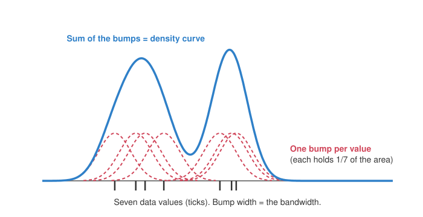
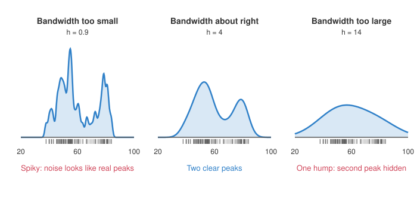

<head>
    <script type="application/ld+json">
        {JSON.stringify({
            "@context": "https://schema.org",
            "@type": "FAQPage",
            "mainEntity": [
                {
                    "@type": "Question",
                    "name": "What does a density plot tell you?",
                    "acceptedAnswer": { "@type": "Answer", "text": "A density plot tells you how the values of one numeric variable are spread out: where they cluster, how many peaks there are, how wide the spread is and whether one side has a long tail. The higher the curve, the more values lie near that point. The area under the curve between two values is the share of the data in that range." }
                },
                {
                    "@type": "Question",
                    "name": "What is the difference between a density plot and a histogram?",
                    "acceptedAnswer": { "@type": "Answer", "text": "A histogram counts values into bins and draws a bar for each bin, so its shape depends on the bin width and where the bins start. A density plot replaces the bars with a smooth curve made by adding a small bump for every value, so its shape depends on the bandwidth instead. A histogram shows counts and is better for small datasets; a density plot is easier to read for large datasets and for comparing several groups on one chart." }
                },
                {
                    "@type": "Question",
                    "name": "What does the y-axis of a density plot mean?",
                    "acceptedAnswer": { "@type": "Answer", "text": "The y-axis measures probability density. It is neither a count nor a percentage. The curve is scaled so the total area under it is 1, so its units are one over the x-axis units, for example per second. Density can be greater than 1 when the values are packed into a narrow range. Read shares from areas, not heights: the area between two x values is the share of the data between them." }
                },
                {
                    "@type": "Question",
                    "name": "What is bandwidth in a density plot?",
                    "acceptedAnswer": { "@type": "Answer", "text": "Bandwidth is the width of the small bump that each data value adds to a density plot. It controls how smooth the curve is. Too small a bandwidth gives a spiky curve that shows noise; too large a bandwidth gives one wide hump that can hide real peaks. Most software chooses one with a rule of thumb, such as Silverman's rule, which is a good starting point to adjust from." }
                },
                {
                    "@type": "Question",
                    "name": "What is a kernel density plot?",
                    "acceptedAnswer": { "@type": "Answer", "text": "A kernel density plot, or KDE plot, is a density plot drawn with kernel density estimation, the usual method. Each data value is replaced by a small, smooth bump called a kernel, most often a bell-shaped Gaussian curve, and the bumps are added together and scaled so the area under the curve is 1. Most density plots you see are kernel density plots." }
                },
                {
                    "@type": "Question",
                    "name": "How do I make a density plot in JavaScript?",
                    "acceptedAnswer": { "@type": "Answer", "text": "With SciChart.js, work out a kernel density estimate on an evenly spaced grid of x values, then draw it with a FastMountainRenderableSeries for a filled curve or a FastLineRenderableSeries for an outline. For several groups, add one series per group; for a ridgeline layout, add each group on its own baseline by setting zeroLineY. The same chart works in React with scichart-react and in Angular with scichart-angular." }
                }
            ]
        })}
    </script>
</head>

# Density Plot

## What is a density plot?

A **density plot** (also called a density chart, density graph or kernel density plot) is a smooth curve showing how the values of one numeric variable are spread out. Where the curve is high, many values lie close together; where it is low, values are rare. You can think of it as a histogram with the steps smoothed away.


*Density plots of one million simulated page load times, 200,000 for each connection type, drawn as a ridgeline plot (sample data). [Try the interactive version](#how-to-create-a-density-plot-in-javascript-react-or-angular).*

:::tip Key takeaways
- A density plot draws the **shape of a distribution** as a smooth curve: its peaks, its spread and its tails.
- The y-axis is **density, not a count**. The total area under the curve is 1, so **areas give shares**: the area between two values is the share of the data between them.
- It is built by **kernel density estimation**: every value adds a small bump, and the bumps are added up.
- The **bandwidth** (the width of each bump) sets how smooth the curve is. Too small looks noisy; too large can hide a real second peak.
- Density plots shine with **large datasets** and for **comparing groups**, overlaid or stacked as a ridgeline plot.
:::

## How to read a density plot


1. **Check what the x-axis measures.** It is the variable you are studying, such as a score, a time or a price, with its units.
2. **Find the peaks.** The highest point is the most common range of values (the **mode**). A second peak often means the data mixes two groups, such as two machines, two customer types or cached and uncached requests.
3. **Look at the spread.** A narrow, tall curve means the values are consistent. A low, wide curve means they vary a lot. The curve's total area is always the same (1), so a wider curve must also be lower.
4. **Look at the tails.** A long tail to the right means a few values are much larger than the rest (right-skewed), as is common with times, sizes and prices.
5. **Read shares from areas, not heights.** The area under the curve between two x values is the share of the data in that range. In the diagram, the shaded band between 60 and 70 holds about 14% of the area, so about 14% of the scores lie between 60 and 70.

A **rug**, a row of short ticks along the x-axis, is sometimes added to show where the individual values are. It helps with small datasets; with thousands of values it turns into a solid bar.

### What does the y-axis of a density plot show?

The y-axis shows **probability density**. The curve is scaled so the area under it adds up to 1 (100% of the data), which means:

- **Its units are "per x unit".** If x is in seconds, density is per second. Change the x units from seconds to milliseconds and every density value is divided by 1,000, though the shape stays the same.
- **Density can be bigger than 1.** In the chart at the top of this page, Fibre load times are packed into a narrow range, so their curve peaks at about 1.7 per second.
- **It is not a count or a percentage.** To get a share, multiply a height by a width, or better, read the area. A curve twice as high at one point means values are about twice as common *near that point*, nothing more.

## How a density plot is made: kernel density estimation

Almost every density plot is drawn with **kernel density estimation** (KDE), a method described by Rosenblatt (1956) and Parzen (1962):

1. **Put a small bump on every value.** The bump is called the **kernel**. It is usually a bell-shaped (Gaussian) curve, though other shapes work too.
2. **Give every bump the same area**, 1 divided by the number of values, so that together they add up to 1.
3. **Add the bumps together.** Where many values sit close together, their bumps pile up into a peak. Where values are sparse, the curve stays low.



In symbols, for values x₁ … xₙ, a kernel K and a bandwidth h, the estimate at any point x is the sum of K((x − xᵢ) / h) over all values, divided by n × h.

**With large datasets,** adding a bump for every value at every point on the curve gets slow: a million values and a thousand points on the curve is a billion calculations. A common shortcut is to count the values into a fine grid first, then add one bump per grid point, weighted by its count. With a grid much finer than the bandwidth the result is practically the same, and it takes a fraction of the time. The live chart on this page does this for one million values when it loads.

### Bandwidth: how smooth should the curve be?

The **bandwidth** is the width of each bump, and it matters far more than the bump's shape. It plays the same role as the bin width in a [histogram](/learn/chart-types/histogram/).



- **Too small:** every little cluster of values gets its own spike. The curve shows noise in this particular sample, not the shape underneath.
- **Too large:** the curve is over-smoothed. Real features, such as the second peak above, melt into one hump.
- **About right:** the main features are clear and stable. If you collected a new sample, they would still be there.

Most software picks a starting bandwidth with a **rule of thumb**. A widely used one is **Silverman's rule**: 0.9 × the smaller of (standard deviation, interquartile range ÷ 1.34) × n^(−1/5), where n is the number of values. It works well for curves with a single peak and can over-smooth data with several peaks, so try a smaller and a larger value too. Because the rule shrinks the bandwidth as n grows, more data lets the curve show finer detail without becoming noisy.

## Types of density plot

| Type | What it shows | Use it for |
| --- | --- | --- |
| **Single density plot** | One curve, often filled | The shape of one variable's distribution |
| **Overlapping density plots** | Two or three curves on the same axes, with see-through fills | Comparing a few groups directly, e.g. before and after a change |
| **Ridgeline plot** (also called a joyplot) | One curve per group, each on its own baseline, stacked so they slightly overlap | Comparing many groups or an ordered series, such as months, versions or connection types |
| **Mirrored density (violin plot)** | The curve and its mirror image, side by side for each group | Comparing groups like a box plot does, but showing the full shape. See [Violin plot](/learn/chart-types/violin-plot/) |
| **2D density plot** | Density over two variables, as colour or contour lines | Where points cluster in a scatter of x and y. Drawn as a [heatmap](/learn/chart-types/heatmap/) or a [contour plot](/learn/chart-types/contour-plot/) |

Overlapping curves get hard to read beyond three or four groups. That is when a ridgeline layout helps, as in the chart at the top of the page.

### How to describe a density plot

Use this template when you report a density plot:

> The distribution of **[variable]** is **[one peak / two peaks]** around **[value(s)]**, **[symmetric / skewed to the right / skewed to the left]**, with most values between **[low]** and **[high]**.

**Worked example** (from the chart at the top): "On 3G, page load times have two peaks, around 2.4 seconds and around 5 seconds, and are skewed to the right. On Fibre, both peaks sit below 1.5 seconds, and about 70% of loads finish within 1 second."

## When to use a density plot

Use a density plot when you have **one numeric variable with plenty of values** and want to see the shape of its distribution, or **compare that shape across groups**. Typical uses are response and load times, sensor readings, measurement errors, test scores and prices.

| Chart | Best for | Watch out for |
| --- | --- | --- |
| **Density plot** | The smooth shape of a distribution; comparing several groups on one chart | Hides the sample size; the bandwidth changes the picture |
| [Histogram](/learn/chart-types/histogram/) | Counts in ranges; small datasets; showing exactly how many values fall where | The bin width and start change the picture; several groups are hard to overlay |
| [Box plot](/learn/chart-types/box-plot/) | Comparing medians, quartiles and outliers across many groups in little space | Hides the shape: two peaks look the same as one |
| [Violin plot](/learn/chart-types/violin-plot/) | The box plot's group comparison plus each group's full shape | Uses more space; still needs enough data per group |

With only a few dozen values, prefer a histogram or a plain dot plot of the values. A smooth curve suggests more certainty about the shape than a small sample can give.

## Common density plot mistakes

- **Reading the y-axis as a count or percentage.** Density is per unit of x. Read shares from the area under the curve, and don't compare peak heights between charts with different x units.
- **Trusting the default bandwidth.** A rule-of-thumb bandwidth can merge two peaks into one. Try a smaller and a larger bandwidth and check that the features you report survive both.
- **Tails beyond the data's possible range.** Each bump spreads a little on both sides, so the curve leaks past the smallest and largest values: negative waiting times, percentages over 100. Cut the curve at the real limits, or use a method that respects them, and say so.
- **Too little data.** With a few dozen values, the curve's wiggles are mostly chance. Show a histogram or the values themselves, or add a rug.
- **Hiding group sizes.** Every curve has an area of 1, so a group of 50 looks as solid as a group of 50,000. State the count for each group.
- **Different scales across groups.** In a ridgeline or a set of small charts, use one shared density scale. Scaling each curve to the same peak height makes narrow and wide distributions look alike.
- **Too many overlapping curves.** Beyond three or four, fills hide each other. Use a ridgeline layout or small multiples instead.

## How to create a density plot in JavaScript, React or Angular

SciChart.js has no separate density series: you work out the kernel density estimate in JavaScript, then draw it as a filled mountain (area) series or a line series. Because SciChart.js draws with WebGL and WebGPU, charts stay smooth to zoom and pan as your data grows or updates live. The chart below estimates densities from one million values in your browser as it loads. Scroll to zoom the time axis, drag to pan, double-click to reset, and hover to see every connection type's density at that load time.

<LiveDocSnippet maxWidth={'100%'} name="./Basic/demo" />

<LearnCta position="top" chart="density plot" demo="mountain-chart" docs="/2d-charts/chart-types/fast-mountain-area-renderable-series/" />

Here is the code for this chart, including the density calculation:

<CodeSnippetBlock labels={["JavaScript", "React", "Angular"]}>
    ```ts showLineNumbers file=./Basic/demo.ts start=#region_A_start end=#region_A_end
    ```

    ```tsx
    import { SciChartReact } from "scichart-react";
    import {
        SciChartSurface,
        NumericAxis,
        FastMountainRenderableSeries,
        XyDataSeries,
        NumberRange,
        EAutoRange,
        EAxisAlignment,
        SweepAnimation,
        SciChartJsNavyTheme
    } from "scichart";

    // initChart builds the chart; SciChartReact creates it, sizes it and cleans it up
    const initChart = async (rootElement: string | HTMLDivElement) => {
        const { wasmContext, sciChartSurface } = await SciChartSurface.create(rootElement, {
            theme: new SciChartJsNavyTheme()
        });

        // One density curve per group: x values on a grid, density at each (see kernelDensity in the JavaScript tab)
        const estimates: { name: string; xValues: number[]; density: number[] }[] = getYourDensityData();
        const maxDensity = Math.max(...estimates.map((e) => Math.max(...e.density)));
        const scale = 1.8 / maxDensity; // one shared scale for every row

        sciChartSurface.xAxes.add(new NumericAxis(wasmContext, { axisTitle: "Value" }));
        const yAxis = new NumericAxis(wasmContext, {
            axisAlignment: EAxisAlignment.Left,
            autoTicks: false,
            majorDelta: 1,
            autoRange: EAutoRange.Never,
            visibleRange: new NumberRange(-0.7, estimates.length + 1)
        });
        // Group names at the baselines instead of numbers
        yAxis.labelProvider.formatLabel = (value) => estimates[estimates.length - 1 - Math.round(value)]?.name ?? "";
        sciChartSurface.yAxes.add(yAxis);

        estimates.forEach((estimate, index) => {
            const baseline = estimates.length - 1 - index;
            sciChartSurface.renderableSeries.add(
                new FastMountainRenderableSeries(wasmContext, {
                    dataSeries: new XyDataSeries(wasmContext, {
                        xValues: estimate.xValues,
                        yValues: estimate.density.map((d) => baseline + d * scale),
                        dataSeriesName: estimate.name
                    }),
                    zeroLineY: baseline,
                    fill: "#50C7E0B0",
                    stroke: "#FFFFFF",
                    strokeThickness: 2,
                    animation: new SweepAnimation({ duration: 800 })
                })
            );
        });
        return { sciChartSurface };
    };

    export const DensityPlot = () => (
        <SciChartReact initChart={initChart} style={{ width: "100%", height: 400 }} />
    );
    ```

    ```ts
    import { Component } from "@angular/core";
    import { ScichartAngularComponent } from "scichart-angular";
    import {
        SciChartSurface,
        NumericAxis,
        FastMountainRenderableSeries,
        XyDataSeries,
        NumberRange,
        EAutoRange,
        EAxisAlignment,
        SweepAnimation,
        SciChartJsNavyTheme
    } from "scichart";

    @Component({
        selector: "app-density-plot",
        standalone: true,
        imports: [ScichartAngularComponent],
        template: `<scichart-angular [initChart]="initChart" style="display: block; width: 100%; height: 400px"></scichart-angular>`
    })
    export class DensityPlotComponent {
        // initChart builds the chart; scichart-angular creates it, sizes it and cleans it up
        initChart = async (rootElement: string | HTMLDivElement) => {
            const { wasmContext, sciChartSurface } = await SciChartSurface.create(rootElement, {
                theme: new SciChartJsNavyTheme()
            });

            // One density curve per group: x values on a grid, density at each (see kernelDensity in the JavaScript tab)
            const estimates: { name: string; xValues: number[]; density: number[] }[] = getYourDensityData();
            const maxDensity = Math.max(...estimates.map((e) => Math.max(...e.density)));
            const scale = 1.8 / maxDensity; // one shared scale for every row

            sciChartSurface.xAxes.add(new NumericAxis(wasmContext, { axisTitle: "Value" }));
            const yAxis = new NumericAxis(wasmContext, {
                axisAlignment: EAxisAlignment.Left,
                autoTicks: false,
                majorDelta: 1,
                autoRange: EAutoRange.Never,
                visibleRange: new NumberRange(-0.7, estimates.length + 1)
            });
            // Group names at the baselines instead of numbers
            yAxis.labelProvider.formatLabel = (value) => estimates[estimates.length - 1 - Math.round(value)]?.name ?? "";
            sciChartSurface.yAxes.add(yAxis);

            estimates.forEach((estimate, index) => {
                const baseline = estimates.length - 1 - index;
                sciChartSurface.renderableSeries.add(
                    new FastMountainRenderableSeries(wasmContext, {
                        dataSeries: new XyDataSeries(wasmContext, {
                            xValues: estimate.xValues,
                            yValues: estimate.density.map((d) => baseline + d * scale),
                            dataSeriesName: estimate.name
                        }),
                        zeroLineY: baseline,
                        fill: "#50C7E0B0",
                        stroke: "#FFFFFF",
                        strokeThickness: 2,
                        animation: new SweepAnimation({ duration: 800 })
                    })
                );
            });
            return { sciChartSurface };
        };
    }
    ```
</CodeSnippetBlock>

Key points:

- Work out the density **before** you chart it. `kernelDensity` in the code above counts the values into a fine grid, then spreads each count with a Gaussian kernel, using Silverman's rule for the bandwidth. Swap in your own bandwidth to make the curve smoother or sharper.
- A [FastMountainRenderableSeries](/2d-charts/chart-types/fast-mountain-area-renderable-series/) draws each curve as a filled area. For an outline only, or for overlapping curves, a [FastLineRenderableSeries](/2d-charts/chart-types/fast-line-renderable-series/) works too.
- **Ridgeline layout:** give each group its own baseline (0, 1, 2, …), add the baseline to its density values and set `zeroLineY` to the baseline, so the fill stops there. Setting the y-axis `labelProvider.formatLabel` puts the group names at the baselines. Add the back rows first so the front rows overlap them.
- **Violin plots** use the same density values, drawn as a mirrored shape with a [FastBandRenderableSeries](/2d-charts/chart-types/fast-band-renderable-series/). See [Violin plot](/learn/chart-types/violin-plot/).

**See it in the demo app:** [JavaScript mountain chart](https://www.scichart.com/demo/javascript/mountain-chart) · [React mountain chart](https://www.scichart.com/demo/react/mountain-chart) · [Angular mountain chart](https://www.scichart.com/demo/angular/mountain-chart)

**The same data as bars:** [JavaScript histogram chart](https://www.scichart.com/demo/javascript/histogram-chart) · [React histogram chart](https://www.scichart.com/demo/react/histogram-chart) · [Angular histogram chart](https://www.scichart.com/demo/angular/histogram-chart)

**Go deeper:** [SciChart.js mountain (area) series documentation](/2d-charts/chart-types/fast-mountain-area-renderable-series/), including gradient fills, and the [SciChart.js band series documentation](/2d-charts/chart-types/fast-band-renderable-series/) for filled shapes between two curves.

## Frequently asked questions

### What does a density plot tell you?

A density plot tells you how the values of one numeric variable are spread out: where they cluster, how many peaks there are, how wide the spread is and whether one side has a long tail. The higher the curve, the more values lie near that point. The area under the curve between two values is the share of the data in that range.

### What is the difference between a density plot and a histogram?

A histogram counts values into bins and draws a bar for each bin, so its shape depends on the bin width and where the bins start. A density plot replaces the bars with a smooth curve made by adding a small bump for every value, so its shape depends on the bandwidth instead. A histogram shows counts and is better for small datasets; a density plot is easier to read for large datasets and for comparing several groups on one chart.

### What does the y-axis of a density plot mean?

The y-axis measures probability density. It is neither a count nor a percentage. The curve is scaled so the total area under it is 1, so its units are one over the x-axis units, for example per second. Density can be greater than 1 when the values are packed into a narrow range. Read shares from areas, not heights: the area between two x values is the share of the data between them.

### What is bandwidth in a density plot?

Bandwidth is the width of the small bump that each data value adds to a density plot. It controls how smooth the curve is. Too small a bandwidth gives a spiky curve that shows noise; too large a bandwidth gives one wide hump that can hide real peaks. Most software chooses one with a rule of thumb, such as Silverman's rule, which is a good starting point to adjust from.

### What is a kernel density plot?

A kernel density plot, or KDE plot, is a density plot drawn with kernel density estimation, the usual method. Each data value is replaced by a small, smooth bump called a kernel, most often a bell-shaped Gaussian curve, and the bumps are added together and scaled so the area under the curve is 1. Most density plots you see are kernel density plots.

### How do I make a density plot in JavaScript?

With SciChart.js, work out a kernel density estimate on an evenly spaced grid of x values, then draw it with a `FastMountainRenderableSeries` for a filled curve or a `FastLineRenderableSeries` for an outline. For several groups, add one series per group; for a ridgeline layout, add each group on its own baseline by setting `zeroLineY`. The same chart works in React with `scichart-react` and in Angular with `scichart-angular`.

## Sources

- Rosenblatt, M. (1956), [Remarks on some nonparametric estimates of a density function](https://doi.org/10.1214/aoms/1177728190). *The Annals of Mathematical Statistics*, 27(3), 832–837. One of the two papers that introduced kernel density estimation.
- Parzen, E. (1962), [On estimation of a probability density function and mode](https://doi.org/10.1214/aoms/1177704472). *The Annals of Mathematical Statistics*, 33(3), 1065–1076. The other founding paper.
- Silverman, B. W. (1986), [Density Estimation for Statistics and Data Analysis](https://doi.org/10.1201/9781315140919). Chapman & Hall. The standard introduction, including the bandwidth rule of thumb and why bandwidth matters more than the kernel's shape.
- Scott, D. W. (2015), [Multivariate Density Estimation: Theory, Practice, and Visualization](https://doi.org/10.1002/9781118575574), 2nd edition. Wiley. Density estimation in one and more dimensions, including bandwidth choice.
- Wilke, C. O. (2019), [Fundamentals of Data Visualization, chapter 7: Visualizing distributions: histograms and density plots](https://clauswilke.com/dataviz/histograms-density-plots.html). O'Reilly. Practical guidance on kernels, bandwidth, the area-equals-one scaling and tails that run past the data.

<LearnCta position="bottom" chart="density plot" demo="mountain-chart" docs="/2d-charts/chart-types/fast-mountain-area-renderable-series/" />
