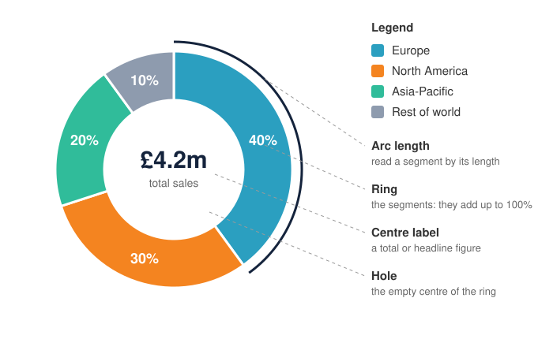

<head>
    <script type="application/ld+json">
        {JSON.stringify({
            "@context": "https://schema.org",
            "@type": "FAQPage",
            "mainEntity": [
                {
                    "@type": "Question",
                    "name": "What is a donut chart used for?",
                    "acceptedAnswer": { "@type": "Answer", "text": "A donut chart shows how one total splits into a few parts, such as sales by region, a budget by category or survey answers, while using the empty centre for the total or the headline figure. It is common on dashboards and in reports where one number and its breakdown belong together." }
                },
                {
                    "@type": "Question",
                    "name": "What is the difference between a donut chart and a pie chart?",
                    "acceptedAnswer": { "@type": "Answer", "text": "Both show parts of a whole that add up to 100%. A pie chart is a full circle of wedge-shaped slices. A donut chart removes the centre, leaving a ring of segments that you read by their arc length, and the empty centre can hold a total or a label." }
                },
                {
                    "@type": "Question",
                    "name": "Is it a donut chart or a doughnut chart?",
                    "acceptedAnswer": { "@type": "Answer", "text": "Both names mean the same chart. Doughnut is the traditional spelling, used in British English and in Microsoft Excel and Office. Donut is the common American spelling, used by many charting libraries and dashboard tools." }
                },
                {
                    "@type": "Question",
                    "name": "Are donut charts harder to read than pie charts?",
                    "acceptedAnswer": { "@type": "Answer", "text": "Not according to the research. A 2016 study by Skau and Kosara found that readers judge pie and donut segments mainly by arc length and area, not by the angle at the centre, and that donut charts were read about as accurately as pie charts. Both are less precise than a bar chart." }
                },
                {
                    "@type": "Question",
                    "name": "When should you not use a donut chart?",
                    "acceptedAnswer": { "@type": "Answer", "text": "Avoid a donut chart when the values don't add up to one whole, when there are more than about five categories, when segments are close in size and need ranking, or when you want to compare several groups or show change over time. A bar chart or a 100% stacked column chart is clearer in those cases." }
                },
                {
                    "@type": "Question",
                    "name": "How do I make a donut chart in JavaScript?",
                    "acceptedAnswer": { "@type": "Answer", "text": "With SciChart.js, create a SciChartPieSurface with pieType set to EPieType.Donut and a holeRadius such as 0.6, then add one PieSegment per segment with its value, text and colour. The same chart works in React with scichart-react and in Angular with scichart-angular." }
                }
            ]
        })}
    </script>
</head>

# Donut Chart

## What is a donut chart?

A **donut chart** (also spelled **doughnut chart**) is a [pie chart](/learn/pie-chart/) with its centre cut out. A **ring** is divided into **segments**, each showing one category's **share of a whole**, and together the segments make **100%**. The empty centre usually holds a **total** or a headline figure.


*A donut chart of annual sales by region (sample data), with the total in the centre. [Try the interactive version](#how-to-create-a-donut-chart-in-javascript-react-or-angular).*

:::tip Key takeaways
- A donut chart shows **parts of one whole** as segments of a ring that add up to 100%.
- You read each segment by **how far it runs round the ring** (its arc length). A quarter of the ring is 25%.
- The **centre** is its one real advantage over a pie: use it for the total or the key figure.
- Research found donut charts are read **about as accurately as pie charts**. Both are less precise than bars.
- Keep to **about five segments**, and avoid multi-ring donuts for comparing groups.
:::

## How to read a donut chart



1. **Read the centre first.** It usually tells you what the whole ring adds up to ("£4.2m total sales") or gives the one number the chart is about.
2. **Match each segment to its category,** using the label on the segment or the legend.
3. **Judge each segment by its arc length:** how far it runs round the ring. With the centre gone, there's no point where the slices meet, so you compare lengths along the ring instead.
4. **Read the labels for exact values.** As with a pie chart, readers can only estimate segment sizes without percentages.

### The clock-face trick

Think of the ring as a clock face, starting at 12 o'clock and running clockwise:

| Segment runs from 12 o'clock to… | Share of the whole |
| --- | --- |
| 1 o'clock | about 8% (one hour is 1/12) |
| 3 o'clock | 25% |
| 4 o'clock | about 33% (a third) |
| 6 o'clock | 50% |
| 9 o'clock | 75% |

In the chart above, Europe starts at 12 o'clock and stops just before 5 o'clock: 4.8 of 12 hours, or 40%. North America then runs on to about 8:25, another 3.6 hours, or 30%.

## Donut chart vs pie chart

A donut chart is a pie chart with the middle removed, so the two show exactly the same kind of data. The differences are in how you read them and what you can do with the centre.

| | Pie chart | Donut chart |
| --- | --- | --- |
| Shape | A full circle of wedge-shaped slices | A ring of curved segments around an empty centre |
| How you judge a share | Arc length, area and the angle at the centre | Arc length and area; there's no centre angle |
| The centre | Taken up by the point of every slice | Free for a total, a label or the selected segment's value |
| Reading accuracy | About the same as a donut, in controlled tests | About the same as a pie, in controlled tests |
| Small shares | Thin wedges that are hard to label | Thin arcs; a thicker ring makes them easier to see |

**Are donut charts harder to read?** A common claim is that removing the centre makes a donut harder to read, because you lose the angle. A 2016 study by Drew Skau and Robert Kosara tested this directly. It found that readers rely mainly on **arc length and area**, not the centre angle, and that donut charts were read **about as accurately** as pie charts. So choose between them on design grounds: a donut if you'll use the centre, a pie if you won't.

## Types of donut chart

| Variant | What it looks like | Watch out for |
| --- | --- | --- |
| Single-ring donut | One ring split into segments, often with a total in the centre | Too many segments, or a ring so thin the segments are hard to compare |
| Exploded donut | One or more segments pulled out from the ring | Pull out one segment at most, or the emphasis is lost (click a segment in the live chart below to try it) |
| Multi-ring (nested) donut | Two or more rings, one inside the other, e.g. this year outside and last year inside | Inner rings are shorter than outer ones, so the same percentage looks smaller on an inner ring. A [bar chart](/learn/bar-chart/) or [100% stacked column chart](/2d-charts/chart-types/stacked-column-renderable-series/) usually compares groups more clearly |
| Sunburst | Nested rings where each outer ring splits the segment inside it (region, then country) | Fine for showing a hierarchy, but small outer segments get very thin. See the [sunburst chart documentation](/2d-charts/chart-types/polar-sunburst-chart/) |
| Single-value (progress) donut | One coloured segment against a grey track, e.g. "72% complete" | Shows one percentage only; a [gauge chart](/2d-charts/chart-types/polar-gauge-chart/) or a plain number may be clearer |
| Semicircle donut | Half a ring, like a dial | The half circle is 100%, so readers have to rescale what they see |

## When to use a donut chart

Use a donut chart for the same data as a pie chart, **a few parts of one whole**, when you want to **show a total or label in the centre**, or when a lighter, ring-shaped chart suits a dashboard. If readers need to **compare segments of similar size**, or there are **many categories**, use a bar chart.

| Chart | Best for |
| --- | --- |
| **Donut chart** | A few parts of one whole, with a total or headline figure in the centre |
| [Pie chart](/learn/pie-chart/) | A few parts of one whole, when you don't need the centre |
| [Bar chart](/learn/bar-chart/) | Comparing values accurately, many categories, or values that don't add up to a whole |
| [100% stacked column chart](/2d-charts/chart-types/stacked-column-renderable-series/) | Comparing how the split of a whole changes across several groups or periods, instead of a multi-ring donut |

## What to put in the centre of a donut chart

The hole is the reason to pick a donut over a pie, so give it a job. Good choices:

- **The total** the ring adds up to, with its unit: "£4.2m total sales", "1,240 responses".
- **The headline share**, when the chart is about one segment: "40% Europe".
- **The selected segment's value,** on an interactive chart: update the centre when the reader hovers over or clicks a segment.
- **Progress towards a target,** on a single-value donut: "72% complete".

Keep it to one number and a short label. If the centre has nothing useful to say, a pie chart is the simpler choice.

## Common donut chart mistakes

Use this as a checklist before you publish a donut chart:

- **An empty hole.** Without a centre label, a donut is a pie chart with less to look at.
- **A centre number that doesn't match the ring.** If the centre shows a total, it must be the total of the segments, in the same unit.
- **A ring that's too thin.** Thin rings make small segments hard to see and label. Keep the ring thick enough to hold its labels.
- **Too many segments.** Keep to about five; group the rest into a grey "Other" segment, placed last.
- **Comparing groups with nested rings.** The same percentage looks smaller on an inner ring. Use side-by-side bars or a 100% stacked column chart instead.
- **Segments that don't make a whole,** such as multiple-choice survey answers that add up to more than 100%.
- **3D effects and random order.** Keep it flat, and sort segments largest first from 12 o'clock.

## How to create a donut chart in JavaScript, React or Angular

In SciChart.js, a donut chart is a `SciChartPieSurface` with `pieType` set to `EPieType.Donut`, so it shares the pie chart's animated updates, legend and selectable segments. Try the chart below: click a segment, or tick it in the legend, to pull it out from the ring.

<LiveDocSnippet maxWidth={'100%'} name="./Basic/demo" />

<LearnCta position="top" chart="donut chart" demo="donut-chart" docs="/2d-charts/chart-types/donut-chart-type/" />

Here is the code for this chart:

<CodeSnippetBlock labels={["JavaScript", "React", "Angular"]}>
    ```ts showLineNumbers file=./Basic/demo.ts start=#region_A_start end=#region_A_end
    ```

    ```tsx
    import { SciChartReact } from "scichart-react";
    import { SciChartPieSurface, EPieType, PieSegment, SciChartJsNavyTheme } from "scichart";

    // initChart builds the chart; SciChartReact creates it, sizes it and cleans it up
    const initChart = async (rootElement: string | HTMLDivElement) => {
        const sciChartPieSurface = await SciChartPieSurface.create(rootElement, {
            theme: new SciChartJsNavyTheme(),
            pieType: EPieType.Donut,
            holeRadius: 0.6,
            animate: true
        });
        sciChartPieSurface.labelProvider.getSegmentText = (segment, total) =>
            `${Math.round((100 * segment.value) / total)}%`;
        sciChartPieSurface.legend.showLegend = true;

        // getYourDonutData() returns [{ text: "Europe", value: 1680, color: "#50C7E0" }, ...]
        for (const { text, value, color } of getYourDonutData()) {
            sciChartPieSurface.pieSegments.add(new PieSegment({ text, value, color }));
        }
        return { sciChartSurface: sciChartPieSurface };
    };

    // The centre label is a normal React element laid over the chart
    export const DonutChart = () => (
        <div style={{ position: "relative", width: "100%", height: 400 }}>
            <SciChartReact initChart={initChart} style={{ width: "100%", height: "100%" }} />
            <div style={{ position: "absolute", inset: 0, display: "flex", alignItems: "center", justifyContent: "center", pointerEvents: "none", color: "#fff", fontSize: 32, fontWeight: "bold" }}>
                £4.2m
            </div>
        </div>
    );
    ```

    ```ts
    import { Component } from "@angular/core";
    import { ScichartAngularComponent } from "scichart-angular";
    import { SciChartPieSurface, EPieType, PieSegment, SciChartJsNavyTheme } from "scichart";

    @Component({
        selector: "app-donut-chart",
        standalone: true,
        imports: [ScichartAngularComponent],
        // The centre label is a normal element laid over the chart
        template: `
            <div style="position: relative; width: 100%; height: 400px">
                <scichart-angular [initChart]="initChart" style="display: block; width: 100%; height: 100%"></scichart-angular>
                <div style="position: absolute; inset: 0; display: flex; align-items: center; justify-content: center; pointer-events: none; color: #fff; font-size: 32px; font-weight: bold">
                    £4.2m
                </div>
            </div>`
    })
    export class DonutChartComponent {
        // initChart builds the chart; scichart-angular creates it, sizes it and cleans it up
        initChart = async (rootElement: string | HTMLDivElement) => {
            const sciChartPieSurface = await SciChartPieSurface.create(rootElement, {
                theme: new SciChartJsNavyTheme(),
                pieType: EPieType.Donut,
                holeRadius: 0.6,
                animate: true
            });
            sciChartPieSurface.labelProvider.getSegmentText = (segment, total) =>
                `${Math.round((100 * segment.value) / total)}%`;
            sciChartPieSurface.legend.showLegend = true;

            // getYourDonutData() returns [{ text: "Europe", value: 1680, color: "#50C7E0" }, ...]
            for (const { text, value, color } of getYourDonutData()) {
                sciChartPieSurface.pieSegments.add(new PieSegment({ text, value, color }));
            }
            return { sciChartSurface: sciChartPieSurface };
        };
    }
    ```
</CodeSnippetBlock>

Key points:

- A [SciChartPieSurface](https://www.scichart.com/documentation/js/current/typedoc/classes/scichartpiesurface.html) draws both pie and donut charts. `pieType: EPieType.Donut` turns the pie into a ring.
- `holeRadius` sets the size of the hole as a fraction of the outer radius: `0.6` leaves a ring 40% of the radius thick.
- Each segment is a [PieSegment](https://www.scichart.com/documentation/js/current/typedoc/classes/piesegment.html) with a `value`, `text` and `color`. You pass raw values; SciChart works out the percentages.
- The centre label is an ordinary HTML element laid over the chart: in plain JavaScript it is added to the surface's `domChartRoot`; in React and Angular it sits next to the chart component.

**See it in the demo app:** [JavaScript donut chart](https://www.scichart.com/demo/javascript/donut-chart) · [React donut chart](https://www.scichart.com/demo/react/donut-chart) · [Angular donut chart](https://www.scichart.com/demo/angular/donut-chart)

**Go deeper:** [SciChart.js donut chart documentation](/2d-charts/chart-types/donut-chart-type/), and the [pie chart documentation](/2d-charts/chart-types/pie-chart-type/) for label formatting and animated updates, which work the same way on a donut.

## Frequently asked questions

### What is a donut chart used for?

A donut chart shows how one total splits into a few parts, such as sales by region, a budget by category or survey answers, while using the empty centre for the total or the headline figure. It is common on dashboards and in reports where one number and its breakdown belong together.

### What is the difference between a donut chart and a pie chart?

Both show parts of a whole that add up to 100%. A [pie chart](/learn/pie-chart/) is a full circle of wedge-shaped slices. A donut chart removes the centre, leaving a ring of segments that you read by their arc length, and the empty centre can hold a total or a label.

### Is it a donut chart or a doughnut chart?

Both names mean the same chart. Doughnut is the traditional spelling, used in British English and in Microsoft Excel and Office. Donut is the common American spelling, used by many charting libraries and dashboard tools.

### Are donut charts harder to read than pie charts?

Not according to the research. A 2016 study by Skau and Kosara found that readers judge pie and donut segments mainly by arc length and area, not by the angle at the centre, and that donut charts were read about as accurately as pie charts. Both are less precise than a [bar chart](/learn/bar-chart/).

### When should you not use a donut chart?

Avoid a donut chart when the values don't add up to one whole, when there are more than about five categories, when segments are close in size and need ranking, or when you want to compare several groups or show change over time. A bar chart or a 100% stacked column chart is clearer in those cases.

### How do I make a donut chart in JavaScript?

With SciChart.js, create a `SciChartPieSurface` with `pieType` set to `EPieType.Donut` and a `holeRadius` such as `0.6`, then add one `PieSegment` per segment with its value, text and colour. The same chart works in React with `scichart-react` and in Angular with `scichart-angular`.

## Sources

- Skau, D. and Kosara, R. (2016), [Arcs, Angles, or Areas: Individual Data Encodings in Pie and Donut Charts](https://doi.org/10.1111/cgf.12888). *Computer Graphics Forum*, 35(3). Two experiments comparing pie and donut charts, finding the centre angle the least important cue and donut charts as accurate as pies.
- Cleveland, W. S. and McGill, R. (1984), [Graphical Perception: Theory, Experimentation, and Application to the Development of Graphical Methods](https://doi.org/10.1080/01621459.1984.10478080). *Journal of the American Statistical Association*, 79(387). Why lengths along a common baseline (bars) are judged more accurately than angles and areas.
- Microsoft, [Available chart types in Office](https://support.microsoft.com/en-us/office/available-chart-types-in-office-a6187218-807e-4103-9e0a-27cdb19afb90). Pie and doughnut charts in Excel and Office, and when to consider them.

<LearnCta position="bottom" chart="donut chart" demo="donut-chart" docs="/2d-charts/chart-types/donut-chart-type/" />
