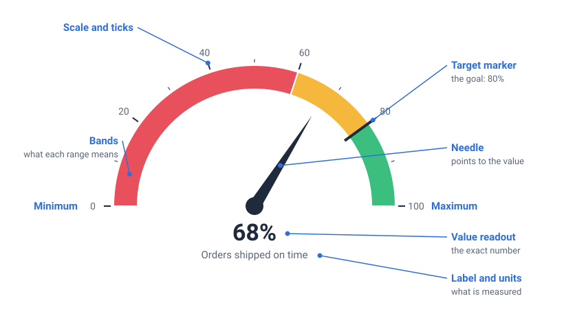
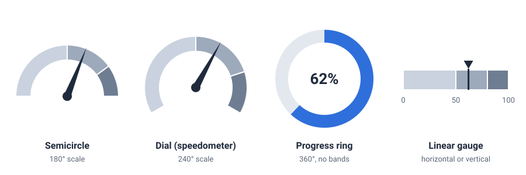

<head>
    <script type="application/ld+json">
        {JSON.stringify({
            "@context": "https://schema.org",
            "@type": "FAQPage",
            "mainEntity": [
                {
                    "@type": "Question",
                    "name": "What is a gauge chart used for?",
                    "acceptedAnswer": { "@type": "Answer", "text": "A gauge chart is used to show one current value against its limits and targets, so a viewer can tell at a glance whether it is in a good, borderline or bad range. Typical uses are live readings on monitoring screens (CPU load, temperature, pressure, speed) and single business measures on dashboards, such as progress towards a sales target or a satisfaction score." }
                },
                {
                    "@type": "Question",
                    "name": "Why would you use a gauge chart?",
                    "acceptedAnswer": { "@type": "Answer", "text": "Use a gauge chart when the question is \"is this one number OK right now?\" and the answer depends on known limits. The dial is instantly familiar from cars and machines, the bands turn a raw number into a status, and a moving needle makes a live value easy to follow. If you need to compare several values or show a trend, a bullet chart or a line chart is a better choice." }
                },
                {
                    "@type": "Question",
                    "name": "What are the disadvantages of a gauge chart?",
                    "acceptedAnswer": { "@type": "Answer", "text": "A gauge chart shows only one value, takes a lot of space for it, and shows no history, so you can't tell whether the value is rising or falling. Values are read from an angle, which is harder to judge precisely than a position on a straight scale, and several gauges side by side are hard to compare. Coloured bands also fail for readers who can't tell red from green unless they are labelled." }
                },
                {
                    "@type": "Question",
                    "name": "What is the difference between a gauge chart and a bullet chart?",
                    "acceptedAnswer": { "@type": "Answer", "text": "Both show one value against qualitative ranges and a target. A gauge chart draws the scale as an arc with a needle, which looks familiar but takes a lot of space. A bullet chart draws the same information as a short straight bar: a dark bar for the value, shaded bands for the ranges and a line for the target. Bullet charts are more compact and easier to stack and compare, which is why they were designed as a replacement for dashboard gauges." }
                },
                {
                    "@type": "Question",
                    "name": "Is a gauge chart the same as a sheet metal gauge chart?",
                    "acceptedAnswer": { "@type": "Answer", "text": "No. A sheet metal gauge chart, or wire gauge chart, is a reference table that converts gauge numbers, such as 14 or 18 gauge, into thickness in inches or millimetres. A gauge chart in data visualisation is a dial-style chart that shows one value on a scale. The two only share the word \"gauge\"." }
                },
                {
                    "@type": "Question",
                    "name": "How do I make a gauge chart in JavaScript?",
                    "acceptedAnswer": { "@type": "Answer", "text": "Draw the gauge on a polar chart whose angular axis covers only part of a circle, for example 240 degrees with the gap at the bottom. The angular axis is the value scale. Add the coloured bands as polar columns from each band's start value to its end value, a needle with a polar pointer annotation, and the number as a text annotation. With SciChart.js these are PolarColumnRenderableSeries, PolarArcAnnotation and PolarPointerAnnotation on a SciChartPolarSurface; the same code works in React with scichart-react and in Angular with scichart-angular." }
                }
            ]
        })}
    </script>
</head>

# Gauge Chart

## What is a gauge chart?

A **gauge chart** (also called a gauge graph, dial chart, speedometer chart or meter chart) shows a single value on a scale between a minimum and a maximum, like the dial on a car dashboard. A needle or a filled arc marks the current value, and coloured bands show whether that value is good, borderline or bad.


*A gauge chart of a server's CPU load, with Normal, High and Critical bands (sample data). [Try the interactive version](#how-to-create-a-gauge-chart-in-javascript-react-or-angular).*

:::tip Key takeaways
- A gauge chart answers one question: **is this one value OK right now?**
- **The bands carry the meaning.** Set them from real limits or targets, and label them in words, not by colour alone.
- **The angle is the value.** A reading is the share of the way round the scale, from the minimum to the maximum.
- Gauges show **no history** and take a lot of space. For trends use a line chart; to compare many values use bullet charts or bars.
- Gauges work best for **live readings**, where a moving needle is easy to follow.
:::

## How to read a gauge chart



1. **Read the label and units first.** They say what is being measured, such as "orders shipped on time, %" or "pressure, bar", and over what period.
2. **Check the ends of the scale.** The minimum and maximum set what a full sweep means. A needle near the top of a 0 to 100 scale and one near the top of a 0 to 1,000 scale mean very different things.
3. **Find the needle,** or the end of the filled arc. Its position along the scale is the value. Use the tick marks to estimate it, or read the number in the readout if there is one.
4. **See which band the value is in.** The bands are what turn a number into a judgement: in the gauge above, 68% sits in the amber band, so the team is close to target but not there.
5. **Compare it with the target,** if there is a marker. 68% against a target of 80% is a gap of 12 percentage points.
6. **Remember what the gauge leaves out.** It shows one moment. To know whether 68% is improving or getting worse, you need the history, for example a line chart beside the gauge.

## Types of gauge chart



| Type | What it looks like | Good for |
| --- | --- | --- |
| **Semicircle gauge** | A half circle, from 9 o'clock to 3 o'clock | Business dashboards, where the half-circle shape fits a short, wide tile |
| **Dial or speedometer gauge** | An arc of about 240 to 270 degrees, with the gap at the bottom | Live readings such as speed, CPU load or pressure, where a longer scale gives finer ticks |
| **Progress ring** (radial gauge) | A full circle that fills up, usually with no needle or bands | Progress towards 100%, such as a download or a goal |
| **Linear gauge** | A straight horizontal or vertical bar with bands and a marker, like a thermometer or a tank level | Narrow spaces, and stacks of gauges that need to line up |
| **Multi-gauge panel** | Several small gauges side by side | Watching a few related readings at once, such as the cores of one machine |

A **bullet chart** is a compact linear gauge designed for dashboards: one bar for the value, shaded bands for the ranges and a short line for the target. It does the same job as a gauge in far less space.

## How to set the bands: a worked example

The bands are the most important design decision on a gauge. Take them from what the value means for the business or the machine, not from equal thirds of the scale.

**Example: a server's CPU load,** as in the live gauge on this page. The operations team agrees three ranges:

| Band | Range | Why there | What to do |
| --- | --- | --- | --- |
| Normal | 0 to 70% | Room left for a sudden spike in traffic | Nothing |
| High | 70 to 90% | Requests start to slow down | Watch it; add capacity if it stays here |
| Critical | 90 to 100% | Little headroom left; requests may queue or time out | Act now |

The bands are deliberately uneven: Normal covers 70% of the scale, Critical only 10%. That's correct, because the scale is about the machine, not about making the colours look balanced.

**Turning a value into an angle.** On a gauge, the angle of the needle from the start of the scale is:

> angle = (value − minimum) ÷ (maximum − minimum) × sweep

The live gauge on this page has a sweep of 240 degrees and a scale from 0 to 100%, so:

| Reading | Angle from the start of the scale | Band |
| --- | --- | --- |
| 35% | 35 ÷ 100 × 240 = 84° | Normal |
| 72% | 72 ÷ 100 × 240 = 172.8° | High |
| 95% | 95 ÷ 100 × 240 = 228° | Critical |

The same sum, run backwards, turns a click or a drag on the gauge into a value, which is how the live gauge lets you set the needle yourself.

### How to describe a gauge chart

Use this template when you report a reading from a gauge:

> **[Measure]** is at **[value and unit]**, in the **[band]** range (**[band limits]**), **[above or below]** **[the target or limit]** by **[gap]**. Over **[period]**, it ranged from **[low]** to **[high]**.

**Worked example:** "CPU load is at 72%, in the High range (70 to 90%), above the Normal limit of 70% by 2 points. Over the last 30 seconds, it ranged from 58% to 81%."

The last sentence is the one most gauges can't support on their own. The live gauge on this page adds a thin white arc that spans the lowest to the highest reading of the last 30 seconds, so the range can be read straight off the dial.

## When to use a gauge chart

Use a gauge chart when **one value matters right now**, it has **known limits or a target**, and viewers need to judge it **at a glance**: a machine reading on a control screen, a live system metric, or a single headline measure on a dashboard.

| Chart | Best for |
| --- | --- |
| **Gauge chart** | One current value against its limits, especially a live reading |
| **Bullet chart** (a compact [linear gauge](/2d-charts/chart-types/linear-gauge-chart/)) | The same information in a small space, and several measures stacked for comparison |
| [Line chart](/learn/line-chart/) | How the value changed over time, and whether it is rising or falling |
| [Bar chart](/learn/bar-chart/) | Comparing the same measure across many items, such as CPU load on 20 servers |
| [Donut chart](/learn/donut-chart/) | How one total splits into a few parts, rather than how far a single value has got |

A good pattern is to pair them: a gauge for the value now, and a small line chart beside it for the last hour.

## Common gauge chart mistakes

- **Too many gauges.** A wall of dials uses a lot of space and is hard to scan. If you are comparing values, use bars or bullet charts; keep gauges for the few readings that matter most.
- **Bands that mean nothing.** Equal thirds coloured green, amber and red look tidy but tell the reader nothing. Set each band from a real limit, target or specification.
- **Colour as the only signal.** The most common kind of colour blindness makes red and green hard to tell apart. Label the bands in words ("Normal", "High", "Critical"), and show the status as text next to the number.
- **A scale that hides the story.** A 0 to 1,000 scale for a value that stays between 40 and 60 leaves the needle barely moving. Choose limits that suit the real range of values, and say so if the scale doesn't start at zero.
- **No number.** Readers can't read an angle precisely. Show the value as text, with its units.
- **No context over time.** A gauge shows a single moment. Add the recent range, a target marker or a small trend chart so readers know whether the value is normal for now.
- **Decoration over data.** 3D effects, shiny bezels and shadows make the needle harder to read. Keep the dial flat and the needle high-contrast.

## How to create a gauge chart in JavaScript, React or Angular

SciChart.js draws gauges on a polar chart whose angular axis covers only part of the circle, so the scale, ticks and labels come from a real axis rather than a picture. Because SciChart.js draws with WebGL and WebGPU, the needle stays smooth even when it updates many times a second. Try the gauge below: it shows a live CPU load reading twice a second. Click or drag anywhere on the dial to move the needle yourself and watch the band, the colour and the status change; the live feed comes back after 5 seconds.

<LiveDocSnippet maxWidth={'100%'} name="./Basic/demo" />

<LearnCta position="top" chart="gauge chart" demo="polar-gauge-chart" docs="/2d-charts/chart-types/polar-gauge-chart/" />

Here is the code for this gauge. Change the `GAUGE` object to set your own scale, sweep and bands:

<CodeSnippetBlock labels={["JavaScript", "React", "Angular"]}>
    ```ts showLineNumbers file=./Basic/demo.ts start=#region_A_start end=#region_A_end
    ```

    ```tsx
    import { SciChartReact } from "scichart-react";
    import { SciChartPolarSurface, SciChartJsNavyTheme } from "scichart";
    // drawGauge and GaugeModifier from the JavaScript tab, saved as gauge.ts
    import { drawGauge, GaugeModifier } from "./gauge";

    // initChart builds the chart; SciChartReact creates it, sizes it and cleans it up
    const initChart = async (rootElement: string | HTMLDivElement) => {
        const { wasmContext, sciChartSurface } = await SciChartPolarSurface.create(rootElement, {
            theme: new SciChartJsNavyTheme()
        });

        const gauge = drawGauge(sciChartSurface, wasmContext);

        // getYourLiveReading() returns the latest value each time it's called
        sciChartSurface.chartModifiers.add(new GaugeModifier(gauge, getYourLiveReading));
        return { sciChartSurface };
    };

    export const GaugeChart = () => (
        <SciChartReact initChart={initChart} style={{ width: "100%", height: 500 }} />
    );
    ```

    ```ts
    import { Component } from "@angular/core";
    import { ScichartAngularComponent } from "scichart-angular";
    import { SciChartPolarSurface, SciChartJsNavyTheme } from "scichart";
    // drawGauge and GaugeModifier from the JavaScript tab, saved as gauge.ts
    import { drawGauge, GaugeModifier } from "./gauge";

    @Component({
        selector: "app-gauge-chart",
        standalone: true,
        imports: [ScichartAngularComponent],
        template: `<scichart-angular [initChart]="initChart" style="display: block; width: 100%; height: 500px"></scichart-angular>`
    })
    export class GaugeChartComponent {
        // initChart builds the chart; scichart-angular creates it, sizes it and cleans it up
        initChart = async (rootElement: string | HTMLDivElement) => {
            const { wasmContext, sciChartSurface } = await SciChartPolarSurface.create(rootElement, {
                theme: new SciChartJsNavyTheme()
            });

            const gauge = drawGauge(sciChartSurface, wasmContext);

            // getYourLiveReading() returns the latest value each time it's called
            sciChartSurface.chartModifiers.add(new GaugeModifier(gauge, getYourLiveReading));
            return { sciChartSurface };
        };
    }
    ```
</CodeSnippetBlock>

Key points:

- The gauge is a `SciChartPolarSurface` whose angular `PolarNumericAxis` has `totalAngle` set to the sweep (240 degrees here) and `startAngle` set so the gap is centred at the bottom; `flippedCoordinates: true` makes the scale run clockwise. A partial arc like this is a [partial polar chart](/2d-charts/chart-types/polar-partial-chart-type/). The axis draws the ticks and labels; the radial axis is hidden and only sets the radii.
- Each band is a [PolarColumnRenderableSeries](/2d-charts/chart-types/polar-column-renderable-series/) with an `XyxyDataSeries` running from the band's start value to its end value, with `columnXMode: EColumnMode.StartEnd`. The value arc and the 30-second range are [PolarArcAnnotations](/2d-charts/annotations-api/polar-arc-annotation/), and the needle is a [PolarPointerAnnotation](/2d-charts/annotations-api/polar-pointer-annotation/). Moving the gauge is just setting `x2` on the arc and `x1` on the pointer.
- `GaugeModifier` extends `CustomChartModifier2D` ([custom chart modifiers](/2d-charts/chart-modifier-api/custom-modifiers/custom-modifiers-overview/)). Any custom modifier on a polar chart must override `get modifierType()` to return `EModifierType.Chart2DPolarModifier`, or the surface won't accept it. It turns a mouse position into a value with the angular axis's `reverseTransform` and coordinate calculator.
- **For a linear gauge,** use a normal 2D chart: draw the bands with `FastRectangleRenderableSeries` and the marker with a `LineArrowAnnotation`, as in the [SciChart.js linear gauge documentation](/2d-charts/chart-types/linear-gauge-chart/).

**See it in the demo app:** [JavaScript gauge chart](https://www.scichart.com/demo/javascript/polar-gauge-chart) · [React gauge chart](https://www.scichart.com/demo/react/polar-gauge-chart) · [Angular gauge chart](https://www.scichart.com/demo/angular/polar-gauge-chart). More examples: [React gauge dashboard with live data](https://www.scichart.com/demo/react/polar-gauge-fifo-dashboard), [React linear gauges](https://www.scichart.com/demo/react/linear-gauges) and the [React partial polar chart](https://www.scichart.com/demo/react/polar-partial-arc).

**Go deeper:** [SciChart.js gauge chart documentation](/2d-charts/chart-types/polar-gauge-chart/), including arc-based, column-based and multi-threshold gauges, and the [SciChart.js linear gauge documentation](/2d-charts/chart-types/linear-gauge-chart/).

## Frequently asked questions

### What is a gauge chart used for?

A gauge chart is used to show one current value against its limits and targets, so a viewer can tell at a glance whether it is in a good, borderline or bad range. Typical uses are live readings on monitoring screens (CPU load, temperature, pressure, speed) and single business measures on dashboards, such as progress towards a sales target or a satisfaction score.

### Why would you use a gauge chart?

Use a gauge chart when the question is "is this one number OK right now?" and the answer depends on known limits. The dial is instantly familiar from cars and machines, the bands turn a raw number into a status, and a moving needle makes a live value easy to follow. If you need to compare several values or show a trend, a bullet chart or a line chart is a better choice.

### What are the disadvantages of a gauge chart?

A gauge chart shows only one value, takes a lot of space for it, and shows no history, so you can't tell whether the value is rising or falling. Values are read from an angle, which is harder to judge precisely than a position on a straight scale, and several gauges side by side are hard to compare. Coloured bands also fail for readers who can't tell red from green unless they are labelled.

### What is the difference between a gauge chart and a bullet chart?

Both show one value against qualitative ranges and a target. A gauge chart draws the scale as an arc with a needle, which looks familiar but takes a lot of space. A bullet chart draws the same information as a short straight bar: a dark bar for the value, shaded bands for the ranges and a line for the target. Bullet charts are more compact and easier to stack and compare, which is why they were designed as a replacement for dashboard gauges.

### Is a gauge chart the same as a sheet metal gauge chart?

No. A sheet metal gauge chart, or wire gauge chart, is a reference table that converts gauge numbers, such as 14 or 18 gauge, into thickness in inches or millimetres. A gauge chart in data visualisation is a dial-style chart that shows one value on a scale. The two only share the word "gauge".

### How do I make a gauge chart in JavaScript?

Draw the gauge on a polar chart whose angular axis covers only part of a circle, for example 240 degrees with the gap at the bottom. The angular axis is the value scale. Add the coloured bands as polar columns from each band's start value to its end value, a needle with a polar pointer annotation, and the number as a text annotation. With SciChart.js these are `PolarColumnRenderableSeries`, `PolarArcAnnotation` and `PolarPointerAnnotation` on a `SciChartPolarSurface`; the same code works in React with `scichart-react` and in Angular with `scichart-angular`.

## Sources

- Cleveland, W. S. and McGill, R. (1984), [Graphical perception: theory, experimentation, and application to the development of graphical methods](https://doi.org/10.1080/01621459.1984.10478080). *Journal of the American Statistical Association*, 79(387), 531–554. Experiments showing that people judge positions along a common scale more accurately than angles.
- Few, S. (2013), [Bullet graph design specification](https://www.perceptualedge.com/articles/misc/Bullet_Graph_Design_Spec.pdf). Perceptual Edge. The specification of the bullet graph, designed to replace the gauges and meters used on dashboards.
- National Eye Institute, [Color blindness](https://www.nei.nih.gov/eye-health-information/eye-conditions-and-diseases/color-blindness). The most common type of colour vision deficiency makes red and green hard to tell apart.

<LearnCta position="bottom" chart="gauge chart" demo="polar-gauge-chart" docs="/2d-charts/chart-types/polar-gauge-chart/" />
