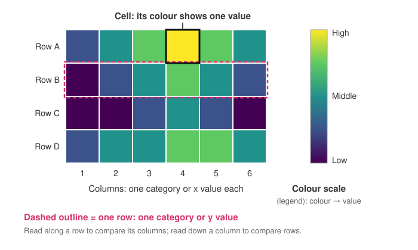

<head>
    <script type="application/ld+json">
        {JSON.stringify({
            "@context": "https://schema.org",
            "@type": "FAQPage",
            "mainEntity": [
                {
                    "@type": "Question",
                    "name": "What is a heat map used for?",
                    "acceptedAnswer": { "@type": "Answer", "text": "A heat map is used to spot patterns in a grid of numbers: when a building uses the most energy, which pairs of variables are correlated, which regions and months sell best, or which risks are both likely and serious. Colour makes high and low areas, clusters and outliers visible without reading every value." }
                },
                {
                    "@type": "Question",
                    "name": "How do you read a heat map?",
                    "acceptedAnswer": { "@type": "Answer", "text": "Find the colour scale first, so you know which colour means high and which means low. Then check what the rows and columns stand for, look for bright or dark bands and blocks, read along a row and down a column to compare, and look for single cells that don't fit. Hover over or look up a cell when you need its exact value." }
                },
                {
                    "@type": "Question",
                    "name": "What is a heat map in business?",
                    "acceptedAnswer": { "@type": "Answer", "text": "In business, a heat map is usually a table of results by two categories, such as sales by region and month, coloured so the strongest and weakest areas stand out. A risk heat map is a common special case: it plots each risk by likelihood and impact, from green for low risk to red for high." }
                },
                {
                    "@type": "Question",
                    "name": "Is it heatmap or heat map?",
                    "acceptedAnswer": { "@type": "Answer", "text": "Both spellings are used and mean the same chart. Heatmap, as one word, is common in software and data science; heat map, as two words, is common in general writing and dictionaries." }
                },
                {
                    "@type": "Question",
                    "name": "What is the difference between a data heatmap and a website heatmap?",
                    "acceptedAnswer": { "@type": "Answer", "text": "A data heatmap is a chart of a grid of values, such as a correlation matrix or energy use by day and hour. A website heatmap is an analytics tool that overlays colour on a screenshot of a web page to show where visitors clicked, moved or scrolled. They share the idea of colour for intensity but are different things." }
                },
                {
                    "@type": "Question",
                    "name": "How do I make a heatmap in JavaScript?",
                    "acceptedAnswer": { "@type": "Answer", "text": "With SciChart.js, create a SciChartSurface with two NumericAxis axes, then add a UniformHeatmapRenderableSeries with a UniformHeatmapDataSeries holding a 2D array of values and a HeatmapColorMap that turns values into colours. Add a HeatmapLegend to show the colour scale. The same chart works in React with scichart-react and in Angular with scichart-angular." }
                }
            ]
        })}
    </script>
</head>

# Heatmap

## What is a heatmap?

A **heatmap** (also written **heat map**) is a chart that shows a table of numbers as a grid of coloured cells. Each row and column stands for a category or a range of values, and each cell's colour shows the value where they meet. A colour scale turns colours back into numbers, so highs, lows and patterns stand out.


*A heatmap of one household's hourly energy use over a week (sample data), from dark purple (low) to yellow (high). [Try the interactive version](#how-to-create-a-heatmap-in-javascript-react-or-angular).*

:::tip Key takeaways
- A heatmap shows **one number for every combination of two things**, such as day and hour, as a grid of coloured cells.
- **Read the colour scale first**, then look for bands, clusters and cells that don't fit.
- Use a **sequential** colour scale for low-to-high values and a **diverging** one for values either side of a midpoint such as zero. Avoid rainbow scales.
- Heatmaps show **patterns, not exact values**. Hover, label the cells or add a table when the numbers matter.
- A data heatmap is not the same as a **website heatmap**, which tracks where visitors click and scroll.
:::

## How to read a heatmap



1. **Find the colour scale** (the legend) before anything else. It tells you which colour is high and which is low, and over what range. Without it you can only say that one cell is higher than another, not by how much.
2. **Check what the rows and columns are.** In the energy chart at the top of the page, rows are days of the week and columns are hours. Each cell is one combination: Thursday, 19:00 to 20:00, for example.
3. **Look at the whole grid for bands and blocks.** A bright vertical band means one column is high in every row. A bright block means a group of rows and columns are high together.
4. **Read along one row, then down one column.** A row compares one category across all the columns (one day across 24 hours); a column compares one column across all the rows (one hour across seven days).
5. **Look for cells that don't fit.** A single bright cell in a dark area, or a dark gap in a bright band, is often a fault, a special event or a data problem worth checking.

People judge colour less precisely than length or position, so treat a heatmap as a map of where to look. Hover over a cell, or show values in the cells, when you need the exact number.

## How to describe a heatmap

When you write about a heatmap in a report, a class or a team update, cover the same four things each time. Use this template:

> Values are **highest** in **[where: rows, columns or area]** and **lowest** in **[where]**. The main pattern is **[a band, a block, a gradient or a cycle]**, which differs **[between which groups]**. **[Name any cells that don't fit.]**

**Worked example,** using the energy heatmap above:

"Energy use is highest on weekday evenings, between 18:00 and 21:00, peaking at 2.76 kWh on Thursday from 19:00 to 20:00. It is lowest overnight, at around 0.3 to 0.7 kWh. Weekdays follow a two-peak pattern, with a smaller peak from 07:00 to 09:00 and a dip in the middle of the day. Weekends are different: there is no early peak, and use stays at about 2 kWh from late morning into the evening. No single hour stands out from its neighbours."

| What you see | What it usually means |
| --- | --- |
| A bright vertical band | One column is high in every row: a busy hour, a popular product, a strong signal |
| A bright horizontal band | One row is high across every column |
| Two blocks with different patterns | Two groups behave differently, such as weekdays and weekends |
| A smooth gradient across the grid | The value changes steadily with one or both dimensions |
| A repeating stripe | A cycle, such as daily or weekly |
| One cell unlike its neighbours | An outlier: a real event or a data error |

## How to choose a heatmap colour scale

The colour scale (also called a **colour map** or palette) decides what the reader sees, so pick it to suit the data, not the look.

| Your data | Colour scale | Example |
| --- | --- | --- |
| Values from low to high, with nothing special in between | **Sequential**: one direction, dark to bright or light to dark | Counts, temperature, energy use, signal strength. The demo uses viridis |
| Values either side of a meaningful midpoint | **Diverging**: two colours meeting at a neutral middle | Correlation from −1 to +1, change against a baseline, profit and loss |
| Categories, not quantities | **Categorical**: distinct, unrelated colours | Status (on, off, fault) for each machine and hour |
| Anything else | **Avoid rainbow** (jet) | Its bands of brightness create edges that aren't in the data |

Also decide the **range** the scale covers. Stretching it from the data's minimum to its maximum uses every colour. Fixing it, say from 0 to 100%, keeps the colours meaning the same thing across several heatmaps. Perceptually uniform scales such as viridis change brightness evenly from end to end, so equal steps in value look like equal steps in colour, and they stay readable for most people with colour-vision deficiencies.

## Types of heatmap and heat map examples

| Type | What the grid shows | Example |
| --- | --- | --- |
| **Matrix heatmap** | Rows and columns are categories | A **correlation matrix**, where each cell is the correlation between two variables, on a diverging scale |
| **Clustered heatmap** | A matrix heatmap with similar rows and columns moved next to each other | Gene expression across samples, often with a tree diagram (dendrogram) along each edge |
| **Calendar or time heatmap** | Time on one or both axes | Hour of day by day of week, as in the chart above; daily activity across a year |
| **Risk heat map** | Likelihood against impact | A business risk register, from green (low risk) to red (high risk) |
| **Spatial heatmap** | A regular grid laid over space | Temperature or rainfall on a map, readings from a sensor array, a thermal image |
| **Spectrogram** | Time against frequency | Sound, vibration or radio signals. See our [spectrogram guide](/learn/spectrogram/) |
| **Non-uniform heatmap** | Cells of different widths or heights | Measurements taken at uneven intervals |
| **Heatmap with contours** | Coloured cells plus lines of equal value | Elevation, pressure or field strength |

In business, a heat map most often means a table of results by two categories (sales by region and month, or support tickets by product and week) or a risk matrix. Both work the same way: colour shows where the numbers are high and where they are low.

Two other things share the name. **Website heatmaps** are analytics tools that overlay colour on a screenshot of a web page to show where visitors clicked, moved or scrolled. **Density maps** blur individual points into a smooth glow over a map. Both use colour for intensity; this guide is about heatmaps of a grid of values.

## When to use a heatmap

Use a heatmap when your data is a **grid**: two dimensions, such as rows and columns, x and y, or time and frequency, with one number for each combination. Heatmaps also cope well with size: a grid with thousands of rows and columns still reads as one picture, where a table of the same numbers would be unreadable.

| Chart | Best for |
| --- | --- |
| **Heatmap** | A value for every combination of two dimensions; spotting patterns, clusters and outliers across the whole grid |
| [Scatter plot](/learn/scatter-plot/) | Individual items with two numeric values each; the relationship between two variables |
| [Bar chart](/learn/bar-chart/) | A few categories where exact values and rankings matter |
| [Contour plot](/learn/contour-plot/) | A smooth surface shown as lines of equal value; reading exact levels, like elevation lines on a map |
| [3D surface plot](/learn/3d-surface-plot/) | The same grid drawn as a 3D landscape; the shape is clearer, but values behind peaks are hidden |

## Common heatmap mistakes

- **Using a rainbow scale.** Rainbow (jet) colours jump in brightness from yellow to cyan, so readers see sharp edges where the data changes smoothly. Use viridis or another perceptually uniform scale.
- **Leaving out the legend.** Without a colour scale, readers can't turn a colour into a value.
- **Using the wrong kind of scale.** A sequential scale hides whether values are above or below zero; a diverging scale with its neutral colour away from the real midpoint makes the wrong cells look important.
- **Letting one extreme value set the range.** A single very high cell takes the top colour and squashes everything else into a few similar shades. Cap the range, or use a logarithmic scale for data that spans several orders of magnitude.
- **Changing the range between heatmaps you compare.** If each chart stretches its own scale, the same colour means different values in each. Fix the range when charts sit side by side.
- **Leaving rows in an arbitrary order.** Alphabetical order scatters similar rows across the grid. Sort rows and columns by value, by time or by similarity so the pattern can form.
- **Reading totals from colour.** A heatmap shows each cell, not the sum of a row. In the energy example, weekend days use about 6 kWh more in total than weekdays, which is hard to see from the colours. Add row totals or a bar chart when totals matter.
- **Relying on red against green.** It is the hardest pair to tell apart for the most common kinds of colour-vision deficiency.

## How to create a heatmap in JavaScript, React or Angular

SciChart.js draws heatmaps with WebGL and WebGPU, so large grids stay smooth to zoom and pan and can update in real time. Try the chart below: scroll to zoom, drag to pan, double-click to reset, and hover over a cell to see its value.

<LiveDocSnippet maxWidth={'100%'} name="./Basic/demo" />

<LearnCta position="top" chart="heatmap" demo="heatmap-chart" docs="/2d-charts/chart-types/uniform-heatmap-renderable-series/uniform-heatmap-chart-type/" />

Here is the code for this chart:

<CodeSnippetBlock labels={["JavaScript", "React", "Angular"]}>
    ```ts showLineNumbers file=./Basic/demo.ts start=#region_A_start end=#region_A_end
    ```

    ```tsx
    import { SciChartReact } from "scichart-react";
    import {
        SciChartSurface,
        NumericAxis,
        UniformHeatmapRenderableSeries,
        UniformHeatmapDataSeries,
        HeatmapColorMap,
        SciChartJsNavyTheme
    } from "scichart";

    // initChart builds the chart; SciChartReact creates it, sizes it and cleans it up
    const initChart = async (rootElement: string | HTMLDivElement) => {
        const { wasmContext, sciChartSurface } = await SciChartSurface.create(rootElement, {
            theme: new SciChartJsNavyTheme()
        });
        sciChartSurface.xAxes.add(new NumericAxis(wasmContext));
        sciChartSurface.yAxes.add(new NumericAxis(wasmContext));

        // zValues is a 2D array: zValues[row][column]
        const zValues = getYourGridData();
        sciChartSurface.renderableSeries.add(
            new UniformHeatmapRenderableSeries(wasmContext, {
                dataSeries: new UniformHeatmapDataSeries(wasmContext, { zValues, xStart: 0, xStep: 1, yStart: 0, yStep: 1 }),
                colorMap: new HeatmapColorMap({
                    minimum: 0,
                    maximum: 3,
                    gradientStops: [
                        { offset: 0, color: "#440154" },
                        { offset: 0.5, color: "#21918C" },
                        { offset: 1, color: "#FDE725" }
                    ]
                })
            })
        );
        return { sciChartSurface };
    };

    export const HeatmapChart = () => (
        <SciChartReact initChart={initChart} style={{ width: "100%", height: 400 }} />
    );
    ```

    ```ts
    import { Component } from "@angular/core";
    import { ScichartAngularComponent } from "scichart-angular";
    import {
        SciChartSurface,
        NumericAxis,
        UniformHeatmapRenderableSeries,
        UniformHeatmapDataSeries,
        HeatmapColorMap,
        SciChartJsNavyTheme
    } from "scichart";

    @Component({
        selector: "app-heatmap-chart",
        standalone: true,
        imports: [ScichartAngularComponent],
        template: `<scichart-angular [initChart]="initChart" style="display: block; width: 100%; height: 400px"></scichart-angular>`
    })
    export class HeatmapChartComponent {
        // initChart builds the chart; scichart-angular creates it, sizes it and cleans it up
        initChart = async (rootElement: string | HTMLDivElement) => {
            const { wasmContext, sciChartSurface } = await SciChartSurface.create(rootElement, {
                theme: new SciChartJsNavyTheme()
            });
            sciChartSurface.xAxes.add(new NumericAxis(wasmContext));
            sciChartSurface.yAxes.add(new NumericAxis(wasmContext));

            // zValues is a 2D array: zValues[row][column]
            const zValues = getYourGridData();
            sciChartSurface.renderableSeries.add(
                new UniformHeatmapRenderableSeries(wasmContext, {
                    dataSeries: new UniformHeatmapDataSeries(wasmContext, { zValues, xStart: 0, xStep: 1, yStart: 0, yStep: 1 }),
                    colorMap: new HeatmapColorMap({
                        minimum: 0,
                        maximum: 3,
                        gradientStops: [
                            { offset: 0, color: "#440154" },
                            { offset: 0.5, color: "#21918C" },
                            { offset: 1, color: "#FDE725" }
                        ]
                    })
                })
            );
            return { sciChartSurface };
        };
    }
    ```
</CodeSnippetBlock>

Key points:

- A [UniformHeatmapDataSeries](https://www.scichart.com/documentation/js/current/typedoc/classes/uniformheatmapdataseries.html) holds your grid as a 2D array, `zValues[row][column]`. `xStart`, `xStep`, `yStart` and `yStep` place the cells on the axes; every cell is the same size.
- A [HeatmapColorMap](https://www.scichart.com/documentation/js/current/typedoc/classes/heatmapcolormap.html) is the colour scale: `minimum` and `maximum` set the range, and `gradientStops` set the colours along it.
- A [HeatmapLegend](https://www.scichart.com/documentation/js/current/typedoc/classes/heatmaplegend.html) draws the colour scale in its own div. Give it the same colour map as the series.
- To update the heatmap live, call `setZValues()` on the data series with a new 2D array. For cells of different sizes, use a `NonUniformHeatmapRenderableSeries`; to add lines of equal value, add a `UniformContoursRenderableSeries`.

**See it in the demo app:** [JavaScript heatmap chart](https://www.scichart.com/demo/javascript/heatmap-chart) · [React heatmap chart](https://www.scichart.com/demo/react/heatmap-chart) · [Angular heatmap chart](https://www.scichart.com/demo/angular/heatmap-chart)

**More heatmap examples:** [JavaScript heatmap chart with contours](https://www.scichart.com/demo/javascript/heatmap-chart-with-contours) · [JavaScript non-uniform heatmap chart](https://www.scichart.com/demo/javascript/non-uniform-heatmap-chart)

**Go deeper:** [SciChart.js heatmap documentation](/2d-charts/chart-types/uniform-heatmap-renderable-series/uniform-heatmap-chart-type/), including [colour maps and legends](/2d-charts/chart-types/uniform-heatmap-renderable-series/color-maps-and-legends/), [real-time updates](/2d-charts/chart-types/uniform-heatmap-renderable-series/updating-realtime/), [non-uniform heatmaps](/2d-charts/chart-types/non-uniform-heatmap-renderable-series/) and [contours](/2d-charts/chart-types/uniform-contours-renderable-series/).

## Frequently asked questions

### What is a heat map used for?

A heat map is used to spot patterns in a grid of numbers: when a building uses the most energy, which pairs of variables are correlated, which regions and months sell best, or which risks are both likely and serious. Colour makes high and low areas, clusters and outliers visible without reading every value.

### How do you read a heat map?

Find the colour scale first, so you know which colour means high and which means low. Then check what the rows and columns stand for, look for bright or dark bands and blocks, read along a row and down a column to compare, and look for single cells that don't fit. Hover over or look up a cell when you need its exact value.

### What is a heat map in business?

In business, a heat map is usually a table of results by two categories, such as sales by region and month, coloured so the strongest and weakest areas stand out. A risk heat map is a common special case: it plots each risk by likelihood and impact, from green for low risk to red for high.

### Is it heatmap or heat map?

Both spellings are used and mean the same chart. Heatmap, as one word, is common in software and data science; heat map, as two words, is common in general writing and dictionaries.

### What is the difference between a data heatmap and a website heatmap?

A data heatmap is a chart of a grid of values, such as a correlation matrix or energy use by day and hour. A website heatmap is an analytics tool that overlays colour on a screenshot of a web page to show where visitors clicked, moved or scrolled. They share the idea of colour for intensity but are different things.

### How do I make a heatmap in JavaScript?

With SciChart.js, create a `SciChartSurface` with two `NumericAxis` axes, then add a `UniformHeatmapRenderableSeries` with a `UniformHeatmapDataSeries` holding a 2D array of values and a `HeatmapColorMap` that turns values into colours. Add a `HeatmapLegend` to show the colour scale. The same chart works in React with `scichart-react` and in Angular with `scichart-angular`.

## Sources

- Wilkinson, L. and Friendly, M. (2009), [The History of the Cluster Heat Map](https://doi.org/10.1198/tas.2009.0033). *The American Statistician*, 63(2). Where the heatmap came from, and why sorting rows and columns reveals patterns.
- Borland, D. and Taylor, R. M. (2007), [Rainbow Color Map (Still) Considered Harmful](https://doi.org/10.1109/MCG.2007.323435). *IEEE Computer Graphics and Applications*, 27(2). Why rainbow colour scales mislead.
- Crameri, F., Shephard, G. E. and Heron, P. J. (2020), [The misuse of colour in science communication](https://doi.org/10.1038/s41467-020-19160-7). *Nature Communications*, 11. Perceptually uniform and colour-vision-friendly colour scales.

<LearnCta position="bottom" chart="heatmap" demo="heatmap-chart" docs="/2d-charts/chart-types/uniform-heatmap-renderable-series/uniform-heatmap-chart-type/" />
