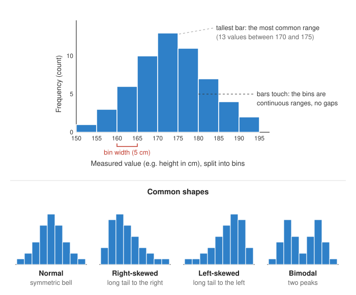

<head>
    <script type="application/ld+json">
        {JSON.stringify({
            "@context": "https://schema.org",
            "@type": "FAQPage",
            "mainEntity": [
                {
                    "@type": "Question",
                    "name": "What is a histogram?",
                    "acceptedAnswer": { "@type": "Answer", "text": "A histogram is a chart that shows how a set of numbers is distributed. It splits the range of the values into intervals called bins and draws a bar for each bin. The height of each bar is the number of values that fall into that bin, called its frequency." }
                },
                {
                    "@type": "Question",
                    "name": "How do you read a histogram?",
                    "acceptedAnswer": { "@type": "Answer", "text": "Read the horizontal axis for the ranges of values and the vertical axis for how many values fall in each range. Then look at where the tallest bars are (the most common values), how wide the bars spread (the variation), whether the shape is symmetric or has a long tail to one side, and whether there are gaps or isolated bars far from the rest (possible outliers)." }
                },
                {
                    "@type": "Question",
                    "name": "Why would someone make a histogram instead of a bar chart?",
                    "acceptedAnswer": { "@type": "Answer", "text": "To see the distribution of one numeric variable, such as heights, prices or response times. A histogram groups the numbers into ranges and shows where they cluster, how spread out they are and what shape they make. A bar chart compares values across separate categories, so it cannot show a distribution." }
                },
                {
                    "@type": "Question",
                    "name": "How many bins should a histogram have?",
                    "acceptedAnswer": { "@type": "Answer", "text": "There is no single right number. Too few bins hide the shape of the data; too many make it look noisy. Common starting points are the square root of the number of values, or Sturges' rule, log2(n) + 1. Try a few bin widths and choose the one that shows the shape most clearly." }
                },
                {
                    "@type": "Question",
                    "name": "What does a skewed histogram mean?",
                    "acceptedAnswer": { "@type": "Answer", "text": "A skewed histogram has a long tail on one side. Right-skewed (positively skewed) data has most values at the low end and a few much larger ones, as with incomes or waiting times; the mean is usually above the median. Left-skewed (negatively skewed) data is the mirror image." }
                },
                {
                    "@type": "Question",
                    "name": "How do I make a histogram in JavaScript?",
                    "acceptedAnswer": { "@type": "Answer", "text": "With SciChart.js, count your values into bins, then add a FastRectangleRenderableSeries with an XyxyDataSeries holding each bin's start, end and count. Set columnXMode to EColumnMode.StartEnd so each bar fills exactly its bin. The same chart works in React with scichart-react and in Angular with scichart-angular." }
                }
            ]
        })}
    </script>
</head>

# Histogram

:::info Looking for the SciChart.js API?
See the [SciChart.js histogram documentation](/2d-charts/chart-types/histogram-chart/) for building histograms with `FastRectangleRenderableSeries`, binning raw data and labelling bars.
:::

A **histogram** shows how a set of numbers is **distributed**. It splits the range of the values into intervals called **bins** and draws a bar for each one. The height of each bar is the **frequency**: how many values fall into that bin. One glance shows where the values cluster, how spread out they are and what shape they make.

Try the interactive chart below: it shows the heights of 1,000 simulated adults, counted into 5 cm bins. Scroll to zoom, drag to pan, double-click to reset, and hover over a bar to see its values.

<LiveDocSnippet maxWidth={'100%'} name="./Basic/demo" />

<LearnCta position="top" chart="histogram" demo="histogram-chart" docs="/2d-charts/chart-types/histogram-chart/" />

## How to read a histogram



- **The horizontal axis** shows the measured value, such as height, price or response time, split into **bins**. Each bin is a range, such as 170 to 175 cm. Bins are usually all the same width.
- **The vertical axis** shows the **frequency**: how many values fall into each bin. Some histograms show a percentage of the total instead (relative frequency).
- **The bars touch,** because the bins are continuous ranges with no gaps between them. A gap means no values fell in that range.
- **The tallest bar** is the most common range of values. Where the bars cluster is the centre of the data; how far they spread is its variation.
- **Bars far from the rest** may be **outliers**: unusual values worth checking.

### Common histogram shapes

| Shape | What it looks like | What it usually means |
| --- | --- | --- |
| Normal (bell-shaped) | One peak in the middle, falling away evenly on both sides | Values vary randomly around an average, as with many measurements such as heights; the mean and median are close |
| Right-skewed (positive skew) | Peak on the left, long tail to the right | Most values are small, a few are much larger, as with incomes or waiting times; the mean is usually above the median |
| Left-skewed (negative skew) | Peak on the right, long tail to the left | Most values are large, a few are much smaller, as with scores on an easy test; the mean is usually below the median |
| Bimodal | Two separate peaks | Often two groups mixed together, such as two machines, shifts or populations; consider splitting the data |
| Uniform | Bars all roughly the same height | Every range is about equally likely |

### Choosing the bins

The bin width changes the picture. **Too few bins** lump everything together and hide the shape; **too many** leave most bins with only a few values, so the chart looks noisy. Common starting points are the **square root** of the number of values, or **Sturges' rule**, log₂(n) + 1 bins. Try a few widths and keep the one that shows the shape most clearly.

| Variant | The bar height shows | Use it when |
| --- | --- | --- |
| Frequency histogram | The count of values in each bin | You want actual numbers |
| Relative frequency histogram | Each bin's share of the total, as a percentage | You compare datasets of different sizes |
| Density histogram | Count ÷ (total × bin width), so the bar areas add up to 1 | Bins have different widths, or you overlay a probability curve |
| Cumulative histogram | The count of values up to the end of each bin | You want to read off "how many are below x" |

If the bins have different widths, use a density histogram, so each bar's **area**, not its height, is proportional to its count. Otherwise the wide bins look bigger than they are.

## When to use a histogram

Use a histogram when you have **many values of one numeric variable** and want to see its **distribution**: where the values cluster, how spread out they are and whether the shape is symmetric, skewed or has more than one peak.

| Chart | Best for |
| --- | --- |
| **Histogram** | The shape of one numeric variable's distribution, counted into ranges |
| [Bar chart](/learn/bar-chart/) | Comparing values across separate categories, such as sales by region |
| [Box plot](/learn/box-plot/) | A compact summary of a distribution (median, quartiles, range and outliers), and comparing many distributions side by side |
| [Scatter plot](/learn/scatter-plot/) | The relationship between two numeric variables |

### Histogram vs bar chart

They look alike, but they answer different questions.

| | Histogram | Bar chart |
| --- | --- | --- |
| **Data** | One numeric (continuous) variable | Separate categories |
| **Each bar is** | A range of values (a bin) | One category |
| **Bar height** | How many values fall in the range | The category's value |
| **Gaps between bars** | No: the bins are continuous | Yes: the categories are separate |
| **Order of bars** | Fixed, in numeric order | Any order, often sorted by size |
| **Answers** | "How are the values distributed?" | "Which category is bigger?" |

## How to create a histogram in JavaScript, React or Angular

SciChart.js draws histograms with WebGL and WebGPU, so they stay smooth with large datasets and live updates. SciChart.js has no separate histogram series: you count your values into bins, then draw each bin as a rectangle from its start to its end. Here is the code for the chart above:

<CodeSnippetBlock labels={["JavaScript", "React", "Angular"]}>
    ```ts showLineNumbers file=./Basic/demo.ts start=#region_A_start end=#region_A_end
    ```

    ```tsx
    import { SciChartReact } from "scichart-react";
    import {
        SciChartSurface,
        NumericAxis,
        NumberRange,
        FastRectangleRenderableSeries,
        XyxyDataSeries,
        EColumnMode,
        EColumnYMode,
        SciChartJsNavyTheme
    } from "scichart";

    // initChart builds the chart; SciChartReact creates it, sizes it and cleans it up
    const initChart = async (rootElement: string | HTMLDivElement) => {
        const { wasmContext, sciChartSurface } = await SciChartSurface.create(rootElement, {
            theme: new SciChartJsNavyTheme()
        });
        sciChartSurface.xAxes.add(new NumericAxis(wasmContext));
        sciChartSurface.yAxes.add(new NumericAxis(wasmContext, { growBy: new NumberRange(0, 0.1) }));

        // One start, end and count per bin
        const { binStarts, binEnds, counts } = getYourBinnedData();
        sciChartSurface.renderableSeries.add(
            new FastRectangleRenderableSeries(wasmContext, {
                dataSeries: new XyxyDataSeries(wasmContext, {
                    xValues: binStarts,
                    x1Values: binEnds,
                    yValues: counts,
                    y1Values: counts.map(() => 0)
                }),
                columnXMode: EColumnMode.StartEnd,
                columnYMode: EColumnYMode.TopBottom,
                fill: "#29aade",
                stroke: "#14233c",
                strokeThickness: 1
            })
        );
        return { sciChartSurface };
    };

    export const Histogram = () => (
        <SciChartReact initChart={initChart} style={{ width: "100%", height: 400 }} />
    );
    ```

    ```ts
    import { Component } from "@angular/core";
    import { ScichartAngularComponent } from "scichart-angular";
    import {
        SciChartSurface,
        NumericAxis,
        NumberRange,
        FastRectangleRenderableSeries,
        XyxyDataSeries,
        EColumnMode,
        EColumnYMode,
        SciChartJsNavyTheme
    } from "scichart";

    @Component({
        selector: "app-histogram",
        standalone: true,
        imports: [ScichartAngularComponent],
        template: `<scichart-angular [initChart]="initChart" style="display: block; width: 100%; height: 400px"></scichart-angular>`
    })
    export class HistogramComponent {
        // initChart builds the chart; scichart-angular creates it, sizes it and cleans it up
        initChart = async (rootElement: string | HTMLDivElement) => {
            const { wasmContext, sciChartSurface } = await SciChartSurface.create(rootElement, {
                theme: new SciChartJsNavyTheme()
            });
            sciChartSurface.xAxes.add(new NumericAxis(wasmContext));
            sciChartSurface.yAxes.add(new NumericAxis(wasmContext, { growBy: new NumberRange(0, 0.1) }));

            // One start, end and count per bin
            const { binStarts, binEnds, counts } = getYourBinnedData();
            sciChartSurface.renderableSeries.add(
                new FastRectangleRenderableSeries(wasmContext, {
                    dataSeries: new XyxyDataSeries(wasmContext, {
                        xValues: binStarts,
                        x1Values: binEnds,
                        yValues: counts,
                        y1Values: counts.map(() => 0)
                    }),
                    columnXMode: EColumnMode.StartEnd,
                    columnYMode: EColumnYMode.TopBottom,
                    fill: "#29aade",
                    stroke: "#14233c",
                    strokeThickness: 1
                })
            );
            return { sciChartSurface };
        };
    }
    ```
</CodeSnippetBlock>

Key points:

- A [FastRectangleRenderableSeries](https://www.scichart.com/documentation/js/current/typedoc/classes/fastrectanglerenderableseries.html) draws one rectangle per bin. Its [XyxyDataSeries](https://www.scichart.com/documentation/js/current/typedoc/classes/xyxydataseries.html) holds each bin's start (`xValues`), end (`x1Values`), count (`yValues`) and baseline of zero (`y1Values`).
- `columnXMode: EColumnMode.StartEnd` makes each bar fill exactly its bin, so the bars touch; bins of different widths work too. `columnYMode: EColumnYMode.TopBottom` draws each bar from the baseline up to its count.
- Binning happens before drawing. In the demo, a short `binValues` helper (plain JavaScript, not part of SciChart.js) counts the raw values into equal-width bins; the [histogram documentation](/2d-charts/chart-types/histogram-chart/) shows the same idea with custom breakpoints.
- `dataLabels` writes each bin's count on its bar.

**See it in the demo app:** [JavaScript histogram chart](https://www.scichart.com/demo/javascript/histogram-chart) · [React histogram chart](https://www.scichart.com/demo/react/histogram-chart) · [Angular histogram chart](https://www.scichart.com/demo/angular/histogram-chart)

**Go deeper:** [SciChart.js histogram documentation](/2d-charts/chart-types/histogram-chart/), including binning raw data, axis formatting, data labels and texture fills.

## Frequently asked questions

### What is a histogram?

A histogram is a chart that shows how a set of numbers is distributed. It splits the range of the values into intervals called bins and draws a bar for each bin. The height of each bar is the number of values that fall into that bin, called its frequency.

### How do you read a histogram?

Read the horizontal axis for the ranges of values and the vertical axis for how many values fall in each range. Then look at where the tallest bars are (the most common values), how wide the bars spread (the variation), whether the shape is symmetric or has a long tail to one side, and whether there are gaps or isolated bars far from the rest (possible outliers).

### Why would someone make a histogram instead of a bar chart?

To see the distribution of one numeric variable, such as heights, prices or response times. A histogram groups the numbers into ranges and shows where they cluster, how spread out they are and what shape they make. A bar chart compares values across separate categories, so it cannot show a distribution.

### How many bins should a histogram have?

There is no single right number. Too few bins hide the shape of the data; too many make it look noisy. Common starting points are the square root of the number of values, or Sturges' rule, log2(n) + 1. Try a few bin widths and choose the one that shows the shape most clearly.

### What does a skewed histogram mean?

A skewed histogram has a long tail on one side. Right-skewed (positively skewed) data has most values at the low end and a few much larger ones, as with incomes or waiting times; the mean is usually above the median. Left-skewed (negatively skewed) data is the mirror image.

### How do I make a histogram in JavaScript?

With SciChart.js, count your values into bins, then add a `FastRectangleRenderableSeries` with an `XyxyDataSeries` holding each bin's start, end and count. Set `columnXMode` to `EColumnMode.StartEnd` so each bar fills exactly its bin. The same chart works in React with `scichart-react` and in Angular with `scichart-angular`. See the code above.

<LearnCta position="bottom" chart="histogram" demo="histogram-chart" docs="/2d-charts/chart-types/histogram-chart/" />
