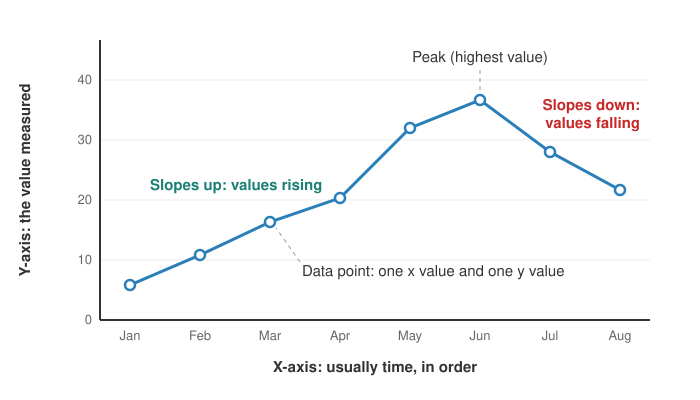

<head>
    <script type="application/ld+json">
        {JSON.stringify({
            "@context": "https://schema.org",
            "@type": "FAQPage",
            "mainEntity": [
                {
                    "@type": "Question",
                    "name": "What is a line graph used for?",
                    "acceptedAnswer": { "@type": "Answer", "text": "A line graph is used to show how a value changes across an ordered sequence, usually time. Typical examples are temperatures through the year, share prices, monthly sales, website visitors and sensor readings. Drawing several lines on the same axes lets you compare how different series rise and fall." }
                },
                {
                    "@type": "Question",
                    "name": "Is a line chart the same as a line graph?",
                    "acceptedAnswer": { "@type": "Answer", "text": "Yes. Line graph and line chart are two names for the same chart, and line plot usually means the same thing too. One exception: in some school maths courses, a line plot is a different chart that stacks crosses above a number line to count values." }
                },
                {
                    "@type": "Question",
                    "name": "Is a trend graph a line graph?",
                    "acceptedAnswer": { "@type": "Answer", "text": "Usually, yes. A trend graph is any chart drawn to show the overall direction of a value over time, and that is almost always a line graph with time along the x-axis. Don't confuse it with a trend line: a straight or smoothed line fitted through data, often on a scatter plot, to summarise which way the points are heading." }
                },
                {
                    "@type": "Question",
                    "name": "What is the difference between a line graph and a bar graph?",
                    "acceptedAnswer": { "@type": "Answer", "text": "A line graph joins its points in order, so it shows movement: trends, peaks and the rate of change, usually over time. A bar graph gives each value its own bar, so it compares amounts across separate categories such as products or countries. If reordering the x values would destroy the meaning, use a line graph." }
                },
                {
                    "@type": "Question",
                    "name": "How do you make a line graph?",
                    "acceptedAnswer": { "@type": "Answer", "text": "Put the ordered values, usually time, on the horizontal x-axis and the measured value on the vertical y-axis, with even spacing and units on both. Plot one point for each pair of values, join the points from left to right with straight lines, then add a title, and a legend if there is more than one line." }
                },
                {
                    "@type": "Question",
                    "name": "Who invented the line graph?",
                    "acceptedAnswer": { "@type": "Answer", "text": "Scientists such as Johann Heinrich Lambert drew line charts of measurements in the 18th century, but the Scottish engineer and economist William Playfair is usually credited with the line graph as used today. His Commercial and Political Atlas, published in 1786, charted England's trade and public spending over many years." }
                },
                {
                    "@type": "Question",
                    "name": "How do I make a line chart in JavaScript?",
                    "acceptedAnswer": { "@type": "Answer", "text": "With SciChart.js, create a SciChartSurface, add a DateTimeNumericAxis or NumericAxis for x and a NumericAxis for y, then add a FastLineRenderableSeries with an XyDataSeries holding your x and y values. Add one series per line. The same chart works in React with scichart-react and in Angular with scichart-angular." }
                }
            ]
        })}
    </script>
</head>

# Line Graph (Line Chart)

## What is a line graph?

A **line graph** (also called a line chart or line plot) is a chart that shows how a value changes over time or across another ordered sequence. Each measurement is a point placed by its **x value** and its **y value**, and a line joins the points from left to right, so its slope shows each rise and fall.


*A line graph of daily temperatures in two cities over a year (sample data). [Try the interactive version](#how-to-create-a-line-chart-in-javascript-react-or-angular).*

:::tip Key takeaways
- A line graph shows **change in one value across an ordered x-axis**, usually time.
- The **direction** of the line shows rising or falling; its **steepness** shows how fast.
- Describe one in a sentence: "*[value]* **rose steadily** from *[start]* to a **peak** of *[high]* in *[when]*, then **fell** to *[end]*."
- Use a line graph when the **order of the x values matters**; use a bar graph for separate categories.
- For very long or noisy series, a **moving average** line shows the trend through the noise.
:::

## How to read a line graph



1. **Read the title and the axes first.** The horizontal **x-axis** is usually time (days, months, years), running left to right. The vertical **y-axis** is the measured value. Note the units on both, and the number the y-axis starts at.
2. **Match each line to the legend.** On a graph with several lines, colour or line style tells them apart.
3. **Follow the overall direction.** A line climbing from left to right means the value is going up. A line heading down means it's going down. A flat stretch means it's holding steady.
4. **Judge the speed from the steepness.** A steep section is a fast change; a gentle slope is a slow one.
5. **Find the turning points.** **Peaks** (highest points), **troughs** (lowest points) and places where the direction changes are usually the story.
6. **Compare lines where they matter.** Is one line always above the other? Do they cross? Does the gap between them grow or shrink?

The points themselves are the real measurements. The straight segments between them are a reasonable guess at what happened in between, not extra data.

## Types of line graph

| Type | What it looks like | Use it for |
| --- | --- | --- |
| Simple line graph | One line | The trend of a single value, such as a city's monthly rainfall |
| Multiple line graph | Two or more lines sharing the same axes | Comparing several series, such as sales in three regions |
| Line graph with markers | A dot on every data point | Short series, where readers need to see each actual measurement |
| [Smoothed (spline) line graph](/2d-charts/chart-types/spline-line-renderable-series/) | A curve through the points instead of straight segments | A softer look; the curve between points is drawn, not measured |
| [Step line graph](/2d-charts/chart-types/fast-line-digital-renderable-series/) | Flat runs joined by vertical jumps | Values that change suddenly and then hold, such as interest rates or on/off states |
| [Area chart](/learn/area-chart/) | A line with the space beneath it filled in | A trend where the size of the total matters |

## How to describe a line graph

Exam questions (such as IELTS Writing Task 1), lab reports and dashboards all ask for the same thing: a short summary of what the line does. Use this template:

> **[What]** **[rose / fell / stayed level]** **[steadily / sharply / gradually]** from **[start value]** in **[start]** to **[peak or low]** in **[when]**, then **[what happened next]**. Overall, **[the main trend or comparison]**.

**Worked example,** using the temperature graph above (monthly averages of the sample data): "Both cities follow the same seasonal pattern. Temperatures climb steadily from January, peak in early July and fall back by December. City B is warmer every day of the year, and its swing is bigger: from about 8°C in January to 25.5°C in July, against roughly 4°C to 18°C for City A. The gap between the two cities is narrowest in winter, at about 4°C, and widest in summer, at about 8°C."

| What the line does | Words to use |
| --- | --- |
| Goes up | rose, increased, climbed, grew |
| Goes up quickly | rose sharply, jumped, surged |
| Goes down | fell, decreased, declined, dropped |
| Stays about the same | held steady, levelled off, plateaued |
| Reaches its highest point | peaked at, reached a high of |
| Reaches its lowest point | bottomed out at, hit a low of |
| Goes up and down repeatedly | fluctuated, varied between … and … |

Lead with the overall trend, then give the highest and lowest values with their dates, then any comparison between lines. Quote numbers from the chart rather than adjectives alone.

## When to use a line graph

Use a line graph when the x values have a **natural order**, most often time, and the reader cares about **how the value moves** from one point to the next. Drawn to show which way something is heading over time, such as sales, prices or temperatures, a line graph is often called a **trend graph** or trend chart: the slope of the line is the trend.

| Your question | Best chart |
| --- | --- |
| How has this value changed over time? | **Line graph** |
| How do a few series compare over the same period? | **Line graph** with one line each (up to about five) |
| How do amounts compare across separate categories? | [Bar or column chart](/learn/bar-chart/) |
| How does a total over time split into parts? | [Stacked area chart](/learn/area-chart/) |
| Are two measured values related, with no order to the points? | [Scatter plot](/learn/scatter-plot/) |

**A quick test:** if you could shuffle the x values without changing the meaning (products, countries, teams), use a bar graph. If shuffling them would destroy the story (months, seconds, distance), use a line graph. Many points also favour lines: a year of daily values is 365 thin bars, but one clear line.

## Line graphs with many data points

Sensors, markets and monitoring systems record values every second or faster, so their line graphs can have tens of thousands of points or more. Two problems appear:

- **Noise hides the trend.** Small, fast ups and downs make the line look like a thick, jagged band.
- **Detail hides in the overview.** At full-day scale, each pixel covers dozens of readings, so short events are squashed together.

The usual fixes are a **moving average**, which replaces each point with the average of the points around it to show the underlying trend, and **zooming in** to see the raw readings.

The chart below shows a day of temperature readings from one sensor, one per second: 86,400 points (sample data). The blue line is every reading; the orange line is a 10-minute moving average of the same data. Scroll to zoom into any part of the day and the raw line separates into individual readings. Untick a line in the legend to hide it.

<LiveDocSnippet maxWidth={'100%'} name="./LargeData/demo" />

## Common line graph mistakes

- **Joining points that have no order.** A line between categories (red, green, blue) suggests a trend that doesn't exist. Use a [bar chart](/learn/bar-chart/).
- **Uneven time steps on an even axis.** If readings are missing or irregular, plot them against real dates, so a gap of six months doesn't look like a gap of one.
- **Too many lines.** Beyond about five lines, colours run out and lines tangle. Highlight one or two and grey out the rest, or split into small multiples.
- **A stretched or squashed aspect ratio.** A tall, narrow chart makes every change look dramatic; a wide, flat one hides real changes. Aim for slopes that are neither near-vertical nor near-flat.
- **A misleading y-axis.** A y-axis that doesn't start at zero is fine for a line graph, which shows change, but say so clearly and don't use it to exaggerate a tiny movement.
- **Two y-axes that tell a false story.** A second y-axis lets you choose the scales so two lines seem to move together. Use one only when units differ, and label each axis in the colour of its line.
- **Smoothing that invents values.** A spline curve can overshoot the real peaks and troughs. Show markers on the real points if exact values matter.

## How to create a line chart in JavaScript, React or Angular

SciChart.js draws line charts with WebGL and WebGPU, so they stay smooth to zoom and pan with large data sets and real-time updates. Try the chart below: scroll to zoom, drag to pan, double-click to reset, hover over a line to see its values, and use the legend to hide or show a line.

<LiveDocSnippet maxWidth={'100%'} name="./Basic/demo" />

<LearnCta position="top" chart="line chart" demo="line-chart" docs="/2d-charts/chart-types/fast-line-renderable-series/" />

Here is the code for this chart:

<CodeSnippetBlock labels={["JavaScript", "React", "Angular"]}>
    ```ts showLineNumbers file=./Basic/demo.ts start=#region_A_start end=#region_A_end
    ```

    ```tsx
    import { SciChartReact } from "scichart-react";
    import {
        SciChartSurface,
        DateTimeNumericAxis,
        NumericAxis,
        FastLineRenderableSeries,
        XyDataSeries,
        SciChartJsNavyTheme
    } from "scichart";

    // initChart builds the chart; SciChartReact creates it, sizes it and cleans it up
    const initChart = async (rootElement: string | HTMLDivElement) => {
        const { wasmContext, sciChartSurface } = await SciChartSurface.create(rootElement, {
            theme: new SciChartJsNavyTheme()
        });
        sciChartSurface.xAxes.add(new DateTimeNumericAxis(wasmContext));
        sciChartSurface.yAxes.add(new NumericAxis(wasmContext));

        const { xValues, yValues } = getYourXyData();
        sciChartSurface.renderableSeries.add(
            new FastLineRenderableSeries(wasmContext, {
                dataSeries: new XyDataSeries(wasmContext, { xValues, yValues }),
                stroke: "#50C7E0",
                strokeThickness: 2
            })
        );
        return { sciChartSurface };
    };

    export const LineChart = () => (
        <SciChartReact initChart={initChart} style={{ width: "100%", height: 400 }} />
    );
    ```

    ```ts
    import { Component } from "@angular/core";
    import { ScichartAngularComponent } from "scichart-angular";
    import {
        SciChartSurface,
        DateTimeNumericAxis,
        NumericAxis,
        FastLineRenderableSeries,
        XyDataSeries,
        SciChartJsNavyTheme
    } from "scichart";

    @Component({
        selector: "app-line-chart",
        standalone: true,
        imports: [ScichartAngularComponent],
        template: `<scichart-angular [initChart]="initChart" style="display: block; width: 100%; height: 400px"></scichart-angular>`
    })
    export class LineChartComponent {
        // initChart builds the chart; scichart-angular creates it, sizes it and cleans it up
        initChart = async (rootElement: string | HTMLDivElement) => {
            const { wasmContext, sciChartSurface } = await SciChartSurface.create(rootElement, {
                theme: new SciChartJsNavyTheme()
            });
            sciChartSurface.xAxes.add(new DateTimeNumericAxis(wasmContext));
            sciChartSurface.yAxes.add(new NumericAxis(wasmContext));

            const { xValues, yValues } = getYourXyData();
            sciChartSurface.renderableSeries.add(
                new FastLineRenderableSeries(wasmContext, {
                    dataSeries: new XyDataSeries(wasmContext, { xValues, yValues }),
                    stroke: "#50C7E0",
                    strokeThickness: 2
                })
            );
            return { sciChartSurface };
        };
    }
    ```
</CodeSnippetBlock>

Key points:

- An [XyDataSeries](https://www.scichart.com/documentation/js/current/typedoc/classes/xydataseries.html) holds one x value and one y value per point, normally with the x values in ascending order. Set `dataSeriesName` to label the line in the legend and tooltip.
- A [FastLineRenderableSeries](https://www.scichart.com/documentation/js/current/typedoc/classes/fastlinerenderableseries.html) draws the line. `stroke` sets its colour and `strokeThickness` its width. Add one series per line.
- A `DateTimeNumericAxis` shows Unix timestamps (in seconds) as dates. Use a `NumericAxis` for plain numbers.
- For a moving average like the one in the large-data chart above, pass your data series to an `XyMovingAverageFilter` and draw it with a second line series (see the [moving average filter](/2d-charts/chart-types/data-filters-api/moving-average-filter/)).

**See it in the demo app:** [JavaScript line chart](https://www.scichart.com/demo/javascript/line-chart) · [React line chart](https://www.scichart.com/demo/react/line-chart) · [Angular line chart](https://www.scichart.com/demo/angular/line-chart)

**Go deeper:** [SciChart.js line chart documentation](/2d-charts/chart-types/fast-line-renderable-series/), including point markers, gaps in the line and colouring individual segments.

## Line chart examples

Here are four line chart examples, three of them from science, medicine and engineering, where line charts often have to draw thousands of points as they arrive. Each picture opens the live, interactive chart in the SciChart.js demo app.

| Example | What it shows |
| --- | --- |
| <a href="https://www.scichart.com/demo/javascript/vital-signs-ecg-medical-chart-example"></a> | **Patient monitor: real-time line charts.** An ECG trace and three other vital signs drawn as lines that sweep across the screen, as on a hospital monitor, with the latest readings beside each one. [JavaScript ECG chart](https://www.scichart.com/demo/javascript/vital-signs-ecg-medical-chart-example) |
| <a href="https://www.scichart.com/demo/javascript/realtime-ghosted-traces-chart"></a> | **Oscilloscope: overlaid line traces.** Repeated sweeps of a noisy signal drawn on top of one another, with older traces fading like the phosphor of an analogue oscilloscope, so the signal's typical shape stands out from the noise. [JavaScript oscilloscope chart](https://www.scichart.com/demo/javascript/realtime-ghosted-traces-chart) |
| <a href="https://www.scichart.com/demo/javascript/polar-line-multi-cycle"></a> | **Climate data: a line chart wrapped into a circle.** Mean surface temperature for each month, one line per year over 30 years. Bending the months into a circle lets December join January, so each year's cycle reads as one loop. [JavaScript polar line chart](https://www.scichart.com/demo/javascript/polar-line-multi-cycle) |
| <a href="https://www.scichart.com/demo/javascript/line-chart"></a> | **Line chart styles side by side.** Nine variations in one view: simple, step (digital), dashed, gradient-coloured, with tooltips, with gaps, vertical, and with high and low warning thresholds that change the line's colour. [JavaScript line chart](https://www.scichart.com/demo/javascript/line-chart) |

## Frequently asked questions

### What is a line graph used for?

A line graph is used to show how a value changes across an ordered sequence, usually time. Typical examples are temperatures through the year, share prices, monthly sales, website visitors and sensor readings. Drawing several lines on the same axes lets you compare how different series rise and fall.

### Is a line chart the same as a line graph?

Yes. Line graph and line chart are two names for the same chart, and line plot usually means the same thing too. One exception: in some school maths courses, a line plot is a different chart that stacks crosses above a number line to count values.

### Is a trend graph a line graph?

Usually, yes. A trend graph is any chart drawn to show the overall direction of a value over time, and that is almost always a line graph with time along the x-axis. Don't confuse it with a trend line: a straight or smoothed line fitted through data, often on a scatter plot, to summarise which way the points are heading.

### What is the difference between a line graph and a bar graph?

A line graph joins its points in order, so it shows movement: trends, peaks and the rate of change, usually over time. A bar graph gives each value its own bar, so it compares amounts across separate categories such as products or countries. If reordering the x values would destroy the meaning, use a line graph.

### How do you make a line graph?

Put the ordered values, usually time, on the horizontal x-axis and the measured value on the vertical y-axis, with even spacing and units on both. Plot one point for each pair of values, join the points from left to right with straight lines, then add a title, and a legend if there is more than one line.

### Who invented the line graph?

Scientists such as Johann Heinrich Lambert drew line charts of measurements in the 18th century, but the Scottish engineer and economist William Playfair is usually credited with the line graph as used today. His Commercial and Political Atlas, published in 1786, charted England's trade and public spending over many years.

### How do I make a line chart in JavaScript?

With SciChart.js, create a `SciChartSurface`, add a `DateTimeNumericAxis` or `NumericAxis` for x and a `NumericAxis` for y, then add a `FastLineRenderableSeries` with an `XyDataSeries` holding your x and y values. Add one series per line. The same chart works in React with `scichart-react` and in Angular with `scichart-angular`.

## Sources

- NIST/SEMATECH, [e-Handbook of Statistical Methods: Run-Sequence Plot](https://www.itl.nist.gov/div898/handbook/eda/section3/runseqpl.htm). How a line plot of values in time order reveals shifts and outliers.
- Cleveland, W. S., McGill, M. E. and McGill, R. (1988), [The shape parameter of a two-variable graph](https://doi.org/10.1080/01621459.1988.10478598). *Journal of the American Statistical Association*, 83(402). Why a line graph's aspect ratio changes how steep its slopes look.
- Wikipedia, [William Playfair](https://en.wikipedia.org/wiki/William_Playfair). Playfair's *Commercial and Political Atlas* (1786) and the early history of line graphs.

<LearnCta position="bottom" chart="line chart" demo="line-chart" docs="/2d-charts/chart-types/fast-line-renderable-series/" />
