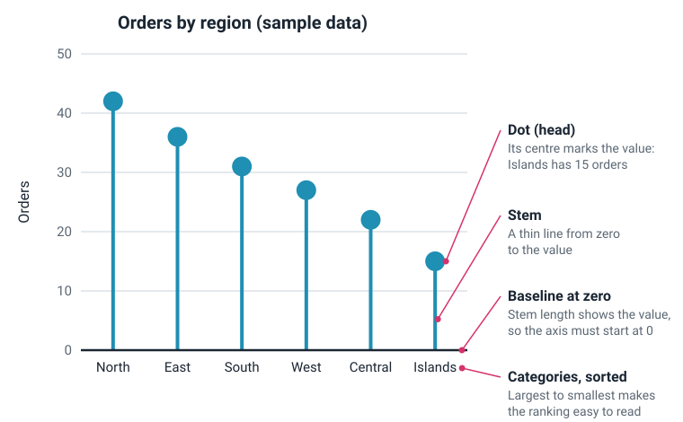
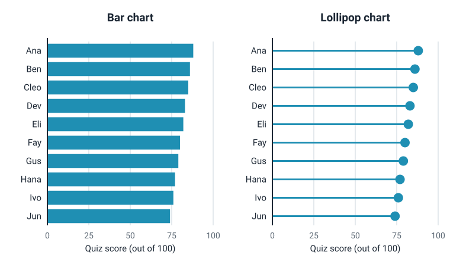

<head>
    <script type="application/ld+json">
        {JSON.stringify({
            "@context": "https://schema.org",
            "@type": "FAQPage",
            "mainEntity": [
                {
                    "@type": "Question",
                    "name": "What is a lollipop chart used for?",
                    "acceptedAnswer": { "@type": "Answer", "text": "A lollipop chart is used to compare one value across many categories, such as scores by person, sales by product or results by region, and to show their ranking. It does the same job as a bar chart but with less ink, so it works best when there are many categories with similar values, where a block of thick bars would be heavy to read." }
                },
                {
                    "@type": "Question",
                    "name": "What is the difference between a lollipop chart and a bar chart?",
                    "acceptedAnswer": { "@type": "Answer", "text": "Both show one value per category as a length from a zero baseline. A bar chart draws each value as a thick bar; a lollipop chart draws it as a thin line, the stem, with a dot at the end. The lollipop chart uses less ink and makes the end points stand out, which helps with many similar values. A bar chart is easier to read precisely, because the end of a bar is a sharp edge rather than a dot." }
                },
                {
                    "@type": "Question",
                    "name": "Does a lollipop chart have to start at zero?",
                    "acceptedAnswer": { "@type": "Answer", "text": "Yes. The stem runs from the baseline to the value, so readers judge each value partly by the stem's length. If the axis starts above zero, the stems no longer match the values and small differences look large. If you need to zoom in on a narrow range of values, use a dot plot, which has no stems and doesn't need a zero baseline." }
                },
                {
                    "@type": "Question",
                    "name": "What is the difference between a lollipop chart and a dumbbell chart?",
                    "acceptedAnswer": { "@type": "Answer", "text": "A lollipop chart shows one value per category, as a stem from zero to a dot. A dumbbell chart shows two values per category, such as before and after, as two dots joined by a line. The line in a dumbbell chart shows the gap between the two values, not a length from zero." }
                },
                {
                    "@type": "Question",
                    "name": "What is a stem plot?",
                    "acceptedAnswer": { "@type": "Answer", "text": "In engineering and signal processing, a stem plot is a lollipop chart of a sequence of samples: each sample is drawn as a vertical stem from a zero line to its value, with a marker at the end. It shows that the data is a set of separate samples rather than a continuous curve. In statistics, stem plot can also mean a stem-and-leaf plot, which is a different, text-based way of showing a distribution." }
                },
                {
                    "@type": "Question",
                    "name": "How do I make a lollipop chart in JavaScript?",
                    "acceptedAnswer": { "@type": "Answer", "text": "With SciChart.js, create a SciChartSurface with two NumericAxis objects, then add a FastImpulseRenderableSeries with an XyDataSeries holding one x value per category and one y value per lollipop. The series draws the stems and the dots; set fill for their colour, size for the dot size and pointMarker for the dot shape. A TextLabelProvider shows the category names, and putting the X axis on the left makes the lollipops horizontal. The same chart works in React with scichart-react and in Angular with scichart-angular." }
                }
            ]
        })}
    </script>
</head>

# Lollipop Chart

## What is a lollipop chart?

A **lollipop chart** (also called a lollipop graph or lollipop plot) is a bar chart where each bar is replaced by a thin line, the **stem**, with a dot at its end. Each lollipop stands for one category, and the stem's length from a zero baseline shows its value. It compares values across categories using less ink than bars.


*A lollipop chart of survey results for 12 product features (sample data). [Try the interactive version](#how-to-create-a-lollipop-chart-in-javascript-react-or-angular).*

:::tip Key takeaways
- A lollipop chart shows **one value per category** as a **stem from zero with a dot at the end**: a bar chart drawn with less ink.
- It works best with **many categories of similar size**, where thick bars would form a heavy block of colour.
- **Start the value axis at zero.** The stem's length is part of the reading, just as a bar's is.
- **Sort the lollipops** by value and use **one colour**, unless colour carries a meaning.
- Two values per category make a **dumbbell chart**. In engineering, a lollipop chart of samples is called a **stem plot**.
:::

## How to read a lollipop chart



1. **Check what each lollipop stands for.** The category axis names them: regions, products, people. Read the value axis title for what is measured and in what unit.
2. **Read the value at the centre of the dot.** The dot sits on the value, so read it against the value axis or its data label. Half of a large dot reaches past the value, so don't read from its outer edge.
3. **Compare the stems.** Longer stems mean larger values. Because every stem starts at zero, a stem twice as long means a value twice as large.
4. **Look at the order.** Most lollipop charts are sorted, so the first and last lollipops are the largest and smallest. Look for gaps where the values drop sharply, and for groups of near-equal values.
5. **Check for negative values.** If some stems go the other way from the baseline, those values are below zero, or below whatever reference line the chart uses (see [diverging lollipop chart](#types-of-lollipop-chart) below).

### How to describe a lollipop chart

Use this template when you report a lollipop chart:

> **[Top category]** has the highest **[measure]** at **[value]**, and **[bottom category]** the lowest at **[value]**. **[Pattern: most values are close together / there's a clear gap after the top few / a few categories stand out]**.

**Worked example,** from the chart at the top of the page: "Search was the feature most often rated useful, by 78% of respondents, and custom themes the least, at 41%. The top three features are within 6 points of each other, while the bottom two fall clearly below the rest."

## Lollipop chart vs bar chart

A lollipop chart and a bar chart show the same thing: one value per category, as a length from zero. The difference is how much ink each value uses.



In the bar chart above, ten scores between 74 and 88 make a near-solid block of colour, and the eye has to find the small differences at the ends of the bars. In the lollipop chart, the thin stems recede and the dots stand out, so the ends, where the differences are, are what you see first.

| | Bar chart | Lollipop chart |
| --- | --- | --- |
| **Shows** | One value per category, as a bar's length | One value per category, as a stem's length with a dot at the end |
| **Ink used** | A lot: every bar is a solid block | Little: a thin line and a dot |
| **Best with** | A few categories, or values that differ a lot | Many categories with similar values |
| **Reading exact values** | Easier: the bar's end is a sharp edge | Slightly harder: read the centre of the dot |
| **Familiar to readers** | Very | Less so, but easy to grasp |
| **Axis starts at zero** | Yes | Yes |

**Rule of thumb:** with a handful of categories, a [bar chart](/learn/bar-chart/) is the safe choice. With a dozen or more similar values, a lollipop chart is usually easier on the eye. The data and the axis rules are the same, so switching between them costs nothing.

## Types of lollipop chart

| Type | What it looks like | Use it for |
| --- | --- | --- |
| **Vertical lollipop chart** | Upright stems, categories along the bottom | Short category names, or categories with a natural order such as years |
| **Horizontal lollipop chart** | Stems pointing right, categories down the left side | Long category names and rankings; the most common layout |
| **Diverging lollipop chart** | Stems go both ways from a central baseline | Values above and below zero (profit and loss, change on last year), or above and below a target or average |
| **Lollipop chart with highlights** | One or a few dots in a second colour | Picking out one category, such as your team or your product, against the rest |
| **Dumbbell chart** | Two dots per category joined by a line | Comparing two values per category, such as before and after; see the [dumbbell chart](/learn/dumbbell-chart/) |
| **Dot plot** (Cleveland dot plot) | Dots only, no stems | Values in a narrow range, where the axis doesn't need to start at zero |

The **dumbbell chart** is the lollipop chart's two-value cousin. Instead of a stem from zero, a line joins two dots, so the line's length shows the **gap** between the two values rather than a value itself. Use it when the change or difference matters more than the values.

In a **diverging lollipop chart** the baseline can be zero or a reference value. If it isn't zero, label it clearly ("difference from the target"), because readers will assume it is.

## Stem plots in signal processing

In engineering and science, the lollipop chart has another name: the **stem plot**. Plotting tools for technical work, such as MATLAB's and Matplotlib's `stem` functions, draw it, and SciChart.js calls it an **impulse** series.


A stem plot shows a **discrete signal**: a sequence of separate samples, numbered 0, 1, 2 and so on, rather than a continuous curve. Each stem rises or drops from the zero line to the sample's value. Drawing stems instead of joining the points with a line makes it clear that there's nothing between the samples. It's used for:

- **sampled signals,** such as audio or sensor readings, looked at sample by sample;
- **impulse responses:** how a filter or system responds to a single, short input pulse, as in the diagram above;
- **filter coefficients and spectra** computed at separate frequencies.

**Don't confuse it with a stem-and-leaf plot.** In statistics teaching, "stem plot" often means a **stem-and-leaf plot**: a table of digits that shows a distribution, a bit like a [histogram](/learn/histogram/) made of numbers. It has nothing to do with lollipops.

## When to use a lollipop chart

Use a lollipop chart when you have **one value for each of many categories** and want readers to compare them or see the ranking. Typical uses:

- **rankings:** scores by person, sales by product, results by country;
- **survey results:** the share of respondents choosing each option, across many options;
- **dashboards:** a light, compact alternative to a bar chart where space is tight;
- **sampled signals and impulse responses,** as a stem plot.

| Chart | Best for |
| --- | --- |
| **Lollipop chart** | Comparing one value across many categories, especially when the values are similar |
| [Bar chart](/learn/bar-chart/) | Comparing one value across a few categories, or several values per category (clustered or stacked bars) |
| [Dumbbell chart](/learn/dumbbell-chart/) | Comparing two values per category, such as before and after, and the gap between them |
| [Scatter plot](/learn/scatter-plot/) | The relationship between two numeric values, rather than a value per category |
| [Line chart](/learn/line-chart/) | How a value changes over continuous time |

## Common lollipop chart mistakes

- **Not starting the value axis at zero.** The stems then no longer match the values, and small differences look large. If you need a narrow range, drop the stems and use a dot plot.
- **Dots too big.** A large dot hides where the value is, and dots on neighbouring lollipops can overlap. Keep the dots just big enough to stand out from the stems.
- **Not sorting.** An unsorted lollipop chart hides the ranking. Sort by value, unless the categories have a natural order such as months or age groups.
- **A different colour for each lollipop.** Colour suggests a meaning the data doesn't have. Use one colour, and a second only to highlight something.
- **Too few categories.** With three or four values, a lollipop chart's lighter look gains little, and a bar chart is more familiar.
- **Using it for continuous data over time.** Stems for every point of a smooth time series look like a comb. Use a [line chart](/learn/line-chart/) unless the samples are separate on purpose, as in a stem plot.
- **Two values on one stem.** Two dots on one stem is a dumbbell chart, and needs its own explanation and legend.

## How to create a lollipop chart in JavaScript, React or Angular

SciChart.js draws lollipop charts natively with its impulse series, which draws each stem and dot from one value. Because it renders with WebGL and WebGPU, the same series also draws stem plots of long signals smoothly as you zoom and pan. Try the chart below: scroll to zoom, drag to pan, double-click to reset, and hover over a lollipop to see its value.

<LiveDocSnippet maxWidth={'100%'} name="./Basic/demo" />

<LearnCta position="top" chart="lollipop chart" demo="impulse-chart" docs="/2d-charts/chart-types/fast-impulse-renderable-series/" />

Here is the code for this chart:

<CodeSnippetBlock labels={["JavaScript", "React", "Angular"]}>
    ```ts showLineNumbers file=./Basic/demo.ts start=#region_A_start end=#region_A_end
    ```

    ```tsx
    import { SciChartReact } from "scichart-react";
    import {
        SciChartSurface,
        NumericAxis,
        FastImpulseRenderableSeries,
        XyDataSeries,
        EllipsePointMarker,
        TextLabelProvider,
        EAxisAlignment,
        NumberRange,
        SciChartJsNavyTheme
    } from "scichart";

    // initChart builds the chart; SciChartReact creates it, sizes it and cleans it up
    const initChart = async (rootElement: string | HTMLDivElement) => {
        const { wasmContext, sciChartSurface } = await SciChartSurface.create(rootElement, {
            theme: new SciChartJsNavyTheme()
        });

        // Category names and values, already sorted from largest to smallest
        const { categories, values } = getYourLollipopData();

        // X axis on the left: horizontal lollipops, one category name per lollipop
        sciChartSurface.xAxes.add(
            new NumericAxis(wasmContext, {
                axisAlignment: EAxisAlignment.Left,
                labelProvider: new TextLabelProvider({ labels: categories }),
                autoTicks: false,
                majorDelta: 1,
                growBy: new NumberRange(0.05, 0.2)
            })
        );
        // Y axis along the top, starting at zero, with values growing left to right
        sciChartSurface.yAxes.add(
            new NumericAxis(wasmContext, {
                axisAlignment: EAxisAlignment.Top,
                flippedCoordinates: true,
                growBy: new NumberRange(0, 0.1)
            })
        );

        sciChartSurface.renderableSeries.add(
            new FastImpulseRenderableSeries(wasmContext, {
                dataSeries: new XyDataSeries(wasmContext, {
                    xValues: categories.map((_, index) => index),
                    yValues: values
                }),
                fill: "#50C7E0",
                strokeThickness: 3,
                size: 18,
                pointMarker: new EllipsePointMarker(wasmContext)
            })
        );
        return { sciChartSurface };
    };

    export const LollipopChart = () => (
        <SciChartReact initChart={initChart} style={{ width: "100%", height: 400 }} />
    );
    ```

    ```ts
    import { Component } from "@angular/core";
    import { ScichartAngularComponent } from "scichart-angular";
    import {
        SciChartSurface,
        NumericAxis,
        FastImpulseRenderableSeries,
        XyDataSeries,
        EllipsePointMarker,
        TextLabelProvider,
        EAxisAlignment,
        NumberRange,
        SciChartJsNavyTheme
    } from "scichart";

    @Component({
        selector: "app-lollipop-chart",
        standalone: true,
        imports: [ScichartAngularComponent],
        template: `<scichart-angular [initChart]="initChart" style="display: block; width: 100%; height: 400px"></scichart-angular>`
    })
    export class LollipopChartComponent {
        // initChart builds the chart; scichart-angular creates it, sizes it and cleans it up
        initChart = async (rootElement: string | HTMLDivElement) => {
            const { wasmContext, sciChartSurface } = await SciChartSurface.create(rootElement, {
                theme: new SciChartJsNavyTheme()
            });

            // Category names and values, already sorted from largest to smallest
            const { categories, values } = getYourLollipopData();

            // X axis on the left: horizontal lollipops, one category name per lollipop
            sciChartSurface.xAxes.add(
                new NumericAxis(wasmContext, {
                    axisAlignment: EAxisAlignment.Left,
                    labelProvider: new TextLabelProvider({ labels: categories }),
                    autoTicks: false,
                    majorDelta: 1,
                    growBy: new NumberRange(0.05, 0.2)
                })
            );
            // Y axis along the top, starting at zero, with values growing left to right
            sciChartSurface.yAxes.add(
                new NumericAxis(wasmContext, {
                    axisAlignment: EAxisAlignment.Top,
                    flippedCoordinates: true,
                    growBy: new NumberRange(0, 0.1)
                })
            );

            sciChartSurface.renderableSeries.add(
                new FastImpulseRenderableSeries(wasmContext, {
                    dataSeries: new XyDataSeries(wasmContext, {
                        xValues: categories.map((_, index) => index),
                        yValues: values
                    }),
                    fill: "#50C7E0",
                    strokeThickness: 3,
                    size: 18,
                    pointMarker: new EllipsePointMarker(wasmContext)
                })
            );
            return { sciChartSurface };
        };
    }
    ```
</CodeSnippetBlock>

Key points:

- A [FastImpulseRenderableSeries](/2d-charts/chart-types/fast-impulse-renderable-series/) draws a stem from zero to each value, with a dot at the end. `fill` sets the colour of both, `size` the dot's size in pixels and `strokeThickness` the stem's thickness.
- `pointMarker` sets the dot's shape: an `EllipsePointMarker` for round dots, or a triangle, square or custom marker.
- The X axis on the left (`axisAlignment: EAxisAlignment.Left`) turns the chart on its side, for horizontal lollipops. A [TextLabelProvider](https://www.scichart.com/documentation/js/current/typedoc/classes/textlabelprovider.html) shows a category name at each x value (0, 1, 2, …). Sort the data before you chart it.
- For a stem plot of a signal, keep the default axes (X along the bottom) and pass the sample numbers as x values. To highlight one lollipop, use the [PaletteProvider for impulse series](/2d-charts/chart-types/palette-provider-api/fast-impulse-renderable-series/).

**See it in the demo app:** [JavaScript lollipop chart](https://www.scichart.com/demo/javascript/impulse-chart) · [React lollipop chart](https://www.scichart.com/demo/react/impulse-chart) · [Angular lollipop chart](https://www.scichart.com/demo/angular/impulse-chart)

**Go deeper:** [SciChart.js lollipop chart documentation](/2d-charts/chart-types/fast-impulse-renderable-series/), including point markers, gaps and colouring individual lollipops.

## Frequently asked questions

### What is a lollipop chart used for?

A lollipop chart is used to compare one value across many categories, such as scores by person, sales by product or results by region, and to show their ranking. It does the same job as a bar chart but with less ink, so it works best when there are many categories with similar values, where a block of thick bars would be heavy to read.

### What is the difference between a lollipop chart and a bar chart?

Both show one value per category as a length from a zero baseline. A bar chart draws each value as a thick bar; a lollipop chart draws it as a thin line, the stem, with a dot at the end. The lollipop chart uses less ink and makes the end points stand out, which helps with many similar values. A bar chart is easier to read precisely, because the end of a bar is a sharp edge rather than a dot.

### Does a lollipop chart have to start at zero?

Yes. The stem runs from the baseline to the value, so readers judge each value partly by the stem's length. If the axis starts above zero, the stems no longer match the values and small differences look large. If you need to zoom in on a narrow range of values, use a dot plot, which has no stems and doesn't need a zero baseline.

### What is the difference between a lollipop chart and a dumbbell chart?

A lollipop chart shows one value per category, as a stem from zero to a dot. A dumbbell chart shows two values per category, such as before and after, as two dots joined by a line. The line in a dumbbell chart shows the gap between the two values, not a length from zero.

### What is a stem plot?

In engineering and signal processing, a stem plot is a lollipop chart of a sequence of samples: each sample is drawn as a vertical stem from a zero line to its value, with a marker at the end. It shows that the data is a set of separate samples rather than a continuous curve. In statistics, stem plot can also mean a stem-and-leaf plot, which is a different, text-based way of showing a distribution.

### How do I make a lollipop chart in JavaScript?

With SciChart.js, create a `SciChartSurface` with two `NumericAxis` objects, then add a `FastImpulseRenderableSeries` with an `XyDataSeries` holding one x value per category and one y value per lollipop. The series draws the stems and the dots; set `fill` for their colour, `size` for the dot size and `pointMarker` for the dot shape. A `TextLabelProvider` shows the category names, and putting the X axis on the left makes the lollipops horizontal. The same chart works in React with `scichart-react` and in Angular with `scichart-angular`.

## Sources

- Cleveland, W. S. and McGill, R. (1984), [Graphical perception: theory, experimentation, and application to the development of graphical methods](https://doi.org/10.1080/01621459.1984.10478080). *Journal of the American Statistical Association*, 79(387). Why lengths and positions on a common scale, as in bar and lollipop charts, are compared accurately.
- Matplotlib, [matplotlib.pyplot.stem](https://matplotlib.org/stable/api/_as_gen/matplotlib.pyplot.stem.html). The stem plot as lines from a baseline to each value, with a marker at the end.
- MathWorks, [stem: plot discrete sequence data](https://www.mathworks.com/help/matlab/ref/stem.html). MATLAB's stem plot for discrete sequences.
- NIST/SEMATECH e-Handbook of Statistical Methods, [Stem and leaf plot](https://www.itl.nist.gov/div898/handbook/eda/section3/stemplot.htm). The other meaning of "stem plot" in statistics.

<LearnCta position="bottom" chart="lollipop chart" demo="impulse-chart" docs="/2d-charts/chart-types/fast-impulse-renderable-series/" />
