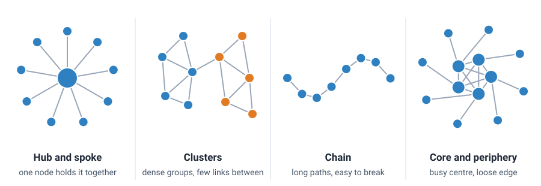

<head>
    <script type="application/ld+json">
        {JSON.stringify({
            "@context": "https://schema.org",
            "@type": "FAQPage",
            "mainEntity": [
                {
                    "@type": "Question",
                    "name": "What is a network graph used for?",
                    "acceptedAnswer": { "@type": "Answer", "text": "A network graph is used to show how things are connected and to find the structure in those connections: which items are central, which groups form, and which items link one group to another. Common uses are social and organisational networks, computer and telecoms networks, transport routes, citations between papers, links between web pages, and interactions between genes or proteins." }
                },
                {
                    "@type": "Question",
                    "name": "What is a force-directed graph?",
                    "acceptedAnswer": { "@type": "Answer", "text": "A force-directed graph is a network graph whose layout comes from a simple physics simulation. Every pair of nodes pushes apart, every edge pulls the two nodes it joins together like a spring, and the simulation runs until the nodes settle. Linked nodes end up close together, so clusters form groups on the screen. The x and y positions themselves carry no units or meaning." }
                },
                {
                    "@type": "Question",
                    "name": "What is the difference between a network graph and a network diagram?",
                    "acceptedAnswer": { "@type": "Answer", "text": "In data visualisation the two names mean the same chart: nodes joined by edges, drawn from data. In IT, a network diagram usually means a hand-drawn plan of a computer network, with routers, switches, servers and the cables between them, often drawn with icons. That plan is a kind of network graph, but it is laid out by a person rather than computed from data." }
                },
                {
                    "@type": "Question",
                    "name": "Is a network graph the same as a graph neural network?",
                    "acceptedAnswer": { "@type": "Answer", "text": "No. A network graph is a chart that draws nodes and the links between them. A graph neural network is a machine learning model that takes the same kind of data, nodes and links, as its input, and learns to make predictions about the nodes, the links or the whole network. You might draw a network graph to explore the data that a graph neural network is trained on." }
                },
                {
                    "@type": "Question",
                    "name": "How do I make a network graph in JavaScript?",
                    "acceptedAnswer": { "@type": "Answer", "text": "Store the data as a list of nodes and a list of edges, where each edge names the two nodes it joins. Run a layout, such as a force-directed simulation, to give each node an x and y position. Then draw the edges as line segments and the nodes as circles. With SciChart.js you draw all the edges in one FastLineSegmentRenderableSeries and the nodes as bubble or scatter series, and add a custom modifier for hover and drag. The same code works in React with scichart-react and in Angular with scichart-angular." }
                }
            ]
        })}
    </script>
</head>

# Network Graph

## What is a network graph?

A **network graph** (also called a network diagram, network chart, node-link diagram or graph visualisation) is a chart that shows how things are connected. Each thing is a dot called a **node**, and each connection is a line called an **edge** or link. It reveals groups, central players and the links between groups.


*A network graph of who works with whom in an imaginary company of 60 people (sample data). Colour shows each person's team; dot size shows how many connections they have. [Try the interactive version](#how-to-create-a-network-graph-in-javascript-react-or-angular).*

:::tip Key takeaways
- A network graph shows **connections**: nodes are the items, edges are the links between them.
- Look for three things: **hubs** (nodes with many links), **clusters** (groups linked mostly to each other) and **bridges** (the few links that join groups).
- In most layouts, **a node's position has no units.** Only which nodes are close, and what's linked to what, means something.
- Use colour for a group and size for a measure such as the number of connections, and **say what each one means**.
- Above a few hundred nodes, a network graph turns into a tangle. Filter, group or zoom rather than drawing everything.
:::

## How to read a network graph


1. **Find out what the nodes and edges are.** A node might be a person, an airport, a web page or a gene. An edge might mean "emailed", "flies to", "links to" or "interacts with". Everything else depends on this.
2. **Check what colour, size and line thickness mean.** Colour usually shows a group, such as a team or a type of item. Node size often shows the number of connections. A thicker edge usually means a stronger or more frequent link (a **weighted edge**). An arrow on an edge means the link has a direction (a **directed graph**), such as "follows" or "cites".
3. **Look for clusters.** A **cluster** (or **community**) is a group of nodes with many links among themselves and few to the rest. On most layouts they show up as tight knots of dots.
4. **Find the hubs.** A **hub** is a node with many more connections than most. The number of connections a node has is its **degree**.
5. **Find the bridges.** A **bridge** is a node or edge that joins two clusters. Remove it and the groups lose touch, so bridges often matter more than their number of connections suggests.
6. **Check the edges of the chart.** Nodes with one link sit on the outside, and an **isolate**, a node with no links at all, floats on its own.
7. **Don't read the x and y positions as values.** In a force-directed layout there are no axes. Linked nodes are drawn close together, but a node on the left is not "less" than one on the right.

## Patterns to look for in a network graph

The same few shapes turn up again and again, whatever the network is about:



| Pattern | What it looks like | What it usually means |
| --- | --- | --- |
| **Hub and spoke** | One large node with lines to many small ones | Everything goes through one person, server or airport: efficient, but a single point of failure |
| **Clusters** | Tight knots of nodes with only a few lines between them | Teams, friend groups, topics or modules that mostly keep to themselves |
| **Bridge** | One node or edge that is the main route between two clusters | A broker or go-between. If it goes, the groups lose touch |
| **Chain** | Nodes in a line, each linked only to the next | Long paths: information or traffic takes many steps, and one broken link splits the network |
| **Core and periphery** | A dense centre with loosely attached nodes around it | An inner group that does most of the work, with occasional contributors on the outside |
| **Isolate** | A node with no lines | Someone or something not yet connected: a new starter, an unused page, an error in the data |

### Network graph measures: degree, betweenness and density

Patterns you see by eye have numbers behind them. These are the ones most often used to size or colour nodes:

| Measure | What it counts | What a high value suggests |
| --- | --- | --- |
| **Degree** | The number of edges a node has | A hub: well connected, often busy |
| **Betweenness centrality** | How often a node sits on the shortest route between two other nodes | A bridge or broker that controls the flow between groups |
| **Closeness centrality** | How few steps a node needs, on average, to reach every other node | A node that can reach the whole network quickly |
| **Density** | The share of all possible edges that exist | A tightly knit network; low density means a sparse one |
| **Path length** | The number of edges on the shortest route between two nodes | How many steps information takes to spread |

## A worked example: who works with whom

The network graph at the top of this page shows an imaginary company of 60 people in four teams of 15. An edge joins two people who work together regularly. The data is made up but has the shape real organisations often have: each team has a lead, and a few people work across teams.

- **60 nodes and 127 edges.** Of the 1,770 possible pairs of people, 127 work together, a **density** of about 7%.
- **The average person has about 4 connections.** The team leads have 11 to 14.
- **Only 8 of the 127 edges cross between teams.** That is why the four teams form four clear clusters.
- **Any two connected people are 3.5 steps apart on average**, and never more than 7.
- **Jon has no connections.** He has just joined Support, so he is an isolate.

The table compares five people by **degree** and by **betweenness**, shown here as the share of shortest routes between other pairs of people that pass through them:

| Person | Team | Connections (degree) | Shortest routes through them (betweenness) |
| --- | --- | --- | --- |
| Grace | Sales (lead) | 14 | 47% |
| Tom | Engineering | 5 | 44% |
| Chloe | Marketing (lead) | 11 | 35% |
| Priya | Engineering (lead) | 13 | 29% |
| Marco | Support (lead) | 12 | 27% |

Priya has the second-highest number of connections, but every one of them is inside Engineering. Tom has only five connections, yet 44% of shortest routes run through him, because three of his five links go to other teams. On the chart Tom is the small blue dot in the middle, with lines out to Sales, Marketing and Support. **A count of connections finds the hubs; betweenness finds the bridges.** Hover over Tom in the [live example below](#how-to-create-a-network-graph-in-javascript-react-or-angular) to see it.

### How to describe a network graph

Use this template when you report a network graph:

> The network has **[number] [nodes]** and **[number] [links]**. They form **[number] main clusters**, which match **[groups, or what they have in common]**. The most connected node is **[name]**, with **[degree]** links, and **[name]** is the main bridge between **[cluster]** and **[cluster]**.

**Worked example:** "The company network has 60 people and 127 working relationships. They form four clusters, one for each team, joined by only eight cross-team links. Grace, the Sales lead, has the most connections (14), and Tom in Engineering is the main bridge from Engineering to the other three teams."

## How does a force-directed layout work?

A network has no natural x and y, so a **layout** method has to place the nodes. The most common is the **force-directed layout**, which treats the network as a set of physical objects:

1. **Start anywhere.** Each node gets a starting position, often random. A fixed random seed makes the result the same every time.
2. **Every pair of nodes pushes apart,** like magnets of the same pole. The push is strongest when they are close, so nodes don't overlap.
3. **Every edge pulls its two nodes together,** like a spring. The further apart they are, the harder it pulls.
4. **Move each node a little in the direction of its total force,** then repeat. Each round, nodes are allowed to move a bit less (called **cooling**), so the layout settles instead of shaking forever.
5. **Stop when nothing moves much.** Linked nodes are now close, groups with many links between them form clusters, and nodes with few links drift to the outside.

The Fruchterman–Reingold method (1991) is a well-known version of these steps, and it's what the live example on this page uses, with a weak pull towards the centre so that separate pieces stay in view. Two consequences matter when you read the result:

- **Distances are only roughly meaningful.** Close nodes are usually linked, or share neighbours. The exact distance between two nodes is not a measurement.
- **The picture can change from run to run.** A different start can mirror, rotate or rearrange the layout. The clusters and links stay the same, so read those, not the positions.

Every pair of nodes pushes on every other, so each round takes longer as the network grows. Libraries for very large networks speed this up by treating distant groups of nodes as one.

Other layouts suit other data:

| Layout | Nodes placed by | Best for |
| --- | --- | --- |
| **Force-directed** | A simulation of pushing and pulling | Finding clusters and bridges in general networks |
| **Circular** | Equal spacing round a circle, often sorted by group | Comparing links within and between groups |
| **Hierarchical (tree)** | Levels, top to bottom | Organisation charts, family trees, dependencies |
| **Geographic** | Real locations on a map | Flight routes, power grids, delivery networks |

## When to use a network graph

Use a network graph when the **connections are the point**: who is linked to whom, which groups form, and who holds them together. Typical uses:

- **people:** social networks, teams and email traffic, fraud rings;
- **technology:** computers on a network, services that call each other, web pages and their links;
- **transport and infrastructure:** routes between airports, stations or substations;
- **science:** citations between papers, interactions between genes or proteins;
- **knowledge:** topics or keywords that appear together.

| Chart | Best for |
| --- | --- |
| **Network graph** | Arbitrary links between items, to find hubs, clusters and bridges |
| [Sankey diagram](/learn/sankey-diagram/) | A quantity flowing one way through stages, with band widths showing amounts |
| [Heatmap](/learn/heatmap/) (adjacency matrix) | Large or dense networks: one row and one column per node, with colour showing the link between them. No tangle, but harder to see paths |
| [Treemap](/learn/treemap/) | A strict hierarchy, where every item has exactly one parent |
| [Scatter plot](/learn/scatter-plot/) | Items with two real measured values. A network graph's x and y are not values |

A note on the name: in IT, a **network diagram** often means a plan of a computer network, with routers, switches and servers drawn as icons. That plan is a network graph too, but a person lays it out by hand. This page is about network graphs drawn from data.

## Common network graph mistakes

- **The hairball.** Draw every node and edge of a large network and you get a dense tangle that shows nothing. Filter to the nodes that matter, group clusters into single nodes, or show one node's neighbourhood at a time.
- **Reading position as data.** In a force-directed layout, left, right, up and down mean nothing. Don't describe a node as "higher" or "further right" as if it were a value.
- **Trusting one layout.** A different random start can rearrange the picture. Check that a pattern is in the links, not just in where the nodes happened to land.
- **Colour or size with no key.** Readers can't guess that colour means team and size means connections. Add a legend, and use colour only for something that matters.
- **Too many labels.** Labelling every node buries the chart in text. Label the hubs and bridges, and show the rest in a tooltip on hover.
- **Ignoring direction and weight.** "A follows B" is not "B follows A", and one email is not a thousand. Use arrows for direction and line thickness for weight when they matter.
- **Hiding the isolates.** Nodes with no links are easy to filter out by accident, but they are often the finding: the customer nobody contacts, the server nothing uses.

## How to create a network graph in JavaScript, React or Angular

SciChart.js has no separate network series, but a network graph is just lines and circles: all the edges go in one line segment series and the nodes in bubble series, both drawn with WebGL or WebGPU. A short helper works out the layout. Try the graph below: hover over a person to highlight their links and neighbours, drag a person to move them (the network follows), scroll to zoom, drag the background to pan and double-click to reset.

<LiveDocSnippet maxWidth={'100%'} name="./Basic/demo" />

<LearnCta position="top" chart="network graph" demo="force-directed-graph" docs="/2d-charts/chart-types/fast-line-segment-renderable-series/" />

Here is the code for this graph. The data is plain JSON: a list of nodes, each with a group, and a list of links that name the two nodes they join:

```json
{
    "groups": [{ "id": "eng", "name": "Engineering", "color": "#50C7E0" }],
    "nodes": [{ "id": "Priya", "name": "Priya", "group": "eng" }, { "id": "Tom", "name": "Tom", "group": "eng" }],
    "links": [{ "source": "Priya", "target": "Tom" }]
}
```

<CodeSnippetBlock labels={["JavaScript", "React", "Angular"]}>
    ```ts showLineNumbers file=./Basic/demo.ts start=#region_A_start end=#region_A_end
    ```

    ```tsx
    import { SciChartReact } from "scichart-react";
    import {
        SciChartSurface,
        NumericAxis,
        NumberRange,
        LegendModifier,
        ELegendPlacement,
        MouseWheelZoomModifier,
        ZoomPanModifier,
        ZoomExtentsModifier,
        SciChartJsNavyTheme
    } from "scichart";
    // createForceLayout, addNetworkSeries and NetworkModifier from the JavaScript tab, saved as network.ts
    import { createForceLayout, addNetworkSeries, NetworkModifier } from "./network";

    // initChart builds the chart; SciChartReact creates it, sizes it and cleans it up
    const initChart = async (rootElement: string | HTMLDivElement) => {
        const { wasmContext, sciChartSurface } = await SciChartSurface.create(rootElement, {
            theme: new SciChartJsNavyTheme()
        });

        // { groups: [{ id, name, color }], nodes: [{ id, name, group }], links: [{ source, target }] }
        const data = getYourNetworkData();
        const layout = createForceLayout(data, { size: 1000, seed: 7 });

        sciChartSurface.xAxes.add(new NumericAxis(wasmContext, { isVisible: false, growBy: new NumberRange(0.06, 0.06) }));
        sciChartSurface.yAxes.add(new NumericAxis(wasmContext, { isVisible: false, growBy: new NumberRange(0.12, 0.06) }));

        const network = addNetworkSeries(sciChartSurface, wasmContext, layout, data.groups);
        const legend = new LegendModifier({ showCheckboxes: false, placement: ELegendPlacement.TopRight });
        sciChartSurface.chartModifiers.add(
            new NetworkModifier(layout, network, data.groups),
            new MouseWheelZoomModifier(),
            new ZoomPanModifier(),
            new ZoomExtentsModifier(),
            legend
        );
        legend.includeSeries(network.edgeSeries, false);
        legend.includeSeries(network.highlightSeries, false);
        return { sciChartSurface };
    };

    export const NetworkGraph = () => (
        <SciChartReact initChart={initChart} style={{ width: "100%", height: 500 }} />
    );
    ```

    ```ts
    import { Component } from "@angular/core";
    import { ScichartAngularComponent } from "scichart-angular";
    import {
        SciChartSurface,
        NumericAxis,
        NumberRange,
        LegendModifier,
        ELegendPlacement,
        MouseWheelZoomModifier,
        ZoomPanModifier,
        ZoomExtentsModifier,
        SciChartJsNavyTheme
    } from "scichart";
    // createForceLayout, addNetworkSeries and NetworkModifier from the JavaScript tab, saved as network.ts
    import { createForceLayout, addNetworkSeries, NetworkModifier } from "./network";

    @Component({
        selector: "app-network-graph",
        standalone: true,
        imports: [ScichartAngularComponent],
        template: `<scichart-angular [initChart]="initChart" style="display: block; width: 100%; height: 500px"></scichart-angular>`
    })
    export class NetworkGraphComponent {
        // initChart builds the chart; scichart-angular creates it, sizes it and cleans it up
        initChart = async (rootElement: string | HTMLDivElement) => {
            const { wasmContext, sciChartSurface } = await SciChartSurface.create(rootElement, {
                theme: new SciChartJsNavyTheme()
            });

            // { groups: [{ id, name, color }], nodes: [{ id, name, group }], links: [{ source, target }] }
            const data = getYourNetworkData();
            const layout = createForceLayout(data, { size: 1000, seed: 7 });

            sciChartSurface.xAxes.add(new NumericAxis(wasmContext, { isVisible: false, growBy: new NumberRange(0.06, 0.06) }));
            sciChartSurface.yAxes.add(new NumericAxis(wasmContext, { isVisible: false, growBy: new NumberRange(0.12, 0.06) }));

            const network = addNetworkSeries(sciChartSurface, wasmContext, layout, data.groups);
            const legend = new LegendModifier({ showCheckboxes: false, placement: ELegendPlacement.TopRight });
            sciChartSurface.chartModifiers.add(
                new NetworkModifier(layout, network, data.groups),
                new MouseWheelZoomModifier(),
                new ZoomPanModifier(),
                new ZoomExtentsModifier(),
                legend
            );
            legend.includeSeries(network.edgeSeries, false);
            legend.includeSeries(network.highlightSeries, false);
            return { sciChartSurface };
        };
    }
    ```
</CodeSnippetBlock>

Key points:

- `createForceLayout` is plain JavaScript with no SciChart code, so you can reuse it anywhere. It runs 300 rounds of a Fruchterman–Reingold layout before the first draw, from a seeded start, so the graph looks the same every time. Its `step()` function runs one more round, which the drag uses to let the network follow the node you move. Each round compares every pair of nodes, so keep to a few hundred nodes or use a faster layout for more.
- All the edges are one [FastLineSegmentRenderableSeries](/2d-charts/chart-types/fast-line-segment-renderable-series/) with an `XyxyDataSeries`, which holds a start point and an end point for each segment. A second line segment series draws the hovered node's edges on top.
- Each group's nodes are a [FastBubbleRenderableSeries](/2d-charts/chart-types/fast-bubble-renderable-series/), with the bubble size in pixels set from the node's number of connections. One series per group gives the legend one entry per colour. A [palette provider](/2d-charts/chart-types/palette-provider-api/fast-bubble-renderable-series/) fades every node that isn't the hovered node or one of its neighbours.
- `NetworkModifier` extends `CustomChartModifier2D` ([custom chart modifiers](/2d-charts/chart-modifier-api/custom-modifiers/custom-modifiers-overview/)) to find the nearest node on each mouse move, show the tooltip and handle dragging. Setting `args.handled = true` on a node stops `ZoomPanModifier` panning the chart at the same time. The axes are hidden, but they still set the drawing area, so zoom and pan work as on any chart.

**See it in the demo app:** [JavaScript force-directed graph](https://www.scichart.com/demo/javascript/force-directed-graph) · [React force-directed graph](https://www.scichart.com/demo/react/force-directed-graph) · [Angular force-directed graph](https://www.scichart.com/demo/angular/force-directed-graph), a network of US airports and flight routes.

**Go deeper:** [SciChart.js line segment series documentation](/2d-charts/chart-types/fast-line-segment-renderable-series/), the [SciChart.js bubble series documentation](/2d-charts/chart-types/fast-bubble-renderable-series/) and the [custom chart modifier documentation](/2d-charts/chart-modifier-api/custom-modifiers/custom-modifiers-overview/).

## Frequently asked questions

### What is a network graph used for?

A network graph is used to show how things are connected and to find the structure in those connections: which items are central, which groups form, and which items link one group to another. Common uses are social and organisational networks, computer and telecoms networks, transport routes, citations between papers, links between web pages, and interactions between genes or proteins.

### What is a force-directed graph?

A force-directed graph is a network graph whose layout comes from a simple physics simulation. Every pair of nodes pushes apart, every edge pulls the two nodes it joins together like a spring, and the simulation runs until the nodes settle. Linked nodes end up close together, so clusters form groups on the screen. The x and y positions themselves carry no units or meaning.

### What is the difference between a network graph and a network diagram?

In data visualisation the two names mean the same chart: nodes joined by edges, drawn from data. In IT, a network diagram usually means a hand-drawn plan of a computer network, with routers, switches, servers and the cables between them, often drawn with icons. That plan is a kind of network graph, but it is laid out by a person rather than computed from data.

### Is a network graph the same as a graph neural network?

No. A network graph is a chart that draws nodes and the links between them. A graph neural network is a machine learning model that takes the same kind of data, nodes and links, as its input, and learns to make predictions about the nodes, the links or the whole network. You might draw a network graph to explore the data that a graph neural network is trained on.

### How do I make a network graph in JavaScript?

Store the data as a list of nodes and a list of edges, where each edge names the two nodes it joins. Run a layout, such as a force-directed simulation, to give each node an x and y position. Then draw the edges as line segments and the nodes as circles. With SciChart.js you draw all the edges in one `FastLineSegmentRenderableSeries` and the nodes as bubble or scatter series, and add a custom modifier for hover and drag. The same code works in React with `scichart-react` and in Angular with `scichart-angular`.

## Sources

- Fruchterman, T. M. J. and Reingold, E. M. (1991), [Graph drawing by force-directed placement](https://doi.org/10.1002/spe.4380211102). *Software: Practice and Experience*, 21(11), 1129–1164. The force-directed layout method used in the live example: nodes repel, edges attract, and the movement cools step by step.
- Freeman, L. C. (1978), [Centrality in social networks: conceptual clarification](https://doi.org/10.1016/0378-8733(78)90021-7). *Social Networks*, 1(3), 215–239. Defines degree, betweenness and closeness centrality.
- Girvan, M. and Newman, M. E. J. (2002), [Community structure in social and biological networks](https://doi.org/10.1073/pnas.122653799). *Proceedings of the National Academy of Sciences*, 99(12), 7821–7826. Clusters (communities) in networks, and finding them through the edges that bridge them.

<LearnCta position="bottom" chart="network graph" demo="force-directed-graph" docs="/2d-charts/chart-types/fast-line-segment-renderable-series/" />
