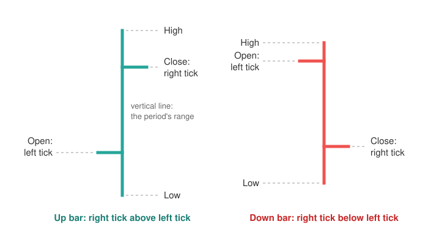
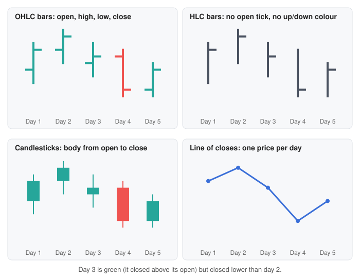

<head>
    <script type="application/ld+json">
        {JSON.stringify({
            "@context": "https://schema.org",
            "@type": "FAQPage",
            "mainEntity": [
                {
                    "@type": "Question",
                    "name": "How do you read an OHLC chart?",
                    "acceptedAnswer": { "@type": "Answer", "text": "Each bar is one period, such as a day. The top of the vertical line is the highest price and the bottom is the lowest. The small tick on the left is where the price opened, and the tick on the right is where it closed. If the right tick is higher than the left one, the price rose during the period; if it is lower, the price fell." }
                },
                {
                    "@type": "Question",
                    "name": "What does OHLC stand for?",
                    "acceptedAnswer": { "@type": "Answer", "text": "OHLC stands for open, high, low and close: the first price, the highest price, the lowest price and the last price traded in a period. Data with a fifth column for the amount traded is often called OHLCV, where the V is volume." }
                },
                {
                    "@type": "Question",
                    "name": "What is the difference between an OHLC chart and a candlestick chart?",
                    "acceptedAnswer": { "@type": "Answer", "text": "They show exactly the same four prices. An OHLC chart marks the open and close with small ticks on the left and right of a thin vertical line. A candlestick chart fills the space between the open and the close with a solid body. Candlesticks make rising and falling periods stand out; OHLC bars are thinner, so more periods fit on screen and indicators drawn on top stay easier to see." }
                },
                {
                    "@type": "Question",
                    "name": "Why do some traders prefer OHLC bars to candlesticks?",
                    "acceptedAnswer": { "@type": "Answer", "text": "OHLC bars take up less space, so a long history fits on one screen. Their open and close are marked by position, not colour, so they still work in black and white. The thin bars leave room for moving averages and other lines drawn on top. Many traders also simply learned on bar charts and find them faster to read." }
                },
                {
                    "@type": "Question",
                    "name": "Can I turn a line chart into an OHLC chart?",
                    "acceptedAnswer": { "@type": "Answer", "text": "Only if you have more than one price per period. A line chart usually plots just the closing price, which is not enough to know the open, high or low. If you have every trade, or prices at a shorter interval, group them by period: the first price is the open, the highest is the high, the lowest is the low and the last is the close." }
                },
                {
                    "@type": "Question",
                    "name": "How do I make an OHLC chart in JavaScript?",
                    "acceptedAnswer": { "@type": "Answer", "text": "With SciChart.js, create a SciChartSurface, add a CategoryAxis and a NumericAxis, then add a FastOhlcRenderableSeries with an OhlcDataSeries holding your x, open, high, low and close values. Set strokeUp and strokeDown for the rising and falling colours. The same chart works in React with scichart-react and in Angular with scichart-angular." }
                }
            ]
        })}
    </script>
</head>

# OHLC Chart

## What is an OHLC chart?

An **OHLC chart** (open-high-low-close chart, also called an OHLC bar chart or, in trading, simply a bar chart) draws each period, such as a day, as one vertical bar. The bar runs from the period's **low** to its **high**, a short tick on the left marks the **open**, and a tick on the right marks the **close**.


*An OHLC chart of 80 trading days (sample data), with green bars for days that closed above their open and red for days that closed below. [Try the interactive version](#how-to-create-an-ohlc-chart-in-javascript-react-or-angular).*

:::tip Key takeaways
- Each bar shows **four prices for one period**: open, high, low and close.
- The **vertical line** is the range from low to high. The **left tick** is the open; the **right tick** is the close.
- **Right tick above left tick** means the price rose during the period; below means it fell. Colour usually repeats this, but the ticks say it on their own.
- An OHLC chart shows **the same data as a [candlestick chart](/learn/candlestick-chart/)**, drawn more thinly, so more periods fit on screen.
- A bar can be **green yet lower than the day before**, if the price opened lower and recovered part of the way. Compare closes across bars to see the trend.
:::

## How to read an OHLC chart



1. **Check the timeframe.** Every bar covers the same length of time: a minute, an hour, a day or a week. The axis labels or the chart settings say which.
2. **Find the range.** The top of the vertical line is the **high**, the highest price traded in the period. The bottom is the **low**. A tall bar means the price swung a lot; a short bar means a quiet period.
3. **Find the open: the left tick.** It points back in time, towards the bars before it, which is an easy way to remember it.
4. **Find the close: the right tick.** It points forward, towards the next bar. For most analysis the close is the most important price, because it is where the period settled.
5. **Compare the two ticks.** Right tick higher than the left: an **up bar**, the price rose during the period. Right tick lower: a **down bar**. Many charts also colour up bars green and down bars red, but some draw every bar in one colour.
6. **Read across the bars.** Follow the right ticks from bar to bar. Closes stepping higher make an uptrend; closes stepping lower make a downtrend.

## How to describe an OHLC bar

Each bar can be put into words with one template. Include the previous close, because it shows whether the period finished above or below the one before:

> The price opened at **[open]**, traded between **[low]** and **[high]**, and closed at **[close]**: **[up / down]** on the period and **[up / down] [amount]** from the previous close of **[previous close]**.

**Worked example:** five trading days, drawn as OHLC bars in the first panel of the diagram further down.

| Day | Open | High | Low | Close | On the day (close − open) | From previous close |
| --- | --- | --- | --- | --- | --- | --- |
| 1 | 100 | 104 | 98 | 103 | +3, up bar | – |
| 2 | 103 | 106 | 101 | 105 | +2, up bar | +2 |
| 3 | 101 | 104 | 99 | 102 | +1, up bar | **−3** |
| 4 | 102 | 103 | 96 | 97 | −5, down bar | −5 |
| 5 | 97 | 101 | 96 | 100 | +3, up bar | +3 |

Day 3 in words: "The price opened at 101, traded between 99 and 104, and closed at 102: up 1 on the day but down 3 from the previous close of 105."

Day 3 is the bar that catches people out. It opened 4 below the previous close (a **gap down**), then recovered part of the way. Its right tick is above its left tick, so it is an up bar and usually coloured green, yet it ended the day 3 below day 2's close. On an OHLC chart you can see this straight away, because the close tick of day 3 sits below the close tick of day 2. That close-to-close comparison is one reason some analysts prefer bars (see [Sources](#sources)).

## OHLC chart vs candlestick chart

An OHLC chart and a [candlestick chart](/learn/candlestick-chart/) are built from exactly the same four prices per period. Only the drawing differs.

| | OHLC chart | Candlestick chart |
| --- | --- | --- |
| Open | Tick on the left of the line | One end of the body (bottom if rising, top if falling) |
| Close | Tick on the right of the line | The other end of the body |
| High and low | Ends of the vertical line | Ends of the wicks |
| Up or down | Right tick above or below left tick; colour optional | Body colour (or hollow vs filled); colour is essential |
| Width on screen | Thin: more periods fit | Wider: fewer periods fit |
| Stands out most | The closes and the range | The direction and size of each period's move |
| Works in black and white | Yes | Only with hollow and filled bodies |
| Pattern names (doji, hammer…) | Rarely used | Widely used |

Neither shows more information than the other. Candlesticks make the move within each period jump out, which suits short-term trading and pattern reading. OHLC bars put the emphasis on where each period closed and leave more room for lines drawn on top. For patterns, the timeframe and the colour conventions of candles, read the [candlestick chart guide](/learn/candlestick-chart/).

## OHLC bars, HLC bars and line charts

The same five days can be drawn four ways. OHLC bars and candlesticks keep all four prices; HLC bars keep three and a line keeps one:



- **OHLC bars** show all four prices. Day 3 shows its gap down: its left tick sits well below day 2's right tick.
- **HLC bars** (high-low-close) drop the open tick. They show the range and where the period settled, which is enough for many analyses and suits data where the opening price is missing or unreliable. Without an open there is no "up" or "down" for the period, so HLC bars are usually drawn in one colour.
- **Candlesticks** show the same four prices as OHLC bars, with a filled body between the open and close.
- **A line of closes** keeps one price per period. The range and the open are gone, so day 3's gap and recovery disappear. In exchange the trend is easiest to see, and several prices can share one chart. See the [line chart guide](/learn/line-chart/).

## When to use an OHLC chart

Use an OHLC chart when your data has an **open, high, low and close for each period** and the reader wants to see both the range and where each period closed. Stocks, futures, forex and crypto are the usual cases, often with a volume chart underneath and indicators such as moving averages on top.

| If the reader needs to… | Use |
| --- | --- |
| See a long history of prices, with the range and close of every period, and lines such as moving averages drawn on top | **OHLC chart** |
| See the direction and size of each period's move at a glance, or read candlestick patterns | [Candlestick chart](/learn/candlestick-chart/) |
| See the range and close only, for data with no reliable opening price | **HLC bar chart** (an OHLC chart without the open tick) |
| Follow the long-term trend, or compare several prices on one chart | [Line chart](/learn/line-chart/) of the closing price |

**Why some traders prefer bars to candlesticks:**

- **More history fits.** A bar is a line and two short ticks, so it needs less width than a candle. More periods fit on screen before the chart gets cramped.
- **Indicators stay visible.** Moving averages, bands and trend lines drawn over thin bars are easier to follow than over solid bodies.
- **No colour needed.** The left and right ticks show the open and close by position, so the chart reads the same in print, in black and white, or for readers who can't tell red from green.
- **Closes line up.** The right ticks form a row of closing prices from bar to bar, which makes close-to-close moves, like day 3 above, easy to spot.
- **Habit.** Many traders learned on bar charts and read them faster. It's a preference, not a rule: both charts show the same data.

## OHLC chart mistakes to avoid

- **Swapping the ticks.** The left tick is always the open and the right tick the close. Reading them the other way round turns every up bar into a down bar.
- **Reading colour as "up from yesterday".** Colour usually compares the close with the same bar's open, not with the previous close. A green bar after a gap down can still end the day lower. Some charting tools let you colour bars by the previous close instead; check which rule the chart uses.
- **Too many bars on screen.** With years of daily data, the ticks shrink until they merge into the line. Zoom in, switch to weekly bars, or use a line chart for the long view. Some charting tools hide the ticks automatically when bars get too close.
- **Lines too thin.** A one-pixel bar on a busy chart is hard to see and harder to click. Use thicker lines on large screens and in screenshots.
- **Gaps on the time axis.** A plain date axis leaves empty spaces for weekends and holidays. An axis that spaces bars by index closes them.
- **Not saying the timeframe.** A daily bar and a weekly bar look the same. Label the timeframe, and don't compare bars from charts with different timeframes.

## How to create an OHLC chart in JavaScript, React or Angular

SciChart.js draws OHLC charts with WebGL and WebGPU, so they stay smooth to zoom and pan with long price histories and live updates. Try the chart below: scroll to zoom, drag to pan, double-click to reset, and hover over a bar to see its open, high, low and close. Zoom a long way out and the open and close ticks hide, leaving the high-low lines; zoom back in to bring them back.

<LiveDocSnippet maxWidth={'100%'} name="./Basic/demo" />

<LearnCta position="top" chart="OHLC chart" demo="ohlc-chart" docs="/2d-charts/chart-types/fast-ohlc-renderable-series/" />

Here is the code for this chart:

<CodeSnippetBlock labels={["JavaScript", "React", "Angular"]}>
    ```ts showLineNumbers file=./Basic/demo.ts start=#region_A_start end=#region_A_end
    ```

    ```tsx
    import { SciChartReact } from "scichart-react";
    import {
        SciChartSurface,
        CategoryAxis,
        NumericAxis,
        FastOhlcRenderableSeries,
        OhlcDataSeries,
        SciChartJsNavyTheme
    } from "scichart";

    // initChart builds the chart; SciChartReact creates it, sizes it and cleans it up
    const initChart = async (rootElement: string | HTMLDivElement) => {
        const { wasmContext, sciChartSurface } = await SciChartSurface.create(rootElement, {
            theme: new SciChartJsNavyTheme()
        });
        const xAxis = new CategoryAxis(wasmContext);
        // Show dates as day and month, e.g. "21 Jan"
        xAxis.labelProvider.formatLabel = (unixSeconds) =>
            new Date(unixSeconds * 1000).toLocaleDateString("en-GB", { day: "numeric", month: "short", timeZone: "UTC" });
        sciChartSurface.xAxes.add(xAxis);
        sciChartSurface.yAxes.add(new NumericAxis(wasmContext, { labelPrefix: "$", labelPrecision: 2 }));

        const { xValues, openValues, highValues, lowValues, closeValues } = getYourOhlcData();
        sciChartSurface.renderableSeries.add(
            new FastOhlcRenderableSeries(wasmContext, {
                dataSeries: new OhlcDataSeries(wasmContext, { xValues, openValues, highValues, lowValues, closeValues }),
                strokeUp: "#26a69a",
                strokeDown: "#ef5350",
                strokeThickness: 2,
                dataPointWidth: 0.7,
                autoSimplify: true
            })
        );
        return { sciChartSurface };
    };

    export const OhlcChart = () => (
        <SciChartReact initChart={initChart} style={{ width: "100%", height: 400 }} />
    );
    ```

    ```ts
    import { Component } from "@angular/core";
    import { ScichartAngularComponent } from "scichart-angular";
    import {
        SciChartSurface,
        CategoryAxis,
        NumericAxis,
        FastOhlcRenderableSeries,
        OhlcDataSeries,
        SciChartJsNavyTheme
    } from "scichart";

    @Component({
        selector: "app-ohlc-chart",
        standalone: true,
        imports: [ScichartAngularComponent],
        template: `<scichart-angular [initChart]="initChart" style="display: block; width: 100%; height: 400px"></scichart-angular>`
    })
    export class OhlcChartComponent {
        // initChart builds the chart; scichart-angular creates it, sizes it and cleans it up
        initChart = async (rootElement: string | HTMLDivElement) => {
            const { wasmContext, sciChartSurface } = await SciChartSurface.create(rootElement, {
                theme: new SciChartJsNavyTheme()
            });
            const xAxis = new CategoryAxis(wasmContext);
            // Show dates as day and month, e.g. "21 Jan"
            xAxis.labelProvider.formatLabel = (unixSeconds) =>
                new Date(unixSeconds * 1000).toLocaleDateString("en-GB", { day: "numeric", month: "short", timeZone: "UTC" });
            sciChartSurface.xAxes.add(xAxis);
            sciChartSurface.yAxes.add(new NumericAxis(wasmContext, { labelPrefix: "$", labelPrecision: 2 }));

            const { xValues, openValues, highValues, lowValues, closeValues } = getYourOhlcData();
            sciChartSurface.renderableSeries.add(
                new FastOhlcRenderableSeries(wasmContext, {
                    dataSeries: new OhlcDataSeries(wasmContext, { xValues, openValues, highValues, lowValues, closeValues }),
                    strokeUp: "#26a69a",
                    strokeDown: "#ef5350",
                    strokeThickness: 2,
                    dataPointWidth: 0.7,
                    autoSimplify: true
                })
            );
            return { sciChartSurface };
        };
    }
    ```
</CodeSnippetBlock>

Key points:

- An [OhlcDataSeries](https://www.scichart.com/documentation/js/current/typedoc/classes/ohlcdataseries.html) holds your data: one x value (a Unix timestamp in seconds) plus open, high, low and close values per bar. It is the same data series a candlestick chart uses, so you can switch between the two without changing your data.
- A [CategoryAxis](https://www.scichart.com/documentation/js/current/typedoc/classes/categoryaxis.html) spaces bars evenly, so weekends and holidays leave no gaps. Its `labelProvider.formatLabel` sets how the dates read, here day and month ("21 Jan").
- A [FastOhlcRenderableSeries](https://www.scichart.com/documentation/js/current/typedoc/classes/fastohlcrenderableseries.html) draws the bars. `strokeUp` and `strokeDown` set the rising and falling colours, `strokeThickness` the line width, and `dataPointWidth` how long the ticks are. `autoSimplify: true` hides the ticks when bars get too close together.
- `CursorModifier` adds the tooltip; `MouseWheelZoomModifier`, `ZoomPanModifier` and `ZoomExtentsModifier` add zooming, panning and the double-click reset.

**See it in the demo app:** [JavaScript OHLC chart](https://www.scichart.com/demo/javascript/ohlc-chart) · [React OHLC chart](https://www.scichart.com/demo/react/ohlc-chart) · [Angular OHLC chart](https://www.scichart.com/demo/angular/ohlc-chart)

**Go deeper:** [SciChart.js OHLC chart documentation](/2d-charts/chart-types/fast-ohlc-renderable-series/), including tick hiding when zoomed out, volume bars and colouring individual bars.

## Building a full trading chart?

[SciTrader.js](/financial-charts/overview/), SciChart's financial charts SDK, gives you a ready-made trading chart with candlestick and OHLC series, live market data feeds, 30+ technical indicators, drawing tools and multiple panes, in JavaScript, TypeScript and React. See what it can do on the [JavaScript stock charts](https://www.scichart.com/javascript-stock-charts/) page.

## Frequently asked questions

### How do you read an OHLC chart?

Each bar is one period, such as a day. The top of the vertical line is the highest price and the bottom is the lowest. The small tick on the left is where the price opened, and the tick on the right is where it closed. If the right tick is higher than the left one, the price rose during the period; if it is lower, the price fell.

### What does OHLC stand for?

OHLC stands for open, high, low and close: the first price, the highest price, the lowest price and the last price traded in a period. Data with a fifth column for the amount traded is often called OHLCV, where the V is volume.

### What is the difference between an OHLC chart and a candlestick chart?

They show exactly the same four prices. An OHLC chart marks the open and close with small ticks on the left and right of a thin vertical line. A candlestick chart fills the space between the open and the close with a solid body. Candlesticks make rising and falling periods stand out; OHLC bars are thinner, so more periods fit on screen and indicators drawn on top stay easier to see.

### Why do some traders prefer OHLC bars to candlesticks?

OHLC bars take up less space, so a long history fits on one screen. Their open and close are marked by position, not colour, so they still work in black and white. The thin bars leave room for moving averages and other lines drawn on top. Many traders also simply learned on bar charts and find them faster to read.

### Can I turn a line chart into an OHLC chart?

Only if you have more than one price per period. A line chart usually plots just the closing price, which is not enough to know the open, high or low. If you have every trade, or prices at a shorter interval, group them by period: the first price is the open, the highest is the high, the lowest is the low and the last is the close.

### How do I make an OHLC chart in JavaScript?

With SciChart.js, create a `SciChartSurface`, add a `CategoryAxis` and a `NumericAxis`, then add a `FastOhlcRenderableSeries` with an `OhlcDataSeries` holding your x, open, high, low and close values. Set `strokeUp` and `strokeDown` for the rising and falling colours. The same chart works in React with `scichart-react` and in Angular with `scichart-angular`.

## Sources

- Wikipedia, [Open-high-low-close chart](https://en.wikipedia.org/wiki/Open-high-low-close_chart). The definition, the left (open) and right (close) ticks, and the argument, from Barbara Rockefeller's *Technical Analysis for Dummies*, that bars need no colour and show close-to-close changes more clearly than candlesticks.
- NinjaTrader Support, [Understanding OHLC Style Charts](https://support.ninjatrader.com/s/article/Understanding-OHLC-Style-Charts). How a trading platform draws OHLC bars: left tick for the open, right tick for the close, green up bars and red down bars by default.
- Wikipedia, [Candlestick chart](https://en.wikipedia.org/wiki/Candlestick_chart). The candlestick alternative, which shows the same four prices with a filled body.

<LearnCta position="bottom" chart="OHLC chart" demo="ohlc-chart" docs="/2d-charts/chart-types/fast-ohlc-renderable-series/" />
