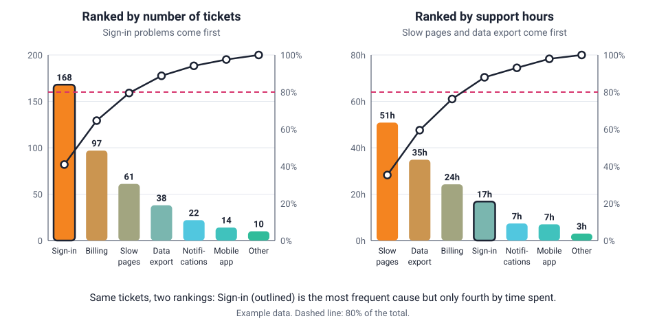

<head>
    <script type="application/ld+json">
        {JSON.stringify({
            "@context": "https://schema.org",
            "@type": "FAQPage",
            "mainEntity": [
                {
                    "@type": "Question",
                    "name": "What is a Pareto chart used for?",
                    "acceptedAnswer": { "@type": "Answer", "text": "A Pareto chart is used to decide which problems or causes to tackle first. It ranks categories such as defect types, complaint reasons or causes of downtime from largest to smallest, and its cumulative line shows how much of the total the top few account for. Quality, operations and support teams use it to focus effort where it has the most effect." }
                },
                {
                    "@type": "Question",
                    "name": "What is the 80/20 rule in a Pareto chart?",
                    "acceptedAnswer": { "@type": "Answer", "text": "The 80/20 rule, or Pareto principle, says that a small share of causes often produces most of an effect, for example 20% of causes giving 80% of the problems. On a Pareto chart, the categories up to the point where the cumulative line reaches about 80% are the vital few. The split is a rule of thumb: real data might be 70/30 or 90/10." }
                },
                {
                    "@type": "Question",
                    "name": "How do you interpret a Pareto chart?",
                    "acceptedAnswer": { "@type": "Answer", "text": "Read the bars from left to right: the tallest bar is the biggest category. Then follow the cumulative line against the right-hand axis to see what share of the total the first few bars account for. Where the line reaches about 80%, the bars up to that point are the few categories worth fixing first. A line that rises steeply then flattens means a few causes dominate." }
                },
                {
                    "@type": "Question",
                    "name": "What is the difference between a Pareto chart and a histogram?",
                    "acceptedAnswer": { "@type": "Answer", "text": "A Pareto chart shows categories, such as types of defect, sorted from largest to smallest, with a cumulative percentage line. A histogram shows how a numeric measurement is distributed across ranges of values, and its bars must stay in numeric order, so they can't be sorted by height." }
                },
                {
                    "@type": "Question",
                    "name": "Is a Pareto chart the same as a bar chart?",
                    "acceptedAnswer": { "@type": "Answer", "text": "A Pareto chart is a special kind of bar chart. Its bars are always sorted from largest to smallest, with any catch-all Other category last, and it adds a cumulative percentage line on a second axis. An ordinary bar chart can use any order and has no cumulative line." }
                },
                {
                    "@type": "Question",
                    "name": "How do I make a Pareto chart in JavaScript?",
                    "acceptedAnswer": { "@type": "Answer", "text": "With SciChart.js, sort your categories from largest to smallest and work out the cumulative percentages. Add a FastColumnRenderableSeries for the counts on the left y-axis, then a second NumericAxis on the right from 0 to 100% and a FastLineRenderableSeries for the cumulative percentages, linked to it with yAxisId. A HorizontalLineAnnotation draws the 80% line. The same chart works in React with scichart-react and in Angular with scichart-angular." }
                }
            ]
        })}
    </script>
</head>

# Pareto Chart

## What is a Pareto chart?

A **Pareto chart** (also called a Pareto diagram) is a bar chart with its bars sorted from largest to smallest, plus a line showing the running total as a percentage. The bars show how often each cause or category occurs. The line shows how much of the total the first few causes make up: the ones to fix first.


*A Pareto chart of one quarter's support tickets, counted by cause (sample data). [Try the interactive version](#how-to-create-a-pareto-chart-in-javascript-react-or-angular).*

:::tip Key takeaways
- A Pareto chart **ranks categories from largest to smallest** and adds a **cumulative percentage line** on a second, right-hand axis.
- It answers one question: **which few causes make up most of the problem?**
- The categories up to where the line reaches about **80%** are the **vital few**: fix those first.
- The **80/20 rule** is a rule of thumb, not a law. Your data might split 70/30 or 90/10.
- Ranking by **count** and ranking by **cost** can give different priorities. Choose the measure that matches your goal.
:::

## How to read a Pareto chart


1. **Check what is being counted.** The left axis is usually a count (defects, complaints, failures) but can be a cost, time or another measure. Note the period the data covers.
2. **Read the bars from left to right.** The tallest bar, on the left, is the largest category. Each bar to its right is smaller. A catch-all **Other** bar goes last, whatever its size.
3. **Follow the cumulative line.** Each point shows the share of the total from that bar plus every bar to its left, read against the **right-hand axis**, which runs from 0% to 100%. The last point always reaches 100%.
4. **Find the cut-off.** Where the line reaches the **80% reference line**, the bars up to that point are the **vital few**. In the diagram, causes A, B and C add up to 82% of the total.
5. **Look at the shape of the line.** A line that climbs steeply and then flattens means a few causes dominate. A line that rises at a steady slope, close to a straight diagonal, means the problem is spread evenly and there is no obvious place to start.

## The 80/20 rule (Pareto principle)

The chart is named after the **Pareto principle**, often called the **80/20 rule**: for many outcomes, a small share of the causes produces most of the effect. In quality work it's often put as "about 80% of the problems come from about 20% of the causes".

The name comes from **Joseph M. Juran**, a pioneer of quality management, who applied the idea to quality problems and credited it to the Italian economist **Vilfredo Pareto**. Pareto had noticed that a small share of Italy's population owned most of its land. Juran called the few large causes the **vital few** and the rest the **useful many**: still worth fixing, just later.

Treat 80/20 as a rough guide:

- **The numbers vary.** Real data might split 70/30, 90/10 or 60/40.
- **The two numbers don't have to add up to 100.** One is a share of causes and the other a share of the effect. In the chart at the top of this page, 3 of the 7 causes (43%) give 79.5% of the tickets.
- **Some data has no vital few.** If the line is close to straight, a Pareto chart has done its job: it tells you there is no single place to focus.

## How to make a Pareto chart: a worked example

You can draw a Pareto chart from any list of categories with a count or cost for each. Here are the steps, using the support tickets from the chart at the top of the page:

1. **Choose the categories and the measure.** Here: the cause of each support ticket, counted over one quarter.
2. **Collect the data for a fixed period,** so every category is measured the same way.
3. **Sort the categories from largest to smallest.** Group small, rare categories into one **Other** bar and put it last.
4. **Work out each category's share of the total** (its count divided by the grand total).
5. **Add up the shares as you go down the list.** This running total is the **cumulative percentage**.
6. **Draw the bars** against a left axis, and **the cumulative line** against a right axis from 0% to 100%. Add a reference line at 80%.

| Cause | Tickets | Share of total | Cumulative % |
| --- | --- | --- | --- |
| Sign-in | 168 | 41.0% | 41.0% |
| Billing | 97 | 23.7% | 64.6% |
| Slow pages | 61 | 14.9% | 79.5% |
| Data export | 38 | 9.3% | 88.8% |
| Notifications | 22 | 5.4% | 94.1% |
| Mobile app | 14 | 3.4% | 97.6% |
| Other | 10 | 2.4% | 100.0% |
| **Total** | **410** | **100%** | |

The cumulative column is worked out from the running count (168, then 168 + 97 = 265, and so on) divided by 410, so it doesn't drift from rounding.

### How to describe a Pareto chart

Use this template when you report a Pareto chart:

> The top **[number]** of **[total number]** causes (**[list them]**) account for **[cumulative %]** of **[what was measured]** in **[period]**.

**Worked example:** "The top three of seven causes (sign-in, billing and slow pages) account for 79.5% of the 410 support tickets logged this quarter. Sign-in problems alone make up 41%."

## Pareto chart by count or by cost?

A Pareto chart ranks categories by whatever you measure, and **the ranking changes with the measure**. A cause that happens often but is quick to fix can matter less than a rarer cause that is slow or expensive. Ranking by cost, time or severity instead of count is sometimes called a **weighted Pareto chart**.



Suppose a sign-in ticket takes about 6 minutes to resolve and a slow-page ticket about 50 (illustrative figures):

- **By count,** sign-in problems are the biggest category, at 41% of tickets.
- **By support hours,** slow pages and data export come first. Together they are about 24% of tickets but about 59% of the time spent. Sign-in drops to fourth.

Neither chart is wrong. Pick the measure that matches the goal: count for the problems customers see most often, time or cost for where the effort or money goes. If you're unsure, draw both.

## When to use a Pareto chart

Use a Pareto chart when you have **counts or costs for a set of categories** and need to decide **which to work on first**. Typical uses:

- **quality control:** which defect types cause most of the scrap or rework;
- **customer support:** which complaint or ticket types take most of the team's time;
- **maintenance and operations:** which faults cause most of the downtime;
- **checking an improvement:** draw the chart again after a fix, with the same categories, and compare the totals and the order of the bars.

| Chart | Best for |
| --- | --- |
| **Pareto chart** | Ranking categories to find the few that make up most of a total |
| [Bar chart](/learn/bar-chart/) | Comparing values across categories in any order, such as by date, region or name |
| [Histogram](/learn/histogram/) | How a numeric measurement is spread across ranges of values; the bars stay in number order |
| [Pie chart](/learn/pie-chart/) | Showing how a total splits into a few parts, without a ranking or a cumulative total |

## Common Pareto chart mistakes

- **Not sorting the bars.** Unsorted bars hide the ranking, and the cumulative line no longer rises steeply then flattens. Sort from largest to smallest every time the data changes.
- **A large "Other" bar.** "Other" goes last whatever its size. If it ends up as one of the biggest bars, it is hiding causes: split it into real categories.
- **Counting when cost matters.** The most frequent problem isn't always the most expensive one. See [Pareto chart by count or by cost?](#pareto-chart-by-count-or-by-cost) above.
- **Treating 80/20 as exact.** Don't force the cut-off to fall at 80%. Report the split your data actually shows.
- **Too few data points.** With only a few dozen events, the order of similar-sized bars can be down to chance. Collect enough data before ranking causes that are close.
- **Mixing periods or sources.** Count every category over the same period and from the same source, or the ranking compares unlike things.
- **A right-hand axis that doesn't run from 0% to 100%.** The cumulative line is only easy to read against a fixed percentage scale.

## How to create a Pareto chart in JavaScript, React or Angular

SciChart.js has no separate Pareto series: you combine a column series and a line series on one chart, each with its own y-axis. Because SciChart.js draws with WebGL and WebGPU, the chart stays smooth to zoom and pan as your data grows or updates live. Try the chart below: scroll to zoom, drag to pan, double-click to reset, and hover over a column to see its count and cumulative percentage.

<LiveDocSnippet maxWidth={'100%'} name="./Basic/demo" />

<LearnCta position="top" chart="Pareto chart" demo="column-chart" docs="/2d-charts/axis-api/multi-axis-and-layout/secondary-and-multiple-axis-overview/" />

Here is the code for this chart:

<CodeSnippetBlock labels={["JavaScript", "React", "Angular"]}>
    ```ts showLineNumbers file=./Basic/demo.ts start=#region_A_start end=#region_A_end
    ```

    ```tsx
    import { SciChartReact } from "scichart-react";
    import {
        SciChartSurface,
        NumericAxis,
        FastColumnRenderableSeries,
        FastLineRenderableSeries,
        XyDataSeries,
        EllipsePointMarker,
        HorizontalLineAnnotation,
        TextLabelProvider,
        EAxisAlignment,
        EAutoRange,
        NumberRange,
        SciChartJsNavyTheme
    } from "scichart";

    // initChart builds the chart; SciChartReact creates it, sizes it and cleans it up
    const initChart = async (rootElement: string | HTMLDivElement) => {
        const { wasmContext, sciChartSurface } = await SciChartSurface.create(rootElement, {
            theme: new SciChartJsNavyTheme()
        });

        // Categories and counts, already sorted from largest to smallest
        const { categories, counts } = getYourParetoData();
        const total = counts.reduce((sum, value) => sum + value, 0);
        let runningTotal = 0;
        const cumulativePercent = counts.map((value) => ((runningTotal += value) / total) * 100);
        const xValues = categories.map((_, index) => index);

        sciChartSurface.xAxes.add(
            new NumericAxis(wasmContext, {
                labelProvider: new TextLabelProvider({ labels: categories }),
                autoTicks: false,
                majorDelta: 1,
                growBy: new NumberRange(0.2, 0.05)
            })
        );
        sciChartSurface.yAxes.add(
            new NumericAxis(wasmContext, { axisTitle: "Count", growBy: new NumberRange(0, 0.15) })
        );
        sciChartSurface.yAxes.add(
            new NumericAxis(wasmContext, {
                id: "percentAxis",
                axisAlignment: EAxisAlignment.Right,
                autoRange: EAutoRange.Never,
                visibleRange: new NumberRange(0, 104),
                labelPostfix: "%"
            })
        );

        sciChartSurface.renderableSeries.add(
            new FastColumnRenderableSeries(wasmContext, {
                dataSeries: new XyDataSeries(wasmContext, { xValues, yValues: counts }),
                fill: "#50C7E0",
                dataPointWidth: 0.7,
                cornerRadius: 8
            }),
            new FastLineRenderableSeries(wasmContext, {
                yAxisId: "percentAxis",
                dataSeries: new XyDataSeries(wasmContext, { xValues, yValues: cumulativePercent }),
                stroke: "#FFFFFF",
                strokeThickness: 3,
                pointMarker: new EllipsePointMarker(wasmContext, { width: 12, height: 12, fill: "#E8336D" })
            })
        );
        sciChartSurface.annotations.add(
            new HorizontalLineAnnotation({ yAxisId: "percentAxis", y1: 80, stroke: "#E8336D", strokeDashArray: [8, 5] })
        );
        return { sciChartSurface };
    };

    export const ParetoChart = () => (
        <SciChartReact initChart={initChart} style={{ width: "100%", height: 400 }} />
    );
    ```

    ```ts
    import { Component } from "@angular/core";
    import { ScichartAngularComponent } from "scichart-angular";
    import {
        SciChartSurface,
        NumericAxis,
        FastColumnRenderableSeries,
        FastLineRenderableSeries,
        XyDataSeries,
        EllipsePointMarker,
        HorizontalLineAnnotation,
        TextLabelProvider,
        EAxisAlignment,
        EAutoRange,
        NumberRange,
        SciChartJsNavyTheme
    } from "scichart";

    @Component({
        selector: "app-pareto-chart",
        standalone: true,
        imports: [ScichartAngularComponent],
        template: `<scichart-angular [initChart]="initChart" style="display: block; width: 100%; height: 400px"></scichart-angular>`
    })
    export class ParetoChartComponent {
        // initChart builds the chart; scichart-angular creates it, sizes it and cleans it up
        initChart = async (rootElement: string | HTMLDivElement) => {
            const { wasmContext, sciChartSurface } = await SciChartSurface.create(rootElement, {
                theme: new SciChartJsNavyTheme()
            });

            // Categories and counts, already sorted from largest to smallest
            const { categories, counts } = getYourParetoData();
            const total = counts.reduce((sum, value) => sum + value, 0);
            let runningTotal = 0;
            const cumulativePercent = counts.map((value) => ((runningTotal += value) / total) * 100);
            const xValues = categories.map((_, index) => index);

            sciChartSurface.xAxes.add(
                new NumericAxis(wasmContext, {
                    labelProvider: new TextLabelProvider({ labels: categories }),
                    autoTicks: false,
                    majorDelta: 1,
                    growBy: new NumberRange(0.2, 0.05)
                })
            );
            sciChartSurface.yAxes.add(
                new NumericAxis(wasmContext, { axisTitle: "Count", growBy: new NumberRange(0, 0.15) })
            );
            sciChartSurface.yAxes.add(
                new NumericAxis(wasmContext, {
                    id: "percentAxis",
                    axisAlignment: EAxisAlignment.Right,
                    autoRange: EAutoRange.Never,
                    visibleRange: new NumberRange(0, 104),
                    labelPostfix: "%"
                })
            );

            sciChartSurface.renderableSeries.add(
                new FastColumnRenderableSeries(wasmContext, {
                    dataSeries: new XyDataSeries(wasmContext, { xValues, yValues: counts }),
                    fill: "#50C7E0",
                    dataPointWidth: 0.7,
                    cornerRadius: 8
                }),
                new FastLineRenderableSeries(wasmContext, {
                    yAxisId: "percentAxis",
                    dataSeries: new XyDataSeries(wasmContext, { xValues, yValues: cumulativePercent }),
                    stroke: "#FFFFFF",
                    strokeThickness: 3,
                    pointMarker: new EllipsePointMarker(wasmContext, { width: 12, height: 12, fill: "#E8336D" })
                })
            );
            sciChartSurface.annotations.add(
                new HorizontalLineAnnotation({ yAxisId: "percentAxis", y1: 80, stroke: "#E8336D", strokeDashArray: [8, 5] })
            );
            return { sciChartSurface };
        };
    }
    ```
</CodeSnippetBlock>

Key points:

- Sort the data and work out the cumulative percentages **before** you chart them. The chart draws what it's given, so the ranking is your code's job.
- A [FastColumnRenderableSeries](https://www.scichart.com/documentation/js/current/typedoc/classes/fastcolumnrenderableseries.html) draws the counts against the default (left) y-axis. A [TextLabelProvider](https://www.scichart.com/documentation/js/current/typedoc/classes/textlabelprovider.html) shows a category name at each x value (0, 1, 2, …).
- The cumulative line is a [FastLineRenderableSeries](/2d-charts/chart-types/fast-line-renderable-series/) on a second `NumericAxis` with `axisAlignment: EAxisAlignment.Right`. Give that axis an `id` and set the same value as the series' `yAxisId`. `autoRange: EAutoRange.Never` with a fixed `visibleRange` keeps it at 0% to 100%. See [secondary and multiple axes](/2d-charts/axis-api/multi-axis-and-layout/secondary-and-multiple-axis-overview/).
- A [HorizontalLineAnnotation](/2d-charts/annotations-api/horizontal-line-annotation/) with `yAxisId` set to the percentage axis draws the 80% reference line.

**See it in the demo app:** [JavaScript column chart](https://www.scichart.com/demo/javascript/column-chart) · [React column chart](https://www.scichart.com/demo/react/column-chart) · [Angular column chart](https://www.scichart.com/demo/angular/column-chart)

**Two y-axes on one chart:** [JavaScript chart with a secondary y-axis](https://www.scichart.com/demo/javascript/chart-with-secondary-y-axis) · [React chart with a secondary y-axis](https://www.scichart.com/demo/react/chart-with-secondary-y-axis) · [Angular chart with a secondary y-axis](https://www.scichart.com/demo/angular/chart-with-secondary-y-axis)

**Go deeper:** [SciChart.js secondary and multiple axes documentation](/2d-charts/axis-api/multi-axis-and-layout/secondary-and-multiple-axis-overview/), and the [SciChart.js column chart documentation](/2d-charts/chart-types/fast-column-renderable-series/column-series-type/), including data labels and colouring individual columns.

## Frequently asked questions

### What is a Pareto chart used for?

A Pareto chart is used to decide which problems or causes to tackle first. It ranks categories such as defect types, complaint reasons or causes of downtime from largest to smallest, and its cumulative line shows how much of the total the top few account for. Quality, operations and support teams use it to focus effort where it has the most effect.

### What is the 80/20 rule in a Pareto chart?

The 80/20 rule, or Pareto principle, says that a small share of causes often produces most of an effect, for example 20% of causes giving 80% of the problems. On a Pareto chart, the categories up to the point where the cumulative line reaches about 80% are the vital few. The split is a rule of thumb: real data might be 70/30 or 90/10.

### How do you interpret a Pareto chart?

Read the bars from left to right: the tallest bar is the biggest category. Then follow the cumulative line against the right-hand axis to see what share of the total the first few bars account for. Where the line reaches about 80%, the bars up to that point are the few categories worth fixing first. A line that rises steeply then flattens means a few causes dominate.

### What is the difference between a Pareto chart and a histogram?

A Pareto chart shows categories, such as types of defect, sorted from largest to smallest, with a cumulative percentage line. A histogram shows how a numeric measurement is distributed across ranges of values, and its bars must stay in numeric order, so they can't be sorted by height.

### Is a Pareto chart the same as a bar chart?

A Pareto chart is a special kind of bar chart. Its bars are always sorted from largest to smallest, with any catch-all Other category last, and it adds a cumulative percentage line on a second axis. An ordinary bar chart can use any order and has no cumulative line.

### How do I make a Pareto chart in JavaScript?

With SciChart.js, sort your categories from largest to smallest and work out the cumulative percentages. Add a `FastColumnRenderableSeries` for the counts on the left y-axis, then a second `NumericAxis` on the right from 0 to 100% and a `FastLineRenderableSeries` for the cumulative percentages, linked to it with `yAxisId`. A `HorizontalLineAnnotation` draws the 80% line. The same chart works in React with `scichart-react` and in Angular with `scichart-angular`.

## Sources

- ASQ, [Seven Basic Quality Tools](https://asq.org/quality-resources/seven-basic-quality-tools). The Pareto chart as one of the classic quality-control tools.
- Juran Institute, [A Guide to the Pareto Principle (80/20 Rule) & Pareto Analysis](https://www.juran.com/blog/a-guide-to-the-pareto-principle-80-20-rule-pareto-analysis/). Juran's naming of the principle after Vilfredo Pareto, and the "vital few" and "useful many".
- Wilkinson, L. (2006), [Revising the Pareto chart](https://doi.org/10.1198/000313006X152243). *The American Statistician*, 60(4), 332–334. Why the order of similar bars can be down to chance, and how to show that uncertainty.

<LearnCta position="bottom" chart="Pareto chart" demo="column-chart" docs="/2d-charts/axis-api/multi-axis-and-layout/secondary-and-multiple-axis-overview/" />
