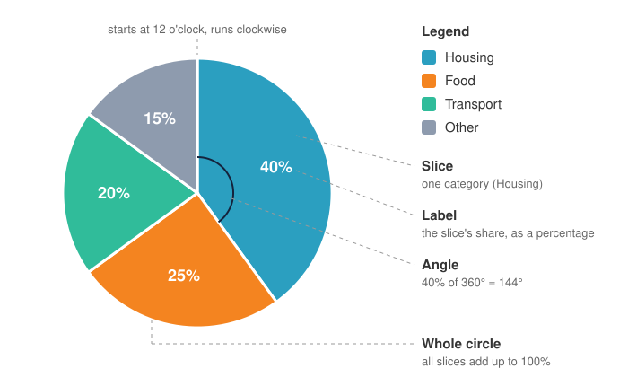

<head>
    <script type="application/ld+json">
        {JSON.stringify({
            "@context": "https://schema.org",
            "@type": "FAQPage",
            "mainEntity": [
                {
                    "@type": "Question",
                    "name": "What is a pie chart?",
                    "acceptedAnswer": { "@type": "Answer", "text": "A pie chart is a circle divided into slices, where each slice shows one category's share of a whole. The slices add up to 100%, and the bigger a category's share, the bigger its slice." }
                },
                {
                    "@type": "Question",
                    "name": "What is a pie chart used for?",
                    "acceptedAnswer": { "@type": "Answer", "text": "A pie chart shows how one total is split into parts: a budget by category, survey answers, or sales by region. It works best when there are only a few parts and the main message is how big one part is compared with the whole." }
                },
                {
                    "@type": "Question",
                    "name": "How many slices should a pie chart have?",
                    "acceptedAnswer": { "@type": "Answer", "text": "As few as possible. A common rule of thumb is no more than five or six. With more, the slices get thin and hard to compare; group the smallest categories into an \"Other\" slice, or use a bar chart instead." }
                },
                {
                    "@type": "Question",
                    "name": "Should I use a 3D pie chart?",
                    "acceptedAnswer": { "@type": "Answer", "text": "Usually not. Tilting the pie in 3D distorts the angles and areas, so slices at the front look bigger than slices of the same size at the back. A flat pie chart shows the same data accurately." }
                },
                {
                    "@type": "Question",
                    "name": "What is the difference between a pie chart and a donut chart?",
                    "acceptedAnswer": { "@type": "Answer", "text": "A donut chart is a pie chart with a hole in the middle. It shows the same parts of a whole, but you read each part by the length of its arc instead of the angle of its slice, and the centre can hold a total or a label." }
                },
                {
                    "@type": "Question",
                    "name": "How do I make a pie chart in JavaScript?",
                    "acceptedAnswer": { "@type": "Answer", "text": "With SciChart.js, create a SciChartPieSurface with pieType set to EPieType.Pie, then add one PieSegment per slice with its value, text and colour. SciChart works out each slice's percentage. The same chart works in React with scichart-react and in Angular with scichart-angular." }
                }
            ]
        })}
    </script>
</head>

# Pie Chart

:::info Looking for the SciChart.js API?
See the [SciChart.js pie chart documentation](/2d-charts/chart-types/pie-chart-type/) for `SciChartPieSurface`, `PieSegment`, label formatting and animated updates.
:::

A **pie chart** is a circle divided into **slices**, where each slice shows one category's **share of a whole**. All the slices add up to **100%**, and each slice's **angle** (and so its area) is proportional to its share. Pie charts are used for budgets, survey results and market share, wherever the question is "what fraction of the total is this?"

Try the interactive chart below. Click a slice, or tick it in the legend, to pull it out from the pie.

<LiveDocSnippet maxWidth={'100%'} name="./Basic/demo" />

<LearnCta position="top" chart="pie chart" demo="pie-chart" docs="/2d-charts/chart-types/pie-chart-type/" />

## How to read a pie chart



- **The whole circle** is the total: 100% of the budget, the votes or the sales.
- **Each slice** is one category. The legend, or a label on the slice, tells you which.
- **The size of a slice** shows its share. A slice's angle is its share of 360°, so a 40% slice spans 144° and a 25% slice is a quarter of the circle.
- **The labels** give the exact percentages. Without them, readers can only estimate, and people are poor at judging angles that aren't close to a quarter or a half.
- **Order matters.** Most pie charts start at 12 o'clock and run clockwise, largest slice first, so the eye reads the biggest share first.

### Good practice for pie charts

- **Keep to a few slices.** A common rule of thumb is no more than five or six. Group the smallest categories into an **"Other"** slice and put it last.
- **Order slices largest first,** starting at 12 o'clock.
- **Label the percentages,** on the slices or next to them, so readers don't have to guess.
- **Use distinct colours,** and a neutral grey for "Other".
- **Make sure the parts really add up to a whole.** If categories overlap (survey questions where people could pick more than one answer), the slices won't sum to 100% and a pie chart is the wrong choice.
- **Avoid 3D.** Tilting the pie distorts angles and areas, so slices at the front look bigger than equal slices at the back.

### Types of pie chart

| Type | What it looks like | Use it when |
| --- | --- | --- |
| Standard pie chart | A full circle split into slices | You have a few parts of one whole |
| [Donut chart](/learn/donut-chart/) | A pie chart with a hole in the middle | You want a total or label in the centre, or a lighter look on a dashboard |
| Exploded pie chart | One or more slices pulled out from the centre | You want to draw attention to one slice (the demo above does this when you click) |
| 3D pie chart | A pie tilted and given depth | Rarely: the perspective distorts the slice sizes |
| Multi-level pie chart ([sunburst](/2d-charts/chart-types/polar-sunburst-chart/)) | Rings of slices, where each outer ring splits the slice inside it | Your data is a hierarchy, such as region, then country |
| Pie of pie, bar of pie | A main pie with one slice broken out into a second, smaller chart | Several tiny slices need a closer look |

## When to use a pie chart

Use a pie chart when you have **one total split into a few parts**, and the main message is **how big one part is compared with the whole** ("housing takes 40% of the budget").

Choose a bar chart when readers need to **compare the parts with each other**, especially when values are close (22% against 25% is hard to see in a pie, easy in bars), when there are **many categories**, or when you need to compare **several totals**, such as this year's budget against last year's.

| Chart | Best for |
| --- | --- |
| **Pie chart** | A few parts of one whole, with one or two dominant shares |
| [Donut chart](/learn/donut-chart/) | The same as a pie chart, with room for a total or label in the centre |
| [Bar chart](/learn/bar-chart/) | Comparing values accurately, many categories, or values that don't add up to a whole |
| [100% stacked column chart](/2d-charts/chart-types/stacked-column-renderable-series/) | Comparing how the split of a whole changes across several groups or periods |

## How to create a pie chart in JavaScript, React or Angular

SciChart.js draws pie and donut charts with the same `SciChartPieSurface`, with animated updates, a built-in legend and selectable slices. Here is the code for the chart above:

<CodeSnippetBlock labels={["JavaScript", "React", "Angular"]}>
    ```ts showLineNumbers file=./Basic/demo.ts start=#region_A_start end=#region_A_end
    ```

    ```tsx
    import { SciChartReact } from "scichart-react";
    import { SciChartPieSurface, EPieType, PieSegment, SciChartJsNavyTheme } from "scichart";

    // initChart builds the chart; SciChartReact creates it, sizes it and cleans it up
    const initChart = async (rootElement: string | HTMLDivElement) => {
        const sciChartPieSurface = await SciChartPieSurface.create(rootElement, {
            theme: new SciChartJsNavyTheme(),
            pieType: EPieType.Pie,
            animate: true
        });
        sciChartPieSurface.labelProvider.getSegmentText = (segment, total) =>
            `${Math.round((100 * segment.value) / total)}%`;
        sciChartPieSurface.legend.showLegend = true;

        // getYourPieData() returns [{ text: "Housing", value: 1200, color: "#50C7E0" }, ...]
        for (const { text, value, color } of getYourPieData()) {
            sciChartPieSurface.pieSegments.add(new PieSegment({ text, value, color }));
        }
        return { sciChartSurface: sciChartPieSurface };
    };

    export const PieChart = () => (
        <SciChartReact initChart={initChart} style={{ width: "100%", height: 400 }} />
    );
    ```

    ```ts
    import { Component } from "@angular/core";
    import { ScichartAngularComponent } from "scichart-angular";
    import { SciChartPieSurface, EPieType, PieSegment, SciChartJsNavyTheme } from "scichart";

    @Component({
        selector: "app-pie-chart",
        standalone: true,
        imports: [ScichartAngularComponent],
        template: `<scichart-angular [initChart]="initChart" style="display: block; width: 100%; height: 400px"></scichart-angular>`
    })
    export class PieChartComponent {
        // initChart builds the chart; scichart-angular creates it, sizes it and cleans it up
        initChart = async (rootElement: string | HTMLDivElement) => {
            const sciChartPieSurface = await SciChartPieSurface.create(rootElement, {
                theme: new SciChartJsNavyTheme(),
                pieType: EPieType.Pie,
                animate: true
            });
            sciChartPieSurface.labelProvider.getSegmentText = (segment, total) =>
                `${Math.round((100 * segment.value) / total)}%`;
            sciChartPieSurface.legend.showLegend = true;

            // getYourPieData() returns [{ text: "Housing", value: 1200, color: "#50C7E0" }, ...]
            for (const { text, value, color } of getYourPieData()) {
                sciChartPieSurface.pieSegments.add(new PieSegment({ text, value, color }));
            }
            return { sciChartSurface: sciChartPieSurface };
        };
    }
    ```
</CodeSnippetBlock>

Key points:

- A [SciChartPieSurface](https://www.scichart.com/documentation/js/current/typedoc/classes/scichartpiesurface.html) is the chart. Pie charts have no axes, so it is a separate surface type from the `SciChartSurface` used for line, bar and other x-y charts. `pieType: EPieType.Pie` draws a full pie.
- Each slice is a [PieSegment](https://www.scichart.com/documentation/js/current/typedoc/classes/piesegment.html) with a `value`, `text` and `color`. You pass raw values (here, pounds); SciChart works out the percentages, and the slices always fill the circle.
- `labelProvider.getSegmentText` sets each slice's label, and the built-in legend names the slices. Clicking a slice toggles its `isSelected` state, which pulls it out from the pie.
- Change a segment's `value` at any time and, with `animate: true`, the pie animates to the new split.

**See it in the demo app:** [JavaScript pie chart](https://www.scichart.com/demo/javascript/pie-chart) · [React pie chart](https://www.scichart.com/demo/react/pie-chart) · [Angular pie chart](https://www.scichart.com/demo/angular/pie-chart)

**Go deeper:** [SciChart.js pie chart documentation](/2d-charts/chart-types/pie-chart-type/), including label formatting, gradient fills and animated updates.

## Frequently asked questions

### What is a pie chart?

A pie chart is a circle divided into slices, where each slice shows one category's share of a whole. The slices add up to 100%, and the bigger a category's share, the bigger its slice.

### What is a pie chart used for?

A pie chart shows how one total is split into parts: a budget by category, survey answers, or sales by region. It works best when there are only a few parts and the main message is how big one part is compared with the whole.

### How many slices should a pie chart have?

As few as possible. A common rule of thumb is no more than five or six. With more, the slices get thin and hard to compare; group the smallest categories into an "Other" slice, or use a [bar chart](/learn/bar-chart/) instead.

### Should I use a 3D pie chart?

Usually not. Tilting the pie in 3D distorts the angles and areas, so slices at the front look bigger than slices of the same size at the back. A flat pie chart shows the same data accurately.

### What is the difference between a pie chart and a donut chart?

A [donut chart](/learn/donut-chart/) is a pie chart with a hole in the middle. It shows the same parts of a whole, but you read each part by the length of its arc instead of the angle of its slice, and the centre can hold a total or a label.

### How do I make a pie chart in JavaScript?

With SciChart.js, create a `SciChartPieSurface` with `pieType` set to `EPieType.Pie`, then add one `PieSegment` per slice with its value, text and colour. SciChart works out each slice's percentage. The same chart works in React with `scichart-react` and in Angular with `scichart-angular`. See the code above.

<LearnCta position="bottom" chart="pie chart" demo="pie-chart" docs="/2d-charts/chart-types/pie-chart-type/" />
