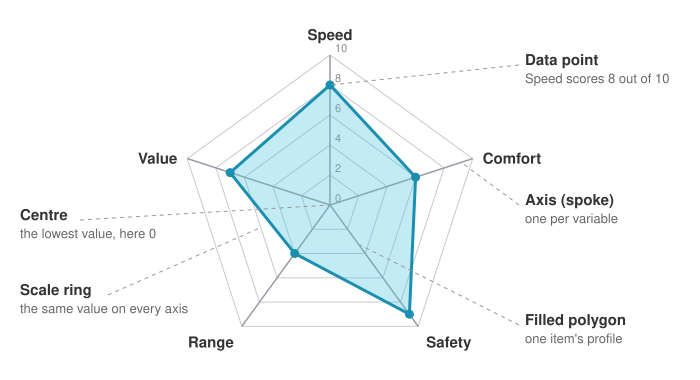

<head>
    <script type="application/ld+json">
        {JSON.stringify({
            "@context": "https://schema.org",
            "@type": "FAQPage",
            "mainEntity": [
                {
                    "@type": "Question",
                    "name": "What is a radar chart used for?",
                    "acceptedAnswer": { "@type": "Answer", "text": "A radar chart compares a few items across several variables measured on the same scale, such as products across features, players across skills or candidates across criteria. Each item becomes a shape, so you can see its strengths and weaknesses, and how it differs from the others, at a glance." }
                },
                {
                    "@type": "Question",
                    "name": "What is the difference between a radar chart and a spider chart?",
                    "acceptedAnswer": { "@type": "Answer", "text": "There is none. Radar chart, spider chart, spider plot, web chart and star plot are all names for the same chart: values on axes that radiate from a centre, joined into a polygon. The name spider chart comes from the web-like look of the axes and scale rings." }
                },
                {
                    "@type": "Question",
                    "name": "How do you read a radar chart?",
                    "acceptedAnswer": { "@type": "Answer", "text": "Each spoke is one variable, with low values at the centre and high values at the edge. Find where an item's shape crosses a spoke to read its value for that variable. Points far from the centre are strengths, points near it are weaknesses, and where two shapes cross between spokes, the items swap places from one variable to the next." }
                },
                {
                    "@type": "Question",
                    "name": "When should you not use a radar chart?",
                    "acceptedAnswer": { "@type": "Answer", "text": "Avoid a radar chart when you have more than three or four items, when the variables use different units or scales, when there is a natural order such as time, or when readers need to compare exact values. A grouped bar chart is usually easier to read in those cases." }
                },
                {
                    "@type": "Question",
                    "name": "How do I make a radar chart in JavaScript?",
                    "acceptedAnswer": { "@type": "Answer", "text": "With SciChart.js, create a SciChartPolarSurface, add a PolarCategoryAxis as the angular axis with one label per variable, and a PolarNumericAxis as the radial axis with gridlineMode set to EPolarGridlineMode.Polygons. Then add a PolarMountainRenderableSeries or PolarLineRenderableSeries for each item, repeating the first point at the end to close the shape. The same chart works in React with scichart-react and in Angular with scichart-angular." }
                }
            ]
        })}
    </script>
</head>

# Radar Chart (Spider Chart)

:::info Looking for the SciChart.js API?
See the [SciChart.js radar chart documentation](/2d-charts/chart-types/polar-radar-chart/) for `SciChartPolarSurface`, polygon gridlines and the polar series used to draw radar charts.
:::

A **radar chart**, also called a **spider chart**, compares items across several variables at once. Each variable gets its own **axis**, radiating from the centre like the spokes of a wheel. An item's value on each axis is plotted as a point, and the points are joined into a **polygon**. The shape shows the item's profile: where it is strong, where it is weak, and how it differs from the others.

Try the interactive chart below. It compares two phones on six features, each scored out of 10. Hover over a spoke to see both scores, scroll to zoom, double-click to reset, and use the legend to show or hide a phone.

<LiveDocSnippet maxWidth={'100%'} name="./Basic/demo" />

<LearnCta position="top" chart="radar chart" demo="polar-radar-chart" docs="/2d-charts/chart-types/polar-radar-chart/" />

## How to read a radar chart



- **Each axis (spoke) is one variable,** such as battery life or price. The variable's name sits at the end of its spoke.
- **The centre is the lowest value** and the outer edge the highest. All axes normally share the same scale.
- **The scale rings** (also called gridlines) join the same value on every axis. They form the web that gives the spider chart its name.
- **Each item is one polygon.** Read a value where the polygon crosses a spoke. Points near the edge are strengths; points near the centre are weaknesses.
- **Compare shapes, not just sizes.** A round, even shape is an all-rounder. A spiky shape is strong in some areas and weak in others. In the chart above, Phone A wins on battery life and value for money; Phone B wins on camera, screen, performance and storage.

## Radar chart pitfalls

Radar charts are popular, but they are easy to misread. Watch for these:

| Pitfall | Why it matters | What to do |
| --- | --- | --- |
| **Axis order changes the shape** | The same data looks different when you reorder the spokes, so a shape can suggest a pattern that isn't there | Group related variables next to each other, and keep the order the same across charts |
| **Area exaggerates differences** | The area of the polygon grows faster than the values: doubling every value quadruples the area, so bigger shapes look more impressive than they are | Compare the values on each spoke, not the overall size of the shapes |
| **Too many items clutter the chart** | Overlapping filled polygons hide each other after three or four items | Show two or three items per chart, use semi-transparent fills, or draw one small chart per item |
| **Mixed scales or directions** | If one axis runs 0 to 10 and another 0 to 1,000, or "higher is better" on one axis and "lower is better" on another, the shape means nothing | Put every variable on the same scale and make higher mean better on every axis (e.g. "value for money", not "price") |
| **Precise values are hard to read** | Each value sits on its own angled axis rather than a shared baseline, so values are harder to compare than bars | Add a tooltip or a table when exact values matter |

## When to use a radar chart

Use a radar chart to **compare a few items across several variables** (roughly 4 to 10) that share a scale: products across features, players across skills, candidates across criteria, or one item against a target profile.

| Chart | Best for |
| --- | --- |
| **Radar chart** | The overall profile of two or three items across several variables on one scale |
| [Bar chart](/learn/bar-chart/) | Comparing exact values, or many items; a grouped bar chart shows the same data as a radar chart and is easier to read precisely |
| [Parallel coordinate plot](/2d-charts/chart-types/parallel-coordinate-plot/) | Many items (dozens or more) across several variables, each with its own scale |
| [Line chart](/learn/line-chart/) | Variables with a natural order, such as time; a radar chart's circular layout would wrongly join the last value to the first |

## How to create a radar chart in JavaScript, React or Angular

SciChart.js draws radar charts on a polar chart surface, with the same WebGL and WebGPU rendering, tooltips and zooming as its other charts. Here is the code for the chart above:

<CodeSnippetBlock labels={["JavaScript", "React", "Angular"]}>
    ```ts showLineNumbers file=./Basic/demo.ts start=#region_A_start end=#region_A_end
    ```

    ```tsx
    import { SciChartReact } from "scichart-react";
    import {
        SciChartPolarSurface,
        PolarCategoryAxis,
        PolarNumericAxis,
        PolarMountainRenderableSeries,
        XyDataSeries,
        NumberRange,
        EPolarAxisMode,
        EPolarGridlineMode,
        SciChartJsNavyTheme
    } from "scichart";

    // initChart builds the chart; SciChartReact creates it, sizes it and cleans it up
    const initChart = async (rootElement: string | HTMLDivElement) => {
        const { wasmContext, sciChartSurface } = await SciChartPolarSurface.create(rootElement, {
            theme: new SciChartJsNavyTheme()
        });

        const { variables, items } = getYourRadarData(); // e.g. ["Speed", ...] and [{ name, scores }]
        sciChartSurface.xAxes.add(
            new PolarCategoryAxis(wasmContext, {
                polarAxisMode: EPolarAxisMode.Angular,
                labels: variables,
                startAngle: Math.PI / 2,
                flippedCoordinates: true
            })
        );
        sciChartSurface.yAxes.add(
            new PolarNumericAxis(wasmContext, {
                polarAxisMode: EPolarAxisMode.Radial,
                gridlineMode: EPolarGridlineMode.Polygons,
                visibleRange: new NumberRange(0, 10),
                startAngle: Math.PI / 2
            })
        );

        for (const item of items) {
            sciChartSurface.renderableSeries.add(
                new PolarMountainRenderableSeries(wasmContext, {
                    dataSeries: new XyDataSeries(wasmContext, {
                        xValues: [...variables.map((_, i) => i), variables.length],
                        yValues: [...item.scores, item.scores[0]], // repeat the first point to close the shape
                        dataSeriesName: item.name
                    }),
                    stroke: "#50C7E0",
                    fill: "#50C7E044",
                    strokeThickness: 3
                })
            );
        }
        return { sciChartSurface };
    };

    export const RadarChart = () => (
        <SciChartReact initChart={initChart} style={{ width: "100%", height: 400 }} />
    );
    ```

    ```ts
    import { Component } from "@angular/core";
    import { ScichartAngularComponent } from "scichart-angular";
    import {
        SciChartPolarSurface,
        PolarCategoryAxis,
        PolarNumericAxis,
        PolarMountainRenderableSeries,
        XyDataSeries,
        NumberRange,
        EPolarAxisMode,
        EPolarGridlineMode,
        SciChartJsNavyTheme
    } from "scichart";

    @Component({
        selector: "app-radar-chart",
        standalone: true,
        imports: [ScichartAngularComponent],
        template: `<scichart-angular [initChart]="initChart" style="display: block; width: 100%; height: 400px"></scichart-angular>`
    })
    export class RadarChartComponent {
        // initChart builds the chart; scichart-angular creates it, sizes it and cleans it up
        initChart = async (rootElement: string | HTMLDivElement) => {
            const { wasmContext, sciChartSurface } = await SciChartPolarSurface.create(rootElement, {
                theme: new SciChartJsNavyTheme()
            });

            const { variables, items } = getYourRadarData(); // e.g. ["Speed", ...] and [{ name, scores }]
            sciChartSurface.xAxes.add(
                new PolarCategoryAxis(wasmContext, {
                    polarAxisMode: EPolarAxisMode.Angular,
                    labels: variables,
                    startAngle: Math.PI / 2,
                    flippedCoordinates: true
                })
            );
            sciChartSurface.yAxes.add(
                new PolarNumericAxis(wasmContext, {
                    polarAxisMode: EPolarAxisMode.Radial,
                    gridlineMode: EPolarGridlineMode.Polygons,
                    visibleRange: new NumberRange(0, 10),
                    startAngle: Math.PI / 2
                })
            );

            for (const item of items) {
                sciChartSurface.renderableSeries.add(
                    new PolarMountainRenderableSeries(wasmContext, {
                        dataSeries: new XyDataSeries(wasmContext, {
                            xValues: [...variables.map((_, i) => i), variables.length],
                            yValues: [...item.scores, item.scores[0]], // repeat the first point to close the shape
                            dataSeriesName: item.name
                        }),
                        stroke: "#50C7E0",
                        fill: "#50C7E044",
                        strokeThickness: 3
                    })
                );
            }
            return { sciChartSurface };
        };
    }
    ```
</CodeSnippetBlock>

Key points:

- A radar chart is a polar chart. [SciChartPolarSurface](https://www.scichart.com/documentation/js/current/typedoc/classes/scichartpolarsurface.html) replaces `SciChartSurface`, with an angular axis around the edge and a radial axis from the centre outwards.
- A [PolarCategoryAxis](https://www.scichart.com/documentation/js/current/typedoc/classes/polarcategoryaxis.html) with `labels` gives one spoke per variable. `startAngle: Math.PI / 2` puts the first spoke at 12 o'clock and `flippedCoordinates: true` runs the spokes clockwise.
- `gridlineMode: EPolarGridlineMode.Polygons` on the radial `PolarNumericAxis` draws straight-sided scale rings: the radar or spider-web look. Without it you get circles.
- Each item is a [PolarMountainRenderableSeries](https://www.scichart.com/documentation/js/current/typedoc/classes/polarmountainrenderableseries.html) (filled) or `PolarLineRenderableSeries` (outline only). Repeat the first value at the end so the polygon closes.
- Polar charts use their own modifiers: `PolarCursorModifier` for the tooltip, `PolarMouseWheelZoomModifier`, `PolarZoomExtentsModifier` and `PolarLegendModifier`.

**See it in the demo app:** [JavaScript radar chart](https://www.scichart.com/demo/javascript/polar-radar-chart) · [React radar chart](https://www.scichart.com/demo/react/polar-radar-chart) · [Angular radar chart](https://www.scichart.com/demo/angular/polar-radar-chart)

**Go deeper:** [SciChart.js radar chart documentation](/2d-charts/chart-types/polar-radar-chart/), and the other polar chart types it builds on, such as [polar line](/2d-charts/chart-types/polar-line-renderable-series/) and [polar mountain](/2d-charts/chart-types/polar-mountain-renderable-series/) series.

## Frequently asked questions

### What is a radar chart used for?

A radar chart compares a few items across several variables measured on the same scale, such as products across features, players across skills or candidates across criteria. Each item becomes a shape, so you can see its strengths and weaknesses, and how it differs from the others, at a glance.

### What is the difference between a radar chart and a spider chart?

There is none. Radar chart, spider chart, spider plot, web chart and star plot are all names for the same chart: values on axes that radiate from a centre, joined into a polygon. The name spider chart comes from the web-like look of the axes and scale rings.

### How do you read a radar chart?

Each spoke is one variable, with low values at the centre and high values at the edge. Find where an item's shape crosses a spoke to read its value for that variable. Points far from the centre are strengths, points near it are weaknesses, and where two shapes cross between spokes, the items swap places from one variable to the next.

### When should you not use a radar chart?

Avoid a radar chart when you have more than three or four items, when the variables use different units or scales, when there is a natural order such as time, or when readers need to compare exact values. A grouped bar chart is usually easier to read in those cases.

### How do I make a radar chart in JavaScript?

With SciChart.js, create a `SciChartPolarSurface`, add a `PolarCategoryAxis` as the angular axis with one label per variable, and a `PolarNumericAxis` as the radial axis with `gridlineMode` set to `EPolarGridlineMode.Polygons`. Then add a `PolarMountainRenderableSeries` or `PolarLineRenderableSeries` for each item, repeating the first point at the end to close the shape. The same chart works in React with `scichart-react` and in Angular with `scichart-angular`. See the code above.

<LearnCta position="bottom" chart="radar chart" demo="polar-radar-chart" docs="/2d-charts/chart-types/polar-radar-chart/" />
