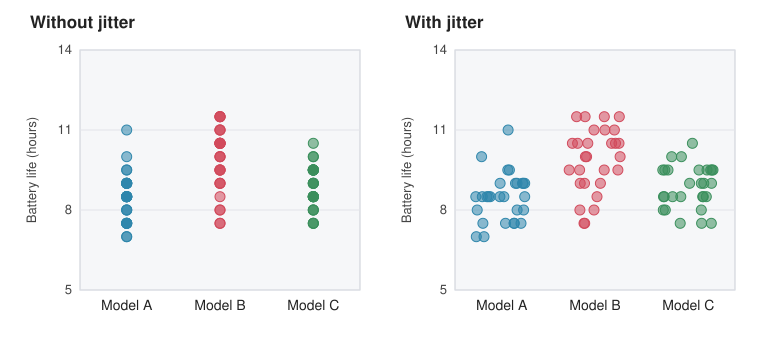

<head>
    <script type="application/ld+json">
        {JSON.stringify({
            "@context": "https://schema.org",
            "@type": "FAQPage",
            "mainEntity": [
                {
                    "@type": "Question",
                    "name": "What is a strip chart used for?",
                    "acceptedAnswer": { "@type": "Answer", "text": "A strip chart is used to watch measurements as they happen and see how they have changed over the last few seconds, minutes or hours. Typical uses are patient monitors (ECG, blood pressure, breathing), process control in plants, lab instruments, vehicle and machine telemetry, and server or network monitoring." }
                },
                {
                    "@type": "Question",
                    "name": "What is a strip chart recorder?",
                    "acceptedAnswer": { "@type": "Answer", "text": "A strip chart recorder is an instrument that draws a measurement onto a long strip of paper with a pen, while a motor pulls the paper past the pen at a steady speed. The distance along the paper is time, and the pen's position across it is the value. Most have now been replaced by data loggers and on-screen strip charts." }
                },
                {
                    "@type": "Question",
                    "name": "What is the difference between a strip chart and a strip plot?",
                    "acceptedAnswer": { "@type": "Answer", "text": "In engineering and monitoring, a strip chart is a live line chart of readings over a moving time window. In statistics, a strip plot (which R's stripchart function also calls a strip chart) is a one-axis dot plot that shows every value in a group as a dot, often spread sideways with jitter. The first shows change over time; the second shows how values are distributed." }
                },
                {
                    "@type": "Question",
                    "name": "What is the difference between a scrolling and a sweeping strip chart?",
                    "acceptedAnswer": { "@type": "Answer", "text": "In a scrolling strip chart the whole trace moves left and the newest reading is always at the right-hand edge. In a sweeping strip chart the trace stays still: a write point moves from left to right, overwriting the previous sweep, then jumps back to the left. Sweeping is easier to read for repeating signals such as heartbeats." }
                },
                {
                    "@type": "Question",
                    "name": "How wide should a strip chart's time window be?",
                    "acceptedAnswer": { "@type": "Answer", "text": "Wide enough to show several cycles of the pattern you care about, and narrow enough to show its detail. A few seconds suits heartbeats or vibration; minutes suit temperatures and pressures; hours suit slow trends. Many strip charts let you change the window, the on-screen version of a paper recorder's chart speed." }
                },
                {
                    "@type": "Question",
                    "name": "How do I make a strip chart in JavaScript?",
                    "acceptedAnswer": { "@type": "Answer", "text": "With SciChart.js, add a FastLineRenderableSeries for each signal, with an XyDataSeries whose fifoCapacity is the number of points in the time window. Append new readings with appendRange and move the x-axis visibleRange to follow them. Set fifoSweeping to true for a sweeping display. For React, wrap it with scichart-react; for Angular, with scichart-angular." }
                }
            ]
        })}
    </script>
</head>

# Strip Chart

## What is a strip chart?

A **strip chart** (also called a scrolling chart, rolling chart or chart recorder display) is a line chart of live readings over a moving window of recent time. New readings appear at one edge as they arrive and the oldest drop off, so the chart always shows the last few seconds, minutes or hours of one or more signals.


*A five-channel strip chart of simulated patient-monitor signals, 1,000 readings a second per channel. [Try the interactive version](#how-to-create-a-strip-chart-in-javascript-react-or-angular), and switch it between scrolling and sweeping.*

In statistics, "strip chart" has a second meaning: a strip plot, a dot plot of individual values along one axis. That is covered [further down](#strip-plot-the-other-strip-chart).

:::tip Key takeaways
- A strip chart shows live data over a fixed time window: new readings come in at one edge and old ones leave at the other.
- The name comes from paper chart recorders, which drew readings with a pen on a moving strip of paper.
- It can scroll (the trace moves, newest at the right) or sweep (the trace stays still and is redrawn from left to right).
- Read it from the "now" edge backwards, giving each lane its own scale, and line up events across lanes.
- A strip plot, the statistical chart that shares the name, shows the distribution of values as dots, not change over time.
:::

## Where the name comes from: the strip chart recorder

Before screens, live measurements were recorded on paper. A **strip chart recorder** has one or more pens that move across a roll of paper while a motor pulls the paper past at a steady speed. Distance along the paper is time, and each pen's position across it is a value. What comes out is a long strip with the history of every signal on it, which is where the name comes from.

- Early examples: Charles Babbage fitted a recorder with about a dozen pens to a railway test carriage he built in 1838 or 1839. In the 1840s the physiologist Carl Ludwig's **kymograph** recorded blood pressure on a turning drum of smoked paper.
- Industry: recorders became standard for temperatures, pressures and flows in plants. Some had a faster second speed, to follow a process closely while it was being adjusted or had gone wrong.
- Medicine: an ECG is usually printed at 25 mm per second (50 mm per second is also used), so each 1 mm square is 40 milliseconds. At that speed, a 10-second window is 250 mm of paper.

Software strip charts copy the same idea onto a screen. The **chart speed** of a paper recorder becomes the **time window** (how many seconds fit across the chart), and the pen becomes the newest point of the trace. Data loggers and on-screen charts have now replaced most paper recorders.

## How to read a strip chart

Read a strip chart backwards from "now": find the newest reading, check how much time the window covers, then read each lane on its own scale and line events up across lanes.


1. Find "now". In a scrolling chart the newest reading is at the right-hand edge. In a sweeping chart it's the moving write point, usually marked by a dot or a gap. Read the chart backwards in time from there.
2. Check the time window. Look at the time axis to see how much history is on screen: 10 seconds and 10 minutes look similar, but mean very different things. A spike that's one pixel wide may last a millisecond or a minute.
3. Read each lane on its own scale. Multi-channel strip charts give each signal its own lane and y-axis, so the lines don't cross. Compare the shape of the lines, not their heights against each other.
4. Look for changes, not just values: a step (a sudden new level), a drift (a slow change), a spike, a change in rhythm, or a flat line, which can mean a disconnected sensor rather than a steady value.
5. Line events up across lanes. A vertical line through every lane is a single moment. In the diagram, pressure jumps, flow drops and temperature starts to climb at the same time, which hints that they are linked.
6. Check limits and markers. Horizontal lines often show alarm limits or a target. Shaded areas or labels may mark events such as an alarm, an operator action or a change of setting.

### How to describe a strip chart

Use this template when reporting what a strip chart shows:

> Over the last [time window], [signal] was [steady / drifting / cycling] around [value], until [time], when it [jumped / dropped / started to rise] to [value], at the same time as [other signal].

For example, using the diagram above: "Over the last 60 seconds, flow was steady at about 30 L/min until 17 seconds ago, when it dropped to about 20 L/min. At the same moment pressure jumped for about 7 seconds and temperature started to rise. Temperature is now just under its high alarm limit."

## Scrolling vs sweeping strip charts

A strip chart can move its data in two ways. Both show the same time window; they differ in what moves.


| | Scrolling (rolling) | Sweeping (wrap-around) |
| --- | --- | --- |
| What moves | The whole trace moves left; the newest reading is always at the right-hand edge | The trace stays still; a write point moves left to right, then jumps back to the left |
| Time axis | Labels change continuously (for example, the last 10 seconds up to now) | Fixed (for example, 0 to 10 seconds), restarting at each sweep |
| Old data | Drops off the left-hand edge | Overwritten just ahead of the write point, usually with a small gap |
| Easiest to read | Trends and slow changes; comparing "now" with the recent past | Repeating signals: each beat or cycle stays in the same place long enough to study |
| Typical use | Process control ([HMI and SCADA trends](/learn/applications/hmi-scada/)), server and network monitoring, [telemetry](/learn/applications/telemetry/), trading | Patient monitors (ECG), oscilloscopes, vibration and other fast periodic signals |

A sweeping display is easier on the eye for fast signals, because nothing slides across the screen. A scrolling display is better when you need "now" in the same place and want to compare the latest values with the ones just before.

### How much data a strip chart shows

A software strip chart holds a fixed number of points: the time window multiplied by the sample rate. When a new point arrives the oldest is discarded, a scheme known as **first in, first out (FIFO)**. The numbers grow quickly:

| Signals | Sample rate | Time window | Points on screen |
| --- | --- | --- | --- |
| 1 temperature | 1 per second | 1 hour | 3,600 |
| 5 patient-monitor channels | 1,000 per second | 10 seconds | 50,000 |
| 8 vibration sensors | 10,000 per second | 10 seconds | 800,000 |

The display also has to redraw at the screen's refresh rate, typically 60 times a second or more, while new data keeps arriving. That is why strip charts with many fast channels need a charting library built for real-time data.

## When to use a strip chart

Use a strip chart when readings arrive continuously and people need to see what is happening now in the context of the last few moments. Typical uses:

- medical monitoring: ECG, blood pressure, oxygen saturation and breathing on a bedside monitor;
- process control: temperatures, pressures, flows and levels in plants, labs and food production;
- test and measurement: oscilloscopes, data acquisition systems, vibration and acoustic testing;
- telemetry: vehicles, motorsport, aircraft, satellites and robots;
- IT operations: CPU load, network traffic and response times on servers.

| Chart | Best for |
| --- | --- |
| Strip chart | Live readings over a moving time window, one lane per signal |
| [Line chart](/learn/chart-types/cartesian/line-chart/) | A fixed period of history, such as a day or a year, that doesn't update while you read it |
| [Sparkline](/learn/chart-types/cartesian/sparkline/) | The recent trend of many values at once, small enough to sit in a table row |
| [Gauge chart](/learn/chart-types/radial/gauge-chart/) | The current value only, against its range and limits, when the history doesn't matter |
| [Real-time dashboard](/learn/real-time/real-time-dashboard/) | Several live charts on one page, with synchronised time axes |
| [Spectrogram](/learn/chart-types/cartesian/spectrogram/) | How the frequencies in a fast signal, such as sound or vibration, change over time |

## Strip plot: the other "strip chart"

In statistics, a **strip plot** (also called a strip chart, jitter plot or one-dimensional scatter plot) shows every value in a group as a dot along a single value axis, with one strip of dots per group. R's `stripchart()` function and the seaborn Python library's `stripplot()` make this chart. It has nothing to do with time: it shows how values are distributed.



- **Jitter** moves each dot a small random distance sideways. Without it, equal or rounded values land on top of each other and the plot hides how many there are (left). With it, every value can be seen (right). The sideways position means nothing.
- Best for small samples, up to a few dozen values per group, where a summary alone would hide the detail.
- With more data, dots merge into a block. Use a [box plot](/learn/chart-types/cartesian/box-plot/) to summarise the spread, or a [violin plot](/learn/chart-types/cartesian/violin-plot/) to show its shape. Many analysts draw a strip plot on top of a box plot to show both the summary and the raw values.
- Strip plot vs [scatter plot](/learn/chart-types/cartesian/scatter-plot/): a scatter plot places each dot by two numeric values. A strip plot uses one numeric value and a group.

## Common strip chart mistakes

Most strip chart mistakes make the trace hard to read while it moves, or let the chart do far more work than the screen can show.

- **A y-axis that rescales on every update.** If the axis zooms to fit the data each frame, the trace jumps about and a large change can look small. Give each signal a fixed range that covers its normal values and limits.
- **The wrong time window.** Too short, and slow drifts are invisible; too long, and fast events shrink to a pixel. Let users change it, as paper recorders let operators change chart speed.
- **No way to stop and look.** A chart that keeps moving while someone tries to read it is frustrating. Provide pause, and zoom on paused data.
- **Hiding a lost signal.** A flat line or a gap can mean a disconnected sensor. Show a break in the line rather than joining across missing data, and mark it clearly.
- **Keeping every point forever.** Memory grows until the app slows down. Keep only the time window on screen (FIFO), and store longer history elsewhere.
- **Redrawing for every reading.** At thousands of readings a second, redrawing each time wastes work. Collect readings into batches and draw once per screen refresh.

## How to create a strip chart in JavaScript, React or Angular

The demo streams five channels at 1,000 readings a second each into data series that keep exactly 10 seconds, 10,000 points per channel, and drop the oldest point as each new one arrives (SciChart.js's built-in FIFO mode). Use the buttons to switch between **Scrolling** and **Sweeping**, and to pause. While paused, the mouse wheel zooms in time, dragging pans and a double-click resets; zooming or dragging pauses it for you. Hover to read the values.

<LiveDocSnippet maxWidth={'100%'} height={560} name="./Basic/demo" />

<LearnCta position="top" chart="strip chart" demo="vital-signs-ecg-medical-chart-example" demoLabel="vital signs ECG chart" docs="/2d-charts/chart-types/data-series-api/realtime-updates/" docsLabel="SciChart.js real-time updates documentation" />

Here is the code for this chart:

<CodeSnippetBlock labels={["JavaScript", "React", "Angular"]}>
    ```ts showLineNumbers file=./Basic/demo.ts start=#region_A_start end=#region_A_end
    ```

    ```tsx
    import { SciChartReact } from "scichart-react";
    import {
        SciChartSurface,
        NumericAxis,
        FastLineRenderableSeries,
        XyDataSeries,
        NumberRange,
        EAutoRange,
        EAxisAlignment,
        LeftAlignedOuterVerticallyStackedAxisLayoutStrategy,
        SciChartJsNavyTheme
    } from "scichart";

    const SAMPLE_RATE = 1000; // readings per second, per channel
    const WINDOW = 10; // seconds on screen
    const SWEEP = false; // true for a sweeping display
    const channels = [
        { name: "ECG (mV)", color: "#3BD16F", range: new NumberRange(-0.5, 1.3) },
        { name: "BP (mmHg)", color: "#EF5350", range: new NumberRange(60, 130) }
    ];

    // initChart builds the chart; SciChartReact creates it, sizes it and cleans it up
    const initChart = async (rootElement: string | HTMLDivElement) => {
        const { wasmContext, sciChartSurface } = await SciChartSurface.create(rootElement, {
            theme: new SciChartJsNavyTheme()
        });
        const xAxis = new NumericAxis(wasmContext, { axisTitle: "Time (s)", autoRange: EAutoRange.Never });
        sciChartSurface.xAxes.add(xAxis);
        sciChartSurface.layoutManager.leftOuterAxesLayoutStrategy =
            new LeftAlignedOuterVerticallyStackedAxisLayoutStrategy();

        const dataSeries = channels.map((channel, index) => {
            sciChartSurface.yAxes.add(
                new NumericAxis(wasmContext, {
                    id: `channel${index}`,
                    axisAlignment: EAxisAlignment.Left,
                    axisTitle: channel.name,
                    autoRange: EAutoRange.Never,
                    visibleRange: channel.range
                })
            );
            // fifoCapacity keeps the newest points and discards the oldest
            const series = new XyDataSeries(wasmContext, {
                fifoCapacity: SAMPLE_RATE * WINDOW,
                fifoSweeping: SWEEP
            });
            sciChartSurface.renderableSeries.add(
                new FastLineRenderableSeries(wasmContext, {
                    yAxisId: `channel${index}`,
                    dataSeries: series,
                    stroke: channel.color,
                    strokeThickness: 2
                })
            );
            return series;
        });

        let sampleIndex = 0;
        const timer = setInterval(() => {
            // New readings since the last update: one array per channel, e.g. from a WebSocket
            const readings = getYourNewReadings();
            const count = readings[0].length;
            const xValues = Array.from({ length: count }, (_, i) =>
                SWEEP ? ((sampleIndex + i) % (SAMPLE_RATE * WINDOW)) / SAMPLE_RATE : (sampleIndex + i) / SAMPLE_RATE
            );
            sampleIndex += count;
            dataSeries.forEach((series, channel) => series.appendRange(xValues, readings[channel]));
            const now = sampleIndex / SAMPLE_RATE;
            xAxis.visibleRange = SWEEP ? new NumberRange(0, WINDOW) : new NumberRange(now - WINDOW, now);
        }, 16);
        sciChartSurface.addDeletable({ delete: () => clearInterval(timer) });

        return { sciChartSurface };
    };

    export const StripChart = () => (
        <SciChartReact initChart={initChart} style={{ width: "100%", height: 500 }} />
    );
    ```

    ```ts
    import { Component } from "@angular/core";
    import { ScichartAngularComponent } from "scichart-angular";
    import {
        SciChartSurface,
        NumericAxis,
        FastLineRenderableSeries,
        XyDataSeries,
        NumberRange,
        EAutoRange,
        EAxisAlignment,
        LeftAlignedOuterVerticallyStackedAxisLayoutStrategy,
        SciChartJsNavyTheme
    } from "scichart";

    const SAMPLE_RATE = 1000; // readings per second, per channel
    const WINDOW = 10; // seconds on screen
    const SWEEP = false; // true for a sweeping display
    const channels = [
        { name: "ECG (mV)", color: "#3BD16F", range: new NumberRange(-0.5, 1.3) },
        { name: "BP (mmHg)", color: "#EF5350", range: new NumberRange(60, 130) }
    ];

    @Component({
        selector: "app-strip-chart",
        standalone: true,
        imports: [ScichartAngularComponent],
        template: `<scichart-angular [initChart]="initChart" style="display: block; width: 100%; height: 500px"></scichart-angular>`
    })
    export class StripChartComponent {
        // initChart builds the chart; scichart-angular creates it, sizes it and cleans it up
        initChart = async (rootElement: string | HTMLDivElement) => {
            const { wasmContext, sciChartSurface } = await SciChartSurface.create(rootElement, {
                theme: new SciChartJsNavyTheme()
            });
            const xAxis = new NumericAxis(wasmContext, { axisTitle: "Time (s)", autoRange: EAutoRange.Never });
            sciChartSurface.xAxes.add(xAxis);
            sciChartSurface.layoutManager.leftOuterAxesLayoutStrategy =
                new LeftAlignedOuterVerticallyStackedAxisLayoutStrategy();

            const dataSeries = channels.map((channel, index) => {
                sciChartSurface.yAxes.add(
                    new NumericAxis(wasmContext, {
                        id: `channel${index}`,
                        axisAlignment: EAxisAlignment.Left,
                        axisTitle: channel.name,
                        autoRange: EAutoRange.Never,
                        visibleRange: channel.range
                    })
                );
                // fifoCapacity keeps the newest points and discards the oldest
                const series = new XyDataSeries(wasmContext, {
                    fifoCapacity: SAMPLE_RATE * WINDOW,
                    fifoSweeping: SWEEP
                });
                sciChartSurface.renderableSeries.add(
                    new FastLineRenderableSeries(wasmContext, {
                        yAxisId: `channel${index}`,
                        dataSeries: series,
                        stroke: channel.color,
                        strokeThickness: 2
                    })
                );
                return series;
            });

            let sampleIndex = 0;
            const timer = setInterval(() => {
                // New readings since the last update: one array per channel, e.g. from a WebSocket
                const readings = getYourNewReadings();
                const count = readings[0].length;
                const xValues = Array.from({ length: count }, (_, i) =>
                    SWEEP ? ((sampleIndex + i) % (SAMPLE_RATE * WINDOW)) / SAMPLE_RATE : (sampleIndex + i) / SAMPLE_RATE
                );
                sampleIndex += count;
                dataSeries.forEach((series, channel) => series.appendRange(xValues, readings[channel]));
                const now = sampleIndex / SAMPLE_RATE;
                xAxis.visibleRange = SWEEP ? new NumberRange(0, WINDOW) : new NumberRange(now - WINDOW, now);
            }, 16);
            sciChartSurface.addDeletable({ delete: () => clearInterval(timer) });

            return { sciChartSurface };
        };
    }
    ```
</CodeSnippetBlock>

Key points:

- An [XyDataSeries](https://www.scichart.com/documentation/js/current/typedoc/classes/xydataseries.html) with `fifoCapacity` set keeps only the newest points, as a circular buffer: append new readings with `appendRange()` and the oldest are discarded for you.
- `fifoSweeping: true` turns the same series into a sweeping display. The x-values must wrap back to 0 at the end of each window, and `fifoSweepingGap` sets the gap ahead of the write point.
- For scrolling, set the x-axis `visibleRange` to the last `WINDOW` seconds after each update; for sweeping, keep it fixed.
- `LeftAlignedOuterVerticallyStackedAxisLayoutStrategy` stacks one y-axis per signal, so each channel gets its own lane. Fixed `visibleRange` values stop the lanes rescaling on every frame.

**See it in the demo app:** [JavaScript vital signs ECG chart](https://www.scichart.com/demo/javascript/vital-signs-ecg-medical-chart-example) · [React vital signs ECG chart](https://www.scichart.com/demo/react/vital-signs-ecg-medical-chart-example) · [Angular vital signs ECG chart](https://www.scichart.com/demo/angular/vital-signs-ecg-medical-chart-example), a sweeping multi-channel monitor. For scrolling data, see the [JavaScript real-time line chart](https://www.scichart.com/demo/javascript/chart-realtime-performance-demo) and [zoom and pan a realtime JavaScript chart](https://www.scichart.com/demo/javascript/zoom-pan-realtime-javascript-chart).

**Go deeper:**
- [SciChart.js real-time updates documentation](/2d-charts/chart-types/data-series-api/realtime-updates/): appending, scrolling with `fifoCapacity` and sweeping with `fifoSweeping`, each with a live example.
- Tutorials: [adding real-time updates](/get-started/tutorials-js-npm-webpack/tutorial-04-adding-realtime-updates/) and [zoom and pan with real-time updates](/get-started/tutorials-js-npm-webpack/tutorial-05-zoom-and-pan-with-realtime-updates/).
- On the SciChart blog: [how to implement real-time data visualization in React](https://www.scichart.com/blog/how-to-implement-real-time-data-visualization-in-react/) (streaming over WebSockets and batching updates), and [real-time telemetry for motorsport](https://www.scichart.com/blog/best-realtime-visualization-telemetry-sensors-motorsport/).

## Frequently asked questions

### What is a strip chart used for?

A strip chart is used to watch measurements as they happen and see how they have changed over the last few seconds, minutes or hours. Typical uses are patient monitors (ECG, blood pressure, breathing), process control in plants, lab instruments, vehicle and machine telemetry, and server or network monitoring.

### What is a strip chart recorder?

A strip chart recorder is an instrument that draws a measurement onto a long strip of paper with a pen, while a motor pulls the paper past the pen at a steady speed. The distance along the paper is time, and the pen's position across it is the value. Most have now been replaced by data loggers and on-screen strip charts.

### What is the difference between a strip chart and a strip plot?

In engineering and monitoring, a strip chart is a live line chart of readings over a moving time window. In statistics, a strip plot (which R's stripchart function also calls a strip chart) is a one-axis dot plot that shows every value in a group as a dot, often spread sideways with jitter. The first shows change over time; the second shows how values are distributed.

### What is the difference between a scrolling and a sweeping strip chart?

In a scrolling strip chart the whole trace moves left and the newest reading is always at the right-hand edge. In a sweeping strip chart the trace stays still: a write point moves from left to right, overwriting the previous sweep, then jumps back to the left. Sweeping is easier to read for repeating signals such as heartbeats.

### How wide should a strip chart's time window be?

Wide enough to show several cycles of the pattern you care about, and narrow enough to show its detail. A few seconds suits heartbeats or vibration; minutes suit temperatures and pressures; hours suit slow trends. Many strip charts let you change the window, the on-screen version of a paper recorder's chart speed.

### How do I make a strip chart in JavaScript?

With SciChart.js, add a `FastLineRenderableSeries` for each signal, with an `XyDataSeries` whose `fifoCapacity` is the number of points in the time window. Append new readings with `appendRange` and move the x-axis `visibleRange` to follow them. Set `fifoSweeping` to true for a sweeping display. For React, wrap it with `scichart-react`; for Angular, with `scichart-angular`.

## Sources

- Wikipedia, [Chart recorder](https://en.wikipedia.org/wiki/Chart_recorder). Strip, circular and roll chart recorders, how the paper is driven, and Babbage's multi-pen recorder of 1838–39.
- Wikipedia, [Kymograph](https://en.wikipedia.org/wiki/Kymograph). Carl Ludwig's blood pressure recorder of the 1840s.
- Becker, D. E. (2006), [Fundamentals of Electrocardiography Interpretation](https://pmc.ncbi.nlm.nih.gov/articles/PMC1614214/). *Anesthesia Progress*, 53(2). The standard ECG paper speed of 25 mm per second.
- R Core Team, [stripchart: 1-D Scatter Plots](https://stat.ethz.ch/R-manual/R-devel/library/graphics/html/stripchart.html). The statistical strip chart (strip plot).
- seaborn, [seaborn.stripplot](https://seaborn.pydata.org/generated/seaborn.stripplot.html). Strip plots with jitter in Python.

<LearnCta position="bottom" chart="strip chart" demo="vital-signs-ecg-medical-chart-example" demoLabel="vital signs ECG chart" docs="/2d-charts/chart-types/data-series-api/realtime-updates/" docsLabel="SciChart.js real-time updates documentation" />
