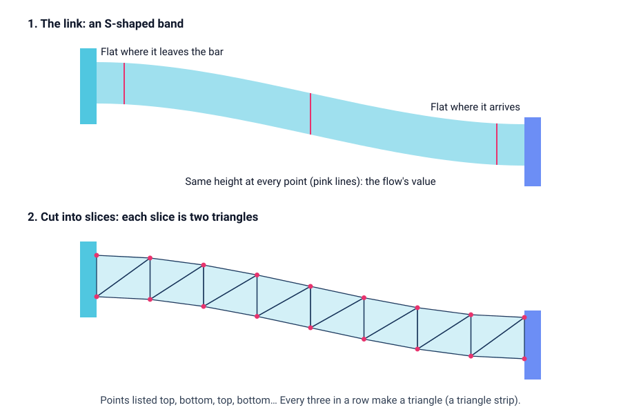

<head>
    <script type="application/ld+json">
        {JSON.stringify({
            "@context": "https://schema.org",
            "@type": "FAQPage",
            "mainEntity": [
                {
                    "@type": "Question",
                    "name": "What is a Sankey diagram used for?",
                    "acceptedAnswer": { "@type": "Answer", "text": "A Sankey diagram is used to show where a total comes from and where it ends up, when something moves through stages. Typical examples are energy from fuels to end uses and losses, a budget from income to spending, materials through a factory, and people through a sign-up or hiring process. It makes the largest flows, and the biggest losses, easy to spot." }
                },
                {
                    "@type": "Question",
                    "name": "What do Sankey diagrams tell us?",
                    "acceptedAnswer": { "@type": "Answer", "text": "A Sankey diagram tells you how a quantity is split and recombined on its way through a system: which sources contribute most, which paths carry the most, and how much reaches each end point. Because each band's width matches its value, you can see at a glance which flows dominate and where a large share is lost." }
                },
                {
                    "@type": "Question",
                    "name": "Why is it called a Sankey diagram?",
                    "acceptedAnswer": { "@type": "Answer", "text": "It is named after Captain Matthew Henry Phineas Riall Sankey, an Irish engineer who in 1898 drew one to show where the heat supplied to a steam engine went, with each band's width matching the amount of energy. Flow drawings with widths in proportion to quantity are older: Charles Minard's 1869 map of Napoleon's march on Moscow is a famous example." }
                },
                {
                    "@type": "Question",
                    "name": "What is the difference between a Sankey diagram and an alluvial diagram?",
                    "acceptedAnswer": { "@type": "Answer", "text": "An alluvial diagram is a kind of Sankey diagram. Its columns are usually the same set of categories measured at different times or by different groupings, and its bands show how items move between categories from one column to the next. A general Sankey diagram has different nodes in each column, such as fuels, then conversion, then end uses, and can show losses leaving the system." }
                },
                {
                    "@type": "Question",
                    "name": "How do I make a Sankey diagram in JavaScript?",
                    "acceptedAnswer": { "@type": "Answer", "text": "Store the data as nodes and links, where each link has a source, a target and a value. A layout step gives each node a column and a height, stacks the links on each node, and turns every link into an S-shaped band. With SciChart.js you draw each band and bar as a FastTriangleRenderableSeries in triangle-strip mode, and use the series' hit-test to add hover highlights and tooltips. The same code works in React with scichart-react and in Angular with scichart-angular." }
                }
            ]
        })}
    </script>
</head>

# Sankey Diagram

## What is a Sankey diagram?

A **Sankey diagram** (also called a Sankey chart or Sankey graph) is a flow diagram that shows how a quantity moves from its sources, through stages, to where it ends up. Each source, stage or end point is a bar called a **node**. Each flow is a band called a **link**, drawn as wide as the amount it carries.


*A Sankey diagram of one year's energy use in an imaginary country, in terawatt-hours (sample data). [Try the interactive version](#how-to-create-a-sankey-diagram-in-javascript-react-or-angular).*

:::tip Key takeaways
- A Sankey diagram shows **where a total comes from and where it goes**, as bands flowing between bars.
- **A band's width is its value,** so the biggest flows are the first thing you see.
- At every middle node, **what flows in equals what flows out**. Anything lost on the way gets its own band and node.
- Use one when something **moves through stages**: energy, money, materials, people. When nothing flows, a bar or pie chart is clearer.
- Keep it readable: **few nodes, few crossings,** and small flows grouped together.
:::

## How to read a Sankey diagram


1. **Check what is flowing.** Find the unit (kilowatt-hours, dollars, tonnes, people) and the period. Every band on the diagram uses the same unit.
2. **Read from left to right.** The left column holds the **sources**. Each column to the right is a later stage, and the right-hand column holds the **end points**. Some end points, such as losses, can sit in a middle column.
3. **Compare the widths of the bands.** A band twice as wide carries twice as much. The height of each node is its total. Use the labels or a tooltip for exact numbers: widths are good for ranking flows, not for reading precise values.
4. **Follow a band from end to end.** Pick a source and trace where its bands go. On an interactive Sankey diagram, hovering over a node or band highlights the whole path.
5. **Check the balance at each middle node.** What flows in should equal what flows out. In the diagram above, node D takes in 15 from A and 15 from B, and sends 5 to E and 25 to F: 30 in, 30 out.
6. **Look at the end points.** They answer the question the diagram was drawn for: how much became useful, how much was spent on each item, how many people finished.

## A worked example: where a country's energy goes

The diagram at the top of this page follows 100 terawatt-hours (TWh) of energy through an imaginary country for one year. The numbers are made up but realistic in shape. Because the total is 100, each value is also a percentage.

| Node | Flows in (TWh) | Flows out (TWh) |
| --- | --- | --- |
| Wind and solar, natural gas, biomass, oil | (sources) | 14 + 48 + 8 + 30 = 100 |
| Electricity | 14 + 22 + 3 + 2 = 41 | 13 to losses, 12 to homes, 13 to industry, 3 to transport = 41 |
| Fuels used directly | 26 + 5 + 28 = 59 | 18 to homes, 14 to industry, 27 to transport = 59 |
| Homes | 12 + 18 = 30 | 21 useful + 9 wasted = 30 |
| Industry | 13 + 14 = 27 | 19 useful + 8 wasted = 27 |
| Transport | 3 + 27 = 30 | 9 useful + 21 wasted = 30 |
| End points | Power station losses 13, useful energy 49, wasted heat 38 | (end) = 100 |

Three things stand out once the flows are drawn:

- **About half the energy does useful work.** 49 of the 100 TWh ends as useful energy; the other 51 TWh is lost as heat.
- **Transport is the least efficient sector.** Only 9 of its 30 TWh does useful work, against 21 of 30 in homes.
- **Making electricity has a cost.** 13 of the 41 TWh that goes into making electricity is lost before it reaches anyone.

The table and the diagram hold the same numbers. The table is better for checking a single value; the diagram shows the structure and the big flows in one look.

### How to describe a Sankey diagram

Use this template when you report a Sankey diagram:

> Of the **[total and unit]** that entered **[the system]** in **[period]**, **[amount or share]** went to **[main destination]**, and **[amount or share]** ended as **[loss or other end point]**. The largest single flow was **[source] to [target]**, at **[value]**.

**Worked example:** "Of the 100 TWh of energy this country used in the year, 49 TWh did useful work and 51 TWh was lost as heat. The largest single flow was fuels used directly into transport, at 27 TWh, and transport turned only 30% of its energy into useful work."

## How does a Sankey diagram work?

A Sankey diagram is drawn in four steps. Most tools do them for you; knowing them helps you fix a diagram that looks wrong.

1. **Give each node a column.** Sources go in the first column. Every other node goes one column to the right of the furthest-right node that feeds it.
2. **Choose one scale for the whole diagram.** A flow of 10 units must be equally wide everywhere. The busiest column sets the scale, so it fills the height with gaps between its nodes.
3. **Stack the links on each node.** The bands leaving a node are stacked down its edge in the order of the nodes they go to, top to bottom. That keeps crossings to a minimum.
4. **Draw each link as an S-shaped band** from its place on the source node to its place on the target node. It leaves and arrives horizontally, and its vertical thickness is the same all the way across.



To put a band on screen, it is cut into thin slices, and each slice is split into two triangles, which is what graphics hardware draws fastest. The more slices, the smoother the curve. The live example on this page draws every band, and every node, this way.

## When to use a Sankey diagram

Use a Sankey diagram when a quantity **moves through stages** and you want to show **how it splits, merges and where it ends up**. Typical uses:

- **energy and materials:** fuels to electricity, end uses and losses; raw material to product, scrap and recycling;
- **money:** income to spending categories, or a company's revenue to costs and profit;
- **people:** visitors through a sign-up process, or applicants through a hiring process, including where they drop out;
- **any process with losses,** where showing what leaves at each stage matters as much as what arrives.

| Chart | Best for |
| --- | --- |
| **Sankey diagram** | How a total flows through stages, splits and merges, with losses shown |
| [Bar chart](/learn/bar-chart/) (stacked) | Comparing totals and their parts across categories, when nothing flows between them |
| [Pie chart](/learn/pie-chart/) | How one total splits into a few parts, at a single stage |
| [Treemap](/2d-charts/chart-types/tree-map-type/) | Parts of a total nested in groups (a hierarchy), with no flow from one stage to the next |

Two close relatives: an **alluvial diagram** is a Sankey diagram whose columns show the same categories at different times, to show how items move between them. A **chord diagram** arranges the groups round a circle, which suits flows that go in both directions between the same groups.

## Common Sankey diagram mistakes

- **Flows that don't balance.** If a middle node takes in more than it sends out, readers can't tell whether something is missing. Show losses, storage or "other" as their own bands and nodes.
- **Too many nodes and hair-thin bands.** A diagram with dozens of tiny links is hard to read. Group the smallest flows into one "Other" link, or split the diagram in two.
- **Too many crossings.** Order the nodes in each column so bands run mostly straight across. Moving one node up or down a column can remove several crossings.
- **Flows that loop back.** A Sankey diagram runs one way, from left to right. If something returns to an earlier stage (recycling, for example), show it as a separate node in a later column rather than a band that runs backwards.
- **Mixed units.** Every band must use the same unit. Don't mix tonnes with dollars, or energy in different units, in one diagram.
- **Colour that means nothing.** Colour bands by their source or by the type of flow, and say which. Random colours make paths harder to follow.
- **Expecting precise comparisons.** Readers rank band widths well but can't read exact values from them. Label the main flows, add tooltips, or give the numbers in a table.

## How to create a Sankey diagram in JavaScript, React or Angular

SciChart.js has no separate Sankey series, but its triangle series can fill any shape, so a short layout helper turns your nodes and links into bars and bands. Because SciChart.js draws with WebGL and WebGPU, the diagram stays smooth to zoom and pan. Try the diagram below: hover over a band or node to highlight its path and see its value, click to keep the highlight, scroll to zoom, drag to pan and double-click to reset.

<LiveDocSnippet maxWidth={'100%'} name="./Basic/demo" />

<LearnCta position="top" chart="Sankey diagram" demo="triangle-series-chart" docs="/2d-charts/chart-types/fast-triangle-renderable-series/" />

Here is the code for this diagram. The data is plain JSON: a list of nodes, and a list of links with a `source`, a `target` and a `value`:

```json
{
    "nodes": [{ "id": "gas", "name": "Natural gas", "color": "#F48420" }, { "id": "electricity", "name": "Electricity", "color": "#50C7E0" }],
    "links": [{ "source": "gas", "target": "electricity", "value": 22 }]
}
```

<CodeSnippetBlock labels={["JavaScript", "React", "Angular"]}>
    ```ts showLineNumbers file=./Basic/demo.ts start=#region_A_start end=#region_A_end
    ```

    ```tsx
    import { SciChartReact } from "scichart-react";
    import {
        SciChartSurface,
        NumericAxis,
        NumberRange,
        MouseWheelZoomModifier,
        ZoomPanModifier,
        ZoomExtentsModifier,
        SciChartJsNavyTheme
    } from "scichart";
    // computeSankeyLayout, addSankeySeries and SankeyHoverModifier from the JavaScript tab, saved as sankey.ts
    import { computeSankeyLayout, addSankeySeries, SankeyHoverModifier } from "./sankey";

    // initChart builds the chart; SciChartReact creates it, sizes it and cleans it up
    const initChart = async (rootElement: string | HTMLDivElement) => {
        const { wasmContext, sciChartSurface } = await SciChartSurface.create(rootElement, {
            theme: new SciChartJsNavyTheme()
        });

        // { nodes: [{ id, name, color }], links: [{ source, target, value }] }
        const layout = computeSankeyLayout(getYourSankeyData(), { width: 1000, height: 600 });

        sciChartSurface.xAxes.add(new NumericAxis(wasmContext, { isVisible: false, growBy: new NumberRange(0.02, 0.02) }));
        sciChartSurface.yAxes.add(new NumericAxis(wasmContext, { isVisible: false, growBy: new NumberRange(0.1, 0.03) }));

        const sankey = addSankeySeries(sciChartSurface, wasmContext, layout, { units: "TWh" });
        sciChartSurface.chartModifiers.add(
            new SankeyHoverModifier(sankey),
            new MouseWheelZoomModifier(),
            new ZoomPanModifier(),
            new ZoomExtentsModifier()
        );
        return { sciChartSurface };
    };

    export const SankeyDiagram = () => (
        <SciChartReact initChart={initChart} style={{ width: "100%", height: 500 }} />
    );
    ```

    ```ts
    import { Component } from "@angular/core";
    import { ScichartAngularComponent } from "scichart-angular";
    import {
        SciChartSurface,
        NumericAxis,
        NumberRange,
        MouseWheelZoomModifier,
        ZoomPanModifier,
        ZoomExtentsModifier,
        SciChartJsNavyTheme
    } from "scichart";
    // computeSankeyLayout, addSankeySeries and SankeyHoverModifier from the JavaScript tab, saved as sankey.ts
    import { computeSankeyLayout, addSankeySeries, SankeyHoverModifier } from "./sankey";

    @Component({
        selector: "app-sankey-diagram",
        standalone: true,
        imports: [ScichartAngularComponent],
        template: `<scichart-angular [initChart]="initChart" style="display: block; width: 100%; height: 500px"></scichart-angular>`
    })
    export class SankeyDiagramComponent {
        // initChart builds the chart; scichart-angular creates it, sizes it and cleans it up
        initChart = async (rootElement: string | HTMLDivElement) => {
            const { wasmContext, sciChartSurface } = await SciChartSurface.create(rootElement, {
                theme: new SciChartJsNavyTheme()
            });

            // { nodes: [{ id, name, color }], links: [{ source, target, value }] }
            const layout = computeSankeyLayout(getYourSankeyData(), { width: 1000, height: 600 });

            sciChartSurface.xAxes.add(new NumericAxis(wasmContext, { isVisible: false, growBy: new NumberRange(0.02, 0.02) }));
            sciChartSurface.yAxes.add(new NumericAxis(wasmContext, { isVisible: false, growBy: new NumberRange(0.1, 0.03) }));

            const sankey = addSankeySeries(sciChartSurface, wasmContext, layout, { units: "TWh" });
            sciChartSurface.chartModifiers.add(
                new SankeyHoverModifier(sankey),
                new MouseWheelZoomModifier(),
                new ZoomPanModifier(),
                new ZoomExtentsModifier()
            );
            return { sciChartSurface };
        };
    }
    ```
</CodeSnippetBlock>

Key points:

- `computeSankeyLayout` is plain JavaScript with no SciChart code, so you can reuse it anywhere. It gives each node a column, sets one scale for the whole diagram, stacks the links on each node, and lists the points of each curved band. It throws an error if the links form a loop.
- Each band and each node bar is a [FastTriangleRenderableSeries](/2d-charts/chart-types/fast-triangle-renderable-series/) with `drawMode: ETriangleSeriesDrawMode.Strip`: the points go top, bottom, top, bottom along the band, and every three in a row make a triangle. One series per shape lets each one have its own colour and opacity.
- Hover and click use the series' [hit-test API](/2d-charts/chart-types/hit-test-api/fast-triangle-renderable-series/): `series.hitTestProvider.hitTest(x, y)` returns `isHit: true` when the mouse is inside one of that series' triangles, so no geometry code of your own is needed. `SankeyHoverModifier` extends `CustomChartModifier2D` ([custom chart modifiers](/2d-charts/chart-modifier-api/custom-modifiers/custom-modifiers-overview/)) to run it on every mouse move.
- Labels and the tooltip are [NativeTextAnnotations](/2d-charts/annotations-api/native-text-annotation/). The axes are hidden, but they still set the drawing area, so zoom and pan work as on any chart.

**See it in the demo app:** [JavaScript triangle series chart](https://www.scichart.com/demo/javascript/triangle-series-chart) · [React triangle series chart](https://www.scichart.com/demo/react/triangle-series-chart) · [Angular triangle series chart](https://www.scichart.com/demo/angular/triangle-series-chart)

**Go deeper:** [SciChart.js triangle series documentation](/2d-charts/chart-types/fast-triangle-renderable-series/), including the strip, list and polygon draw modes, and the [SciChart.js hit-test API documentation](/2d-charts/chart-types/hit-test-api/hit-test-api-overview/).

## Frequently asked questions

### What is a Sankey diagram used for?

A Sankey diagram is used to show where a total comes from and where it ends up, when something moves through stages. Typical examples are energy from fuels to end uses and losses, a budget from income to spending, materials through a factory, and people through a sign-up or hiring process. It makes the largest flows, and the biggest losses, easy to spot.

### What do Sankey diagrams tell us?

A Sankey diagram tells you how a quantity is split and recombined on its way through a system: which sources contribute most, which paths carry the most, and how much reaches each end point. Because each band's width matches its value, you can see at a glance which flows dominate and where a large share is lost.

### Why is it called a Sankey diagram?

It is named after Captain Matthew Henry Phineas Riall Sankey, an Irish engineer who in 1898 drew one to show where the heat supplied to a steam engine went, with each band's width matching the amount of energy. Flow drawings with widths in proportion to quantity are older: Charles Minard's 1869 map of Napoleon's march on Moscow is a famous example.

### What is the difference between a Sankey diagram and an alluvial diagram?

An alluvial diagram is a kind of Sankey diagram. Its columns are usually the same set of categories measured at different times or by different groupings, and its bands show how items move between categories from one column to the next. A general Sankey diagram has different nodes in each column, such as fuels, then conversion, then end uses, and can show losses leaving the system.

### How do I make a Sankey diagram in JavaScript?

Store the data as nodes and links, where each link has a source, a target and a value. A layout step gives each node a column and a height, stacks the links on each node, and turns every link into an S-shaped band. With SciChart.js you draw each band and bar as a `FastTriangleRenderableSeries` in triangle-strip mode, and use the series' hit-test to add hover highlights and tooltips. The same code works in React with `scichart-react` and in Angular with `scichart-angular`. See the code above.

## Sources

- Kennedy, A. B. W. and Sankey, H. R. (1898), [The thermal efficiency of steam engines](https://doi.org/10.1680/imotp.1898.19100). *Minutes of the Proceedings of the Institution of Civil Engineers*, 134, 278–312. The committee report that included Sankey's energy-flow diagram of a steam engine.
- Schmidt, M. (2008), [The Sankey diagram in energy and material flow management, Part I: History](https://doi.org/10.1111/j.1530-9290.2008.00004.x). *Journal of Industrial Ecology*, 12(1), 82–94. The history of the diagram and how its use spread from engineering to energy and material accounts.
- Schmidt, M. (2008), [The Sankey diagram in energy and material flow management, Part II: Methodology and current applications](https://doi.org/10.1111/j.1530-9290.2008.00015.x). *Journal of Industrial Ecology*, 12(2), 173–185. How Sankey diagrams are used for energy and material flow accounts.

<LearnCta position="bottom" chart="Sankey diagram" demo="triangle-series-chart" docs="/2d-charts/chart-types/fast-triangle-renderable-series/" />
