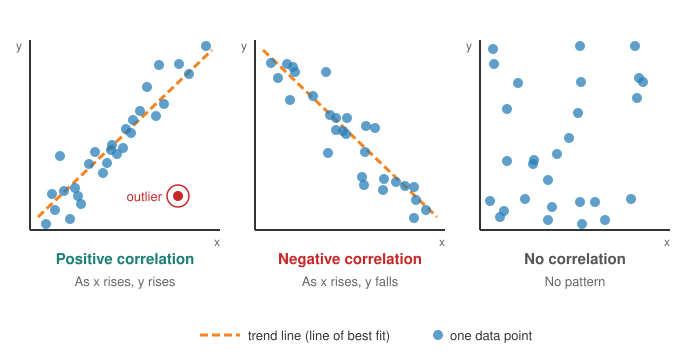

<head>
    <script type="application/ld+json">
        {JSON.stringify({
            "@context": "https://schema.org",
            "@type": "FAQPage",
            "mainEntity": [
                {
                    "@type": "Question",
                    "name": "What is a scatter plot used for?",
                    "acceptedAnswer": { "@type": "Answer", "text": "A scatter plot is used to see whether two measured values are related, for example height and weight, advertising spend and sales, or temperature and energy use. It shows the direction and strength of the relationship, and picks out outliers and clusters that a table of numbers would hide." }
                },
                {
                    "@type": "Question",
                    "name": "How do you describe a scatter plot?",
                    "acceptedAnswer": { "@type": "Answer", "text": "Describe four things: the direction (positive, negative or none), the form (linear or curved), the strength (how tightly the dots follow the pattern), and anything unusual such as outliers or clusters. For example: a strong, positive, linear relationship with two outliers." }
                },
                {
                    "@type": "Question",
                    "name": "What is the difference between a scatter plot and a line graph?",
                    "acceptedAnswer": { "@type": "Answer", "text": "A scatter plot shows separate dots for two measured values and does not join them, because the order of the points has no meaning. A line graph joins points in order along the x axis, usually time, to show how one value changes." }
                },
                {
                    "@type": "Question",
                    "name": "Does correlation on a scatter plot mean causation?",
                    "acceptedAnswer": { "@type": "Answer", "text": "No. A scatter plot shows that two values move together, not why. A third factor may drive both, the cause may run the other way, or the pattern may be chance. Showing cause needs a controlled experiment or other evidence." }
                },
                {
                    "@type": "Question",
                    "name": "Who invented the scatter plot?",
                    "acceptedAnswer": { "@type": "Answer", "text": "Historians of statistics credit the astronomer John Herschel with one of the first true scatter plots, drawn in 1833 to study the orbits of double stars. Francis Galton later used scatter plots to study correlation in the 1880s." }
                },
                {
                    "@type": "Question",
                    "name": "How do I make a scatter plot in JavaScript?",
                    "acceptedAnswer": { "@type": "Answer", "text": "With SciChart.js, create a SciChartSurface with two NumericAxis objects, then add an XyScatterRenderableSeries with an XyDataSeries holding your x and y values and a point marker such as EllipsePointMarker. The same chart works in React with scichart-react and in Angular with scichart-angular." }
                }
            ]
        })}
    </script>
</head>

# Scatter Plot

## What is a scatter plot?

A **scatter plot** (also called a scatter chart, scatter graph or scatter diagram) is a chart that shows how two numeric values relate. Each item is one dot: its **x value** sets how far along it sits and its **y value** sets how high. The overall pattern of dots shows whether the two values move together, how strongly, and which items don't fit.


*A scatter plot of height against weight for 202 people (sample data), two of them outliers, with a trend line. [Try the interactive version](#how-to-create-a-scatter-plot-in-javascript-react-or-angular).*

:::tip Key takeaways
- A scatter plot shows the **relationship between two measured values**, with one dot per item.
- The pattern shows the **direction**, **strength** and **form** of the relationship, plus any **outliers** and **clusters**.
- Describe one in a sentence: "a *strong*, *positive*, *linear* relationship with *two outliers*".
- It shows **correlation, not causation**: two values can move together without one causing the other.
- With many thousands of points, dots hide each other. Use **small, semi-transparent markers** or a heatmap.
:::

## How to read a scatter plot



1. **Check the axes.** Find out which value runs along the bottom (x) and which runs up the side (y), and their units. The x value is usually the one you think might explain the other.
2. **Look at the overall direction.** Dots rising from left to right show a **positive correlation**: as x increases, y tends to increase. Dots falling from left to right show a **negative correlation**. A shapeless cloud shows **no correlation**.
3. **Judge the strength.** The closer the dots sit to an imaginary line, the **stronger** the relationship. A wide, loose band means a **weak** one.
4. **Check the form.** The dots may follow a straight line (**linear**) or a curve (**non-linear**), such as values that rise quickly and then level off.
5. **Look for anything unusual.** **Outliers** are dots far from the rest. They may be errors, or the most interesting items in the data. **Clusters** are separate groups, which often mean the data mixes different kinds of item.

A **trend line** (line of best fit), usually calculated by least-squares regression, summarises the direction. The **correlation coefficient**, *r*, measures the strength of a straight-line relationship from −1 (perfect negative) through 0 (none) to +1 (perfect positive).

## How to describe a scatter plot

Teachers, analysts and report writers describe scatter plots the same way. Use this template:

> There is a **[strong / moderate / weak]**, **[positive / negative]**, **[linear / non-linear]** relationship between **[x]** and **[y]**, **[with / without]** outliers or clusters.

**Worked example,** using the height and weight chart above: "There is a moderate, positive, linear relationship between height and weight. Taller people tend to be heavier, with about 0.9 kg more weight for each extra centimetre of height. Two people don't fit the pattern: a short person who is unusually heavy and a tall person who is unusually light."

| What you see | How to describe it |
| --- | --- |
| Dots tightly packed around a rising line | Strong, positive, linear |
| A loose band falling from left to right | Weak, negative, linear |
| Dots following a curve that flattens out | Positive, non-linear |
| A shapeless cloud | No correlation |
| Two or more separate groups of dots | Clustered: describe each group, and consider colouring them by group |

## When to use a scatter plot

Use a scatter plot when you have **two measured values for each item** and want to know whether, and how, they're related. Typical uses:

- **science and engineering:** checking whether one measurement predicts another, such as temperature and pressure, or dose and response;
- **quality control:** spotting faulty parts that sit away from the normal pattern;
- **finance and business:** risk against return, or advertising spend against sales;
- **data exploration:** a first look at a new dataset before any modelling.

| Chart | Best for |
| --- | --- |
| **Scatter plot** | The relationship between two numeric values, one dot per item; the order of the points doesn't matter |
| [Line chart](/learn/line-chart/) | How one value changes over time or another sequence, with points joined in order |
| [Bubble chart](/learn/bubble-chart/) | A scatter plot that also shows a third value as the size of each bubble |
| [Heatmap](/learn/heatmap/) | Very dense data, where colour showing how many points fall in each cell is clearer than individual dots |

## Scatter plots with large datasets

When a scatter plot has tens of thousands of points or more, dots overlap until whole areas look like a solid block. Three fixes:
- **smaller, semi-transparent dots,** so overlapping dots build up into brighter, denser areas;
- **zooming in** on a region to see individual points;
- switching to a **[heatmap](/learn/heatmap/)** that counts how many points fall in each cell.

The chart below has 100,000 points in two groups, each in its own colour: a rising group (blue) and a falling group (orange) that cross in the middle. With small, semi-transparent dots you can see both trends and where they're densest. The orange group is drawn more transparent, so the blue shows through where they cross. Untick a group in the legend to see the other one on its own. Scroll to zoom into the dense areas.

<LiveDocSnippet maxWidth={'100%'} name="./LargeData/demo" />

## Common scatter plot mistakes

- **Reading cause into correlation.** Ice-cream sales and sunburn rise together because hot weather drives both, not because one causes the other.
- **Joining the dots.** A line between scatter points implies an order that doesn't exist. Use a [line chart](/learn/line-chart/) when the order matters.
- **Squashed or stretched axes.** Axis ranges that crop the data, or don't start where they should, can make a weak relationship look strong. Leave a small margin around the data and label both axes with units.
- **Extending the trend line too far.** A trend line describes the range you measured. It says nothing reliable about values well outside that range.
- **Deleting outliers without checking them.** An outlier may be a data-entry error, or the most important point on the chart.
- **Overplotting.** With thousands of points, dots pile on top of each other and hide where most of the data really is. See [Scatter plots with large datasets](#scatter-plots-with-large-datasets) above.

## How to create a scatter plot in JavaScript, React or Angular

SciChart.js draws scatter plots with WebGL and WebGPU, so they stay smooth to zoom and pan with large numbers of points and live updates. Try the chart below: scroll to zoom, drag to pan, double-click to reset, and hover over a dot to see its values.

<LiveDocSnippet maxWidth={'100%'} name="./Basic/demo" />

<LearnCta position="top" chart="scatter plot" demo="scatter-chart" docs="/2d-charts/chart-types/xy-scatter-renderable-series/" />

Here is the code for this chart:

<CodeSnippetBlock labels={["JavaScript", "React", "Angular"]}>
    ```ts showLineNumbers file=./Basic/demo.ts start=#region_A_start end=#region_A_end
    ```

    ```tsx
    import { SciChartReact } from "scichart-react";
    import {
        SciChartSurface,
        NumericAxis,
        XyDataSeries,
        XyScatterRenderableSeries,
        EllipsePointMarker,
        SciChartJsNavyTheme
    } from "scichart";

    // initChart builds the chart; SciChartReact creates it, sizes it and cleans it up
    const initChart = async (rootElement: string | HTMLDivElement) => {
        const { wasmContext, sciChartSurface } = await SciChartSurface.create(rootElement, {
            theme: new SciChartJsNavyTheme()
        });
        sciChartSurface.xAxes.add(new NumericAxis(wasmContext, { axisTitle: "Height (cm)" }));
        sciChartSurface.yAxes.add(new NumericAxis(wasmContext, { axisTitle: "Weight (kg)" }));

        const { xValues, yValues } = getYourXyData();
        sciChartSurface.renderableSeries.add(
            new XyScatterRenderableSeries(wasmContext, {
                dataSeries: new XyDataSeries(wasmContext, { xValues, yValues }),
                pointMarker: new EllipsePointMarker(wasmContext, {
                    width: 9,
                    height: 9,
                    strokeThickness: 1,
                    fill: "#50C7E0AA",
                    stroke: "#50C7E0"
                })
            })
        );
        return { sciChartSurface };
    };

    export const ScatterPlot = () => (
        <SciChartReact initChart={initChart} style={{ width: "100%", height: 400 }} />
    );
    ```

    ```ts
    import { Component } from "@angular/core";
    import { ScichartAngularComponent } from "scichart-angular";
    import {
        SciChartSurface,
        NumericAxis,
        XyDataSeries,
        XyScatterRenderableSeries,
        EllipsePointMarker,
        SciChartJsNavyTheme
    } from "scichart";

    @Component({
        selector: "app-scatter-plot",
        standalone: true,
        imports: [ScichartAngularComponent],
        template: `<scichart-angular [initChart]="initChart" style="display: block; width: 100%; height: 400px"></scichart-angular>`
    })
    export class ScatterPlotComponent {
        // initChart builds the chart; scichart-angular creates it, sizes it and cleans it up
        initChart = async (rootElement: string | HTMLDivElement) => {
            const { wasmContext, sciChartSurface } = await SciChartSurface.create(rootElement, {
                theme: new SciChartJsNavyTheme()
            });
            sciChartSurface.xAxes.add(new NumericAxis(wasmContext, { axisTitle: "Height (cm)" }));
            sciChartSurface.yAxes.add(new NumericAxis(wasmContext, { axisTitle: "Weight (kg)" }));

            const { xValues, yValues } = getYourXyData();
            sciChartSurface.renderableSeries.add(
                new XyScatterRenderableSeries(wasmContext, {
                    dataSeries: new XyDataSeries(wasmContext, { xValues, yValues }),
                    pointMarker: new EllipsePointMarker(wasmContext, {
                        width: 9,
                        height: 9,
                        strokeThickness: 1,
                        fill: "#50C7E0AA",
                        stroke: "#50C7E0"
                    })
                })
            );
            return { sciChartSurface };
        };
    }
    ```
</CodeSnippetBlock>

Key points:

- An [XyDataSeries](https://www.scichart.com/documentation/js/current/typedoc/classes/xydataseries.html) holds one x value and one y value per point. Unlike a line chart, the x values don't need to be sorted.
- An [XyScatterRenderableSeries](https://www.scichart.com/documentation/js/current/typedoc/classes/xyscatterrenderableseries.html) draws a marker at each point, with no line between them.
- The `pointMarker` sets each dot's shape and colour. `EllipsePointMarker` draws circles; square, triangle, cross and custom image markers are also available (see [point markers](/2d-charts/chart-types/common-series-apis/drawing-point-markers/)).
- The trend line is a `FastLineRenderableSeries` with two points, calculated with a least-squares fit.

**See it in the demo app:** [JavaScript scatter chart](https://www.scichart.com/demo/javascript/scatter-chart) · [React scatter chart](https://www.scichart.com/demo/react/scatter-chart) · [Angular scatter chart](https://www.scichart.com/demo/angular/scatter-chart)

**Go deeper:** [SciChart.js scatter plot documentation](/2d-charts/chart-types/xy-scatter-renderable-series/), including point marker types and colouring individual points.

## Frequently asked questions

### What is a scatter plot used for?

A scatter plot is used to see whether two measured values are related, for example height and weight, advertising spend and sales, or temperature and energy use. It shows the direction and strength of the relationship, and picks out outliers and clusters that a table of numbers would hide.

### How do you describe a scatter plot?

Describe four things: the direction (positive, negative or none), the form (linear or curved), the strength (how tightly the dots follow the pattern), and anything unusual such as outliers or clusters. For example: a strong, positive, linear relationship with two outliers.

### What is the difference between a scatter plot and a line graph?

A scatter plot shows separate dots for two measured values and does not join them, because the order of the points has no meaning. A line graph joins points in order along the x axis, usually time, to show how one value changes.

### Does correlation on a scatter plot mean causation?

No. A scatter plot shows that two values move together, not why. A third factor may drive both, the cause may run the other way, or the pattern may be chance. Showing cause needs a controlled experiment or other evidence.

### Who invented the scatter plot?

Historians of statistics credit the astronomer John Herschel with one of the first true scatter plots, drawn in 1833 to study the orbits of double stars. Francis Galton later used scatter plots to study correlation in the 1880s.

### How do I make a scatter plot in JavaScript?

With SciChart.js, create a `SciChartSurface` with two `NumericAxis` objects, then add an `XyScatterRenderableSeries` with an `XyDataSeries` holding your x and y values and a point marker such as `EllipsePointMarker`. The same chart works in React with `scichart-react` and in Angular with `scichart-angular`.

## Sources

- NIST/SEMATECH, [e-Handbook of Statistical Methods: Scatter Plot](https://www.itl.nist.gov/div898/handbook/eda/section3/scatterp.htm). How scatter plots are used in exploratory data analysis.
- Friendly, M. and Denis, D. (2005), [The early origins and development of the scatterplot](https://doi.org/10.1002/jhbs.20078). *Journal of the History of the Behavioral Sciences*, 41(2). The history of the scatter plot, from Herschel to Galton.

<LearnCta position="bottom" chart="scatter plot" demo="scatter-chart" docs="/2d-charts/chart-types/xy-scatter-renderable-series/" />
