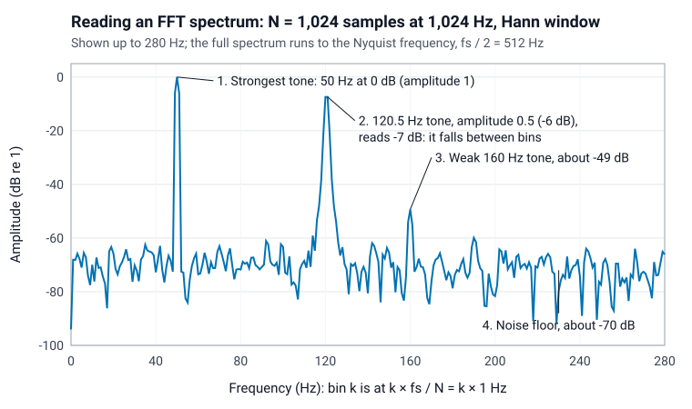
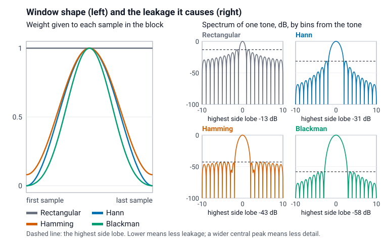

<head>
    <script type="application/ld+json">
        {JSON.stringify({
            "@context": "https://schema.org",
            "@type": "FAQPage",
            "mainEntity": [
                {
                    "@type": "Question",
                    "name": "What does FFT stand for?",
                    "acceptedAnswer": { "@type": "Answer", "text": "FFT stands for fast Fourier transform. It is a fast way to compute the discrete Fourier transform (DFT) of a block of samples, which tells you how much of each frequency the block contains. FFT analysis means using it to look at a signal's spectrum." }
                },
                {
                    "@type": "Question",
                    "name": "What is the difference between the DFT and the FFT?",
                    "acceptedAnswer": { "@type": "Answer", "text": "The DFT is the calculation: it turns N samples into N frequency bins. The FFT is a family of algorithms that compute exactly the same result much faster. Computed directly, the DFT takes about N squared operations; an FFT takes about N log2 N, which for 1,024 samples is around 200 times fewer." }
                },
                {
                    "@type": "Question",
                    "name": "What is FFT size, and how do I choose it?",
                    "acceptedAnswer": { "@type": "Answer", "text": "FFT size is the number of samples N in each block. It sets the bin width, which is the sample rate divided by N. A bigger N gives finer frequency detail but needs a longer recording (N divided by the sample rate) and reacts more slowly to change. Choose N so the bin width is no more than about half the gap between the closest frequencies you need to separate." }
                },
                {
                    "@type": "Question",
                    "name": "Why does my FFT show a mirror image or two peaks for one tone?",
                    "acceptedAnswer": { "@type": "Answer", "text": "For a real signal, the FFT's second half mirrors the first: bins above N/2 are the negative frequencies. Plot only bins 0 to N/2, which run from 0 Hz to the Nyquist frequency, and double their amplitude (except the first and last) to get the one-sided spectrum." }
                },
                {
                    "@type": "Question",
                    "name": "Does a JavaScript FFT give the same result as NumPy or MATLAB?",
                    "acceptedAnswer": { "@type": "Answer", "text": "Yes, if the conventions match. A standard JavaScript FFT, numpy.fft.fft and MATLAB fft(x) all compute the same unnormalised DFT with the same sign, so bin k is identical to within rounding when you use 64-bit numbers (Float64Array). numpy.fft.rfft returns only bins 0 to N/2, the same half you plot; in MATLAB, keep fft(x)(1:N/2+1), since MATLAB counts from 1. When the numbers don't match, the window is the usual cause. numpy.hanning(N) and MATLAB hann(N) are symmetric, while hann(N, 'periodic') and scipy.signal.get_window('hann', N) are periodic (the demo above uses the periodic form), so use the same one on both sides. Scale amplitudes the same way too: 2|X[k]| divided by the window's sum, except at bin 0 and bin N/2." }
                },
                {
                    "@type": "Question",
                    "name": "How do I plot an FFT in JavaScript?",
                    "acceptedAnswer": { "@type": "Answer", "text": "Window the samples, run an FFT (a short radix-2 function is enough), keep bins 0 to N/2, and convert each magnitude to an amplitude or decibels. With SciChart.js, put the frequencies and levels in an XyDataSeries and draw them with a FastLineRenderableSeries; call clear() and appendRange() each time new samples arrive. The same chart works in React with scichart-react and in Angular with scichart-angular." }
                }
            ]
        })}
    </script>
</head>

# FFT (Fast Fourier Transform)

## What is an FFT?

The **FFT** (**fast Fourier transform**) is an algorithm that splits a block of signal samples into the sine waves it contains, and measures how strong each frequency is. It computes the discrete Fourier transform (DFT) far faster than the direct method, which is why [spectrum analysers](/learn/signal-processing/audio-spectrum-analyzer/), audio tools and vibration monitors can show a signal's frequencies in real time.


*A test signal of three tones plus noise (top) and its FFT spectrum in decibels (bottom), sample data. [Try the interactive version](#how-to-plot-an-fft-in-javascript-react-or-angular), where you can move a tone between bins and change the window.*

:::tip Key takeaways
- An FFT turns $N$ samples into frequency bins spaced $\Delta f = f_s / N$ apart, from 0 Hz up to the Nyquist frequency $f_s / 2$.
- It gives the same answer as the DFT, in about $N \log_2 N$ operations instead of $N^2$.
- Longer records, finer detail: halving the bin width means recording for twice as long.
- A tone that falls between bins spreads into its neighbours (spectral leakage). A window such as Hann reduces it.
- Zero padding makes the plot smoother but doesn't separate tones that are too close together.
:::

## How the FFT works

This section explains the algorithm. To read a spectrum first, skip to [how to read an FFT plot](#how-to-read-an-fft-plot).

The Fourier transform says that any signal can be built from sine waves of different frequencies, amplitudes and phases. (For the idea itself, see the [Fourier transform](/learn/signal-processing/fourier-transform/) guide.) A computer works with a list of samples, so it uses the discrete Fourier transform. For $N$ samples $x_0 \ldots x_{N-1}$, bin $k$ of the DFT is:

$$
X_k = \sum_{n=0}^{N-1} x_n \, e^{-2\pi i \, k n / N}, \qquad k = 0, 1, \ldots, N-1
$$

Each bin compares the signal with a sine and cosine that complete exactly $k$ cycles in the block. A strong match gives a large $\lvert X_k \rvert$; no match gives a value near zero.

Done directly, each of the $N$ bins needs $N$ multiplications, so the work grows as $N^2$. Double the block and the work goes up four times.

### The radix-2 trick

The FFT avoids most of that work by reusing it. The best-known version, published by James Cooley and John Tukey in 1965 (Gauss had used the same idea around 1805, unpublished in his lifetime), works on blocks whose length is a power of 2:

1. Split the samples into the even-numbered ones and the odd-numbered ones.
2. Transform each half. Each is a DFT of half the length, and each of those splits again, down to blocks of one sample.
3. Combine each pair of half-size results with a **butterfly**: two outputs, $a + w\,b$ and $a - w\,b$, where $w$ is a fixed complex number called a **twiddle factor**.

The split only reorders the samples. Splitting into even and odd samples, then splitting each half the same way, ends with the samples in **bit-reversed order**: write each position as a binary number, read the bits backwards, and that's the sample that lands there. In a 16-sample block, position 1 (0001) gets sample 8 (1000). Code does the whole split in one pass, swapping pairs of samples in place.

![Five rows show 16 samples being split. One block of samples 0 to 15 splits into the even samples 0, 2, 4 … 14 and the odd samples 1, 3, 5 … 15, then into four blocks of 4, eight blocks of 2 and finally sixteen single samples in the order 0, 8, 4, 12, 2, 10, 6, 14, 1, 9, 5, 13, 3, 11, 7, 15. Worked bit reversals: position 1 = 0001 holds sample 1000 = 8, position 2 = 0010 holds 4, position 3 = 0011 holds 12, position 6 = 0110 holds 6, and position 11 = 1011 holds 13. Adapted from Burnett-Thompson (2007)](./fft-bit-reversal-decomposition.svg)

*Adapted from [Burnett-Thompson (2007)](#sources).*

The DFT of one sample is that sample, so transforming a single sample costs nothing and the reordered list is already $N$ one-point spectra. All the work is in combining them.

Each butterfly multiplies the lower of its two values by a twiddle factor and outputs their sum and their difference:


*Adapted from [Burnett-Thompson (2007)](#sources).*

The twiddle factors $W_N^R = e^{-2\pi i R / N}$ are the DFT's own test waves, points spaced evenly around the unit circle. The FFT computes each product $w\,b$ once and uses it twice, once added and once subtracted, and that reuse is where the saving comes from. Stage 1 pairs values next to each other, stage 2 pairs values 2 apart, stage 3 pairs values 4 apart, and so on, doubling until one $N$-point spectrum is left.

#### Worked example: an 8-point FFT

Sample one cycle of a sine wave 8 times, $x_n = \sin(2\pi n / 8)$, which gives $[0, \tfrac{\sqrt{2}}{2}, 1, \tfrac{\sqrt{2}}{2}, 0, -\tfrac{\sqrt{2}}{2}, -1, -\tfrac{\sqrt{2}}{2}]$.


*Adapted from [Burnett-Thompson (2007)](#sources).*

1. Reorder. In bit-reversed order ($x_0, x_4, x_2, x_6, x_1, x_5, x_3, x_7$) the input is $[0, 0, 1, -1, \tfrac{\sqrt{2}}{2}, -\tfrac{\sqrt{2}}{2}, \tfrac{\sqrt{2}}{2}, -\tfrac{\sqrt{2}}{2}]$.
2. Stage 1 combines neighbours with $W^0 = 1$, so each pair becomes its sum and its difference: $[0, 0, 0, 2, 0, \sqrt{2}, 0, \sqrt{2}]$. These are four 2-point spectra.
3. Stage 2 combines values 2 apart with $W^0 = 1$ and $W^2 = -i$. The second butterfly, for example, takes $0$ and $2$ and gives $0 + (-i)(2) = -2i$ and $0 - (-i)(2) = 2i$. The result is two 4-point spectra, $[0, -2i, 0, 2i]$ and $[0, \sqrt{2} - \sqrt{2}i, 0, \sqrt{2} + \sqrt{2}i]$.
4. Stage 3 combines values 4 apart with $W^0$ to $W^3$. Bin 1 is $-2i + W^1(\sqrt{2} - \sqrt{2}i) = -2i + (1 - i)^2 = -4i$, and bin 5, the same butterfly's difference, is $-2i - (-2i) = 0$. Bin 7 is $2i - W^3(\sqrt{2} + \sqrt{2}i) = 2i + 2i = 4i$.

The output comes out in natural order and is zero everywhere except $X_1 = -4i$ and $X_7 = 4i$: one wave at one cycle per block, plus its mirror image in bin $N - 1$. Its amplitude is $2\lvert X_1 \rvert / N = 2 \times 4 / 8 = 1$, and the $-i$ marks a sine rather than a cosine. A direct DFT gives the same eight numbers with 64 multiplications; the FFT used 12 butterflies.

There are $\log_2 N$ levels of splitting and $N/2$ butterflies per level, so the total work grows as $N \log_2 N$ rather than $N^2$. The answer is the same as the direct DFT. If anything, the FFT's rounding errors are smaller, because each result passes through fewer operations.

| Block size $N$ | Direct DFT ($N^2$ multiplications) | Radix-2 FFT ($\tfrac{N}{2}\log_2 N$ butterflies) | About how many times less work |
| --- | --- | --- | --- |
| 256 | 65,536 | 1,024 | 64 |
| 1,024 | 1,048,576 | 5,120 | 200 |
| 4,096 | 16,777,216 | 24,576 | 680 |
| 65,536 | 4,294,967,296 | 524,288 | 8,200 |
| 1,048,576 | about 1.1 trillion | 10,485,760 | 100,000 |

The FFT made spectrum analysis cheap enough to run continuously, on everything from lab instruments to phones. Other FFT algorithms (mixed-radix, split-radix, Bluestein's) handle block sizes that aren't powers of 2, and FFT libraries pick between them for you.

### The inverse FFT

The inverse DFT differs from the forward one only in the sign of the exponent and a factor of $1/N$. So the same FFT code can run it backwards, in four steps:

1. Conjugate the spectrum: flip the sign of every imaginary part.
2. Run the forward FFT on the result.
3. Divide every output by $N$.
4. Conjugate again. For a real signal the imaginary parts left over are zero, apart from rounding errors.

It works because conjugating the input and the output of a sum of complex exponentials flips the sign of the exponent: $\overline{\sum_k \overline{X_k}\, e^{-2\pi i kn/N}} = \sum_k X_k\, e^{2\pi i kn/N}$. Put the spectrum from the 8-point example through these steps and the eight sine samples come back. Some texts and libraries put the $1/N$ on the forward transform instead of the inverse, so check which convention a library uses before comparing amplitudes.

## How to read an FFT plot

An FFT plot (also called an FFT spectrum or FFT graph) has frequency along the horizontal axis and amplitude or level up the vertical axis. Each peak is a frequency the signal contains; its height is how strong that frequency is.



Read it in this order:

1. Check the frequency axis. It runs from 0 Hz to the **Nyquist frequency**, half the sample rate ($f_s / 2$). Nothing above that can be measured; it would have shown up as a false, lower frequency ([aliasing](/learn/signal-processing/nyquist-and-aliasing/)) when the signal was sampled.
2. Check the vertical scale. On a linear scale, a peak's height is the tone's amplitude. On a decibel (dB) scale, each 20 dB is a factor of 10 in amplitude: $L = 20 \log_{10}(A)$, so amplitude 1 is 0 dB, 0.5 is about -6 dB, 0.1 is -20 dB and 0.001 is -60 dB. Use dB when you need to see weak tones next to strong ones.
3. Find the peaks. Each narrow peak is a steady tone. Evenly spaced peaks (for example 50, 100, 150 Hz) are a fundamental and its [harmonics](/learn/signal-processing/fourier-series/), usually a sign that the waveform isn't a pure sine.
4. Find the **noise floor**, the uneven level between the peaks. A peak only means something if it stands clearly above it (see [signal-to-noise ratio](/learn/signal-processing/signal-to-noise-ratio/)).
5. Look at the shape of each peak. A wide skirt around a peak is usually leakage from the window, not real content (see [windowing](#windowing-and-spectral-leakage)).

For a real signal (any measurement from a sensor or microphone), the FFT's output is symmetric: bins above $N/2$ mirror the ones below, as negative frequencies. So FFT plots show only bins 0 to $N/2$ (the **one-sided spectrum**), and double those amplitudes (except at 0 Hz and at the Nyquist frequency) so each tone's energy is counted once.

### Amplitude, power or power spectral density?

An **amplitude spectrum** (as here) reads the size of each tone directly. A **power spectrum** shows the square of it. A [power spectral density](/learn/signal-processing/power-spectral-density/) (PSD) divides power by the bin width, so random noise reads the same whatever the FFT size; vibration and noise measurements often use it.

## FFT resolution: bins, bin width and FFT size

An FFT of $N$ samples taken at a sample rate $f_s$ gives bins at

$$
f_k = k \, \frac{f_s}{N}, \qquad \Delta f = \frac{f_s}{N} = \frac{1}{T}
$$

where $\Delta f$ is the **bin width** (or **frequency resolution**) and $T = N / f_s$ is how long the block lasts. The resolution depends only on how long you record, not on how fast you sample. Sampling faster raises the Nyquist frequency; recording longer makes the bins narrower.

For audio sampled at 48,000 samples a second:

| FFT size $N$ | Bin width $\Delta f$ | Block length $T$ | Good for |
| --- | --- | --- | --- |
| 1,024 | 46.9 Hz | 21 ms | Fast-moving level meters and real-time displays |
| 4,096 | 11.7 Hz | 85 ms | General audio analysis |
| 16,384 | 2.9 Hz | 341 ms | Separating close musical notes or mains harmonics |
| 65,536 | 0.73 Hz | 1.4 s | Fine detail on steady signals, such as machine vibration |

The trade-off is between detail in frequency and detail in time. A long block gives narrow bins but blurs anything that changes within it. To follow a signal that changes, take many short FFTs one after another and draw them as a [spectrogram](/learn/chart-types/cartesian/spectrogram/).

### How close can two tones be?

As a rule of thumb, two tones of similar size show as separate peaks when they are further apart than a peak's width 6 dB below its top: about 1.2 bins with no window and 2 bins with a Hann window (Harris, 1978). Windowing widens each peak, so it costs some resolution.

## Windowing and spectral leakage

The FFT assumes the block repeats forever. If a tone completes a whole number of cycles in the block, the end joins the start smoothly and the tone lands in exactly one bin. If it doesn't, which is nearly always, the repeat has a jump at the join. That jump spreads the tone's energy into many other bins. This is **spectral leakage**.

Leakage does two kinds of harm:

- It hides weak tones. The skirts of a strong peak can be higher than a small peak nearby.
- It lowers the peak. A tone exactly halfway between two bins reads about 3.9 dB too low with no window. This is called **scalloping loss**.

A [**window function**](/learn/signal-processing/window-functions/) fixes most of this. Before the FFT, each sample is multiplied by a weight that is largest in the middle of the block and falls towards the ends, so the jump at the join disappears. It also widens the central peak (less frequency detail) and lowers the overall level, which the amplitude scaling corrects.



| Window | Formula, $n = 0 \ldots N-1$ | Highest side lobe | Central peak width (to first zero) | Peak drop between bins | Best for |
| --- | --- | --- | --- | --- | --- |
| Rectangular (none) | $1$ | -13 dB | ±1 bin | 3.9 dB | Tones that fit the block exactly; short transients that start and end inside it |
| Hann (Hanning) | $0.5 - 0.5\cos\frac{2\pi n}{N}$ | -31 dB | ±2 bins | 1.4 dB | A good default for most signals, noise and random vibration |
| Hamming | $0.54 - 0.46\cos\frac{2\pi n}{N}$ | -43 dB | ±2 bins | 1.8 dB | Lower close-in leakage than Hann, often used in speech processing |
| Blackman | $0.42 - 0.5\cos\frac{2\pi n}{N} + 0.08\cos\frac{4\pi n}{N}$ | -58 dB | ±3 bins | 1.1 dB | Finding weak tones near strong ones |

We measured these figures with the FFT code on this page. They match the standard values in Harris (1978); see [Sources](#sources). Far from the peak, leakage falls away quickly with Hann and Blackman but only slowly with Hamming, whose side lobes stay in the -40s and -50s of dB for many bins. For the most accurate peak heights, test equipment also offers a [flat-top](/learn/signal-processing/window-functions/#correcting-amplitude-and-power-after-windowing) window, with almost no peak drop but a very wide peak.

In the [live example](#how-to-plot-an-fft-in-javascript-react-or-angular), with the moving tone at 120.5 Hz, switch the window to **Rectangular**. Its skirt rises over the weak 160 Hz tone. Switch back to **Hann** or **Blackman** and the small peak reappears. Then move the tone to exactly 120.0 Hz: with a rectangular window the leakage vanishes, because the tone now fits the block.

## Zero padding: a smoother plot, not more detail

**Zero padding** means adding zeros to the end of the block before the FFT, for example 1,024 samples plus 3,072 zeros for a 4,096-point FFT. The result has four times as many points, a quarter of a bin apart. That draws the same spectrum at more points, like interpolating between them, so peaks look smoother and their tops are easier to locate. It doesn't improve the resolution: the bin width still depends on the real data, $f_s / N$, so two tones too close to separate in 1,024 samples stay merged however many zeros you add.

Padding is also used to reach the next power of 2 so a radix-2 FFT can run, and before [fast convolution](/learn/signal-processing/convolution/) so the result doesn't wrap around. For how zero padding relates to leakage, see [does zero padding reduce spectral leakage?](/learn/signal-processing/window-functions/#does-zero-padding-reduce-spectral-leakage) in the window functions guide.

## FFT vs DFT, Fourier transform and spectrogram

| If you need… | Use | Why |
| --- | --- | --- |
| The spectrum of a block of samples | FFT | The standard tool: same result as the DFT, far less work |
| A handful of specific frequencies (for example, detecting phone keypad tones) | Direct DFT of those bins, or the Goertzel algorithm | Cheaper than a full FFT when you need only a few bins |
| The maths of a continuous signal, on paper | [Fourier transform](/learn/signal-processing/fourier-transform/) | The continuous version the DFT and FFT approximate |
| How the frequencies change over time | [Spectrogram](/learn/chart-types/cartesian/spectrogram/) (short-time FFT) | Many FFTs of short, overlapping blocks, drawn as a heatmap |
| To filter or smooth a signal | A [low-pass filter](/learn/signal-processing/low-pass-filter/), or FFT-based convolution for long filters | Filtering changes the signal; an FFT only measures it |

## What FFT analysis is used for

- Audio: spectrum analysers, equalisers, pitch detection, room measurement and finding hum or noise.
- Vibration and machine monitoring: bearing and shaft faults show up as peaks linked to the machine's speed.
- Oscilloscopes and test equipment: most digital oscilloscopes have an FFT mode that shows the spectrum of the captured waveform.
- Communications, imaging and science: OFDM (Wi-Fi, 4G and 5G), MRI scanners, astronomy, seismology and spectroscopy all run on forward and inverse FFTs.
- Fast filtering: long filters and [convolution](/learn/signal-processing/convolution/) run faster through an FFT than directly.

## Common FFT mistakes

- **No window on a signal that doesn't fit the block.** Leakage then hides weak tones and lowers peak heights. Use Hann unless you have a reason not to.
- **Forgetting to scale.** Raw FFT magnitudes grow with $N$. Divide by the sum of the window (and double the one-sided bins) to read amplitudes.
- **Mixing up 10 and 20 log.** Use $20 \log_{10}$ for amplitude and $10 \log_{10}$ for power, or every level is off by a factor of two in dB.
- **[Aliasing](/learn/signal-processing/nyquist-and-aliasing/) before the FFT.** Frequencies above $f_s / 2$ fold back into the spectrum as false peaks. Filter them out with an analogue or [low-pass filter](/learn/signal-processing/low-pass-filter/) before sampling or downsampling.
- **Leaving in the DC offset.** A constant offset makes a large 0 Hz bin, and its leakage can swamp low frequencies. Subtract the mean first.
- **Reading a single FFT of noise as fact.** Noise in one FFT is ragged. Average the spectra of several blocks (Welch's method) for a steady estimate.

## How to plot an FFT in JavaScript, React or Angular

SciChart.js draws FFT spectra and spectrograms with WebGL and WebGPU, fast enough to redraw them as new samples stream in. The example below runs the FFT in your browser with the plain JavaScript functions in the code. Move the tone, change the window, the FFT size $N$, zero padding and the scale; the line under the controls says where the tone falls among the bins. Hover over the spectrum to read a bin, scroll to zoom into a frequency range, drag to pan and double-click to reset.

<LiveDocSnippet maxWidth={'100%'} height={680} name="./Basic/demo" />

<LearnCta position="top" chart="FFT spectrum analyzer" demo="audio-analyzer-fft-example" docs="/2d-charts/chart-types/fast-line-renderable-series/" docsLabel="SciChart.js line chart documentation" />

Here is the code for this example. The JavaScript tab includes the FFT, window and spectrum functions; the React and Angular tabs reuse them.

<CodeSnippetBlock labels={["JavaScript", "React", "Angular"]}>
    ```ts showLineNumbers file=./Basic/demo.ts start=#region_A_start end=#region_A_end
    ```

    ```tsx
    import { SciChartReact } from "scichart-react";
    import {
        SciChartSurface,
        NumericAxis,
        NumberRange,
        FastLineRenderableSeries,
        XyDataSeries,
        SciChartJsNavyTheme,
        CursorModifier,
        MouseWheelZoomModifier,
        ZoomPanModifier,
        ZoomExtentsModifier,
        EXyDirection
    } from "scichart";
    // fft, makeWindow and amplitudeSpectrum: copy them from the JavaScript tab
    import { amplitudeSpectrum } from "./fft";

    const SAMPLE_RATE = 1024; // your sample rate, in samples per second

    // initChart builds the chart; SciChartReact creates it, sizes it and cleans it up
    const initChart = async (rootElement: string | HTMLDivElement) => {
        const { wasmContext, sciChartSurface } = await SciChartSurface.create(rootElement, {
            theme: new SciChartJsNavyTheme()
        });
        sciChartSurface.xAxes.add(
            new NumericAxis(wasmContext, { axisTitle: "Frequency (Hz)", visibleRange: new NumberRange(0, SAMPLE_RATE / 2) })
        );
        sciChartSurface.yAxes.add(
            new NumericAxis(wasmContext, { axisTitle: "Amplitude (dB)", visibleRange: new NumberRange(-100, 5) })
        );

        // Your block of samples (a power of 2 long), windowed and transformed
        const samples = getYourSamples();
        const { frequencies, amplitudes } = amplitudeSpectrum(samples, SAMPLE_RATE, "hann", 1);
        const levels = amplitudes.map((a) => 20 * Math.log10(Math.max(a, 1e-10)));

        sciChartSurface.renderableSeries.add(
            new FastLineRenderableSeries(wasmContext, {
                dataSeries: new XyDataSeries(wasmContext, { xValues: frequencies, yValues: levels, dataIsSortedInX: true }),
                stroke: "#50C7E0",
                strokeThickness: 2
            })
        );
        sciChartSurface.chartModifiers.add(
            new CursorModifier({ showTooltip: true }),
            new MouseWheelZoomModifier({ xyDirection: EXyDirection.XDirection }),
            new ZoomPanModifier({ xyDirection: EXyDirection.XDirection }),
            new ZoomExtentsModifier({ xyDirection: EXyDirection.XDirection })
        );
        return { sciChartSurface };
    };

    export const FftSpectrum = () => <SciChartReact initChart={initChart} style={{ width: "100%", height: 400 }} />;
    ```

    ```ts
    import { Component } from "@angular/core";
    import { ScichartAngularComponent } from "scichart-angular";
    import {
        SciChartSurface,
        NumericAxis,
        NumberRange,
        FastLineRenderableSeries,
        XyDataSeries,
        SciChartJsNavyTheme,
        CursorModifier,
        MouseWheelZoomModifier,
        ZoomPanModifier,
        ZoomExtentsModifier,
        EXyDirection
    } from "scichart";
    // fft, makeWindow and amplitudeSpectrum: copy them from the JavaScript tab
    import { amplitudeSpectrum } from "./fft";

    const SAMPLE_RATE = 1024; // your sample rate, in samples per second

    @Component({
        selector: "app-fft-spectrum",
        standalone: true,
        imports: [ScichartAngularComponent],
        template: `<scichart-angular [initChart]="initChart" style="display: block; width: 100%; height: 400px"></scichart-angular>`
    })
    export class FftSpectrumComponent {
        // initChart builds the chart; scichart-angular creates it, sizes it and cleans it up
        initChart = async (rootElement: string | HTMLDivElement) => {
            const { wasmContext, sciChartSurface } = await SciChartSurface.create(rootElement, {
                theme: new SciChartJsNavyTheme()
            });
            sciChartSurface.xAxes.add(
                new NumericAxis(wasmContext, { axisTitle: "Frequency (Hz)", visibleRange: new NumberRange(0, SAMPLE_RATE / 2) })
            );
            sciChartSurface.yAxes.add(
                new NumericAxis(wasmContext, { axisTitle: "Amplitude (dB)", visibleRange: new NumberRange(-100, 5) })
            );

            // Your block of samples (a power of 2 long), windowed and transformed
            const samples = getYourSamples();
            const { frequencies, amplitudes } = amplitudeSpectrum(samples, SAMPLE_RATE, "hann", 1);
            const levels = amplitudes.map((a) => 20 * Math.log10(Math.max(a, 1e-10)));

            sciChartSurface.renderableSeries.add(
                new FastLineRenderableSeries(wasmContext, {
                    dataSeries: new XyDataSeries(wasmContext, { xValues: frequencies, yValues: levels, dataIsSortedInX: true }),
                    stroke: "#50C7E0",
                    strokeThickness: 2
                })
            );
            sciChartSurface.chartModifiers.add(
                new CursorModifier({ showTooltip: true }),
                new MouseWheelZoomModifier({ xyDirection: EXyDirection.XDirection }),
                new ZoomPanModifier({ xyDirection: EXyDirection.XDirection }),
                new ZoomExtentsModifier({ xyDirection: EXyDirection.XDirection })
            );
            return { sciChartSurface };
        };
    }
    ```
</CodeSnippetBlock>

Key points:

- The spectrum is an `XyDataSeries` of frequencies and levels, drawn by a `FastLineRenderableSeries`. Set `dataIsSortedInX: true`, since FFT bins are already in order.
- To update it live, keep the data series and call `clear()` then `appendRange()` with each new spectrum, as the example's `update()` function does. SciChart.js redraws on the next frame.
- A fixed y-axis range (`autoRange: EAutoRange.Never` and a `visibleRange` in dB) stops the axis jumping as the noise changes.
- The FFT itself is plain JavaScript. Swap in any FFT library you prefer; the chart code stays the same.

**See it in the demo app:** [JavaScript FFT spectrum analyzer](https://www.scichart.com/demo/javascript/audio-analyzer-fft-example) · [React FFT spectrum analyzer](https://www.scichart.com/demo/react/audio-analyzer-fft-example) · [Angular FFT spectrum analyzer](https://www.scichart.com/demo/angular/audio-analyzer-fft-example). It analyses live audio from your microphone, with a waveform, an FFT spectrum and a spectrogram.

**Go deeper:** [SciChart.js line chart documentation](/2d-charts/chart-types/fast-line-renderable-series/), and the [spectrogram guide](/learn/chart-types/cartesian/spectrogram/) for drawing many FFTs over time.

## Frequently asked questions

### What does FFT stand for?

FFT stands for fast Fourier transform. It is a fast way to compute the discrete Fourier transform (DFT) of a block of samples, which tells you how much of each frequency the block contains. FFT analysis means using it to look at a signal's spectrum.

### What is the difference between the DFT and the FFT?

The DFT is the calculation: it turns N samples into N frequency bins. The FFT is a family of algorithms that compute exactly the same result much faster. Computed directly, the DFT takes about N squared operations; an FFT takes about N log2 N, which for 1,024 samples is around 200 times fewer.

### What is FFT size, and how do I choose it?

FFT size is the number of samples N in each block. It sets the bin width, which is the sample rate divided by N. A bigger N gives finer frequency detail but needs a longer recording (N divided by the sample rate) and reacts more slowly to change. Choose N so the bin width is no more than about half the gap between the closest frequencies you need to separate.

### Why does my FFT show a mirror image or two peaks for one tone?

For a real signal, the FFT's second half mirrors the first: bins above N/2 are the negative frequencies. Plot only bins 0 to N/2, which run from 0 Hz to the Nyquist frequency, and double their amplitude (except the first and last) to get the one-sided spectrum.

### Does a JavaScript FFT give the same result as NumPy or MATLAB?

Yes, if the conventions match. A standard JavaScript FFT, `numpy.fft.fft` and MATLAB `fft(x)` all compute the same unnormalised DFT with the same sign, so bin $k$ is identical to within rounding when you use 64-bit numbers (`Float64Array`). `numpy.fft.rfft` returns only bins 0 to $N/2$, the same half you plot; in MATLAB, keep `fft(x)(1:N/2+1)`, since MATLAB counts from 1.

When the numbers don't match, the window is the usual cause. `numpy.hanning(N)` and MATLAB `hann(N)` are symmetric, while `hann(N, 'periodic')` and `scipy.signal.get_window('hann', N)` are periodic (the demo above uses the periodic form), so use the same one on both sides. Scale amplitudes the same way too: $2|X[k]|$ divided by the window's sum, except at bin 0 and bin $N/2$.

### How do I plot an FFT in JavaScript?

Window the samples, run an FFT (a short radix-2 function is enough), keep bins 0 to N/2, and convert each magnitude to an amplitude or decibels. With SciChart.js, put the frequencies and levels in an `XyDataSeries` and draw them with a `FastLineRenderableSeries`; call `clear()` and `appendRange()` each time new samples arrive. The same chart works in React with `scichart-react` and in Angular with `scichart-angular`.

## Sources

- Cooley, J. W. and Tukey, J. W. (1965), [An Algorithm for the Machine Calculation of Complex Fourier Series](https://doi.org/10.1090/S0025-5718-1965-0178586-1). *Mathematics of Computation*, 19(90), 297–301. The radix-2 FFT.
- Heideman, M. T., Johnson, D. H. and Burrus, C. S. (1984), [Gauss and the History of the Fast Fourier Transform](https://doi.org/10.1109/MASSP.1984.1162257). *IEEE ASSP Magazine*, 1(4), 14–21. Gauss's earlier use of the idea.
- Harris, F. J. (1978), [On the Use of Windows for Harmonic Analysis with the Discrete Fourier Transform](https://doi.org/10.1109/PROC.1978.10837). *Proceedings of the IEEE*, 66(1), 51–83. Window side lobes, scalloping loss and bandwidth.
- Smith, S. W., *The Scientist and Engineer's Guide to Digital Signal Processing*: [chapter 8, The Discrete Fourier Transform](https://www.dspguide.com/ch8.htm), [chapter 9, Applications of the DFT](https://www.dspguide.com/ch9.htm) (windows, resolution and zero padding) and [chapter 12, The Fast Fourier Transform](https://www.dspguide.com/ch12.htm).
- Smith, J. O., [Spectral Audio Signal Processing](https://ccrma.stanford.edu/~jos/sasp/), Center for Computer Research in Music and Acoustics (CCRMA), Stanford University. Windows, zero padding and spectrum analysis in depth.
- Burnett-Thompson, A. (2007), *A 3D Local Positioning System to track A Neutrally Buoyant Flow Follower*, PhD thesis, chapter 3 ([associated published paper](https://www.semanticscholar.org/paper/A-3D-Acoustic-Local-Positioning-System-to-Track-a-Burnett-Thompson-York/13e659919f6201ceecdf458643b708d58912841c)). The bit-reversal, butterfly and 8-point flow-graph diagrams on this page are adapted from it.

<LearnCta position="bottom" chart="FFT spectrum analyzer" demo="audio-analyzer-fft-example" docs="/2d-charts/chart-types/fast-line-renderable-series/" docsLabel="SciChart.js line chart documentation" />
