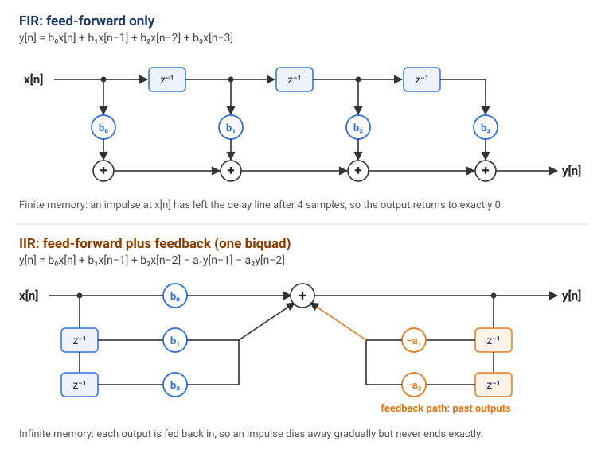

<head>
    <script type="application/ld+json">
        {JSON.stringify({
            "@context": "https://schema.org",
            "@type": "FAQPage",
            "mainEntity": [
                {
                    "@type": "Question",
                    "name": "What is the difference between FIR and IIR filters?",
                    "acceptedAnswer": { "@type": "Answer", "text": "An FIR (finite impulse response) filter computes each output from recent inputs only, so its response to a single pulse ends after a fixed number of samples. An IIR (infinite impulse response) filter also feeds back its own past outputs, so that response dies away but never ends. FIR filters are always stable and can delay every frequency equally (linear phase); IIR filters reach the same sharpness with far fewer calculations, but delay frequencies unequally and can become unstable if designed carelessly." }
                },
                {
                    "@type": "Question",
                    "name": "What is an FIR filter?",
                    "acceptedAnswer": { "@type": "Answer", "text": "An FIR filter is a digital filter whose output is a weighted sum of the current input and a fixed number of past inputs: y[n] = b0 x[n] + b1 x[n-1] + ... + bM x[n-M]. The list of weights, called taps or coefficients, is also its impulse response. Applying it is a convolution. A common way to design one is the windowed-sinc method." }
                },
                {
                    "@type": "Question",
                    "name": "What is an IIR filter?",
                    "acceptedAnswer": { "@type": "Answer", "text": "An IIR filter is a digital filter that uses feedback: each output depends on recent inputs and on its own previous outputs. Because of that feedback its impulse response goes on for ever, decaying over time. Butterworth, Chebyshev, elliptic and Bessel filters are usually built as IIR filters, as a chain of second-order sections called biquads." }
                },
                {
                    "@type": "Question",
                    "name": "What is a Butterworth filter?",
                    "acceptedAnswer": { "@type": "Answer", "text": "A Butterworth filter is a filter designed to have the flattest possible passband: no ripple at all, with the gain falling smoothly to -3 dB at the cutoff frequency. Its magnitude is 1 / sqrt(1 + (f/fc)^(2n)) for order n, so it rolls off at 20n dB per decade above the cutoff. It was described by Stephen Butterworth in 1930 and is the usual default for analogue and digital IIR filters." }
                },
                {
                    "@type": "Question",
                    "name": "What is the sinc function?",
                    "acceptedAnswer": { "@type": "Answer", "text": "The sinc function is sin(x)/x, with the value 1 at x = 0. In signal processing the normalised form sin(πx)/(πx) is common; it is zero at every non-zero whole number. It matters because it is the Fourier transform of a rectangle: the impulse response of an ideal low-pass filter is a sinc, which is why windowed-sinc FIR filters start from it." }
                },
                {
                    "@type": "Question",
                    "name": "How do I apply an FIR or IIR filter in JavaScript?",
                    "acceptedAnswer": { "@type": "Answer", "text": "Design the coefficients first: windowed-sinc taps for an FIR filter, or Butterworth biquad coefficients from the bilinear transform for an IIR filter. Then run the difference equation over your samples: a weighted sum of past inputs for FIR, plus feedback from past outputs for IIR. In SciChart.js, wrap the filter in an XyCustomFilter on your XyDataSeries; it recalculates when the filter changes and as new samples are appended." }
                }
            ]
        })}
    </script>
</head>

# FIR vs IIR Filters

## What are FIR and IIR filters?

**FIR** (finite impulse response) and **IIR** (infinite impulse response) filters are the two families of digital filter. An FIR filter computes each output from recent inputs only, so its memory of any input ends. An IIR filter also feeds back past outputs, so its memory fades but never ends. FIR filters are always stable; IIR filters need fewer calculations.


*A windowed-sinc FIR filter (blue) and a Butterworth IIR filter (orange) with the same cutoff: magnitude, group delay, impulse response and the effect on a pulse. [Try the interactive version](#how-to-apply-fir-and-iir-filters-in-javascript-react-or-angular).*

:::tip Key takeaways
- FIR = feed-forward only. Its impulse response is a finite list of taps, it is always stable, and a symmetric kernel gives linear phase (every frequency is delayed equally).
- IIR = feedback. Its impulse response decays for ever. It reaches a given sharpness with far fewer multiplications, but its delay changes with frequency.
- The windowed-sinc method designs an FIR filter in four steps: sinc, truncate, window, normalise. High-pass and band-pass filters come from the same recipe.
- A Butterworth filter is maximally flat, −3 dB at the cutoff, and rolls off at 20 dB per decade per order. Digitally, it is built from biquads via the bilinear transform.
- Choose FIR when phase matters or the filter must adapt; choose IIR for low cost and low latency on live data.
:::

## How FIR and IIR filters work

A digital filter is a rule for computing each output sample $y[n]$ from input samples $x[n]$. For the linear filters on this page, that rule is a **difference equation**: a weighted sum of recent inputs and, for IIR filters, recent outputs.

$$
\underbrace{y[n] = \sum_{k=0}^{M} b_k \, x[n-k]}_{\text{FIR}}
\qquad\qquad
\underbrace{y[n] = \sum_{k=0}^{M} b_k \, x[n-k] \;-\; \sum_{k=1}^{N} a_k \, y[n-k]}_{\text{IIR}}
$$

The $b_k$ are the **feed-forward** coefficients and the $a_k$ the **feedback** coefficients. An FIR filter is the special case with no $a_k$. Each $z^{-1}$ box in the diagram below holds a sample for one step: it is a one-sample delay.



The names come from what each does with a single unit pulse (an **impulse**) at the input:

- FIR: the pulse walks down the delay line, picking up each weight in turn, and is gone after $M+1$ samples. The output is the list of weights itself, so an FIR filter's impulse response is its coefficients, and applying it is a [convolution](/learn/signal-processing/convolution/) of the signal with those taps.
- IIR: the pulse comes out, is fed back in, comes out again a little smaller, and so on. The response decays like a ringing bell but, mathematically, never reaches exactly zero.

In the z-domain (the algebra of sampled signals, in which $z^{-1}$ stands for a one-sample delay), the transfer function is $H(z) = B(z)/A(z)$. The roots of $B(z)$ are the filter's **zeros**, values of $z$ where $H$ is zero, and the roots of $A(z)$ its **poles**, values where $H$ becomes infinite. An FIR filter has only zeros (all its poles are at the origin), so it can't become unstable. An IIR filter is stable only if every pole lies inside the **unit circle**, the circle of radius 1 on which each frequency, from 0 Hz up to the sample rate, is a point; a pole on or outside it makes the output ring for ever or grow without limit.

To see what a filter does to each frequency, evaluate $H$ around the unit circle and plot the gain and phase: the [Bode plot](/learn/signal-processing/bode-plot/) of the filter.

## FIR vs IIR filter: which should you use?

Use an FIR filter when waveform shape or exact timing matters, and an IIR filter when computation is tight or the data is live.

| | FIR filter | IIR filter |
| --- | --- | --- |
| Structure | Feed-forward only | Feed-forward plus feedback |
| Impulse response | Finite: exactly $M + 1$ samples | Infinite: decays, never quite ends |
| Stability | Always stable | Stable only if every pole is inside the unit circle |
| Phase | Linear phase with a symmetric kernel: no phase distortion | Non-linear: different frequencies are delayed by different amounts |
| Delay (latency) | $M/2$ samples, the same at every frequency; long for sharp filters | Short at low frequencies, peaking near the cutoff |
| Multiplications per sample | One per tap (about half with a symmetric kernel); tens to hundreds, more as the transition narrows | About five per biquad, so 10 to 20 for common orders; fewest with Chebyshev and elliptic designs |
| Numerical sensitivity | Low; quantised taps only add small ripples | Higher; needs biquads, and care in fixed point |
| Design | Windowed-sinc, least squares, Parks–McClellan; any shape | From analogue prototypes (Butterworth, Chebyshev, elliptic, Bessel) |
| Adaptive filtering | The usual choice (e.g. LMS echo cancellers), since it can't go unstable | Rarely used |
| Analogue equivalent | Tapped delay lines and surface acoustic wave (SAW) filters, mainly at radio frequencies | RC, LC and op-amp filters, which IIR designs model directly |
| Best for | Audio and measurement where shape and phase matter; offline analysis; adaptive filters | Real-time control, sensors, microcontrollers, audio EQ; anything on a tight budget |

Anti-aliasing filters are a common case where the choice is made for you: the filter in front of an analogue-to-digital converter has to be analogue, so it is usually a Butterworth, Chebyshev, elliptic or Bessel design. Inside the digital part of an oversampling converter, the decimation filters are usually FIR. See [anti-aliasing filters and oversampling](/learn/signal-processing/nyquist-and-aliasing/#anti-aliasing-filters-and-oversampling).

### Worked comparison

Take a 1 kHz sample rate, a low-pass with −3 dB at 50 Hz, and at least 40 dB of rejection from 100 Hz up:

| Design | Size | Multiplications per sample | Delay |
| --- | --- | --- | --- |
| FIR, windowed-sinc, Hamming window | 39 taps | 39 (20 using symmetry) | 19 ms at every frequency |
| IIR, 7th-order Butterworth | 3 biquads + 1 first-order section | 18 | 14 ms at low frequencies, rising to about 25 ms near the cutoff |

For a gentle spec like this, the two are close. Tighten it to −60 dB from 60 Hz and the FIR filter needs about 305 taps with a Blackman window, a 152 ms delay; a Butterworth filter would need order 38, and that is where Chebyshev and elliptic IIR designs, with far lower orders, win. These figures come from the demo's design code.

## What is a sinc function?

The **sinc function** is $\sin(x)/x$, defined as 1 at $x = 0$ (its limit). Signal processing usually uses the **normalised sinc**, which is zero at every non-zero whole number:

$$
\operatorname{sinc}(x) = \frac{\sin(\pi x)}{\pi x}, \qquad \operatorname{sinc}(0) = 1
$$

It is the Fourier transform of a rectangle, so it describes the ideal filter. An ideal low-pass filter has a rectangular frequency response: gain 1 up to the cutoff $f_c$ and 0 above it. Transform that rectangle back to the time domain and you get the filter's impulse response, a sinc:

$$
h[k] = 2 f_c \operatorname{sinc}(2 f_c k) = \frac{\sin(2\pi f_c k)}{\pi k}
$$

with $f_c$ given as a fraction of the sample rate (between 0 and 0.5). The same shape turns up in reverse, too: the spectrum of a short rectangular pulse is a sinc, so a rectangular window leaks into its neighbours in an [FFT](/learn/signal-processing/fast-fourier-transform/#windowing-and-spectral-leakage). A sinc filter in a delta-sigma converter is a related idea: a moving-average stage whose frequency response has the shape of a (periodic) sinc.

The ideal sinc is infinite and non-causal (half of it comes before the impulse), so it must be truncated and windowed. The [low-pass filter guide](/learn/signal-processing/low-pass-filter/#windowed-sinc-fir-filter) shows the result as one formula; the next section takes it step by step.

## How to design an FIR filter: the windowed-sinc method

The **windowed-sinc** method turns the ideal sinc into a practical filter of $M + 1$ taps ($M$ even, so there is a centre tap):

1. Choose the cutoff $f_c$ as a fraction of the sample rate, and the length $M$. A longer kernel gives a sharper transition.
2. Sample the sinc, centred on the middle tap. Shifting it by $M/2$ makes the filter causal (it only uses samples it has seen):

$$
h[i] = \frac{\sin\big(2\pi f_c (i - M/2)\big)}{i - M/2}, \qquad i = 0 \dots M, \qquad h[M/2] = 2\pi f_c
$$

3. Multiply by a [window](/learn/signal-processing/window-functions/) $w[i]$, which tapers the ends to zero. Cutting the sinc off abruptly (a rectangular window) leaves large ripples in the frequency response; tapering trades a wider transition for a much deeper stopband.
4. Normalise: divide every tap by their sum, so the gain at 0 Hz is exactly 1 (0 dB). This also absorbs the constant $\pi$ factor dropped in step 2.

The two classic windows, for $i = 0 \dots M$:

$$
w_{\text{Hamming}}[i] = 0.54 - 0.46\cos\!\left(\frac{2\pi i}{M}\right), \qquad
w_{\text{Blackman}}[i] = 0.42 - 0.5\cos\!\left(\frac{2\pi i}{M}\right) + 0.08\cos\!\left(\frac{4\pi i}{M}\right)
$$


*Adapted from Burnett-Thompson (2007).*

| Window | Stopband attenuation | Transition width (roughly) | Use it when |
| --- | --- | --- | --- |
| Rectangular (plain truncation) | About 21 dB | $0.9/M$ of the sample rate | Not for filtering |
| Hamming | About 53 dB | $3.1/M$ | A good balance of sharpness and rejection |
| Blackman | About 74 dB | $4.6/M$ | Deep rejection, with a wider transition |

The transition widths are a guide: they depend on how you define the band edges, so other texts give Blackman as roughly $4/M$, the figure the low-pass, high-pass and band-pass guides use. For the same number of taps, the window decides between a narrow transition and a deep stopband. With the windowed-sinc recipe, $f_c$ is the half-amplitude point (−6 dB) of the finished filter, not the −3 dB point a Butterworth filter uses. Switch the window in the demo below and watch the stopband ripples drop from about −20 dB to below −70 dB.

### High-pass, band-pass and band-stop from the same recipe

Every other response comes from low-pass kernels of the same length:

- **High-pass by spectral inversion:** negate every tap of the low-pass kernel, then add 1 to the centre tap. The result is "an impulse minus the low-pass", which passes everything the low-pass removes. The figure above shows the tall centre spike this leaves. (The [high-pass filter guide](/learn/signal-processing/high-pass-filter/#digital-high-pass-filters) compares it with simpler high-pass filters.)
- **High-pass by spectral reversal:** multiply every other tap by −1. That mirrors the frequency response about a quarter of the sample rate, so a low-pass at $f_c$ becomes a high-pass at $0.5 - f_c$.
- **[Band-pass](/learn/signal-processing/band-pass-filter/):** subtract a low-pass at the lower edge from a low-pass at the upper edge (same length, same window), tap by tap. Or convolve a low-pass kernel with a high-pass kernel, which gives a kernel almost twice as long.
- **[Band-stop](/learn/signal-processing/notch-filter/):** add a low-pass at the lower edge to a high-pass at the upper edge, or spectrally invert a band-pass.

A windowed-sinc kernel is symmetric about its centre, so it has **linear phase**: it delays every frequency by exactly $M/2$ samples. Run offline and centred on each sample, it doesn't delay the signal at all.

Other FIR design methods exist, such as least-squares and the Parks–McClellan (equiripple) algorithm, which get a given spec with fewer taps. The windowed-sinc method is the one to learn first: it fits in a dozen lines of code, and it's easy to see why it works.

## What is a Butterworth filter?

A **Butterworth filter** is a filter designed to have the flattest possible passband, with no ripple at all, for its order. Stephen Butterworth described it in 1930. Its magnitude response, for order $n$ and cutoff $f_c$, is:

$$
|H(f)|^2 = \frac{1}{1 + (f/f_c)^{2n}}
$$

- At $f = f_c$ the gain is $1/\sqrt{2}$, −3 dB, whatever the order.
- Far above the cutoff, the gain falls by 20n dB per decade (about 6n dB per octave). A 2nd-order filter falls at 40 dB per decade, a 4th-order at 80.
- Below the cutoff, the first $2n - 1$ derivatives of $|H|^2$ are zero at 0 Hz. That is what "**maximally flat**" means.
- Its poles sit evenly spaced on a half circle in the left half of the s-plane (the complex-frequency plane used for analogue filters), at the angles $\pi(2k + n - 1)/(2n)$ for $k = 1 \dots n$.

Each pair of those poles is a second-order section with a quality factor $Q$. A 2nd-order Butterworth filter is one section with $Q = 1/\sqrt{2} \approx 0.7071$; a 4th-order filter is two sections, with $Q \approx 0.5412$ and $Q \approx 1.3066$. An odd order adds one first-order section.

### How to choose a Butterworth filter's order

To pass up to $f_c$ (at −3 dB) and reduce frequencies from $f_{stop}$ upwards by at least $A$ dB, the minimum order is:

$$
n \ge \frac{\log_{10}\left(10^{A/10} - 1\right)}{2 \log_{10}\left(f_{stop}/f_c\right)}
$$

rounded up. For example, for −40 dB at twice the cutoff, $n \ge \log_{10}(9999) / (2 \log_{10} 2) = 4.0/0.602 = 6.6$, so a 7th-order filter. For a digital filter, use the prewarped ratio $\tan(\pi f_{stop}/f_s) / \tan(\pi f_c/f_s)$ instead of $f_{stop}/f_c$ (explained below). At a 1 kHz sample rate with $f_c = 50$ Hz and $f_{stop} = 100$ Hz, that gives 6.4, so order 7 again.

Chebyshev, elliptic and Bessel filters are the alternatives, with different trade-offs:

- **Chebyshev type I** allows ripple in the passband (type II in the stopband) for a steeper transition at the same order.
- **Elliptic** (Cauer) filters ripple in both bands and give the steepest transition for a given order.
- **Bessel** filters roll off gently but delay low frequencies almost equally, so pulses keep their shape.

## How to design a digital IIR filter: the bilinear transform and biquads

The usual route to a digital IIR filter is to design the analogue filter first, then convert it. The **bilinear transform** replaces each $s$ in the analogue transfer function with:

$$
s = 2 f_s \, \frac{1 - z^{-1}}{1 + z^{-1}}
$$

It maps the whole analogue frequency axis onto the digital one from 0 to $f_s/2$, so a stable analogue filter always gives a stable digital filter, and nothing aliases. Frequencies are squeezed in the process, more so near $f_s/2$: an analogue frequency $\Omega$ lands at a digital frequency $f$ where $\Omega = 2 f_s \tan(\pi f / f_s)$. **Prewarping** corrects for that at the frequency that matters: design the analogue filter with its cutoff at $2 f_s \tan(\pi f_c / f_s)$, and the digital filter's −3 dB point lands exactly on $f_c$.

For one second-order section with quality factor $Q$, writing $K = \tan(\pi f_c / f_s)$, the low-pass coefficients come out as:

$$
b_0 = b_2 = \frac{K^2}{D}, \quad b_1 = 2b_0, \quad a_1 = \frac{2(K^2 - 1)}{D}, \quad a_2 = \frac{1 - K/Q + K^2}{D}, \quad D = 1 + K/Q + K^2
$$

and for a high-pass, $b_0 = b_2 = 1/D$ and $b_1 = -2/D$ with the same $a_1$ and $a_2$. For example, a 2nd-order Butterworth low-pass at 100 Hz, sampled at 1 kHz, has $K = \tan(0.1\pi) = 0.3249$ and gives

$$
b = [0.067455,\ 0.134911,\ 0.067455], \qquad a = [1,\ -1.142981,\ 0.412802]
$$

the same coefficients as the *Audio EQ Cookbook* formulas for $Q = 0.7071$.

### Building higher-order IIR filters from biquads

Each pole pair becomes one second-order section (a **biquad**), and the sections run one after another, the output of one feeding the next. Expanding them into a single high-order difference equation is mathematically the same, but it isn't numerically: the roots of a long polynomial are extremely sensitive to rounding in its coefficients, and a high-order filter in that "direct form" can end up with a pole outside the unit circle. Cascaded second-order sections keep each pole pair's coefficients separate and well behaved.

## Phase, group delay and linear phase

Every causal filter delays the signal. The useful measure is the **group delay**: how long the filter holds up the energy at each frequency, $\tau(f) = -\frac{1}{2\pi}\frac{d\varphi}{df}$, where $\varphi$ is the phase.

- A symmetric FIR filter has a constant group delay of $M/2$ samples. Every frequency arrives together, so a pulse comes out the same shape, just later. That is linear phase.
- An IIR filter's group delay varies with frequency. For a Butterworth low-pass it is smallest at low frequencies and peaks near the cutoff, and the peak grows with the order. At a 1 kHz sample rate and a 50 Hz cutoff, the delay at 1 Hz is about 3.2 ms (1st order), 4.5 ms (2nd), 8.3 ms (4th) and 16.2 ms (8th); the 4th-order filter's peaks at about 12.6 ms near the cutoff, and the 8th-order's at about 30 ms.

Unequal delay is **phase distortion**. You can see it in the step response: the frequencies near the cutoff arrive late and pile up, so a Butterworth low-pass overshoots a step by about 4% at 2nd order, 11% at 4th and 16.5% at 8th. A windowed-sinc filter rings too, but symmetrically, before and after the edge. On a filtered pulse, the FIR output is the same shape on both edges, and the IIR output is lopsided.

### Zero-phase filtering offline

When the whole recording is available, you can remove the delay altogether:

- **Forward-backward filtering** (`filtfilt` in MATLAB and SciPy): run an IIR filter forwards, then run it again backwards over the result. The phase shifts cancel exactly. The magnitude is applied twice, so the attenuation doubles in dB and the −3 dB point becomes −6 dB.
- Shift a symmetric FIR output back by $M/2$ samples, or compute each output from the samples centred on it.

Neither works in real time, because both need samples from the future.

## Common FIR and IIR filter mistakes

The usual mistakes are numerical (IIR stability, too few FIR taps) or about how the cutoff is defined.

- **Building a high-order IIR filter as one difference equation.** Coefficient rounding moves the poles, and a high-order direct-form filter, especially one with a low cutoff, can become unstable in single precision or fixed point. Use a cascade of biquads.
- **Forgetting phase distortion.** An IIR filter changes the shape of pulses, steps and heartbeats. If shape or timing matters (ECG, seismic picking, measuring edges), use a linear-phase FIR filter or zero-phase filtering.
- **Using `filtfilt` and expecting the designed cutoff.** Forward-backward filtering doubles the attenuation, so the −3 dB point moves. Design for −1.5 dB at the cutoff, or correct for it.
- **Too few taps.** A short windowed-sinc kernel can't make a sharp transition: the transition width is several times $f_s/M$. Check the response; don't trust the cutoff you typed.
- **Comparing cutoffs defined differently.** A windowed-sinc $f_c$ is the −6 dB point, a Butterworth $f_c$ the −3 dB point, and some tools take the cutoff as a fraction of half the sample rate. Measure the −3 dB point of the finished filter.
- **No window, or the wrong one.** Plain truncation leaves ripples only about 21 dB down, whatever the length. Use Hamming or Blackman.
- **Forgetting the start-up transient.** Both kinds start from zero memory, so the first $M$ outputs of an FIR filter, and the first few time constants of an IIR filter, are not yet valid. Trim them, or start the filter from the first sample's value.
- **Asking for a cutoff the sample rate can't support.** Cutoffs must be below $f_s/2$, and a bilinear-transform design warps badly near it. Leave a margin, or raise the sample rate.

## How to apply FIR and IIR filters in JavaScript, React or Angular

The demo designs a windowed-sinc FIR filter and a Butterworth IIR filter to the same cutoff at 1,000 samples per second, and recomputes their frequency responses, group delays, impulse responses and filtered signals on every change. Choose a response type, then change the cutoff, the FIR length and window, and the Butterworth order: the readout above the charts gives each filter's cost, delay and measured −3 dB point. Hover over any of the four charts for values; scroll to zoom, drag to pan, and double-click to reset.

<LiveDocSnippet maxWidth={'100%'} height={820} name="./Basic/demo" />

<LearnCta position="top" chart="FIR and IIR filter comparison" demo="trend-ma-ratio" demoLabel="trendline and moving average filters" docs="/2d-charts/chart-types/data-filters-api/custom-filter/" docsLabel="SciChart.js custom filter documentation" />

Here is the code for this example. The JavaScript tab has the full windowed-sinc and Butterworth design code; the React and Angular tabs apply a windowed-sinc FIR low-pass and a 2nd-order Butterworth IIR low-pass to live, streaming data:

<CodeSnippetBlock labels={["JavaScript", "React", "Angular"]}>
    ```ts showLineNumbers file=./Basic/demo.ts start=#region_A_start end=#region_A_end
    ```

    ```tsx
    import { SciChartReact } from "scichart-react";
    import {
        SciChartSurface,
        NumericAxis,
        EAutoRange,
        XyDataSeries,
        XyCustomFilter,
        FastLineRenderableSeries,
        LegendModifier,
        SciChartJsNavyTheme
    } from "scichart";

    // FIR: a windowed-sinc low-pass kernel (Blackman window, gain 1 at 0 Hz). fc is a fraction of the sample rate
    const windowedSinc = (fc: number, taps: number) => {
        const M = taps - 1;
        const h = Array.from({ length: taps }, (_, i) => {
            const k = i - M / 2;
            const sinc = k === 0 ? 2 * Math.PI * fc : Math.sin(2 * Math.PI * fc * k) / k;
            return sinc * (0.42 - 0.5 * Math.cos((2 * Math.PI * i) / M) + 0.08 * Math.cos((4 * Math.PI * i) / M));
        });
        const total = h.reduce((sum, v) => sum + v, 0);
        return h.map((v) => v / total);
    };

    // IIR: a 2nd-order Butterworth low-pass biquad from the bilinear transform (Q = 0.7071)
    const butterworth2 = (fc: number) => {
        const K = Math.tan(Math.PI * fc);
        const Q = Math.SQRT1_2;
        const D = 1 + K / Q + K * K;
        return { b: [K * K / D, (2 * K * K) / D, K * K / D], a: [(2 * (K * K - 1)) / D, (1 - K / Q + K * K) / D] };
    };

    // initChart builds the chart; SciChartReact creates it, sizes it and cleans it up
    const initChart = async (rootElement: string | HTMLDivElement) => {
        const { wasmContext, sciChartSurface } = await SciChartSurface.create(rootElement, {
            theme: new SciChartJsNavyTheme()
        });
        sciChartSurface.xAxes.add(new NumericAxis(wasmContext, { axisTitle: "Time (s)", autoRange: EAutoRange.Always }));
        sciChartSurface.yAxes.add(new NumericAxis(wasmContext, { axisTitle: "Amplitude", autoRange: EAutoRange.Always }));

        const sampleRate = 1000;
        const raw = new XyDataSeries(wasmContext, { dataSeriesName: "Raw" });

        // XyCustomFilter calls filterFunction(index, y) in index order: from 0 on a full recalculation,
        // then only for new points as data is appended. The FIR reads past inputs from the source series
        const taps = windowedSinc(50 / sampleRate, 101);
        const fir = new XyCustomFilter(raw, {
            dataSeriesName: "FIR (101 taps)",
            filterFunction: (index) => {
                const x = raw.getNativeYValues();
                let sum = 0;
                for (let k = 0; k < taps.length && k <= index; k++) sum += taps[k] * x.get(index - k);
                return sum;
            }
        });
        // The IIR keeps its last two inputs and outputs as state, cleared at index 0
        const { b, a } = butterworth2(50 / sampleRate);
        let x1 = 0, x2 = 0, y1 = 0, y2 = 0;
        const iir = new XyCustomFilter(raw, {
            dataSeriesName: "IIR (Butterworth)",
            filterFunction: (index, x) => {
                if (index === 0) x1 = x2 = y1 = y2 = 0;
                const y = b[0] * x + b[1] * x1 + b[2] * x2 - a[0] * y1 - a[1] * y2;
                [x2, x1, y2, y1] = [x1, x, y1, y];
                return y;
            }
        });

        sciChartSurface.renderableSeries.add(
            new FastLineRenderableSeries(wasmContext, { dataSeries: raw, stroke: "#FFFFFF66" }),
            new FastLineRenderableSeries(wasmContext, { dataSeries: fir, stroke: "#50C7E0", strokeThickness: 2 }),
            new FastLineRenderableSeries(wasmContext, { dataSeries: iir, stroke: "#F48420", strokeThickness: 2 })
        );
        sciChartSurface.chartModifiers.add(new LegendModifier());

        // Append new samples as they arrive: both filters update themselves
        const timer = setInterval(() => {
            const { time, values } = getYourNewSamples();
            raw.appendRange(time, values);
        }, 50);
        sciChartSurface.addDeletable({ delete: () => clearInterval(timer) });
        return { sciChartSurface };
    };

    export const FirVsIirChart = () => <SciChartReact initChart={initChart} style={{ width: "100%", height: 400 }} />;
    ```

    ```ts
    import { Component } from "@angular/core";
    import { ScichartAngularComponent } from "scichart-angular";
    import {
        SciChartSurface,
        NumericAxis,
        EAutoRange,
        XyDataSeries,
        XyCustomFilter,
        FastLineRenderableSeries,
        LegendModifier,
        SciChartJsNavyTheme
    } from "scichart";

    // FIR: a windowed-sinc low-pass kernel (Blackman window, gain 1 at 0 Hz). fc is a fraction of the sample rate
    const windowedSinc = (fc: number, taps: number) => {
        const M = taps - 1;
        const h = Array.from({ length: taps }, (_, i) => {
            const k = i - M / 2;
            const sinc = k === 0 ? 2 * Math.PI * fc : Math.sin(2 * Math.PI * fc * k) / k;
            return sinc * (0.42 - 0.5 * Math.cos((2 * Math.PI * i) / M) + 0.08 * Math.cos((4 * Math.PI * i) / M));
        });
        const total = h.reduce((sum, v) => sum + v, 0);
        return h.map((v) => v / total);
    };

    // IIR: a 2nd-order Butterworth low-pass biquad from the bilinear transform (Q = 0.7071)
    const butterworth2 = (fc: number) => {
        const K = Math.tan(Math.PI * fc);
        const Q = Math.SQRT1_2;
        const D = 1 + K / Q + K * K;
        return { b: [K * K / D, (2 * K * K) / D, K * K / D], a: [(2 * (K * K - 1)) / D, (1 - K / Q + K * K) / D] };
    };

    @Component({
        selector: "app-fir-vs-iir-chart",
        standalone: true,
        imports: [ScichartAngularComponent],
        template: `<scichart-angular [initChart]="initChart" style="display: block; width: 100%; height: 400px"></scichart-angular>`
    })
    export class FirVsIirChartComponent {
        // initChart builds the chart; scichart-angular creates it, sizes it and cleans it up
        initChart = async (rootElement: string | HTMLDivElement) => {
            const { wasmContext, sciChartSurface } = await SciChartSurface.create(rootElement, {
                theme: new SciChartJsNavyTheme()
            });
            sciChartSurface.xAxes.add(new NumericAxis(wasmContext, { axisTitle: "Time (s)", autoRange: EAutoRange.Always }));
            sciChartSurface.yAxes.add(new NumericAxis(wasmContext, { axisTitle: "Amplitude", autoRange: EAutoRange.Always }));

            const sampleRate = 1000;
            const raw = new XyDataSeries(wasmContext, { dataSeriesName: "Raw" });

            // XyCustomFilter calls filterFunction(index, y) in index order: from 0 on a full recalculation,
            // then only for new points as data is appended. The FIR reads past inputs from the source series
            const taps = windowedSinc(50 / sampleRate, 101);
            const fir = new XyCustomFilter(raw, {
                dataSeriesName: "FIR (101 taps)",
                filterFunction: (index) => {
                    const x = raw.getNativeYValues();
                    let sum = 0;
                    for (let k = 0; k < taps.length && k <= index; k++) sum += taps[k] * x.get(index - k);
                    return sum;
                }
            });
            // The IIR keeps its last two inputs and outputs as state, cleared at index 0
            const { b, a } = butterworth2(50 / sampleRate);
            let x1 = 0, x2 = 0, y1 = 0, y2 = 0;
            const iir = new XyCustomFilter(raw, {
                dataSeriesName: "IIR (Butterworth)",
                filterFunction: (index, x) => {
                    if (index === 0) x1 = x2 = y1 = y2 = 0;
                    const y = b[0] * x + b[1] * x1 + b[2] * x2 - a[0] * y1 - a[1] * y2;
                    [x2, x1, y2, y1] = [x1, x, y1, y];
                    return y;
                }
            });

            sciChartSurface.renderableSeries.add(
                new FastLineRenderableSeries(wasmContext, { dataSeries: raw, stroke: "#FFFFFF66" }),
                new FastLineRenderableSeries(wasmContext, { dataSeries: fir, stroke: "#50C7E0", strokeThickness: 2 }),
                new FastLineRenderableSeries(wasmContext, { dataSeries: iir, stroke: "#F48420", strokeThickness: 2 })
            );
            sciChartSurface.chartModifiers.add(new LegendModifier());

            // Append new samples as they arrive: both filters update themselves
            const timer = setInterval(() => {
                const { time, values } = getYourNewSamples();
                raw.appendRange(time, values);
            }, 50);
            sciChartSurface.addDeletable({ delete: () => clearInterval(timer) });
            return { sciChartSurface };
        };
    }
    ```
</CodeSnippetBlock>

Key points:

- One design, many responses: `windowedSincLowPass` builds the kernel; spectral inversion makes the high-pass, and the difference of two low-pass kernels the band-pass. `butterworthSections` returns one biquad per pole pair (plus a first-order section for an odd order), with the prewarped bilinear-transform coefficients.
- Your own filter on chart data: an [XyCustomFilter](/2d-charts/chart-types/data-filters-api/custom-filter/) wraps a source `XyDataSeries` and calls your `filterFunction(index, y)` for each point in index order, from index 0 when it recalculates everything (on creation, or when `filterFunction` is set) and only for new points when data is appended. That suits both kinds: the FIR filter reads past inputs from the source series, and the IIR filter carries each biquad's state from one call to the next. If you update a single point of the source, `filterFunction` is called for that index alone, so set `filterFunction` again to recalculate the whole output.
- The response charts are plain JavaScript: `responseAt` evaluates each section's polynomials at $e^{-j\omega k}$ to get the gain in dB and the group delay, drawn on a [LogarithmicAxis](/2d-charts/axis-api/axis-types/logarithmic-axis/) like a Bode plot. The impulse responses are the FIR taps and the IIR filter's output for a single 1.
- Live updates: each control calls `update()`, which redesigns both filters, refills the `XyDataSeries` with `clear()` and `appendRange()`, and sets new filter functions, so all four charts redraw at once.

**See it in the demo app:** [JavaScript trendline and moving average filters](https://www.scichart.com/demo/javascript/trend-ma-ratio) · [React trendline and moving average filters](https://www.scichart.com/demo/react/trend-ma-ratio) · [Angular trendline and moving average filters](https://www.scichart.com/demo/angular/trend-ma-ratio), whose moving average is the simplest FIR filter. For frequency responses on log axes, see the [JavaScript chart with a logarithmic axis](https://www.scichart.com/demo/javascript/chart-logarithmic-axis).

**Go deeper:** [SciChart.js custom filter documentation](/2d-charts/chart-types/data-filters-api/custom-filter/), the [data filters API overview](/2d-charts/chart-types/data-filters-api/data-filters-api-overview/), the [logarithmic axis](/2d-charts/axis-api/axis-types/logarithmic-axis/), and the related guides in this section: [low-pass filter](/learn/signal-processing/low-pass-filter/), [high-pass filter](/learn/signal-processing/high-pass-filter/), [convolution](/learn/signal-processing/convolution/) and the [Bode plot](/learn/signal-processing/bode-plot/).

## Frequently asked questions

### What is the difference between FIR and IIR filters?

An FIR (finite impulse response) filter computes each output from recent inputs only, so its response to a single pulse ends after a fixed number of samples. An IIR (infinite impulse response) filter also feeds back its own past outputs, so that response dies away but never ends. FIR filters are always stable and can delay every frequency equally (linear phase); IIR filters reach the same sharpness with far fewer calculations, but delay frequencies unequally and can become unstable if designed carelessly.

### What is an FIR filter?

An FIR filter is a digital filter whose output is a weighted sum of the current input and a fixed number of past inputs: y[n] = b0 x[n] + b1 x[n-1] + ... + bM x[n-M]. The list of weights, called taps or coefficients, is also its impulse response. Applying it is a convolution. A common way to design one is the windowed-sinc method.

### What is an IIR filter?

An IIR filter is a digital filter that uses feedback: each output depends on recent inputs and on its own previous outputs. Because of that feedback its impulse response goes on for ever, decaying over time. Butterworth, Chebyshev, elliptic and Bessel filters are usually built as IIR filters, as a chain of second-order sections called biquads.

### What is a Butterworth filter?

A Butterworth filter is a filter designed to have the flattest possible passband: no ripple at all, with the gain falling smoothly to -3 dB at the cutoff frequency. Its magnitude is 1 / sqrt(1 + (f/fc)^(2n)) for order n, so it rolls off at 20n dB per decade above the cutoff. It was described by Stephen Butterworth in 1930 and is the usual default for analogue and digital IIR filters.

### What is the sinc function?

The sinc function is sin(x)/x, with the value 1 at x = 0. In signal processing the normalised form sin(πx)/(πx) is common; it is zero at every non-zero whole number. It matters because it is the Fourier transform of a rectangle: the impulse response of an ideal low-pass filter is a sinc, which is why windowed-sinc FIR filters start from it.

### How do I apply an FIR or IIR filter in JavaScript?

Design the coefficients first: windowed-sinc taps for an FIR filter, or Butterworth biquad coefficients from the bilinear transform for an IIR filter. Then run the difference equation over your samples: a weighted sum of past inputs for FIR, plus feedback from past outputs for IIR. In SciChart.js, wrap the filter in an XyCustomFilter on your XyDataSeries; it recalculates when the filter changes and as new samples are appended.

## Sources

- Smith, S. W. (1997), [*The Scientist and Engineer's Guide to Digital Signal Processing*](https://www.dspguide.com/pdfbook.htm), California Technical Publishing. Chapters 14 (introduction to digital filters, spectral inversion and reversal), 16 ([windowed-sinc filters](https://www.dspguide.com/ch16.htm)), 19 (recursive filters) and 20 (Chebyshev filters).
- Oppenheim, A. V. and Schafer, R. W. (2010), *Discrete-Time Signal Processing*, 3rd edition, Pearson. FIR design by windowing (window attenuation and transition widths), the bilinear transform, and the effects of coefficient quantisation on direct-form and cascade structures.
- Butterworth, S. (1930), "On the Theory of Filter Amplifiers", *Experimental Wireless and the Wireless Engineer*, 7, pp. 536–541. The original maximally flat filter.
- Lyons, R. G. (2010), *Understanding Digital Signal Processing*, 3rd edition, Prentice Hall. FIR and IIR filters compared, biquads, and group delay.
- Smith, J. O. (2007), [*Introduction to Digital Filters with Audio Applications*](https://ccrma.stanford.edu/~jos/filters/), Center for Computer Research in Music and Acoustics (CCRMA), Stanford University. Difference equations, poles and zeros, the bilinear transform and forward-backward (zero-phase) filtering.
- Burnett-Thompson, A. (2007), *A 3D Local Positioning System to track A Neutrally Buoyant Flow Follower*, PhD thesis, chapter 3. The associated published paper is Burnett-Thompson, A. and York, T. (2007), [*A 3D Acoustic Local Positioning System to Track a Neutrally Buoyant Flow Follower*](https://www.semanticscholar.org/paper/A-3D-Acoustic-Local-Positioning-System-to-Track-a-Burnett-Thompson-York/13e659919f6201ceecdf458643b708d58912841c), IEEE Instrumentation and Measurement Technology Conference (IMTC 2007). The structure of the windowed-sinc design section, and the idea of showing a high-pass kernel next to its frequency response.

<LearnCta position="bottom" chart="FIR and IIR filter comparison" demo="trend-ma-ratio" demoLabel="trendline and moving average filters" docs="/2d-charts/chart-types/data-filters-api/custom-filter/" docsLabel="SciChart.js custom filter documentation" />
