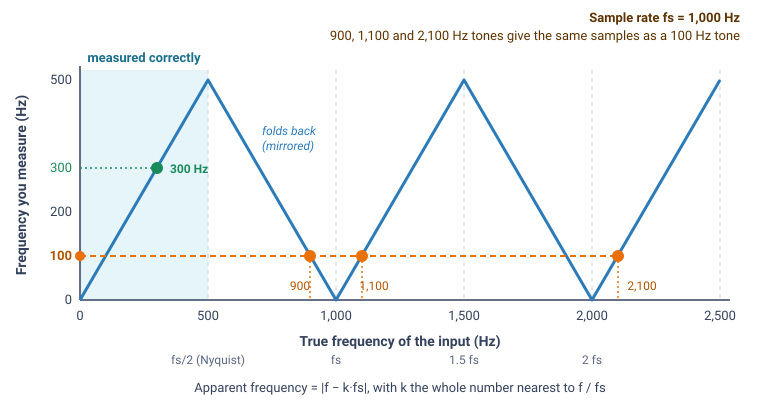
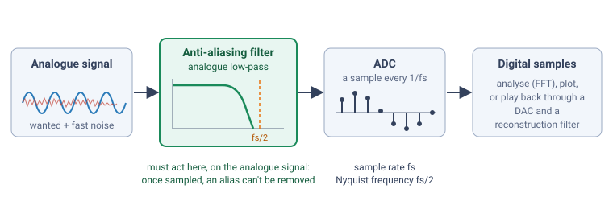

<head>
    <script type="application/ld+json">
        {JSON.stringify({
            "@context": "https://schema.org",
            "@type": "FAQPage",
            "mainEntity": [
                {
                    "@type": "Question",
                    "name": "What is the Nyquist frequency?",
                    "acceptedAnswer": { "@type": "Answer", "text": "The Nyquist frequency is half the sampling rate: fN = fs / 2. It is the highest frequency a sampled signal can represent. Sampling at 1,000 samples per second gives a Nyquist frequency of 500 Hz, and CD audio at 44,100 samples per second gives 22,050 Hz. Anything above the Nyquist frequency is aliased to a lower frequency." }
                },
                {
                    "@type": "Question",
                    "name": "What does the Nyquist theorem say?",
                    "acceptedAnswer": { "@type": "Answer", "text": "The Nyquist–Shannon sampling theorem says that a signal containing no frequencies above B hertz can be rebuilt exactly from its samples if you sample faster than 2B samples per second. In short: sample at more than twice the highest frequency in the signal, fs > 2 fmax, and remove anything higher before sampling." }
                },
                {
                    "@type": "Question",
                    "name": "What is the difference between the Nyquist rate and the Nyquist frequency?",
                    "acceptedAnswer": { "@type": "Answer", "text": "The Nyquist frequency belongs to the sampling system: it is half the sample rate, fs / 2, and is the highest frequency you can capture. The Nyquist rate belongs to the signal: it is twice the signal's highest frequency, 2 fmax, and is the rate you must sample faster than. For audio up to 20 kHz, the Nyquist rate is 40 kHz; a 48 kHz recorder has a Nyquist frequency of 24 kHz." }
                },
                {
                    "@type": "Question",
                    "name": "What is aliasing?",
                    "acceptedAnswer": { "@type": "Answer", "text": "Aliasing is what happens when a signal is sampled too slowly: frequencies above half the sample rate show up as false, lower frequencies in the samples. A 900 Hz tone sampled 1,000 times a second looks exactly like a 100 Hz tone. In images and graphics, the same effect causes jagged edges, moiré patterns and wheels that seem to spin backwards on film." }
                },
                {
                    "@type": "Question",
                    "name": "How do you prevent aliasing?",
                    "acceptedAnswer": { "@type": "Answer", "text": "Remove every frequency above half the sample rate before sampling. In hardware, put an analogue low-pass anti-aliasing filter in front of the analogue-to-digital converter, and sample fast enough to leave room for the filter's roll-off. In software, low-pass filter before you downsample, and when plotting dense data, use a min-max or similar downsampling method rather than keeping every nth point." }
                },
                {
                    "@type": "Question",
                    "name": "How do I show sampling and aliasing in JavaScript?",
                    "acceptedAnswer": { "@type": "Answer", "text": "Generate or load your samples, then draw them as stems with an impulse series and draw the continuous signal as a line. To find where a tone lands, subtract the nearest whole multiple of the sample rate from its frequency and take the size of the result. With SciChart.js, use a FastImpulseRenderableSeries for the samples and a FastLineRenderableSeries for the signal; the same code works in React with scichart-react and in Angular with scichart-angular." }
                }
            ]
        })}
    </script>
</head>

# Nyquist Frequency and Aliasing

## What is the Nyquist frequency?

The **Nyquist frequency** is half the sampling rate: $f_s/2$, where $f_s$ is the number of samples taken each second. It is the highest frequency that a signal sampled $f_s$ times a second can represent. Frequencies above it are **aliased**: they turn up in the samples as false, lower frequencies. At 44.1 kHz, the Nyquist frequency is 22.05 kHz.


*A 9 Hz sine sampled 10 times a second (top) looks like a 1 Hz wave, and its spectrum (bottom) shows the tone folding down below the Nyquist frequency. [Try the interactive version](#how-to-visualise-sampling-and-aliasing-in-javascript-react-or-angular), where you can sweep the frequency past the Nyquist limit.*

:::tip Key takeaways
- The Nyquist frequency is $f_s/2$, half the sample rate: the highest frequency the samples can hold.
- The Nyquist–Shannon sampling theorem: sample faster than twice the highest frequency in the signal, $f_s > 2 f_{max}$.
- Aliasing folds anything above $f_s/2$ back down: the apparent frequency is $|f - k f_s|$. A 900 Hz tone sampled at 1 kHz reads as 100 Hz.
- After sampling, an alias can't be told apart from a real tone, so it must be removed before sampling with an anti-aliasing (low-pass) filter.
- The same effect causes moiré in photos, jagged edges in graphics, backwards-spinning wheels on film and misleading charts of dense data.
:::

## What is aliasing?

**Aliasing** is the error that appears when a signal is sampled too slowly to follow it: a fast oscillation produces the same samples as a slower one, so the slower one is what you see. The false frequency is called an **alias**. In signal processing, aliasing happens to any frequency above the Nyquist frequency.

Picture a three-bladed ceiling fan filmed at 25 frames a second. If it turns just under a third of a revolution between frames, each frame catches the blades slightly short of where the previous blade was, and on screen they creep slowly backwards. The camera's frame rate is a sample rate, and the slow backwards motion is an alias of the fast forward one. Nothing in the frames tells you which is true.

## Sampling and the sampling rate

**Sampling** turns a continuous (analogue) signal into a list of numbers by measuring it at regular moments. An **analogue-to-digital converter** (ADC) in a sound card, a data logger, an [oscilloscope](/learn/applications/oscilloscope/) or a sensor does this.

The **sampling rate** (also called the sample rate or sampling frequency), $f_s$, is how many samples are taken each second. It is given in hertz (Hz) or samples per second (S/s), and the time between samples, the **sampling interval**, is its reciprocal:

$$
T_s = \frac{1}{f_s}
$$

For example, 48 kHz audio takes 48,000 samples a second, one every 20.8 µs. A sample rate tells you how often you look at the signal; it says nothing about how precisely each sample is measured, which is the converter's **bit depth** (resolution).

## The Nyquist–Shannon sampling theorem

The **Nyquist–Shannon sampling theorem** (often just the Nyquist theorem or sampling theorem) answers the question "how often do I need to sample?":

> If a signal contains no frequencies above $B$ hertz, it is completely determined by samples taken more than $2B$ times a second.

So the rule is:

$$
f_s > 2 f_{max}
$$

Completely determined means the original continuous waveform, including what it does between the samples, can be rebuilt exactly. The ideal rebuild puts a $\operatorname{sinc}$ pulse at each sample and adds them up (Whittaker–Shannon interpolation):

$$
x(t) = \sum_{n} x[n] \; \operatorname{sinc}\!\left(f_s t - n\right), \qquad \operatorname{sinc}(u) = \frac{\sin(\pi u)}{\pi u}
$$

A digital-to-analogue converter followed by a low-pass **reconstruction filter** approximates this in hardware.

The theorem holds only under these conditions:

- The signal must be band-limited. Real signals rarely stop dead at a frequency. Noise, harmonics and sharp edges reach far higher, which is why an anti-aliasing filter is needed.
- The inequality is strict. At exactly $f_s = 2f$, a sine can be sampled at its zero crossings every time and look like a flat line. Its samples don't fix its amplitude or phase.
- The rebuild assumes the samples go on for ever. With a finite record, the edges of the record are less accurate.

### Who discovered the sampling theorem?

Harry Nyquist showed in 1928 that a telegraph channel of bandwidth $B$ can carry at most $2B$ independent pulses a second. Claude Shannon gave the theorem its modern statement and proof in 1949, and named the interval $1/2B$ after Nyquist. E. T. Whittaker (1915) and Vladimir Kotelnikov (1933) had reached the same result independently, so it also appears as the Whittaker–Kotelnikov–Shannon theorem.

### Nyquist frequency formula

The Nyquist frequency, $f_N$, follows directly from the sample rate:

$$
f_N = \frac{f_s}{2}
$$

To calculate it, halve the sample rate: 1 kHz gives 500 Hz, 8 kHz gives 4 kHz, 44.1 kHz gives 22.05 kHz and 1 GS/s (a billion samples a second) gives 500 MHz. Going the other way, the minimum sample rate for a signal is just over twice its highest frequency.

## Nyquist frequency vs Nyquist rate

The two names sound alike and are often swapped. One is a property of the sampling system, the other a property of the signal:

| | Nyquist frequency | Nyquist rate |
| --- | --- | --- |
| Formula | $f_s / 2$ | $2 f_{max}$ |
| Depends on | The sample rate you chose | The highest frequency in the signal |
| Answers | "What's the highest frequency I can capture at this sample rate?" | "How fast must I sample this signal?" |
| Rule | Keep the signal below it | Sample faster than it |
| Example | A 48 kHz recorder: 24 kHz | Sound up to 20 kHz: 40 kHz |
| Also called | Folding frequency, Nyquist limit | Minimum sampling rate |

When a signal's Nyquist rate is below the system's sample rate, its highest frequency is below the Nyquist frequency, and there's no aliasing.

One more name clash: the Nyquist plot and the Nyquist stability criterion in control theory come from a different paper by the same Harry Nyquist (1932). They are about feedback loops, not sampling.

## How aliasing works: the folding formula

Sampling at $f_s$ can't tell apart frequencies that differ by a whole multiple of $f_s$. Every frequency therefore lands somewhere between 0 and $f_s/2$, at its **apparent frequency**:

$$
f_{alias} = \left| f - k f_s \right|, \qquad k = \text{the whole number nearest to } f / f_s
$$

Think of the frequency axis as a strip of paper folded like a concertina at $f_s/2$, $f_s$, $3f_s/2$ and so on. Every frequency that lies on top of another after folding gives the same samples. That's why the Nyquist frequency is also called the **folding frequency**.



For example, a 900 Hz tone is sampled at 1,000 samples a second. The Nyquist frequency is 500 Hz, so the tone is too high. The nearest multiple of 1,000 to 900 is 1,000 ($k = 1$), so

$$
f_{alias} = |900 - 1 \times 1000| = 100\ \text{Hz}
$$

The samples, and any FFT of them, show a 100 Hz tone. More examples, all checked with a direct Fourier transform of the samples:

| Tone $f$ | Sample rate $f_s$ | $k$ | Apparent frequency | What happens |
| --- | --- | --- | --- | --- |
| 300 Hz | 1 kHz | 0 | 300 Hz | Below $f_s/2$: measured correctly |
| 600 Hz | 1 kHz | 1 | 400 Hz | Just above $f_s/2$: mirrored just below it |
| 900 Hz | 1 kHz | 1 | 100 Hz | The worked example |
| 1,100 Hz | 1 kHz | 1 | 100 Hz | Also 100 Hz: indistinguishable from 900 Hz |
| 2,000 Hz | 1 kHz | 2 | 0 Hz | A whole multiple of $f_s$: looks like a constant (a stopped wheel) |
| 25 kHz | 44.1 kHz | 1 | 19.1 kHz | Ultrasound folds into the audible range |
| 30 kHz | 44.1 kHz | 1 | 14.1 kHz | Further up, and further down into the audio band |

Tones between $f_s/2$ and $f_s$ (and in every other "falling" stretch of the zigzag) are mirrored: as the true frequency rises, the alias falls. Their phase is reversed too, which is why a wheel just under the frame rate seems to turn backwards.

### Why aliases can't be told apart after sampling

Sample a sine of frequency $f$ at the moments $t = n/f_s$:

$$
\sin\!\left(2\pi f \frac{n}{f_s}\right) = \sin\!\left(2\pi (f - k f_s) \frac{n}{f_s} + 2\pi k n\right) = \sin\!\left(2\pi (f - k f_s) \frac{n}{f_s}\right)
$$

because adding a whole number of turns, $2\pi k n$, changes nothing. The two sines give exactly the same numbers at every sample. No later processing (no filter, FFT or clever algorithm) can work out which one was there, because the information isn't in the data. Aliasing has to be prevented before or during sampling, not fixed afterwards.

## Anti-aliasing filters and oversampling

The standard defence is an **anti-aliasing filter**: an analogue [low-pass filter](/learn/signal-processing/low-pass-filter/) placed in front of the ADC, which removes everything above the Nyquist frequency before it can fold. In software, the same job is done by a digital filter before downsampling (see [FIR vs IIR filters](/learn/signal-processing/fir-vs-iir-filters/) for the two ways to build one).



No real filter is a brick wall, so a gap is needed between the highest frequency you want and the Nyquist frequency, where the filter can roll off. An 8th-order Butterworth filter with a cutoff at $0.4 f_s$, for example, still lets through 17% of a tone at $f_s/2$ (−16 dB), and only falls to 0.15% (−56 dB) at $0.9 f_s$. To get the gap:

- Sample faster than the bare minimum. CD audio covers sound up to about 20 kHz and samples at 44.1 kHz, so the filter has from 20 kHz to the 22.05 kHz Nyquist frequency to work.
- Oversample. Sample many times faster than needed, so a gentle, cheap analogue filter is enough. Then apply a sharp digital low-pass filter and keep every $M$th sample. Most modern audio converters (delta-sigma ADCs) work this way.
- Use a steeper analogue filter, such as a high-order elliptic filter (the steepest roll-off for a given order), at the cost of more components and more phase distortion near the cutoff.

The same rule applies in software. **Downsampling** (keeping every $M$th sample) lowers the Nyquist frequency to $f_s/(2M)$, so anything above that must be low-pass filtered out first. Filtering and then downsampling is called **decimation**; see [downsampling in signal processing](/learn/big-data/downsampling/#downsampling-in-signal-processing-decimation-and-anti-aliasing).

## Common sampling rates and why they were chosen

Most standard sample rates are set a little above twice the highest frequency the signal needs, leaving room for the anti-aliasing filter.

| Use | Typical sample rate | Nyquist frequency | Why |
| --- | --- | --- | --- |
| Telephone speech (ITU-T G.711) | 8 kHz | 4 kHz | The telephone band is about 300 to 3,400 Hz, so 8 kHz leaves room for the filter |
| Wideband (HD) voice (ITU-T G.722) | 16 kHz | 8 kHz | Carries speech up to about 7 kHz, which sounds noticeably clearer |
| CD audio (IEC 60908) | 44.1 kHz | 22.05 kHz | Above twice the roughly 20 kHz limit of human hearing. The exact figure came from storing digital audio on video recorders: 3 samples per line on 245 lines at 60 fields a second, or 294 lines at 50 fields, both give 44,100 |
| Professional audio and video (AES5) | 48 kHz | 24 kHz | The standard rate for broadcast, film and video sound; it gives a whole number of samples per frame at 24, 25 and 30 frames a second |
| High-resolution audio | 96 kHz or 192 kHz | 48 kHz or 96 kHz | Moves the filter's roll-off far above hearing; common in studio recording |
| Diagnostic ECG | 500 Hz or more | 250 Hz or more | Clinical guidelines ask for a bandwidth of at least 150 Hz in adults (250 Hz in children), so 500 samples a second is a common minimum |
| Machine vibration (FFT analysers) | Often 2.56 × the analysis range, e.g. 25.6 kHz for 10 kHz | 1.28 × the range | The margin above the range of interest leaves room for the anti-aliasing filter's roll-off |
| Film and video | 24, 25, 30 or 60 frames/s | 12 to 30 cycles/s | A temporal sample rate: anything that repeats faster (wheels, rotors, screens) can alias |

## Aliasing in an FFT

An [FFT](/learn/signal-processing/fast-fourier-transform/) of sampled data shows frequencies from 0 Hz up to the Nyquist frequency only. A tone above $f_s/2$ doesn't appear off the end of the plot: it appears inside it, at its alias, looking exactly like a real peak. A 700 Hz tone sampled at 1 kHz shows as a clean peak at 300 Hz.

Broadband noise aliases too. Noise above the Nyquist frequency doesn't form a peak; it folds onto the whole band and raises the noise floor. A missing or weak anti-aliasing filter often shows up as a spectrum that is noisier than it should be, rather than as a false tone.

### How to tell whether a peak is an alias

Change the sample rate. A real tone stays at the same frequency. An alias moves, because its position depends on $f_s$. If you can't change the rate, look for peaks that make no physical sense (for example a "harmonic" that doesn't sit at a whole multiple of the fundamental), and check how the ADC is filtered.

## Aliasing when plotting dense data

Aliasing can also happen when data is drawn. A chart a thousand pixels wide can't show a million samples individually, so something has to reduce them. The simplest method, keeping every $n$th point, is sampling again at a lower rate, with no anti-aliasing filter:

- a fast oscillation can turn into a slow false wave, or vanish when the kept points happen to fall on its zero crossings;
- narrow spikes and glitches disappear whenever they fall between kept points;
- the picture can change completely as you zoom or pan, as different points are kept.

Methods built for charts avoid this by keeping the shape of the data in each pixel column instead of a single point. **Min-max** keeps the lowest and highest value of each column, so the envelope and every spike survive; **M4** also keeps the first and last; **LTTB** picks the points that best preserve the visual shape. See [downsampling for charts: every-nth vs min-max vs LTTB](/learn/big-data/downsampling/) for a live comparison on a million points.

## Aliasing in images, video and graphics

The "aliasing" you meet in photography, video and games is the same effect in space or time instead of in a signal:

- Moiré patterns: a camera sensor samples the image on a grid of pixels. Fine, regular detail (a striped shirt, a fabric weave, a brick wall far away) above the sensor's spatial Nyquist frequency folds into large, wavy false patterns. Some cameras put an optical low-pass filter in front of the sensor for exactly this reason.
- Jagged edges ("jaggies"): drawing a sloped line or curve on a pixel grid samples it at each pixel centre, which turns a smooth edge into steps. Anti-aliasing in graphics and games (supersampling, multisample anti-aliasing or MSAA, and similar) renders at extra sample points per pixel and averages them, which is oversampling and low-pass filtering in two dimensions.
- The wagon-wheel (stroboscopic) effect: film and video sample time at a fixed frame rate, so spokes, rotors and propellers can appear to stand still or turn backwards. A strobe light does the same deliberately, to "freeze" a spinning machine for inspection.
- Doppler ultrasound: a pulsed Doppler scanner samples blood velocity once per pulse, at its pulse repetition frequency (PRF). Flow fast enough to create a Doppler shift above PRF/2 wraps around and is displayed as flow in the opposite direction, an aliasing artefact.

## Common sampling and aliasing mistakes

Most aliasing problems come from sampling too close to the limit, or from filtering too late.

- **Sampling at exactly twice the frequency.** The theorem needs more than $2f_{max}$, and real filters need a margin on top. Sampling at $2f$ can miss a sine completely.
- **Counting only the fundamental.** A square wave, a PWM signal or a clipped waveform has harmonics far above its repetition rate. The highest frequency present, not the one you care about, sets the requirement.
- **Downsampling by dropping samples.** Keeping every $M$th sample without low-pass filtering first folds everything between the new and old Nyquist frequencies into your data.
- **Confusing the Nyquist rate and the Nyquist frequency.** One is $2 f_{max}$, the other $f_s/2$. Mixing them up gives a sample rate that is off by a factor of two or more.
- **Expecting a higher sample rate to sharpen an FFT.** Sampling faster raises the Nyquist frequency; only a longer recording gives finer frequency resolution.
- **Trusting a plot of dense data drawn by decimation.** If a chart keeps every $n$th point, a fast signal can look slow or flat. Use a min-max-based method for display.

## How to visualise sampling and aliasing in JavaScript, React or Angular

The demo draws one second of a tone as a 6,000-point line, samples it at the rate you choose, and works out where the alias lands each time you move a slider. Drag the **signal frequency** past the dashed Nyquist line and watch the orange "what the samples show" wave slow down, stop at the sample rate and speed up again; or press **Sweep the frequency**. Move the **sample rate** to see the alias move while the true tone stays put, and switch on the **anti-aliasing filter** to see it remove the alias. Hover over the stems to read each sample; scroll to zoom, drag to pan, and double-click to reset.

<LiveDocSnippet maxWidth={'100%'} height={720} name="./Basic/demo" />

<LearnCta position="top" chart="sampling and aliasing chart" demo="impulse-chart" demoLabel="impulse (stem) chart" docs="/2d-charts/chart-types/fast-impulse-renderable-series/" docsLabel="SciChart.js impulse (stem) series documentation" />

Here is the code for this chart. The JavaScript tab contains the sampling and aliasing maths; the React and Angular tabs show your own samples as stems, with the band-limited signal rebuilt between them by sinc interpolation:

<CodeSnippetBlock labels={["JavaScript", "React", "Angular"]}>
    ```ts showLineNumbers file=./Basic/demo.ts start=#region_A_start end=#region_A_end
    ```

    ```tsx
    import { SciChartReact } from "scichart-react";
    import {
        SciChartSurface,
        NumericAxis,
        XyDataSeries,
        FastImpulseRenderableSeries,
        FastLineRenderableSeries,
        EllipsePointMarker,
        LegendModifier,
        CursorModifier,
        SciChartJsNavyTheme
    } from "scichart";

    // Ideal (Whittaker-Shannon) reconstruction: the band-limited signal that passes through every sample,
    // x(t) = sum of x[n] * sinc(sampleRate * t - n). Exact only if the signal had nothing above sampleRate / 2.
    // This direct sum suits a few hundred samples; for long signals, use an FFT-based resampler.
    const sincReconstruct = (values: number[], sampleRate: number, pointsPerSample = 16) => {
        const time: number[] = [];
        const signal: number[] = [];
        for (let i = 0; i <= (values.length - 1) * pointsPerSample; i++) {
            const t = i / pointsPerSample / sampleRate;
            let sum = 0;
            for (let n = 0; n < values.length; n++) {
                const u = Math.PI * (sampleRate * t - n);
                sum += values[n] * (Math.abs(u) < 1e-12 ? 1 : Math.sin(u) / u);
            }
            time.push(t);
            signal.push(sum);
        }
        return { time, signal };
    };

    // initChart builds the chart; SciChartReact creates it, sizes it and cleans it up
    const initChart = async (rootElement: string | HTMLDivElement) => {
        const { wasmContext, sciChartSurface } = await SciChartSurface.create(rootElement, {
            theme: new SciChartJsNavyTheme()
        });
        const { sampleRate, values } = getYourSampledData(); // e.g. from an ADC, a sensor or a WAV file
        sciChartSurface.xAxes.add(
            new NumericAxis(wasmContext, { axisTitle: `Time (s) · Nyquist frequency ${sampleRate / 2} Hz` })
        );
        sciChartSurface.yAxes.add(new NumericAxis(wasmContext, { axisTitle: "Amplitude" }));

        const { time, signal } = sincReconstruct(values, sampleRate);
        sciChartSurface.renderableSeries.add(
            // The rebuilt signal between the samples
            new FastLineRenderableSeries(wasmContext, {
                dataSeries: new XyDataSeries(wasmContext, { xValues: time, yValues: signal, dataSeriesName: "Reconstructed" }),
                stroke: "#F48420",
                strokeThickness: 2
            }),
            // Each sample as a stem with a dot
            new FastImpulseRenderableSeries(wasmContext, {
                dataSeries: new XyDataSeries(wasmContext, {
                    xValues: values.map((_, n) => n / sampleRate),
                    yValues: values,
                    dataSeriesName: "Samples"
                }),
                fill: "#FFFFFF",
                strokeThickness: 2,
                size: 10,
                pointMarker: new EllipsePointMarker(wasmContext)
            })
        );
        sciChartSurface.chartModifiers.add(new LegendModifier(), new CursorModifier({ showTooltip: true }));
        return { sciChartSurface };
    };

    export const SampledSignalChart = () => (
        <SciChartReact initChart={initChart} style={{ width: "100%", height: 400 }} />
    );
    ```

    ```ts
    import { Component } from "@angular/core";
    import { ScichartAngularComponent } from "scichart-angular";
    import {
        SciChartSurface,
        NumericAxis,
        XyDataSeries,
        FastImpulseRenderableSeries,
        FastLineRenderableSeries,
        EllipsePointMarker,
        LegendModifier,
        CursorModifier,
        SciChartJsNavyTheme
    } from "scichart";

    // Ideal (Whittaker-Shannon) reconstruction: the band-limited signal that passes through every sample,
    // x(t) = sum of x[n] * sinc(sampleRate * t - n). Exact only if the signal had nothing above sampleRate / 2.
    // This direct sum suits a few hundred samples; for long signals, use an FFT-based resampler.
    const sincReconstruct = (values: number[], sampleRate: number, pointsPerSample = 16) => {
        const time: number[] = [];
        const signal: number[] = [];
        for (let i = 0; i <= (values.length - 1) * pointsPerSample; i++) {
            const t = i / pointsPerSample / sampleRate;
            let sum = 0;
            for (let n = 0; n < values.length; n++) {
                const u = Math.PI * (sampleRate * t - n);
                sum += values[n] * (Math.abs(u) < 1e-12 ? 1 : Math.sin(u) / u);
            }
            time.push(t);
            signal.push(sum);
        }
        return { time, signal };
    };

    @Component({
        selector: "app-sampled-signal-chart",
        standalone: true,
        imports: [ScichartAngularComponent],
        template: `<scichart-angular [initChart]="initChart" style="display: block; width: 100%; height: 400px"></scichart-angular>`
    })
    export class SampledSignalChartComponent {
        // initChart builds the chart; scichart-angular creates it, sizes it and cleans it up
        initChart = async (rootElement: string | HTMLDivElement) => {
            const { wasmContext, sciChartSurface } = await SciChartSurface.create(rootElement, {
                theme: new SciChartJsNavyTheme()
            });
            const { sampleRate, values } = getYourSampledData(); // e.g. from an ADC, a sensor or a WAV file
            sciChartSurface.xAxes.add(
                new NumericAxis(wasmContext, { axisTitle: `Time (s) · Nyquist frequency ${sampleRate / 2} Hz` })
            );
            sciChartSurface.yAxes.add(new NumericAxis(wasmContext, { axisTitle: "Amplitude" }));

            const { time, signal } = sincReconstruct(values, sampleRate);
            sciChartSurface.renderableSeries.add(
                // The rebuilt signal between the samples
                new FastLineRenderableSeries(wasmContext, {
                    dataSeries: new XyDataSeries(wasmContext, { xValues: time, yValues: signal, dataSeriesName: "Reconstructed" }),
                    stroke: "#F48420",
                    strokeThickness: 2
                }),
                // Each sample as a stem with a dot
                new FastImpulseRenderableSeries(wasmContext, {
                    dataSeries: new XyDataSeries(wasmContext, {
                        xValues: values.map((_, n) => n / sampleRate),
                        yValues: values,
                        dataSeriesName: "Samples"
                    }),
                    fill: "#FFFFFF",
                    strokeThickness: 2,
                    size: 10,
                    pointMarker: new EllipsePointMarker(wasmContext)
                })
            );
            sciChartSurface.chartModifiers.add(new LegendModifier(), new CursorModifier({ showTooltip: true }));
            return { sciChartSurface };
        };
    }
    ```
</CodeSnippetBlock>

Key points:

- Samples as stems: a [FastImpulseRenderableSeries](/2d-charts/chart-types/fast-impulse-renderable-series/) draws each sample as a vertical line from zero with an `EllipsePointMarker` on top, the usual way to show discrete-time data. The continuous signal and the apparent wave are ordinary `FastLineRenderableSeries`.
- The aliasing maths is one line: `f - sampleRate * Math.round(f / sampleRate)` gives the alias with its sign (a negative value runs backwards); its size is the apparent frequency. The spectrum chart draws the measured line, the true tone and the images at $m f_s \pm f_{alias}$ (the copies of the spectrum that sampling repeats around every multiple of $f_s$) as three impulse series.
- Live updates: each control calls `update()`, which calls `clear()` and `appendRange()` on the data series and moves the annotations: a `BoxAnnotation` shades 0 to $f_s/2$, `VerticalLineAnnotation`s mark the Nyquist frequency and $f_s$, and a `LineArrowAnnotation` shows the fold.
- Plotting dense data without aliasing: when a series has more points than the chart has pixels, SciChart.js [resamples](/2d-charts/chart-types/data-series-api/resampling/) it automatically with min-max style algorithms that keep peaks and troughs, so a fast signal isn't turned into a false slow one on screen.

**See it in the demo app:** [JavaScript impulse (stem) chart](https://www.scichart.com/demo/javascript/impulse-chart) · [React impulse (stem) chart](https://www.scichart.com/demo/react/impulse-chart) · [Angular impulse (stem) chart](https://www.scichart.com/demo/angular/impulse-chart). For a live signal and its spectrum, see the [JavaScript audio analyzer](https://www.scichart.com/demo/javascript/audio-analyzer-fft-example) · [React audio analyzer](https://www.scichart.com/demo/react/audio-analyzer-fft-example) · [Angular audio analyzer](https://www.scichart.com/demo/angular/audio-analyzer-fft-example).

**Go deeper:** [SciChart.js impulse (stem) series documentation](/2d-charts/chart-types/fast-impulse-renderable-series/), [data series resampling](/2d-charts/chart-types/data-series-api/resampling/), and the related guides: [FFT](/learn/signal-processing/fast-fourier-transform/), [low-pass filter](/learn/signal-processing/low-pass-filter/) and [downsampling](/learn/big-data/downsampling/).

## Frequently asked questions

### What is the Nyquist frequency?

The Nyquist frequency is half the sampling rate: fN = fs / 2. It is the highest frequency a sampled signal can represent. Sampling at 1,000 samples per second gives a Nyquist frequency of 500 Hz, and CD audio at 44,100 samples per second gives 22,050 Hz. Anything above the Nyquist frequency is aliased to a lower frequency.

### What does the Nyquist theorem say?

The Nyquist–Shannon sampling theorem says that a signal containing no frequencies above B hertz can be rebuilt exactly from its samples if you sample faster than 2B samples per second. In short: sample at more than twice the highest frequency in the signal, fs > 2 fmax, and remove anything higher before sampling.

### What is the difference between the Nyquist rate and the Nyquist frequency?

The Nyquist frequency belongs to the sampling system: it is half the sample rate, fs / 2, and is the highest frequency you can capture. The Nyquist rate belongs to the signal: it is twice the signal's highest frequency, 2 fmax, and is the rate you must sample faster than. For audio up to 20 kHz, the Nyquist rate is 40 kHz; a 48 kHz recorder has a Nyquist frequency of 24 kHz.

### What is aliasing?

Aliasing is what happens when a signal is sampled too slowly: frequencies above half the sample rate show up as false, lower frequencies in the samples. A 900 Hz tone sampled 1,000 times a second looks exactly like a 100 Hz tone. In images and graphics, the same effect causes jagged edges, moiré patterns and wheels that seem to spin backwards on film.

### How do you prevent aliasing?

Remove every frequency above half the sample rate before sampling. In hardware, put an analogue low-pass anti-aliasing filter in front of the analogue-to-digital converter, and sample fast enough to leave room for the filter's roll-off. In software, low-pass filter before you downsample, and when plotting dense data, use a min-max or similar downsampling method rather than keeping every nth point.

### How do I show sampling and aliasing in JavaScript?

Generate or load your samples, then draw them as stems with an impulse series and draw the continuous signal as a line. To find where a tone lands, subtract the nearest whole multiple of the sample rate from its frequency and take the size of the result. With SciChart.js, use a FastImpulseRenderableSeries for the samples and a FastLineRenderableSeries for the signal; the same code works in React with scichart-react and in Angular with scichart-angular.

## Sources

- Nyquist, H. (1928), [Certain Topics in Telegraph Transmission Theory](https://doi.org/10.1109/T-AIEE.1928.5055024). *Transactions of the AIEE*, 47(2), 617–644. The $2B$ pulses-per-second limit.
- Shannon, C. E. (1949), [Communication in the Presence of Noise](https://doi.org/10.1109/JRPROC.1949.232969). *Proceedings of the IRE*, 37(1), 10–21. The sampling theorem and sinc reconstruction.
- Smith, S. W., *The Scientist and Engineer's Guide to Digital Signal Processing*, [chapter 3: ADC and DAC](https://www.dspguide.com/ch3.htm). The sampling theorem, aliasing and anti-aliasing filters.
- Oppenheim, A. V. and Schafer, R. W. (2010), *Discrete-Time Signal Processing*, 3rd edition, Pearson. Chapter 4, sampling of continuous-time signals, decimation and oversampling.
- ITU-T Recommendation [G.711](https://www.itu.int/rec/T-REC-G.711) (8 kHz telephone sampling) and [G.722](https://www.itu.int/rec/T-REC-G.722) (16 kHz wideband speech); Audio Engineering Society, *AES5: Preferred sampling frequencies for applications employing pulse-code modulation*.
- Kligfield, P. et al. (2007), [Recommendations for the Standardization and Interpretation of the Electrocardiogram, Part I](https://doi.org/10.1161/CIRCULATIONAHA.106.180200). *Circulation*, 115(10), 1306–1324. ECG bandwidth (high-frequency cutoff).
- Randall, R. B. (1987), *Frequency Analysis*, 3rd edition, Brüel & Kjær. FFT analysers and anti-aliasing filters.

<LearnCta position="bottom" chart="sampling and aliasing chart" demo="impulse-chart" demoLabel="impulse (stem) chart" docs="/2d-charts/chart-types/fast-impulse-renderable-series/" docsLabel="SciChart.js impulse (stem) series documentation" />
