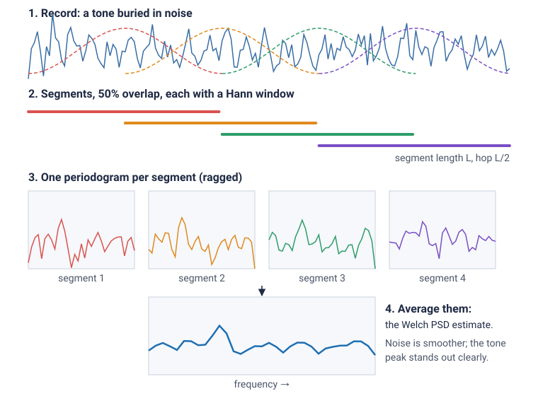

<head>
    <script type="application/ld+json">
        {JSON.stringify({
            "@context": "https://schema.org",
            "@type": "FAQPage",
            "mainEntity": [
                {
                    "@type": "Question",
                    "name": "What is power spectral density in simple terms?",
                    "acceptedAnswer": { "@type": "Answer", "text": "Power spectral density (PSD) shows how a signal's power is spread across frequency, as power per hertz. A flat PSD means the power is spread evenly, like white noise; a tall, narrow peak means a lot of power at one frequency, like a hum or a resonance. The area under the PSD is the signal's total power, its mean square." }
                },
                {
                    "@type": "Question",
                    "name": "What are the units of power spectral density?",
                    "acceptedAnswer": { "@type": "Answer", "text": "The units are the signal's unit squared per hertz: V²/Hz for a voltage, g²/Hz for acceleration in vibration testing, Pa²/Hz for sound pressure. On a decibel scale it is written dB/Hz, meaning 10 log10 of the PSD relative to a reference such as 1 V²/Hz or 1 mW/Hz (dBm/Hz). The square root, in V/√Hz, is the amplitude spectral density used on noise data sheets." }
                },
                {
                    "@type": "Question",
                    "name": "What is the difference between PSD and FFT?",
                    "acceptedAnswer": { "@type": "Answer", "text": "The FFT is an algorithm that turns a block of samples into frequency bins. A PSD is a measurement you calculate from those bins: the squared magnitudes, scaled by the sample rate and window so they read as power per hertz, and usually averaged over many blocks. An FFT amplitude spectrum suits steady tones; a PSD suits noise and random vibration, because its level doesn't change with the FFT size." }
                },
                {
                    "@type": "Question",
                    "name": "How do you calculate Grms from a PSD?",
                    "acceptedAnswer": { "@type": "Answer", "text": "Grms is the square root of the area under an acceleration PSD in g²/Hz. For a flat PSD, multiply the level by the bandwidth and take the square root: 0.04 g²/Hz from 20 to 2,000 Hz gives 0.04 × 1,980 = 79.2 g², so about 8.9 Grms. For a measured or sloped PSD, add up level × bin width over every bin, then take the square root." }
                },
                {
                    "@type": "Question",
                    "name": "Does a JavaScript PSD match Python's scipy.signal.welch or MATLAB's pwelch?",
                    "acceptedAnswer": { "@type": "Answer", "text": "Yes, when the settings match. The Welch function on this page agrees with scipy.signal.welch to rounding error when both use the same periodic Hann window, segment length and overlap, and detrend is set to False; scipy subtracts each segment's mean by default, which changes only the lowest bins. MATLAB's pwelch uses the same density scaling, but its default is a symmetric Hamming window and eight segments with 50% overlap, so pass the window, overlap, FFT length and sample rate explicitly when comparing." }
                },
                {
                    "@type": "Question",
                    "name": "How do I plot a power spectral density in JavaScript?",
                    "acceptedAnswer": { "@type": "Answer", "text": "Cut the samples into overlapping segments, window each one, run an FFT, scale the squared magnitudes by the sample rate and the sum of the squared window, and average them (Welch's method). Convert to dB/Hz with 10 log10. With SciChart.js, put the frequencies and levels in an XyDataSeries, draw them with a FastLineRenderableSeries, and use a LogarithmicAxis for the frequency axis when the data spans several decades." }
                }
            ]
        })}
    </script>
</head>

# Power Spectral Density (PSD)

## What is power spectral density?

**Power spectral density** (**PSD**, also called the spectral density or power density spectrum) describes how a signal's power is spread across frequency, as **power per hertz** of bandwidth. It is the standard way to measure noise and random vibration: peaks show frequencies that carry a lot of power, and the area under the curve is the signal's total power.


*The PSD of two tones in white noise: one periodogram (orange) and the Welch average of 127 segments (blue), sample data. [Try the interactive version](#how-to-plot-a-power-spectral-density-in-javascript-react-or-angular), where you can change the segment length, overlap, window and number of averages.*

:::tip Key takeaways
- A PSD gives **power per unit of frequency**, in units such as V²/Hz, g²/Hz or dB/Hz.
- Dividing by the bin width makes **noise read the same level whatever the FFT size**. That's why it's called a density.
- The **area under the PSD is the mean square** of the signal, so its square root is the RMS (or Grms in vibration testing).
- A single periodogram is very noisy. **Welch's method** averages many windowed, overlapping segments to steady it, at the cost of frequency resolution.
- Use an **amplitude spectrum for tones** and a **PSD for noise and broadband signals**.
:::

## Why "density"? Power per hertz explained

An FFT splits a block of samples into frequency **bins**, each $\Delta f = f_s / N$ wide, where $f_s$ is the sample rate and $N$ the block length. (The [FFT guide](/learn/signal-processing/fast-fourier-transform/) explains bins in detail.) The squared magnitude of each bin is the power that falls inside it.

That power depends on how wide the bin is:

- **A steady tone** puts all its power into one bin, whatever the bin width. Its power reading stays the same as $N$ changes.
- **Broadband noise** spreads its power across every frequency. Make the bins half as wide and each catches half as much, so the noise floor in a power spectrum falls by 3 dB each time you double $N$.

So a plain power or amplitude spectrum of noise has no fixed level: it depends on a setting chosen by whoever ran the analysis. **Dividing each bin's power by its width** fixes that. The result, power per hertz, is the same for any FFT size, sample rate or instrument. Two labs can compare noise floors, and a vibration test can specify a level that any controller reproduces.


The trade goes the other way for tones. In a PSD, a tone's peak **rises 3 dB for each doubling of $N$**, because the same power is divided by an ever narrower bin. A PSD peak's height therefore isn't the tone's level. To read a tone's size, use an amplitude spectrum, or add up the PSD across the peak (see [Parseval's check](#the-area-under-the-psd-rms-and-grms)).

### The formal definition

For a stationary random signal, the PSD $S_{xx}(f)$ is the Fourier transform of its **[autocorrelation](/learn/signal-processing/autocorrelation/)** $R_{xx}(\tau)$, the average of $x(t)\,x(t+\tau)$ (the **Wiener–Khinchin theorem**):

$$
S_{xx}(f) = \int_{-\infty}^{\infty} R_{xx}(\tau)\, e^{-2\pi i f \tau}\, d\tau
$$

In practice nobody has an infinitely long recording, so the PSD is **estimated** from a finite block of samples. The rest of this guide is about doing that well.

## PSD units and dB/Hz

The unit of a PSD is the square of the signal's unit, per hertz. Plots often show it in decibels, because a PSD can span many powers of ten.

| Signal | PSD unit | In decibels | Square root (amplitude density) | Where you'll see it |
| --- | --- | --- | --- | --- |
| Voltage | V²/Hz | dB re 1 V²/Hz, often written dB/Hz or dBV/Hz | V/√Hz (nV/√Hz on data sheets) | Electronics, sensors, op-amp and ADC noise |
| Acceleration | g²/Hz | dB re 1 g²/Hz | g/√Hz | Random vibration testing, accelerometer noise |
| Sound pressure | Pa²/Hz | dB re (20 µPa)²/Hz | Pa/√Hz | Acoustics, noise measurement |
| Electrical power | W/Hz or mW/Hz | dBm/Hz (dB re 1 mW/Hz) | none | Radio, communications, noise figure |
| Brain or muscle signals | µV²/Hz | dB re 1 µV²/Hz | µV/√Hz | EEG and EMG band power |

**Converting to and from decibels.** A PSD in dB is $10 \log_{10}(S / S_\text{ref})$, using 10 rather than 20 because a PSD is already a power. So 2.44 × 10⁻⁴ V²/Hz is −36.1 dB re 1 V²/Hz, and its square root is 15.6 mV/√Hz. Every 10 dB is a factor of 10 in power density.

**Why it's "per hertz" even for power in watts.** A radio receiver's thermal noise floor is about −174 dBm/Hz at room temperature. In a 1 MHz bandwidth (60 dB above 1 Hz), that adds up to about −114 dBm. The density lets you work out the noise in any bandwidth by adding $10 \log_{10}(\text{bandwidth})$.

## How to read a PSD plot

A PSD plot (also called a PSD curve or PSD graph) has frequency along the horizontal axis and power density up the vertical axis, nearly always on a log or dB scale.

1. **Check the units on the vertical axis.** V²/Hz, g²/Hz or dB/Hz means a density. If it's V, V² or dB with no "/Hz", it's an amplitude or power spectrum, and noise levels won't compare across settings.
2. **Read the noise floor.** The broad level between peaks is the background noise density. On a dB/Hz scale, a 3 dB step is a doubling of power density.
3. **Look at its slope.** A flat floor is **white noise**. One that falls 3 dB per octave (10 dB per decade) is **pink noise**, or 1/f noise, common in electronics, music and nature. A 6 dB per octave fall is **brown (red) noise**, which looks like a random walk. Plot frequency on a log axis to see slopes as straight lines.
4. **Find the peaks.** A narrow peak is a tone: a hum, a rotating part or a clock. A wider hump is a resonance, such as a structure's natural frequency. Remember a narrow peak's height depends on the bin width.
5. **Read power in a band** as the area under the curve between two frequencies, not as a height. That's how EEG band power (for example, the alpha band around 8 to 13 Hz) and vibration Grms are found.

## How to calculate power spectral density

The basic estimate is the **periodogram**: one windowed FFT, squared and scaled to a density. **Welch's method** averages many of them.

### Step 1: the periodogram

Take $L$ samples $x_0 \ldots x_{L-1}$, multiply them by a window $w_n$ (such as Hann), run an FFT and square the magnitude. Then scale bin $k$ so it reads as power per hertz:

$$
P_k = \frac{c_k}{f_s \sum_{n=0}^{L-1} w_n^2} \left| \sum_{n=0}^{L-1} w_n\, x_n\, e^{-2\pi i k n / L} \right|^2, \qquad k = 0 \ldots \tfrac{L}{2}
$$

Each part of the scaling has a job:

- **$\sum w_n^2$** (the window's power) undoes the power the window removes. With no window it equals $L$.
- **$f_s$** turns power per bin into power per hertz. Together with $\sum w_n^2$, it divides by the window's **equivalent noise bandwidth**, which is 1 bin for no window and 1.5 bins for Hann.
- **$c_k = 2$** for every bin except 0 Hz and the Nyquist frequency ($c_k = 1$). A real signal's spectrum is mirrored at negative frequencies; doubling folds that power into the one-sided PSD you plot.

### Step 2: why one periodogram isn't enough

A periodogram of noise is very ragged. Each bin's value is random, with a spread as large as its average: about ±5.6 dB on a dB scale, however long the block. Making the block longer gives narrower bins, but each one is just as noisy. We measured a standard deviation of 5.1 dB across the noise floor of one 1,024-point periodogram in the example below.

### Step 3: Welch's method

**Welch's method** (Peter Welch, 1967) steadies the estimate by averaging:

1. **Cut** the recording into segments of $L$ samples. Let them **overlap**, usually by 50%: with a tapering window, the ends of each segment count for little, and overlap puts those samples back in the middle of the next one.
2. **Window** each segment, usually with Hann.
3. **Compute** each segment's periodogram, scaled as in step 1.
4. **Average** the $K$ periodograms, bin by bin:

$$
\hat{S}_k = \frac{1}{K} \sum_{m=1}^{K} P_k^{(m)}
$$



Averaging $K$ independent periodograms cuts the spread by a factor of $\sqrt{K}$. In the example below, the 127 segments of 1,024 samples with 50% overlap bring the noise floor's spread down from 5.1 dB to 0.39 dB.

### The trade-off: resolution vs variance

For a recording of fixed length $T$, the segment length decides everything:

| Segment length $L$ | Bin width $f_s / L$ | Segments averaged | Result |
| --- | --- | --- | --- |
| Long (few segments) | Narrow: fine detail | Few | Can separate close tones, but the noise floor is ragged |
| Short (many segments) | Wide: coarse detail | Many | Smooth, repeatable noise floor, but close peaks merge and narrow peaks look lower |

With 32 seconds of data at 2,048 samples a second (the example below) and 50% overlap: 256-sample segments give 8 Hz bins and 511 averages; 8,192-sample segments give 0.25 Hz bins and only 15. Pick the widest bins that still separate the features you care about, then average as much as the recording allows. If you need both fine detail and low variance, record for longer.

## The area under the PSD: RMS and Grms

**Parseval's theorem** says a signal's power is the same in time and in frequency. For a PSD, that means the area under the curve is the **mean square** of the signal:

$$
\sum_{k} \hat{S}_k \, \Delta f \;\approx\; \frac{1}{N} \sum_{n} x_n^2 = x_\text{rms}^2
$$

It's the best check that a PSD is scaled correctly. Add up the PSD times the bin width, take the square root, and you should get the RMS you measure in the time domain. With no window and no overlap the two match exactly; with a window they agree to within a fraction of a per cent for a steady signal. The example below shows both numbers side by side as you change the settings.

**Band power.** Add up only the bins between two frequencies to get the power, or RMS, in that band. This is how a 50 Hz hum's share of the noise is measured, or the power in each EEG band.

**Grms in vibration testing.** Random vibration tests are specified as an acceleration PSD in g²/Hz, and the shaker's overall level is quoted as **Grms**, the square root of the area. For a flat profile:

$$
G_\text{rms} = \sqrt{\text{PSD level} \times \text{bandwidth}}
$$

For example, 0.04 g²/Hz from 20 Hz to 2,000 Hz gives $\sqrt{0.04 \times 1980} = \sqrt{79.2} \approx 8.9$ Grms. Test profiles with sloping sections (given in dB per octave) need each sloping band integrated separately, but the principle is the same: area, then square root.

## PSD vs FFT, amplitude spectrum and power spectrum

These terms get mixed up, partly because "FFT" is often used to mean "a spectrum made with an FFT".

| If you're measuring… | Use | Units | Why |
| --- | --- | --- | --- |
| The size of steady tones: hum, harmonics, a rotating part | **Amplitude spectrum** (an FFT, scaled) | V, g or dB | A tone's peak reads its amplitude directly, whatever the FFT size |
| The power of each tone | **Power spectrum** | V², g² or dB | The square of the amplitude spectrum; again, tones read true, noise doesn't |
| Noise, random vibration or any broadband signal | **Power spectral density** | V²/Hz, g²/Hz or dB/Hz | The noise level doesn't depend on the FFT size, and the area gives the RMS |
| A signal whose frequencies change over time | **[Spectrogram](/learn/chart-types/cartesian/spectrogram/)** | Any of the above, as colour | Many short spectra over time, drawn as a heatmap |
| The underlying maths | **[Fourier transform](/learn/signal-processing/fourier-transform/)** | n/a | The theory every spectrum is built on |

Many real signals have both: tones on top of a noise floor. Instruments often show either view of the same data. Read tone sizes from the amplitude spectrum and noise levels from the PSD, and say which one a plot shows.

## What PSD is used for

- **Random vibration testing:** aerospace, automotive and electronics parts are shaken on a test rig to a PSD profile in g²/Hz, and the controller adjusts the drive until the measured PSD matches.
- **Structural and machine monitoring:** resonances show as humps in the PSD of an accelerometer signal; a shift in their frequency can mean damage or wear.
- **Electronics noise:** amplifier, sensor and ADC data sheets give noise density in nV/√Hz, so designers can work out the noise in their own bandwidth.
- **Communications:** a transmitter's PSD shows whether it stays inside its channel, and receiver sensitivity starts from the noise floor in dBm/Hz.
- **EEG and neuroscience:** brain activity is summarised as power in the delta, theta, alpha, beta and gamma bands, each an area under the PSD.
- **Audio and acoustics:** the PSD shows the tonal balance of a recording or a room's background noise, and checks whether a noise source is white or pink.
- **Science and finance:** turbulence, climate records, the 1/f noise of physical systems and the volatility of price series are all studied through their spectral density.

## Common PSD mistakes

- **Wrong scaling.** Forgetting the window's $\sum w^2$, the sample rate, or the factor of 2 for one-sided bins. Check with Parseval: the area should equal the mean square.
- **Comparing a PSD with an amplitude spectrum.** A tone at 0 dB in one can be −14 dB/Hz in the other, and noise floors differ by an amount that depends on the bin width. Compare like with like, and label the units.
- **Reading a peak height as a tone's level.** In a PSD a narrow peak grows as the bins narrow. Integrate across the peak, or use an amplitude spectrum.
- **Linear axes.** On a linear power scale the noise floor and weak peaks sit invisibly near zero. Use dB/Hz or a log y-axis, and a log frequency axis for slopes such as 1/f noise.
- **Segments too short or too long.** Too short and close peaks merge; too long and too few averages leave a ragged floor. Try a few segment lengths, as in the example below.
- **No window, or no overlap with a window.** Without a window, leakage from a strong tone hides the floor around it. With a Hann window but no overlap, the samples near each segment's ends barely count, so you average fewer effective segments.
- **Leaving in a DC offset or trend.** A large 0 Hz component leaks into the lowest bins. Subtract the mean (scipy's default) or a fitted line first.
- **Non-stationary data.** A PSD averages over the whole recording. If the signal changes, the PSD blurs it; use a spectrogram instead.

## How to plot a power spectral density in JavaScript, React or Angular

SciChart.js draws spectra, PSDs and spectrograms with WebGL and WebGPU, fast enough to redraw them as new samples arrive. The example below runs Welch's method in your browser on 32 seconds of a test signal: a 1 V tone at 128.7 Hz, a weak 0.08 V tone at 330 Hz and 0.5 V RMS of white or pink noise. Change the segment length, overlap, window and number of averages, and compare a single periodogram with the Welch average. The line above the chart compares the RMS from the PSD's area with the RMS of the samples. Hover to read a bin, scroll to zoom, drag to pan and double-click to reset.

<LiveDocSnippet maxWidth={'100%'} height={640} name="./Basic/demo" />

<LearnCta position="top" chart="power spectral density plot" demo="audio-analyzer-fft-example" docs="/2d-charts/axis-api/axis-types/logarithmic-axis/" docsLabel="SciChart.js logarithmic axis documentation" />

**Things to try:** set **Averages** to 1 and the weak 330 Hz tone disappears into the ragged floor; slide it up and the floor smooths out until the tone stands clear. Switch the segment length from 1,024 to 8,192: the noise floor stays at about −36 dB/Hz while the 128.7 Hz peak rises. Choose **Pink** noise and a **Log** frequency axis, and the floor becomes a straight line falling 3 dB per octave.

Here is the code for this example. The JavaScript tab includes the FFT, window and Welch functions; the React and Angular tabs reuse them.

<CodeSnippetBlock labels={["JavaScript", "React", "Angular"]}>
    ```ts showLineNumbers file=./Basic/demo.ts start=#region_A_start end=#region_A_end
    ```

    ```tsx
    import { SciChartReact } from "scichart-react";
    import {
        SciChartSurface,
        NumericAxis,
        LogarithmicAxis,
        NumberRange,
        ENumericFormat,
        FastLineRenderableSeries,
        XyDataSeries,
        SciChartJsNavyTheme,
        CursorModifier,
        MouseWheelZoomModifier,
        ZoomPanModifier,
        ZoomExtentsModifier,
        EXyDirection
    } from "scichart";
    // fft, makeWindow and welchPsd: copy them from the JavaScript tab
    import { welchPsd } from "./psd";

    const SAMPLE_RATE = 2048; // your sample rate, in samples per second

    // initChart builds the chart; SciChartReact creates it, sizes it and cleans it up
    const initChart = async (rootElement: string | HTMLDivElement) => {
        const { wasmContext, sciChartSurface } = await SciChartSurface.create(rootElement, {
            theme: new SciChartJsNavyTheme()
        });

        // Your samples: 1,024-sample Hann segments with 50% overlap, all of them averaged
        const samples = getYourSamples();
        const { frequencies, psd, binWidth } = welchPsd(samples, SAMPLE_RATE, 1024, 0.5, "hann", Infinity);
        // Skip 0 Hz, which a log axis can't show, and convert to dB re 1 unit²/Hz
        const levels = psd.subarray(1).map((p) => 10 * Math.log10(Math.max(p, 1e-20)));

        sciChartSurface.xAxes.add(
            new LogarithmicAxis(wasmContext, {
                axisTitle: "Frequency (Hz)",
                logBase: 10,
                labelFormat: ENumericFormat.SignificantFigures,
                visibleRange: new NumberRange(binWidth, SAMPLE_RATE / 2)
            })
        );
        sciChartSurface.yAxes.add(new NumericAxis(wasmContext, { axisTitle: "PSD (dB/Hz)" }));
        sciChartSurface.renderableSeries.add(
            new FastLineRenderableSeries(wasmContext, {
                dataSeries: new XyDataSeries(wasmContext, {
                    xValues: frequencies.subarray(1),
                    yValues: levels,
                    dataIsSortedInX: true
                }),
                stroke: "#50C7E0",
                strokeThickness: 2
            })
        );
        sciChartSurface.chartModifiers.add(
            new CursorModifier({ showTooltip: true }),
            new MouseWheelZoomModifier({ xyDirection: EXyDirection.XDirection }),
            new ZoomPanModifier({ xyDirection: EXyDirection.XDirection }),
            new ZoomExtentsModifier({ xyDirection: EXyDirection.XDirection })
        );
        return { sciChartSurface };
    };

    export const PsdChart = () => <SciChartReact initChart={initChart} style={{ width: "100%", height: 400 }} />;
    ```

    ```ts
    import { Component } from "@angular/core";
    import { ScichartAngularComponent } from "scichart-angular";
    import {
        SciChartSurface,
        NumericAxis,
        LogarithmicAxis,
        NumberRange,
        ENumericFormat,
        FastLineRenderableSeries,
        XyDataSeries,
        SciChartJsNavyTheme,
        CursorModifier,
        MouseWheelZoomModifier,
        ZoomPanModifier,
        ZoomExtentsModifier,
        EXyDirection
    } from "scichart";
    // fft, makeWindow and welchPsd: copy them from the JavaScript tab
    import { welchPsd } from "./psd";

    const SAMPLE_RATE = 2048; // your sample rate, in samples per second

    @Component({
        selector: "app-psd-chart",
        standalone: true,
        imports: [ScichartAngularComponent],
        template: `<scichart-angular [initChart]="initChart" style="display: block; width: 100%; height: 400px"></scichart-angular>`
    })
    export class PsdChartComponent {
        // initChart builds the chart; scichart-angular creates it, sizes it and cleans it up
        initChart = async (rootElement: string | HTMLDivElement) => {
            const { wasmContext, sciChartSurface } = await SciChartSurface.create(rootElement, {
                theme: new SciChartJsNavyTheme()
            });

            // Your samples: 1,024-sample Hann segments with 50% overlap, all of them averaged
            const samples = getYourSamples();
            const { frequencies, psd, binWidth } = welchPsd(samples, SAMPLE_RATE, 1024, 0.5, "hann", Infinity);
            // Skip 0 Hz, which a log axis can't show, and convert to dB re 1 unit²/Hz
            const levels = psd.subarray(1).map((p) => 10 * Math.log10(Math.max(p, 1e-20)));

            sciChartSurface.xAxes.add(
                new LogarithmicAxis(wasmContext, {
                    axisTitle: "Frequency (Hz)",
                    logBase: 10,
                    labelFormat: ENumericFormat.SignificantFigures,
                    visibleRange: new NumberRange(binWidth, SAMPLE_RATE / 2)
                })
            );
            sciChartSurface.yAxes.add(new NumericAxis(wasmContext, { axisTitle: "PSD (dB/Hz)" }));
            sciChartSurface.renderableSeries.add(
                new FastLineRenderableSeries(wasmContext, {
                    dataSeries: new XyDataSeries(wasmContext, {
                        xValues: frequencies.subarray(1),
                        yValues: levels,
                        dataIsSortedInX: true
                    }),
                    stroke: "#50C7E0",
                    strokeThickness: 2
                })
            );
            sciChartSurface.chartModifiers.add(
                new CursorModifier({ showTooltip: true }),
                new MouseWheelZoomModifier({ xyDirection: EXyDirection.XDirection }),
                new ZoomPanModifier({ xyDirection: EXyDirection.XDirection }),
                new ZoomExtentsModifier({ xyDirection: EXyDirection.XDirection })
            );
            return { sciChartSurface };
        };
    }
    ```
</CodeSnippetBlock>

Key points:

- A PSD is an ordinary line chart: an `XyDataSeries` of frequencies and levels, drawn by a `FastLineRenderableSeries` with `dataIsSortedInX: true`.
- Use a `LogarithmicAxis` for frequency when the data covers several decades, so 1/f slopes and low-frequency detail are readable. Leave out the 0 Hz bin, which has no place on a log axis. The example swaps between a `NumericAxis` and a `LogarithmicAxis` by removing one axis and adding the other.
- Plot the PSD in dB/Hz on a fixed y-axis range (`autoRange: EAutoRange.Never`), so the axis doesn't jump as the estimate changes.
- To update it live, keep the data series and call `clear()` then `appendRange()` with each new estimate, as the example's `update()` function does. The Welch function itself is plain JavaScript: swap in any FFT library and the chart code stays the same.

**See it in the demo app:** [JavaScript FFT spectrum analyzer](https://www.scichart.com/demo/javascript/audio-analyzer-fft-example) · [React FFT spectrum analyzer](https://www.scichart.com/demo/react/audio-analyzer-fft-example) · [Angular FFT spectrum analyzer](https://www.scichart.com/demo/angular/audio-analyzer-fft-example). It analyses live audio from your microphone, with a waveform, an FFT spectrum and a spectrogram.

**Go deeper:** [SciChart.js logarithmic axis documentation](/2d-charts/axis-api/axis-types/logarithmic-axis/), the [SciChart.js line chart documentation](/2d-charts/chart-types/fast-line-renderable-series/), and the [spectrogram guide](/learn/chart-types/cartesian/spectrogram/) for drawing how a spectrum changes over time.

## Frequently asked questions

### What is power spectral density in simple terms?

Power spectral density (PSD) shows how a signal's power is spread across frequency, as power per hertz. A flat PSD means the power is spread evenly, like white noise; a tall, narrow peak means a lot of power at one frequency, like a hum or a resonance. The area under the PSD is the signal's total power, its mean square.

### What are the units of power spectral density?

The units are the signal's unit squared per hertz: V²/Hz for a voltage, g²/Hz for acceleration in vibration testing, Pa²/Hz for sound pressure. On a decibel scale it is written dB/Hz, meaning 10 log10 of the PSD relative to a reference such as 1 V²/Hz or 1 mW/Hz (dBm/Hz). The square root, in V/√Hz, is the amplitude spectral density used on noise data sheets.

### What is the difference between PSD and FFT?

The FFT is an algorithm that turns a block of samples into frequency bins. A PSD is a measurement you calculate from those bins: the squared magnitudes, scaled by the sample rate and window so they read as power per hertz, and usually averaged over many blocks. An FFT amplitude spectrum suits steady tones; a PSD suits noise and random vibration, because its level doesn't change with the FFT size.

### How do you calculate Grms from a PSD?

Grms is the square root of the area under an acceleration PSD in g²/Hz. For a flat PSD, multiply the level by the bandwidth and take the square root: 0.04 g²/Hz from 20 to 2,000 Hz gives 0.04 × 1,980 = 79.2 g², so about 8.9 Grms. For a measured or sloped PSD, add up level × bin width over every bin, then take the square root.

### Does a JavaScript PSD match Python's scipy.signal.welch or MATLAB's pwelch?

Yes, when the settings match. The Welch function on this page agrees with scipy.signal.welch to rounding error when both use the same periodic Hann window, segment length and overlap, and detrend is set to False; scipy subtracts each segment's mean by default, which changes only the lowest bins. MATLAB's pwelch uses the same density scaling, but its default is a symmetric Hamming window and eight segments with 50% overlap, so pass the window, overlap, FFT length and sample rate explicitly when comparing.

### How do I plot a power spectral density in JavaScript?

Cut the samples into overlapping segments, window each one, run an FFT, scale the squared magnitudes by the sample rate and the sum of the squared window, and average them (Welch's method). Convert to dB/Hz with 10 log10. With SciChart.js, put the frequencies and levels in an XyDataSeries, draw them with a FastLineRenderableSeries, and use a LogarithmicAxis for the frequency axis when the data spans several decades.

## Sources

- Welch, P. D. (1967), [The Use of Fast Fourier Transform for the Estimation of Power Spectra: A Method Based on Time Averaging Over Short, Modified Periodograms](https://doi.org/10.1109/TAU.1967.1161901). *IEEE Transactions on Audio and Electroacoustics*, 15(2), 70–73. Welch's method.
- Heinzel, G., Rüdiger, A. and Schilling, R. (2002), [Spectrum and spectral density estimation by the Discrete Fourier transform (DFT), including a comprehensive list of window functions and some new flat-top windows](https://hdl.handle.net/11858/00-001M-0000-0013-557A-5). Max Planck Institute for Gravitational Physics. PSD scaling, noise bandwidth and overlap.
- Smith, J. O., [Welch's Method](https://ccrma.stanford.edu/~jos/sasp/Welch_s_Method.html), in *Spectral Audio Signal Processing*, Center for Computer Research in Music and Acoustics (CCRMA), Stanford University.
- Harris, F. J. (1978), [On the Use of Windows for Harmonic Analysis with the Discrete Fourier Transform](https://doi.org/10.1109/PROC.1978.10837). *Proceedings of the IEEE*, 66(1), 51–83. Equivalent noise bandwidth of windows.
- Bendat, J. S. and Piersol, A. G., *Random Data: Analysis and Measurement Procedures*, 4th edition (Wiley, 2010). Spectral density, its estimation and its random error.
- Smith, S. W., *The Scientist and Engineer's Guide to Digital Signal Processing*, [chapter 9, Applications of the DFT](https://www.dspguide.com/ch9.htm). Spectral analysis of noisy signals and averaging.

<LearnCta position="bottom" chart="power spectral density plot" demo="audio-analyzer-fft-example" docs="/2d-charts/axis-api/axis-types/logarithmic-axis/" docsLabel="SciChart.js logarithmic axis documentation" />
