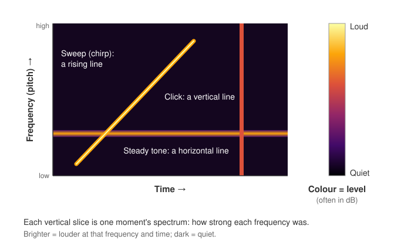

<head>
    <script type="application/ld+json">
        {JSON.stringify({
            "@context": "https://schema.org",
            "@type": "FAQPage",
            "mainEntity": [
                {
                    "@type": "Question",
                    "name": "What is a spectrogram used for?",
                    "acceptedAnswer": { "@type": "Answer", "text": "A spectrogram is used to see how the frequencies in a signal change over time. Audio engineers use it to find hum, clicks and noise; speech scientists to study voices; biologists to identify bird, bat and whale calls; engineers to spot machine faults from vibration; and radio, radar and sonar operators to watch signals and targets." }
                },
                {
                    "@type": "Question",
                    "name": "How do you read a spectrogram?",
                    "acceptedAnswer": { "@type": "Answer", "text": "Check the colour scale first, so you know which colours are loud and which are quiet. Then read left to right through time: a horizontal line is a steady tone, stacked parallel lines are a sound and its harmonics, a rising or falling line is a changing pitch, a vertical line is a click or other short sound, and a speckled background is noise." }
                },
                {
                    "@type": "Question",
                    "name": "How does a spectrogram work?",
                    "acceptedAnswer": { "@type": "Answer", "text": "The signal is cut into short, usually overlapping windows. A Fourier transform (in practice, an FFT) of each window measures how strong each frequency is in it, and the result becomes one column of the spectrogram. This is called the short-time Fourier transform (STFT)." }
                },
                {
                    "@type": "Question",
                    "name": "What is a mel spectrogram?",
                    "acceptedAnswer": { "@type": "Answer", "text": "A mel spectrogram is a spectrogram whose frequency axis uses the mel scale, which spaces frequencies roughly the way people hear pitch: more detail at low frequencies, less at high ones. Mel spectrograms are widely used as the input to speech recognition and other audio machine-learning models." }
                },
                {
                    "@type": "Question",
                    "name": "What is the difference between a spectrogram, a spectrum and a spectrograph?",
                    "acceptedAnswer": { "@type": "Answer", "text": "A spectrum shows the strength of each frequency at one moment, as a line of level against frequency. A spectrogram stacks many spectra side by side over time and shows level as colour. A spectrograph is an instrument that produces a spectrum or spectrogram, such as the sound spectrograph used for speech or an optical spectrograph that splits light." }
                },
                {
                    "@type": "Question",
                    "name": "How do I make a spectrogram in JavaScript?",
                    "acceptedAnswer": { "@type": "Answer", "text": "Compute a spectrum (for example with an FFT) for each new block of samples. With SciChart.js, put the spectra in a UniformHeatmapDataSeries, one column per time step and one row per frequency band, draw it with a UniformHeatmapRenderableSeries and a HeatmapColorMap in decibels, and call setZValues() as new columns arrive so the chart scrolls. The same chart works in React with scichart-react and in Angular with scichart-angular." }
                }
            ]
        })}
    </script>
</head>

# Spectrogram

## What is a spectrogram?

A **spectrogram** (also called a sonogram or voiceprint) is a chart of how the frequencies in a signal change over time. Time runs along the horizontal axis and frequency up the vertical axis. The colour of each point shows how strong that frequency was at that moment, usually in decibels (dB).


*A live spectrogram of a test signal (sample data): two steady tones, a tone that pulses on and off, and a sweep that repeats every four seconds, over background noise. [Try the interactive version](#how-to-create-a-spectrogram-in-javascript-react-or-angular).*

:::tip Key takeaways
- A spectrogram shows **frequency against time**, with **colour for strength**, usually in decibels.
- **Each shape has a meaning:** flat lines are steady tones, stacked lines are harmonics, slopes are changing pitch, vertical lines are clicks, and speckle is noise.
- It is built from many short **Fourier transforms** (the short-time Fourier transform, or STFT). The **window length** trades detail in time against detail in frequency.
- The highest frequency it can show is **half the sample rate** (the Nyquist frequency).
- It is used in audio, speech, wildlife sound, machine monitoring, radar, sonar, radio and medicine.
:::

## How to read a spectrogram



1. **Check the colour scale.** It tells you which colours are loud and which are quiet. Levels are usually in decibels, a logarithmic scale, so quiet detail and loud tones fit on one chart. The darkest colour is usually the **noise floor**: the level of the background when nothing else is happening.
2. **Check the axes.** Time usually runs left to right; in a scrolling **waterfall** display it may run top to bottom. Note whether the frequency axis is evenly spaced (linear) or squeezed at the top (logarithmic or mel), and where it stops.
3. **Read one vertical slice.** A slice is one moment in time. Reading up it tells you which frequencies were present then, and how strong each one was.
4. **Follow the shapes across time.** Lines and patches that persist, move or repeat are the sounds or signals. The table below says what each shape usually is.
5. **Compare against the noise floor.** Anything only slightly brighter than the background may be noise; a feature well above it is a real signal.

## Spectrogram patterns: what each shape means

| What you see | What it is | Examples |
| --- | --- | --- |
| A flat horizontal line | A steady tone at one frequency | Mains hum at 50 or 60 Hz, a whistle, a fan or motor running at constant speed |
| A stack of evenly spaced parallel lines | A **fundamental** frequency and its **harmonics**, at whole-number multiples of it | A sung or spoken vowel, a violin note, a rotating machine |
| A rising or falling line | A frequency that changes over time: a sweep or **chirp** | A siren, birdsong, an engine speeding up, a test sweep |
| A dashed line | A tone that switches on and off | An alarm beep, Morse code, the 5,500 Hz tone in the chart above |
| A thin vertical line | A short, sharp sound containing many frequencies at once | A click, knock, drum hit or footstep |
| A speckled haze over many frequencies | Broadband noise | Hiss, wind, rain, air conditioning |
| Broad, darker bands that shift in speech | **Formants**: resonances of the mouth and throat | Vowels; each vowel has its own formant pattern |
| A gap from top to bottom | Silence or a dropout | A pause in speech, a break in a recording |

### How to describe a spectrogram

To write up what a spectrogram shows, describe each feature in turn with this template:

> There is **[a steady tone / harmonics / a sweep / a burst / noise]** at **[frequency or range]**, at about **[level]** dB, which **[lasts throughout / repeats every … / rises from … to …]**.

**Worked example,** using the chart above: "There is a noise floor of about −80 dB across the whole band. Two steady tones last throughout: a strong one at 1,000 Hz, at about −25 dB, and a weaker one at 3,000 Hz, at about −40 dB. A third tone at 5,500 Hz switches on for one second in every two. A sweep rises from 500 Hz to 7,000 Hz every four seconds, then jumps back down and starts again."

## How a spectrogram is made

You don't need the maths to read a spectrogram, but knowing how it is made explains what it can and can't show.

1. **Cut the signal into short windows,** for example 1,024 samples each, usually overlapping.
2. **Taper each window** with a window function, such as a Hann window, so the cut edges don't add false frequencies.
3. **Take a Fourier transform of each window.** In practice this is a fast Fourier transform (**FFT**). It measures how strong each frequency is in that window. Together, these steps are the **short-time Fourier transform** (STFT).
4. **Convert to decibels and colour it.** Each window's result becomes one column of the spectrogram, and each frequency band becomes one row.

The highest frequency a spectrogram can show is half the signal's sample rate, the **Nyquist frequency**: 22,050 Hz for audio sampled at 44,100 Hz. Before computers, spectrograms were drawn by an analogue machine, the sound spectrograph, described by researchers at Bell Telephone Laboratories in 1946.

### Window length: time detail against frequency detail

The window length sets a trade-off you can't avoid. A long window separates close frequencies but blurs when things happened; a short window shows timing sharply but merges nearby frequencies.

| Window (at 44,100 samples per second) | Time per column | Frequency band width | Good for |
| --- | --- | --- | --- |
| 256 samples | about 6 ms | about 172 Hz | Clicks, drum hits and other fast events |
| 1,024 samples | about 23 ms | about 43 Hz | General audio and speech |
| 4,096 samples | about 93 ms | about 11 Hz | Separating close musical notes or steady machine tones |

Band width is the sample rate divided by the window length; time per column is the window length divided by the sample rate. Overlapping windows add columns more often, but they don't sharpen the time detail.

## Types of spectrogram

| Type | What changes | Typical use |
| --- | --- | --- |
| **Linear spectrogram** | Frequency axis evenly spaced, as in the chart above | Engineering, vibration, radio |
| **Log-frequency spectrogram** | Frequency axis on a logarithmic scale, so each octave takes the same height | Music analysis |
| **Mel spectrogram** | Frequency axis on the mel scale, which spaces frequencies roughly as people hear pitch | Speech recognition and audio machine learning |
| **Waterfall display** | A spectrogram that scrolls as new data arrives, often from top to bottom | Radio and software-defined radio (SDR), sonar |

## When to use a spectrogram

Use a spectrogram when **the frequencies in a signal change over time** and you need to see when each one starts, stops or moves. Common uses:

- **audio and music:** finding hum, clicks, noise and clipping, checking mixes, and analysing notes and harmonics;
- **speech:** phonetics and voice analysis, where vowels show as formant bands;
- **wildlife sound:** identifying birdsong and bat, whale and dolphin calls;
- **vibration and condition monitoring:** spotting a bearing or gear fault as a new tone appearing or drifting;
- **radar and sonar:** detecting targets and how they move;
- **medicine:** time-frequency analysis of EEG (brain wave) signals;
- **radio:** watching which channels are busy, on spectrum analysers and SDR waterfall displays.

| Chart | Best for |
| --- | --- |
| **Spectrogram** | How the frequencies in a signal change over time |
| Waveform ([line chart](/learn/line-chart/)) | The raw signal, amplitude against time: good for loudness and timing, poor for pitch |
| Spectrum (FFT plot) | Level against frequency at one moment: precise levels, but no history |
| [Heatmap](/learn/heatmap/) | Any grid of values. A spectrogram is a heatmap whose axes are time and frequency |

Many tools show a waveform, a spectrum and a spectrogram together, as in the SciChart audio analyser demo linked below.

## Common spectrogram mistakes

- **Choosing the wrong window length.** Too long and clicks smear across time; too short and close tones merge into one band. Match it to what you're looking for (see the table above).
- **Skipping the window function.** Without tapering, energy from a strong tone leaks into the bands either side of it, which can hide quieter signals nearby.
- **Plotting raw amplitude instead of decibels.** On a linear scale only the loudest sounds show; everything else is lost in the darkest colour.
- **Setting the colour range badly.** Set the bottom of the range near the noise floor and the top just above the loudest signal. Too wide a range makes everything look dark; too narrow a range turns noise into false detail and flattens the loud parts.
- **Ignoring the Nyquist limit.** Frequencies above half the sample rate don't vanish: they fold back down as false lines (**aliasing**). Filter out high frequencies before sampling.
- **Using a linear frequency axis for music or speech.** Most of the interest is in the low frequencies, which a linear axis squeezes into the bottom of the chart. Use a logarithmic or mel axis.
- **Comparing spectrograms made with different settings.** A different window length, colour range or decibel reference can make the same signal look different. Keep the settings the same when you compare.

## How to create a spectrogram in JavaScript, React or Angular

In SciChart.js a spectrogram is a real-time, scrolling heatmap. You compute each new spectrum, for example with an FFT of the latest samples, and SciChart.js draws it with WebGL and WebGPU, so the chart keeps up with live data. The spectrogram below is generated live: scroll to zoom into a frequency band, drag up or down to pan, double-click to reset, and hover to read the level.

<LiveDocSnippet maxWidth={'100%'} name="./Basic/demo" />

<LearnCta position="top" chart="spectrogram" demo="audio-analyzer-fft-example" docs="/2d-charts/chart-types/uniform-heatmap-renderable-series/uniform-heatmap-chart-type/" />

Here is the code for this chart:

<CodeSnippetBlock labels={["JavaScript", "React", "Angular"]}>
    ```ts showLineNumbers file=./Basic/demo.ts start=#region_A_start end=#region_A_end
    ```

    ```tsx
    import { SciChartReact } from "scichart-react";
    import {
        SciChartSurface,
        NumericAxis,
        EAutoRange,
        UniformHeatmapRenderableSeries,
        UniformHeatmapDataSeries,
        HeatmapColorMap,
        SciChartJsNavyTheme
    } from "scichart";

    const BINS = 256; // frequency bands per spectrum
    const COLUMNS = 200; // spectra kept on screen

    // initChart builds the chart; SciChartReact creates it, sizes it and cleans it up
    const initChart = async (rootElement: string | HTMLDivElement) => {
        const { wasmContext, sciChartSurface } = await SciChartSurface.create(rootElement, {
            theme: new SciChartJsNavyTheme()
        });
        sciChartSurface.xAxes.add(new NumericAxis(wasmContext, { axisTitle: "Time (s)", autoRange: EAutoRange.Always }));
        sciChartSurface.yAxes.add(new NumericAxis(wasmContext, { axisTitle: "Frequency (Hz)" }));

        // zValues[frequency band][time column], in dB
        const zValues: number[][] = Array.from({ length: BINS }, () => new Array(COLUMNS).fill(-90));
        const dataSeries = new UniformHeatmapDataSeries(wasmContext, {
            zValues,
            xStart: 0,
            xStep: 0.05, // seconds per spectrum
            yStart: 0,
            yStep: 8000 / BINS // Hz per frequency band
        });
        sciChartSurface.renderableSeries.add(
            new UniformHeatmapRenderableSeries(wasmContext, {
                dataSeries,
                colorMap: new HeatmapColorMap({
                    minimum: -90,
                    maximum: -10,
                    gradientStops: [
                        { offset: 0, color: "#000004" },
                        { offset: 0.5, color: "#932667" },
                        { offset: 1, color: "#FCFFA4" }
                    ]
                })
            })
        );

        // Each time a new spectrum arrives, scroll the chart by one column
        const timer = setInterval(() => {
            const spectrum = getYourNextSpectrum(); // one dB level per frequency band, e.g. from an FFT
            spectrum.forEach((level, bin) => {
                zValues[bin].shift();
                zValues[bin].push(level);
            });
            dataSeries.xStart += dataSeries.xStep;
            dataSeries.setZValues(zValues);
        }, 50);
        sciChartSurface.addDeletable({ delete: () => clearInterval(timer) });

        return { sciChartSurface };
    };

    export const Spectrogram = () => (
        <SciChartReact initChart={initChart} style={{ width: "100%", height: 400 }} />
    );
    ```

    ```ts
    import { Component } from "@angular/core";
    import { ScichartAngularComponent } from "scichart-angular";
    import {
        SciChartSurface,
        NumericAxis,
        EAutoRange,
        UniformHeatmapRenderableSeries,
        UniformHeatmapDataSeries,
        HeatmapColorMap,
        SciChartJsNavyTheme
    } from "scichart";

    const BINS = 256; // frequency bands per spectrum
    const COLUMNS = 200; // spectra kept on screen

    @Component({
        selector: "app-spectrogram",
        standalone: true,
        imports: [ScichartAngularComponent],
        template: `<scichart-angular [initChart]="initChart" style="display: block; width: 100%; height: 400px"></scichart-angular>`
    })
    export class SpectrogramComponent {
        // initChart builds the chart; scichart-angular creates it, sizes it and cleans it up
        initChart = async (rootElement: string | HTMLDivElement) => {
            const { wasmContext, sciChartSurface } = await SciChartSurface.create(rootElement, {
                theme: new SciChartJsNavyTheme()
            });
            sciChartSurface.xAxes.add(new NumericAxis(wasmContext, { axisTitle: "Time (s)", autoRange: EAutoRange.Always }));
            sciChartSurface.yAxes.add(new NumericAxis(wasmContext, { axisTitle: "Frequency (Hz)" }));

            // zValues[frequency band][time column], in dB
            const zValues: number[][] = Array.from({ length: BINS }, () => new Array(COLUMNS).fill(-90));
            const dataSeries = new UniformHeatmapDataSeries(wasmContext, {
                zValues,
                xStart: 0,
                xStep: 0.05, // seconds per spectrum
                yStart: 0,
                yStep: 8000 / BINS // Hz per frequency band
            });
            sciChartSurface.renderableSeries.add(
                new UniformHeatmapRenderableSeries(wasmContext, {
                    dataSeries,
                    colorMap: new HeatmapColorMap({
                        minimum: -90,
                        maximum: -10,
                        gradientStops: [
                            { offset: 0, color: "#000004" },
                            { offset: 0.5, color: "#932667" },
                            { offset: 1, color: "#FCFFA4" }
                        ]
                    })
                })
            );

            // Each time a new spectrum arrives, scroll the chart by one column
            const timer = setInterval(() => {
                const spectrum = getYourNextSpectrum(); // one dB level per frequency band, e.g. from an FFT
                spectrum.forEach((level, bin) => {
                    zValues[bin].shift();
                    zValues[bin].push(level);
                });
                dataSeries.xStart += dataSeries.xStep;
                dataSeries.setZValues(zValues);
            }, 50);
            sciChartSurface.addDeletable({ delete: () => clearInterval(timer) });

            return { sciChartSurface };
        };
    }
    ```
</CodeSnippetBlock>

Key points:

- A [UniformHeatmapDataSeries](https://www.scichart.com/documentation/js/current/typedoc/classes/uniformheatmapdataseries.html) holds the spectrogram as a 2D array, `zValues[frequency band][time column]`. `yStep` is the width of each frequency band (sample rate divided by FFT size) and `xStep` is the time between spectra.
- To scroll, drop the oldest column, add the newest, call `setZValues()` and move `xStart` on. An x-axis with `autoRange: EAutoRange.Always` follows the newest data.
- A [HeatmapColorMap](https://www.scichart.com/documentation/js/current/typedoc/classes/heatmapcolormap.html) with `minimum` and `maximum` in decibels sets the colour scale; a [HeatmapLegend](https://www.scichart.com/documentation/js/current/typedoc/classes/heatmaplegend.html) shows it.
- SciChart.js draws the chart; the FFT is up to you. The audio analyser in the demo app includes an FFT, a microphone input, a waveform and a spectrum alongside its spectrogram.

**See it in the demo app:** [JavaScript spectrogram](https://www.scichart.com/demo/javascript/audio-analyzer-fft-example) · [React spectrogram](https://www.scichart.com/demo/react/audio-analyzer-fft-example) · [Angular spectrogram](https://www.scichart.com/demo/angular/audio-analyzer-fft-example)

**Go deeper:** [SciChart.js spectrogram documentation](/2d-charts/chart-types/uniform-heatmap-renderable-series/uniform-heatmap-chart-type/), including [updating a heatmap in real time](/2d-charts/chart-types/uniform-heatmap-renderable-series/updating-realtime/) and [colour maps and legends](/2d-charts/chart-types/uniform-heatmap-renderable-series/color-maps-and-legends/). New to heatmaps? Read our [heatmap guide](/learn/heatmap/).

## Frequently asked questions

### What is a spectrogram used for?

A spectrogram is used to see how the frequencies in a signal change over time. Audio engineers use it to find hum, clicks and noise; speech scientists to study voices; biologists to identify bird, bat and whale calls; engineers to spot machine faults from vibration; and radio, radar and sonar operators to watch signals and targets.

### How do you read a spectrogram?

Check the colour scale first, so you know which colours are loud and which are quiet. Then read left to right through time: a horizontal line is a steady tone, stacked parallel lines are a sound and its harmonics, a rising or falling line is a changing pitch, a vertical line is a click or other short sound, and a speckled background is noise.

### How does a spectrogram work?

The signal is cut into short, usually overlapping windows. A Fourier transform (in practice, an FFT) of each window measures how strong each frequency is in it, and the result becomes one column of the spectrogram. This is called the short-time Fourier transform (STFT).

### What is a mel spectrogram?

A mel spectrogram is a spectrogram whose frequency axis uses the mel scale, which spaces frequencies roughly the way people hear pitch: more detail at low frequencies, less at high ones. Mel spectrograms are widely used as the input to speech recognition and other audio machine-learning models.

### What is the difference between a spectrogram, a spectrum and a spectrograph?

A spectrum shows the strength of each frequency at one moment, as a line of level against frequency. A spectrogram stacks many spectra side by side over time and shows level as colour. A spectrograph is an instrument that produces a spectrum or spectrogram, such as the sound spectrograph used for speech or an optical spectrograph that splits light.

### How do I make a spectrogram in JavaScript?

Compute a spectrum (for example with an FFT) for each new block of samples. With SciChart.js, put the spectra in a `UniformHeatmapDataSeries`, one column per time step and one row per frequency band, draw it with a `UniformHeatmapRenderableSeries` and a `HeatmapColorMap` in decibels, and call `setZValues()` as new columns arrive so the chart scrolls. The same chart works in React with `scichart-react` and in Angular with `scichart-angular`.

## Sources

- Koenig, W., Dunn, H. K. and Lacy, L. Y. (1946), [The Sound Spectrograph](https://doi.org/10.1121/1.1916342). *The Journal of the Acoustical Society of America*, 18(1). The Bell Telephone Laboratories instrument that first made spectrograms practical.
- Harris, F. J. (1978), [On the use of windows for harmonic analysis with the discrete Fourier transform](https://doi.org/10.1109/PROC.1978.10837). *Proceedings of the IEEE*, 66(1). Window functions and spectral leakage.
- Stevens, S. S., Volkmann, J. and Newman, E. B. (1937), [A Scale for the Measurement of the Psychological Magnitude Pitch](https://doi.org/10.1121/1.1915893). *The Journal of the Acoustical Society of America*, 8(3). The origin of the mel scale.
- SciPy, [scipy.signal.spectrogram](https://docs.scipy.org/doc/scipy/reference/generated/scipy.signal.spectrogram.html). A reference implementation of the STFT spectrogram, with its window, overlap and scaling options.

<LearnCta position="bottom" chart="spectrogram" demo="audio-analyzer-fft-example" docs="/2d-charts/chart-types/uniform-heatmap-renderable-series/uniform-heatmap-chart-type/" />
