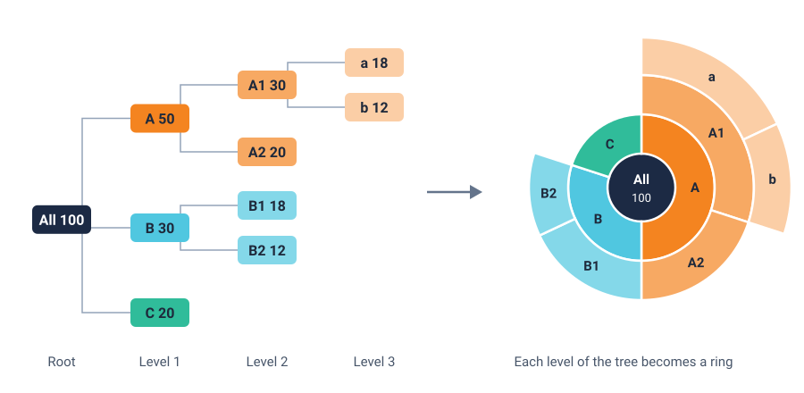

<head>
    <script type="application/ld+json">
        {JSON.stringify({
            "@context": "https://schema.org",
            "@type": "FAQPage",
            "mainEntity": [
                {
                    "@type": "Question",
                    "name": "What is a sunburst chart used for?",
                    "acceptedAnswer": { "@type": "Answer", "text": "A sunburst chart is used to show a total broken down over several levels, such as disk space by folder and subfolder, a budget by department and team, sales by region, country and product, or website visits by section and page. It is most useful when you want to see the structure of a hierarchy and which branches take up the most, in one picture." }
                },
                {
                    "@type": "Question",
                    "name": "What is the difference between a sunburst chart and a donut chart?",
                    "acceptedAnswer": { "@type": "Answer", "text": "A donut chart has one ring, so it shows how one total splits into parts. A sunburst chart adds more rings: each ring is one level of a hierarchy, and each segment sits just outside the part it belongs to. A sunburst chart with only one ring is a donut chart." }
                },
                {
                    "@type": "Question",
                    "name": "Is a sunburst chart better than a treemap?",
                    "acceptedAnswer": { "@type": "Answer", "text": "Each is better at something different. A sunburst chart makes the levels of a hierarchy, and which item belongs to which, easy to follow. A treemap fills a rectangle with nested boxes, so it uses space better and can show many more items, but its structure is harder to see. Use a sunburst for a few levels with a clear structure, and a treemap for many items." }
                },
                {
                    "@type": "Question",
                    "name": "How many levels should a sunburst chart have?",
                    "acceptedAnswer": { "@type": "Answer", "text": "Two to four levels is usually the most a sunburst chart can show clearly. Each extra ring makes the outer segments thinner and harder to label. If the hierarchy is deeper, show the top few levels and let readers click a segment to zoom into that branch." }
                },
                {
                    "@type": "Question",
                    "name": "How do I make a sunburst chart in JavaScript?",
                    "acceptedAnswer": { "@type": "Answer", "text": "Store the data as a tree, where each item has a name and either a value or a list of children. A layout step walks the tree and gives every item a start and end on a scale from zero to the total, ring by ring. With SciChart.js you draw each ring as a PolarColumnRenderableSeries on a polar chart, with a palette provider for the colours and the series' hit-test for hover and click. The same code works in React with scichart-react and in Angular with scichart-angular." }
                }
            ]
        })}
    </script>
</head>

# Sunburst Chart

## What is a sunburst chart?

A **sunburst chart** (also called a sunburst diagram, sunburst graph, ring chart or multi-level pie chart) shows a hierarchy as rings around a centre. The centre is the whole. Each ring outwards is one level down, and each segment's angle is its share of the total, so you see the breakdown and the structure at once.


*A sunburst chart of the space used on a laptop drive, by folder, in gigabytes (sample data). [Try the interactive version](#how-to-create-a-sunburst-chart-in-javascript-react-or-angular).*

:::tip Key takeaways
- A sunburst chart shows **a total broken down level by level**, as rings around a centre.
- **Angle is value:** a segment that spans a quarter of the circle is a quarter of the total.
- **Each child sits just outside its parent** and fills no more than the parent's angle, so you can trace any branch outwards.
- **Colour usually marks the top-level branch,** getting lighter further out.
- Keep it to **two to four levels**, and add hover or click-to-zoom for the small outer segments. A one-ring sunburst is a [donut chart](/learn/donut-chart/).
:::

## How to read a sunburst chart


1. **Start at the centre.** It stands for the whole: all the disk space, the whole budget, every visitor. Many charts print the total there.
2. **Read the first ring.** These are the top-level groups. Together they go all the way round, because together they make up the total.
3. **Compare angles, not areas.** A segment's angle is its share of the total. A segment in an outer ring covers more area than an inner one with the same value, because the ring is bigger, so judge size by how far round the circle it reaches.
4. **Work outwards along a branch.** Each segment's children sit directly outside it and share its angle between them. If a segment has no ring outside it, it has no children: that branch ends there.
5. **Use colour to keep your place.** Most sunburst charts give each top-level branch its own colour and use lighter shades of it further out, as the charts on this page do. Check the key, because some charts use colour for something else, such as growth or a category.
6. **Hover or click for detail.** Small outer segments rarely have room for a label. On an interactive chart, hovering shows the exact value and share, and clicking a segment zooms into that branch.

## A worked example: what's filling a laptop drive

The chart at the top of this page shows 640 GB of used space on a 1 TB laptop drive, split into five top-level folders and then into subfolders. The numbers are made up but realistic in shape. Files and folders are the job the Sunburst tool in the first published studies was built for (see Sources).

| Top-level folder | Size (GB) | Share of used space | Split into |
| --- | --- | --- | --- |
| Videos | 220 | 34% | Family 120 (2024: 70, 2025: 50); Projects 100 (Drone 60, Recordings 40) |
| Photos | 150 | 23% | Phone 90 (2024: 40, 2025: 50); RAW 60 (Holiday 35, Studio 25) |
| Apps | 110 | 17% | Games 70, Creative 25, Utilities 15 |
| System | 100 | 16% | OS 45, Caches 30, Swap 25 |
| Documents | 60 | 9% | Work 35 (Reports 20, Data 15); Personal 25 |
| **Total** | **640** | **100%** (rounded) | |

Three things stand out from the rings:

- **Videos and photos take more than half the drive.** Together they hold 370 of the 640 GB, 58%.
- **Equal values can look unequal.** Games (70 GB, in the second ring) and the 2024 family videos (70 GB, in the third ring) are the same size. Their angles match even though the outer one covers more area, which is why you compare angles, not areas.
- **Documents are small.** At 60 GB, they are under a tenth of the used space.

The table is better for looking up one number. The chart shows the shape of the whole hierarchy in one look: which branches are big, how deep each goes, and where the space sits within each one.

### How to describe a sunburst chart

Use this template when you report a sunburst chart:

> Of the **[total and unit]** in **[the whole]**, **[largest group]** makes up **[share]**, mostly **[its largest part]** at **[value]**. **[Second group]** follows at **[share]**, and **[smallest group]** is only **[share]**.

**Worked example:** "Of the 640 GB used on this drive, videos make up 34%, mostly family videos at 120 GB. Photos follow at 23%, and documents are only 9%."

## How does a sunburst chart work?

A sunburst chart is a tree of data drawn in a circle. Most tools do the layout for you; knowing the steps helps when a chart looks wrong.



1. **Total each branch.** Only the outermost items (the leaves) need a value. Each parent's value is the sum of its children: A1 is a + b = 30, and A is A1 + A2 = 50.
2. **Give each level a ring.** The root goes in the centre, level 1 in the first ring, level 2 in the second, and so on. Every ring is the same width.
3. **Share out the angle.** The full circle stands for the root's total. Going round from the top, each item gets an angle in proportion to its value, starting where the item before it ended.
4. **Keep children inside their parent's angle.** A's children start where A starts and together end where A ends. That is what lines each branch up from the centre outwards.

Because every item has a start and an end on one scale from zero to the total, a sunburst chart can be drawn as **columns on a polar chart**: one column per item, with its start and end giving its angle, and its level giving its distance from the centre. The live example on this page is built that way.

## When to use a sunburst chart

Use a sunburst chart when a total **breaks down over several levels** and you want to show **both the shares and the structure**. Typical uses:

- **storage and files:** disk space by folder and subfolder;
- **money:** a budget by department, team and cost type, or revenue by region, country and product;
- **websites and apps:** visits by section and page, or time spent by feature;
- **classifications:** a population split by group, subgroup and type.

| Chart | Best for |
| --- | --- |
| **Sunburst chart** | A total split over two to four levels, when the structure matters as much as the sizes |
| [Treemap](/learn/treemap/) | Many items in a hierarchy, packed into a rectangle; better for comparing sizes, weaker at showing levels |
| [Donut chart](/learn/donut-chart/) or [pie chart](/learn/pie-chart/) | One total split into a few parts, with no deeper levels |
| [Bar chart](/learn/bar-chart/#stacked-bar-chart) (stacked) | Comparing several totals and their parts side by side, with exact values easy to read |
| [Sankey diagram](/learn/sankey-diagram/) | A total that flows through stages, splitting and merging, rather than a fixed hierarchy |

### Sunburst chart vs treemap

Both show the same kind of data: a total broken down into a hierarchy, with size showing value. A treemap nests rectangles inside rectangles; a sunburst chart puts each level in its own ring. In a 2000 study that compared the two for finding and comparing files and folders, people tended to answer more questions correctly with the sunburst, especially when they first used it, and strongly preferred it because it showed the structure better (Stasko and colleagues, see Sources). A treemap wastes no space, so it suits hierarchies with hundreds of items, where a sunburst's outer rings would be too thin to read.

## Common sunburst chart mistakes

- **Too many levels.** Each extra ring splits the segments into thinner slivers. Show two to four levels, and let readers click to zoom into deeper branches.
- **Comparing areas across rings.** An outer segment looks bigger than an inner one with the same value. Tell readers to compare angles, label the values, or add a tooltip.
- **Children that don't add up.** If a parent's children add up to more than the parent, the chart can't be drawn honestly. If they add up to less, the gap is unexplained. Add an "Other" item so every branch adds up.
- **Negative values.** An angle can't be negative, so a sunburst chart can't show losses or refunds. Use a bar chart for data that goes below zero.
- **Colour that means nothing.** Random colours on every segment hide the branches. Colour by top-level branch and shade it outwards, or colour by one clear measure, and say which.
- **Labels on every slice.** Small outer segments have no room for text. Label only the segments wide enough to hold it, and show the rest on hover.
- **A flat list in rings.** If the data has only one level, a sunburst chart is just a [donut chart](/learn/donut-chart/), and a sorted [bar chart](/learn/bar-chart/) is usually clearer still.

## How to create a sunburst chart in JavaScript, React or Angular

SciChart.js has no separate sunburst series: a short layout helper turns your tree into rings, and each ring is drawn as a polar column series. Because SciChart.js draws with WebGL and WebGPU, hover highlights and drill-down redraw instantly. Try the chart below: hover over a segment to highlight its branch and see its size in the centre, click a segment to zoom into it, and click the centre to go back.

<LiveDocSnippet maxWidth={'100%'} name="./Basic/demo" />

<LearnCta position="top" chart="sunburst chart" demo="polar-sunburst-chart" docs="/2d-charts/chart-types/polar-sunburst-chart/" />

Here is the code for this chart. The data is plain JSON: a tree in which each item has a `name` and either a `value` or a list of `children`:

```json
{
    "name": "Used space",
    "children": [
        { "name": "Videos", "children": [{ "name": "Family", "value": 120 }, { "name": "Projects", "value": 100 }] },
        { "name": "Apps", "children": [{ "name": "Games", "value": 70 }, { "name": "Utilities", "value": 15 }] }
    ]
}
```

<CodeSnippetBlock labels={["JavaScript", "React", "Angular"]}>
    ```ts showLineNumbers file=./Basic/demo.ts start=#region_A_start end=#region_A_end
    ```

    ```tsx
    import { SciChartReact } from "scichart-react";
    import {
        SciChartPolarSurface,
        PolarNumericAxis,
        EPolarAxisMode,
        EAxisAlignment,
        SciChartJsNavyTheme
    } from "scichart";
    // buildSunburstRings, drawSunburst and SunburstModifier from the JavaScript tab, saved as sunburst.ts
    import { SunburstModifier } from "./sunburst";

    // initChart builds the chart; SciChartReact creates it, sizes it and cleans it up
    const initChart = async (rootElement: string | HTMLDivElement) => {
        const { wasmContext, sciChartSurface } = await SciChartPolarSurface.create(rootElement, {
            theme: new SciChartJsNavyTheme()
        });

        // Angular axis: the value scale, clockwise from 12 o'clock. Radial axis: the ring number
        sciChartSurface.xAxes.add(new PolarNumericAxis(wasmContext, {
            polarAxisMode: EPolarAxisMode.Angular, axisAlignment: EAxisAlignment.Top,
            startAngle: Math.PI / 2, flippedCoordinates: true, isVisible: false
        }));
        sciChartSurface.yAxes.add(new PolarNumericAxis(wasmContext, {
            polarAxisMode: EPolarAxisMode.Radial, axisAlignment: EAxisAlignment.Right,
            startAngle: Math.PI / 2, isVisible: false
        }));

        // { name, children: [{ name, value }] }: only the leaves need a value
        sciChartSurface.chartModifiers.add(new SunburstModifier(wasmContext, getYourHierarchyData(), { units: "GB" }));
        return { sciChartSurface };
    };

    export const SunburstChart = () => (
        <SciChartReact initChart={initChart} style={{ width: "100%", height: 500 }} />
    );
    ```

    ```ts
    import { Component } from "@angular/core";
    import { ScichartAngularComponent } from "scichart-angular";
    import {
        SciChartPolarSurface,
        PolarNumericAxis,
        EPolarAxisMode,
        EAxisAlignment,
        SciChartJsNavyTheme
    } from "scichart";
    // buildSunburstRings, drawSunburst and SunburstModifier from the JavaScript tab, saved as sunburst.ts
    import { SunburstModifier } from "./sunburst";

    @Component({
        selector: "app-sunburst-chart",
        standalone: true,
        imports: [ScichartAngularComponent],
        template: `<scichart-angular [initChart]="initChart" style="display: block; width: 100%; height: 500px"></scichart-angular>`
    })
    export class SunburstChartComponent {
        // initChart builds the chart; scichart-angular creates it, sizes it and cleans it up
        initChart = async (rootElement: string | HTMLDivElement) => {
            const { wasmContext, sciChartSurface } = await SciChartPolarSurface.create(rootElement, {
                theme: new SciChartJsNavyTheme()
            });

            // Angular axis: the value scale, clockwise from 12 o'clock. Radial axis: the ring number
            sciChartSurface.xAxes.add(new PolarNumericAxis(wasmContext, {
                polarAxisMode: EPolarAxisMode.Angular, axisAlignment: EAxisAlignment.Top,
                startAngle: Math.PI / 2, flippedCoordinates: true, isVisible: false
            }));
            sciChartSurface.yAxes.add(new PolarNumericAxis(wasmContext, {
                polarAxisMode: EPolarAxisMode.Radial, axisAlignment: EAxisAlignment.Right,
                startAngle: Math.PI / 2, isVisible: false
            }));

            // { name, children: [{ name, value }] }: only the leaves need a value
            sciChartSurface.chartModifiers.add(new SunburstModifier(wasmContext, getYourHierarchyData(), { units: "GB" }));
            return { sciChartSurface };
        };
    }
    ```
</CodeSnippetBlock>

Key points:

- `buildSunburstRings` is plain JavaScript with no SciChart code, so you can reuse it anywhere. It totals each branch, then gives every item a `start` and `end` on a scale from zero to the total, ring by ring. Colour comes from the item's top-level branch, lighter for each ring further out.
- Each ring is one [PolarColumnRenderableSeries](/2d-charts/chart-types/polar-column-renderable-series/) with `columnXMode: EColumnMode.StartEnd`. Its `XyxDataSeries` holds each segment's start (`xValues`), end (`x1Values`) and outer radius (`yValues`); `defaultY1` sets the inner radius. The centre is one more series: a single full-circle segment.
- A palette provider colours each segment from its metadata and fades the ones that aren't highlighted. Labels are the series' data labels, left off segments under 4% of the total.
- `SunburstModifier` extends `CustomChartModifier2D` and returns `EModifierType.Chart2DPolarModifier` as its `modifierType`, which a polar chart requires. On mouse move it calls each ring's `hitTestProvider.hitTest(x, y)`, which reports a hit only inside a segment; a click redraws the rings from the clicked segment, keeping its colours.

**See it in the demo app:** [JavaScript sunburst chart](https://www.scichart.com/demo/javascript/polar-sunburst-chart) · [React sunburst chart](https://www.scichart.com/demo/react/polar-sunburst-chart) · [Angular sunburst chart](https://www.scichart.com/demo/angular/polar-sunburst-chart)

**Go deeper:** [SciChart.js sunburst chart documentation](/2d-charts/chart-types/polar-sunburst-chart/), including an animated drill-down, the [polar column series documentation](/2d-charts/chart-types/polar-column-renderable-series/), and the [polar stacked column series](/2d-charts/chart-types/polar-stacked-column-renderable-series/) for stacked values round a circle.

## Frequently asked questions

### What is a sunburst chart used for?

A sunburst chart is used to show a total broken down over several levels, such as disk space by folder and subfolder, a budget by department and team, sales by region, country and product, or website visits by section and page. It is most useful when you want to see the structure of a hierarchy and which branches take up the most, in one picture.

### What is the difference between a sunburst chart and a donut chart?

A donut chart has one ring, so it shows how one total splits into parts. A sunburst chart adds more rings: each ring is one level of a hierarchy, and each segment sits just outside the part it belongs to. A sunburst chart with only one ring is a donut chart.

### Is a sunburst chart better than a treemap?

Each is better at something different. A sunburst chart makes the levels of a hierarchy, and which item belongs to which, easy to follow. A treemap fills a rectangle with nested boxes, so it uses space better and can show many more items, but its structure is harder to see. Use a sunburst for a few levels with a clear structure, and a treemap for many items.

### How many levels should a sunburst chart have?

Two to four levels is usually the most a sunburst chart can show clearly. Each extra ring makes the outer segments thinner and harder to label. If the hierarchy is deeper, show the top few levels and let readers click a segment to zoom into that branch.

### How do I make a sunburst chart in JavaScript?

Store the data as a tree, where each item has a name and either a value or a list of children. A layout step walks the tree and gives every item a start and end on a scale from zero to the total, ring by ring. With SciChart.js you draw each ring as a PolarColumnRenderableSeries on a polar chart, with a palette provider for the colours and the series' hit-test for hover and click. The same code works in React with scichart-react and in Angular with scichart-angular.

## Sources

- Stasko, J., Catrambone, R., Guzdial, M. and McDonald, K. (2000), [An evaluation of space-filling information visualizations for depicting hierarchical structures](https://doi.org/10.1006/ijhc.2000.0420). *International Journal of Human-Computer Studies*, 53(5), 663–694. The study that compared a Sunburst tool with a treemap on file and folder tasks; an earlier version is a [Georgia Tech technical report](http://repository.gatech.edu/bitstreams/458e585d-4573-4e24-b9c5-b7c7d3078601/download).
- Stasko, J. and Zhang, E. (2000), [Focus+context display and navigation techniques for enhancing radial, space-filling hierarchy visualizations](https://doi.org/10.1109/INFVIS.2000.885091). *IEEE Symposium on Information Visualization 2000*, 57–65. Techniques for exploring the outer levels of a sunburst display.

<LearnCta position="bottom" chart="sunburst chart" demo="polar-sunburst-chart" docs="/2d-charts/chart-types/polar-sunburst-chart/" />
