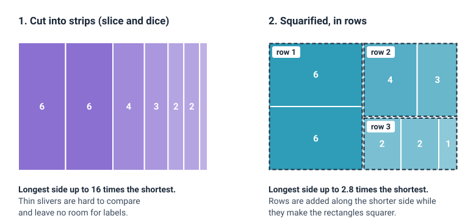

<head>
    <script type="application/ld+json">
        {JSON.stringify({
            "@context": "https://schema.org",
            "@type": "FAQPage",
            "mainEntity": [
                {
                    "@type": "Question",
                    "name": "What is a treemap used for?",
                    "acceptedAnswer": { "@type": "Answer", "text": "A treemap is used to show how a total is made up when the parts sit in groups, and to find the biggest items quickly. Typical examples are sales by department and product, a budget by department and line item, disk space by folder and file, and a stock market by sector and company. Because it fills a rectangle completely, it can show hundreds of items in a small space." }
                },
                {
                    "@type": "Question",
                    "name": "Is a treemap the same as a heatmap?",
                    "acceptedAnswer": { "@type": "Answer", "text": "No. In a treemap, each rectangle's size shows a value and the rectangles are arranged by group, so position carries no meaning. In a heatmap, every cell is the same size and sits in a grid of rows and columns, and colour alone shows the value. A treemap can use colour for a second value, which makes it look like a heatmap, but its sizes still show the main value." }
                },
                {
                    "@type": "Question",
                    "name": "What is the difference between a treemap and a tree diagram?",
                    "acceptedAnswer": { "@type": "Answer", "text": "Both show a hierarchy, but in different ways. A tree diagram draws each item as a node with lines to its parent and children, so it shows the structure clearly but not the size of each item. A treemap draws each item as a rectangle inside its parent's rectangle, with area matching its value, so it shows the sizes but makes the levels harder to follow." }
                },
                {
                    "@type": "Question",
                    "name": "Who invented the treemap?",
                    "acceptedAnswer": { "@type": "Answer", "text": "The treemap was invented by Ben Shneiderman at the University of Maryland in 1990, to see which folders and files were filling up a shared hard disk. He published the method in 1992. In 2000, Mark Bruls, Kees Huizing and Jarke van Wijk published the squarified layout, which keeps the rectangles close to square and is widely used today." }
                },
                {
                    "@type": "Question",
                    "name": "How do I make a treemap in JavaScript?",
                    "acceptedAnswer": { "@type": "Answer", "text": "Store the data as a hierarchy, where each leaf has a name and a value, and each group has a list of children. A layout step, such as the squarified algorithm, turns it into one rectangle per item. With SciChart.js you draw the rectangles with a FastRectangleRenderableSeries, using start and end values for X and top and bottom values for Y, and use the series' hit-test to add tooltips. The same code works in React with scichart-react and in Angular with scichart-angular." }
                }
            ]
        })}
    </script>
</head>

# Treemap

## What is a treemap?

A **treemap** (also called a tree map or treemap chart) is a chart that shows how a total splits into parts and groups, as nested rectangles. Each item is a rectangle with an **area that matches its value**, and items in the same group sit together inside their group's rectangle. Colour usually shows the group, or a second value.


*A treemap of one year's sales for an imaginary online shop, in millions of dollars (sample data). Area shows sales; colour shows the department. [Try the interactive version](#how-to-create-a-treemap-in-javascript-react-or-angular).*

:::tip Key takeaways
- A treemap shows **parts of a whole that sit in groups** (a hierarchy), as rectangles inside rectangles.
- **Area is the value.** The biggest items are the biggest rectangles, so they stand out at once.
- **Colour has a job:** it shows the group, or a second value such as growth. Say which in a legend or caption.
- Treemaps fit **hundreds of items** in one rectangle, but they're poor for exact comparisons: label the main values.
- If there's **no hierarchy**, or only a few items, a bar chart is clearer.
:::

## How to read a treemap


1. **Check what the area measures.** Find the value and its unit: sales in dollars, file sizes in gigabytes, population in people. The whole chart is the total.
2. **Find the groups.** The large outlined blocks are the top level of the hierarchy, usually with a header showing the group's name and total. A group's area is the sum of everything inside it.
3. **Compare the rectangles by area.** A rectangle with twice the area holds twice the value. Rectangles of different shapes are hard to compare by eye, so use the labels or a tooltip for exact numbers.
4. **Find out what the colour means.** It either repeats the group (each group has its own colour) or shows a second value on a colour scale (for example, red for falling and green for rising). Check the legend or caption.
5. **Look for the big and the small.** Note which few items fill most of the chart, and which groups are made of many small pieces.
6. **Zoom in, or hover, for the small ones.** Tiny rectangles have no room for a label. On an interactive treemap, hover to see their values, or zoom in until the labels appear.

## A worked example: an online shop's sales

The treemap at the top of this page shows one year's sales for an imaginary online shop: $100 million in total, so every value in millions of dollars is also a percentage of the whole. The numbers are made up for this example.

| Department | Sales ($M) | Product categories ($M) |
| --- | --- | --- |
| Electronics | 38 | Phones 14, laptops 10, TV and audio 7, accessories 4, cameras 3 |
| Home and garden | 24 | Furniture 9, kitchen 6, garden 4, lighting 3, bedding 2 |
| Fashion | 21 | Women's clothing 8, men's clothing 5, shoes 5, bags 2, jewellery 1 |
| Sports | 17 | Fitness 6, bikes 5, camping 3, team sports 2, water sports 1 |
| **Total** | **100** | 20 categories |

Three things stand out once the rectangles are drawn:

- **Electronics is the biggest department,** with 38% of sales, more than twice the size of sports (17%).
- **Phones alone ($14M) are almost as big as the whole sports department ($17M).** That's easy to see in the treemap, and easy to miss in a list of departments.
- **The long tail is small.** The five smallest categories (jewellery, water sports, bedding, bags and team sports) add up to only $8M, or 8% of sales.

The table is better for looking up one number. The treemap shows the structure, the biggest items and the long tail in one look.

### How to describe a treemap

Use this template when you report a treemap:

> Of the **[total and unit]** in **[the data]**, the largest group was **[group]**, with **[value or share]**. The largest single item was **[item]** in **[its group]**, at **[value or share]**, and the **[number]** smallest items together made up only **[value or share]**.

**Worked example:** "Of the shop's $100M of sales last year, the largest department was electronics, with 38%. The largest single category was phones, at $14M, and the five smallest categories together made up only 8%."

## What colour means in a treemap

Size always shows the main value. Colour is free for one more job, and a treemap should use it for only one:

| Colour shows | How it's coloured | Good for | Example |
| --- | --- | --- | --- |
| **The group** | One colour per top-level group | Seeing which group each small item belongs to, at a glance | The shop treemap on this page |
| **A second value** | A colour scale, often diverging (red, through grey, to green) | Showing size and change together | A stock market map: size is company value, colour is today's price change |
| **Nothing** | One colour for everything | When the groups' outlines are enough and colour would distract | A disk-space treemap of one folder |

When colour shows a second value, add a legend with the scale. When it shows the group, label the groups. Colour that means nothing, such as a random colour per rectangle, makes readers look for a pattern that isn't there.

## How does a treemap work?

A treemap is drawn by a **layout algorithm** that turns the hierarchy into rectangles. Most tools do it for you; knowing the steps helps you understand why a treemap looks the way it does.

1. **Add up the values.** Each group's value is the sum of its children, all the way up to the total.
2. **Give the whole chart to the top level.** The total fills the chart's rectangle. Each group gets a share of the area that matches its share of the total.
3. **Split each rectangle among its children,** the same way, leaving room for the group's header and a small gap.
4. **Keep the rectangles close to square.** The simplest layout, slice and dice, cuts each rectangle into strips, which makes small items into thin slivers. The **squarified** layout sorts the items from largest to smallest and places them in rows along the shorter side, adding an item to the current row only if that makes the row's rectangles more square.



Near-square rectangles are easier to compare, easier to label and easier to point at. The cost is that the squarified layout orders items by size, not by name or date, so the same item can move when the data changes.

## When to use a treemap

Use a treemap when your data is a **total split into parts that sit in groups**, and the most important question is **which parts are biggest**. Typical uses:

- **money:** sales by department and product, a budget by department and line item, a portfolio by sector and holding;
- **storage and software:** disk space by folder and file, code size by module and file;
- **markets:** a stock market by sector and company, sized by company value and coloured by price change;
- **any long list of parts** that would need hundreds of bars, where you want the big items and the groups to stand out.

| Chart | Best for |
| --- | --- |
| **Treemap** | Many parts of a total in groups, using all the space; the biggest items stand out |
| [Sunburst chart](/learn/sunburst-chart/) | The same kind of data as rings around a centre, which shows the levels of the hierarchy more clearly but fits fewer items |
| [Bar chart](/learn/bar-chart/) | Comparing values exactly, when there's no hierarchy or only a few items |
| [Pie chart](/learn/pie-chart/) | One total split into a few parts, with no groups |
| [Heatmap](/learn/heatmap/) | Values on a grid of two categories (rows and columns), shown by colour only |

## Common treemap mistakes

- **Using it for data without a hierarchy, or with few items.** Five values in a treemap are harder to compare than five bars. Treemaps pay off with many items in groups.
- **Negative or zero values.** An area can't be negative. Show losses or falls with colour, or use a different chart, such as a waterfall or a bar chart.
- **Expecting exact comparisons.** Readers judge area far less precisely than length, and different shapes make it harder still. Label the main values, add tooltips, or give the numbers in a table.
- **Too many levels.** Beyond two or three levels, the groups become hard to tell apart. Show the top levels and let readers zoom or click into the rest.
- **Colour without a key.** If colour shows a second value, add a legend with the scale. If it shows the group, label the groups. Never let colour be decoration.
- **Labels that don't fit.** Text cut off at the edge of a rectangle is worse than no label. Hide labels that don't fit and show them on hover or when zoomed in.
- **Forgetting the gaps.** Headers and padding take a little space from each group, so the areas are slightly smaller than the values say. Keep the padding small, or leave headers out when exact areas matter.

## How to create a treemap in JavaScript, React or Angular

SciChart.js draws a treemap with its rectangle series, and a short layout helper turns your hierarchy into rectangles. Because SciChart.js draws with WebGL and WebGPU, the chart stays smooth to zoom and pan, even with thousands of rectangles. Try the treemap below: hover over a rectangle to see its value and share, scroll to zoom into the small ones until their labels appear, drag to pan and double-click to reset.

<LiveDocSnippet maxWidth={'100%'} name="./Basic/demo" />

<LearnCta position="top" chart="treemap" demo="treemap-chart" docs="/2d-charts/chart-types/tree-map-type/" />

Here is the code for this treemap. The data is plain JSON: groups with a list of `children`, and leaves with a `name` and a `value`:

```json
{
    "name": "All sales",
    "children": [
        { "name": "Electronics", "color": "#50C7E0", "children": [{ "name": "Phones", "value": 14 }, { "name": "Laptops", "value": 10 }] }
    ]
}
```

<CodeSnippetBlock labels={["JavaScript", "React", "Angular"]}>
    ```ts showLineNumbers file=./Basic/demo.ts start=#region_A_start end=#region_A_end
    ```

    ```tsx
    import { SciChartReact } from "scichart-react";
    import {
        SciChartSurface,
        NumericAxis,
        NumberRange,
        MouseWheelZoomModifier,
        ZoomPanModifier,
        ZoomExtentsModifier,
        SciChartJsNavyTheme
    } from "scichart";
    // computeTreemapLayout, addTreemapSeries and TreemapTooltipModifier from the JavaScript tab, saved as treemap.ts
    import { computeTreemapLayout, addTreemapSeries, TreemapTooltipModifier } from "./treemap";

    // initChart builds the chart; SciChartReact creates it, sizes it and cleans it up
    const initChart = async (rootElement: string | HTMLDivElement) => {
        const { wasmContext, sciChartSurface } = await SciChartSurface.create(rootElement, {
            theme: new SciChartJsNavyTheme()
        });

        // { name, children: [{ name, color, children: [{ name, value }] }] }
        const layout = computeTreemapLayout(getYourTreemapData(), { width: 1000, height: 600 });

        sciChartSurface.xAxes.add(new NumericAxis(wasmContext, { isVisible: false, growBy: new NumberRange(0.005, 0.005) }));
        sciChartSurface.yAxes.add(new NumericAxis(wasmContext, { isVisible: false, growBy: new NumberRange(0.07, 0.01) }));

        const treemap = addTreemapSeries(sciChartSurface, wasmContext, layout, { formatValue: (value: number) => `$${value}M` });
        sciChartSurface.chartModifiers.add(
            new TreemapTooltipModifier(treemap),
            new MouseWheelZoomModifier(),
            new ZoomPanModifier(),
            new ZoomExtentsModifier()
        );
        return { sciChartSurface };
    };

    export const Treemap = () => (
        <SciChartReact initChart={initChart} style={{ width: "100%", height: 500 }} />
    );
    ```

    ```ts
    import { Component } from "@angular/core";
    import { ScichartAngularComponent } from "scichart-angular";
    import {
        SciChartSurface,
        NumericAxis,
        NumberRange,
        MouseWheelZoomModifier,
        ZoomPanModifier,
        ZoomExtentsModifier,
        SciChartJsNavyTheme
    } from "scichart";
    // computeTreemapLayout, addTreemapSeries and TreemapTooltipModifier from the JavaScript tab, saved as treemap.ts
    import { computeTreemapLayout, addTreemapSeries, TreemapTooltipModifier } from "./treemap";

    @Component({
        selector: "app-treemap",
        standalone: true,
        imports: [ScichartAngularComponent],
        template: `<scichart-angular [initChart]="initChart" style="display: block; width: 100%; height: 500px"></scichart-angular>`
    })
    export class TreemapComponent {
        // initChart builds the chart; scichart-angular creates it, sizes it and cleans it up
        initChart = async (rootElement: string | HTMLDivElement) => {
            const { wasmContext, sciChartSurface } = await SciChartSurface.create(rootElement, {
                theme: new SciChartJsNavyTheme()
            });

            // { name, children: [{ name, color, children: [{ name, value }] }] }
            const layout = computeTreemapLayout(getYourTreemapData(), { width: 1000, height: 600 });

            sciChartSurface.xAxes.add(new NumericAxis(wasmContext, { isVisible: false, growBy: new NumberRange(0.005, 0.005) }));
            sciChartSurface.yAxes.add(new NumericAxis(wasmContext, { isVisible: false, growBy: new NumberRange(0.07, 0.01) }));

            const treemap = addTreemapSeries(sciChartSurface, wasmContext, layout, { formatValue: (value: number) => `$${value}M` });
            sciChartSurface.chartModifiers.add(
                new TreemapTooltipModifier(treemap),
                new MouseWheelZoomModifier(),
                new ZoomPanModifier(),
                new ZoomExtentsModifier()
            );
            return { sciChartSurface };
        };
    }
    ```
</CodeSnippetBlock>

Key points:

- `computeTreemapLayout` is plain JavaScript with no SciChart code, so you can reuse it anywhere. It adds up the values, then uses the squarified layout to give every group and leaf a rectangle, leaving a header strip and a small gap in each group. It works for any number of levels.
- Every rectangle is drawn by a [FastRectangleRenderableSeries](/2d-charts/chart-types/fast-rectangle-renderable-series/) with an `XyxyDataSeries`: `columnXMode: EColumnMode.StartEnd` reads `xValues` and `x1Values` as the left and right edges, and `columnYMode: EColumnYMode.TopBottom` reads `yValues` and `y1Values` as the top and bottom. One series per group gives each group its own colour.
- The tooltip uses the series' [hit-test API](/2d-charts/chart-types/hit-test-api/hit-test-api-overview/): `series.hitTestProvider.hitTest(x, y)` returns `isHit: true` and the rectangle's `dataSeriesIndex` when the mouse is inside one. `TreemapTooltipModifier` extends `CustomChartModifier2D` ([custom chart modifiers](/2d-charts/chart-modifier-api/custom-modifiers/custom-modifiers-overview/)) to run it on every mouse move.
- Labels are [NativeTextAnnotations](/2d-charts/annotations-api/native-text-annotation/). After each redraw, each label is shown only if its rectangle is big enough on screen, so zooming in reveals the small ones. The axes are hidden, but they still set the drawing area, so zoom and pan work as on any chart.

**See it in the demo app:** [JavaScript treemap chart](https://www.scichart.com/demo/javascript/treemap-chart) · [React treemap chart](https://www.scichart.com/demo/react/treemap-chart) · [Angular treemap chart](https://www.scichart.com/demo/angular/treemap-chart)

**Go deeper:** [SciChart.js treemap documentation](/2d-charts/chart-types/tree-map-type/), which walks through the demo app's stock market treemap, coloured by price change, and the [SciChart.js rectangle series documentation](/2d-charts/chart-types/fast-rectangle-renderable-series/).

## Frequently asked questions

### What is a treemap used for?

A treemap is used to show how a total is made up when the parts sit in groups, and to find the biggest items quickly. Typical examples are sales by department and product, a budget by department and line item, disk space by folder and file, and a stock market by sector and company. Because it fills a rectangle completely, it can show hundreds of items in a small space.

### Is a treemap the same as a heatmap?

No. In a treemap, each rectangle's size shows a value and the rectangles are arranged by group, so position carries no meaning. In a heatmap, every cell is the same size and sits in a grid of rows and columns, and colour alone shows the value. A treemap can use colour for a second value, which makes it look like a heatmap, but its sizes still show the main value.

### What is the difference between a treemap and a tree diagram?

Both show a hierarchy, but in different ways. A tree diagram draws each item as a node with lines to its parent and children, so it shows the structure clearly but not the size of each item. A treemap draws each item as a rectangle inside its parent's rectangle, with area matching its value, so it shows the sizes but makes the levels harder to follow.

### Who invented the treemap?

The treemap was invented by Ben Shneiderman at the University of Maryland in 1990, to see which folders and files were filling up a shared hard disk. He published the method in 1992. In 2000, Mark Bruls, Kees Huizing and Jarke van Wijk published the squarified layout, which keeps the rectangles close to square and is widely used today.

### How do I make a treemap in JavaScript?

Store the data as a hierarchy, where each leaf has a name and a value, and each group has a list of children. A layout step, such as the squarified algorithm, turns it into one rectangle per item. With SciChart.js you draw the rectangles with a `FastRectangleRenderableSeries`, using start and end values for X and top and bottom values for Y, and use the series' hit-test to add tooltips. The same code works in React with `scichart-react` and in Angular with `scichart-angular`.

## Sources

- Shneiderman, B. (1992), [Tree visualization with tree-maps: 2-d space-filling approach](https://doi.org/10.1145/102377.115768). *ACM Transactions on Graphics*, 11(1), 92–99. The paper that introduced the treemap.
- Bruls, M., Huizing, K. and van Wijk, J. J. (2000), [Squarified treemaps](https://doi.org/10.1007/978-3-7091-6783-0_4). In *Data Visualization 2000*, Eurographics, 33–42. The squarified layout used on this page.
- Shneiderman, B. and Plaisant, C. (1998, last updated 2014), [Treemaps for space-constrained visualization of hierarchies](https://www.cs.umd.edu/hcil/treemap-history/). University of Maryland Human-Computer Interaction Lab. Shneiderman's own history of the treemap, from its start in 1990 as a map of a full hard disk.

<LearnCta position="bottom" chart="treemap" demo="treemap-chart" docs="/2d-charts/chart-types/tree-map-type/" />
